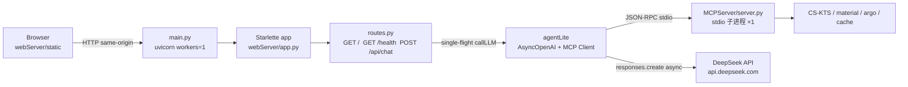
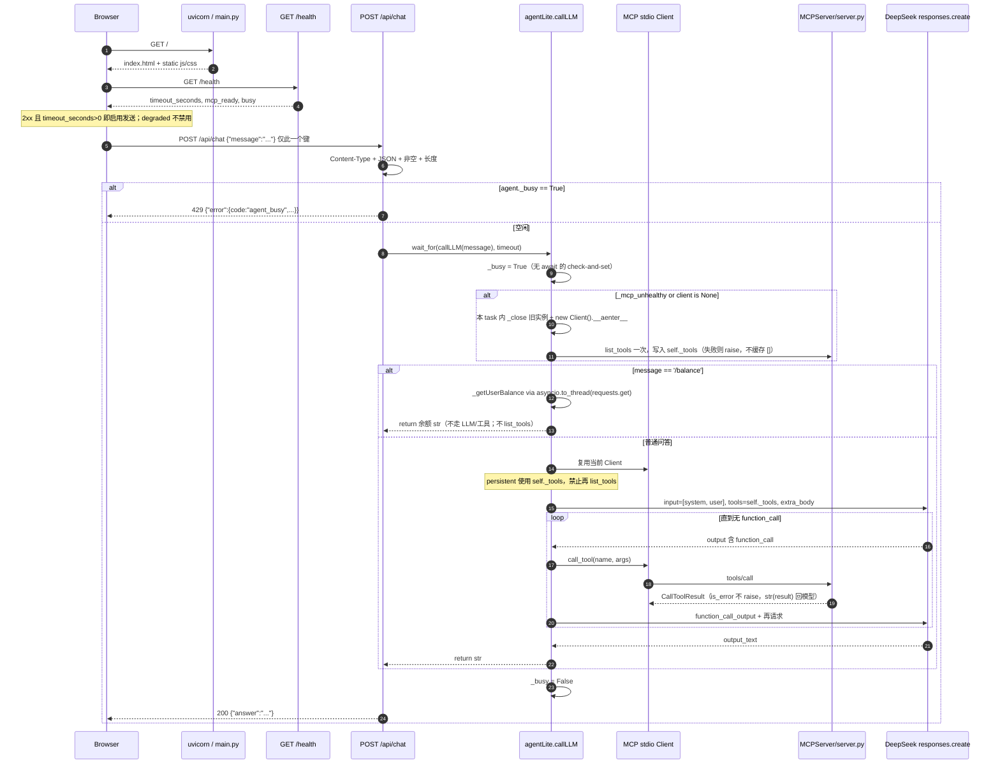
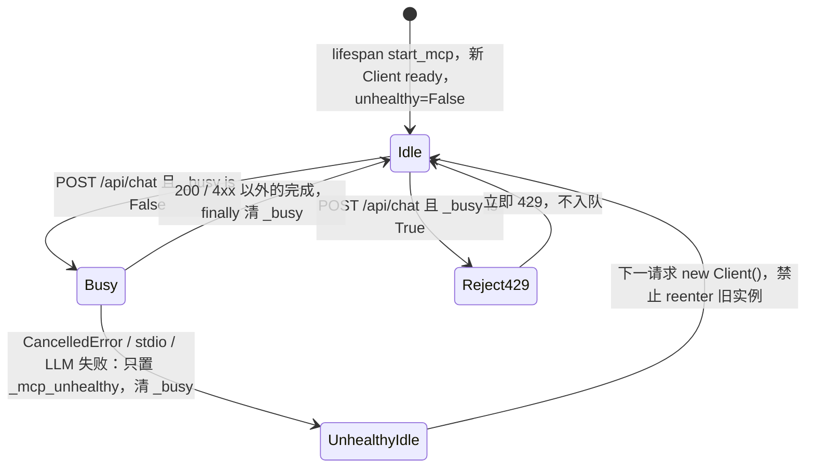
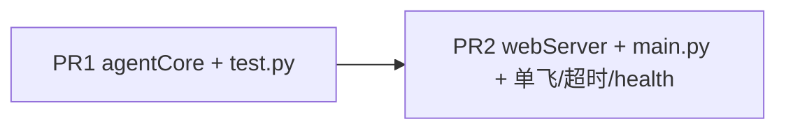

# harnessPrototype Web 服务化设计文档

| 字段 | 内容 |
|---|---|
| 标题 | 将 `test.py` CLI Agent 改造为可网页访问的最小 Web 服务 |
| 作者 | TBD |
| 日期 | 2026-09-04 |
| 状态 | Accepted（实现依据） |
| 仓库 | `/home/xumaozhou/Music/harnessPrototype` |
| 范围 | 实现按本文 PR1 → PR2 进行 |

---

## Overview

当前原型通过仓库根目录的 `test.py` 在 stdin 上循环读取用户输入，每次独立调用 `agentLite.callLLM`，由 DeepSeek + MCP stdio 工具完成一次 Agent 推理，最终答案只写日志、不返回。`main.py` 为空，无法作为服务入口。

本设计把同一套 Agent 语义接到一个 **最小 Starlette + uvicorn Web 服务**：`python3 main.py` 默认绑定本机局域网 IPv4（可用 `--host` / `HARNESS_HOST` 覆盖）提供单页问答 UI；浏览器每次 POST **当前这一条**用户消息，服务端独立跑完 `_simpleAgentLoop` 后一次性返回最终答案。产品规则是 **每一条消息都是独立问答**——不向 Agent 累积多轮历史，请求体不得携带上一句。为适配 HTTP 层，`callLLM` 必须改为返回 `str`；MCP stdio 子进程改为服务生命周期内复用，并用单飞互斥避免并发共用一条 stdio 管道。**persistent MCP 与单飞必须同一 PR 上线**，禁止出现「网页已复用 Client、尚未 429」的中间状态。

---

## Background & Motivation

### 当前状态

仓库是内部原型（harnessPrototype），无 `pyproject.toml` / `requirements.txt`。Python 3.10 venv 在 `.venv`。与本设计相关的已安装包：

| 包 | 版本 | 用途 |
|---|---|---|
| openai | 3.3.1 | DeepSeek `responses.create` |
| mcp | 2.1.1 | stdio Client / MCPServer |
| starlette | 1.6.0 | 已安装，可用作 HTTP 框架 |
| uvicorn | 0.52.4 | ASGI server |
| python-multipart | 0.0.32 | 表单（本设计不用） |
| anyio / pydantic | 随 mcp/starlette | 异步原语 / 校验 |
| **fastapi** | **未安装** | 不引入 |

现有调用链：

```
test.py  stdin loop
  └── agentLite()                          # agentCore/agentCore.py
        └── callLLM(input_msg)             # 每次 async with Client；当前 return None
              └── _simpleAgentLoop
                    ├── 若 input_msg == '/balance' → _getUserBalance()
                    │     └── 同步 requests.get(https://api.deepseek.com/user/balance)
                    ├── 否则 OpenAI(DeepSeek) 同步 responses.create
                    └── MCPServer/server.py  # 新的 python 子进程，stdio JSON-RPC
```

`test.py` 行为（必须保持语义）：

1. 实例化 **一个** `agentLite()`。
2. 无限 `input()`；`exit` / `exit()` 退出。
3. 每一行独立 `asyncio.run(agent.callLLM(input_msg=input_msg))`——**新 event loop、不累积对话历史**。
4. 答案仅在 `callLLM` 内 `logging.info(f'[answer]: {answer}]')`；`callLLM` **当前返回 `None`**。

`agentLite.__init__` 当前硬编码 / 现状：

- `_user_id` 写死字符串并标 FIXME；本设计改为读环境变量 `HARNESS_USER_ID`（KD-20），缺则 fail-fast。
- `OpenAI(api_key=os.environ.get('DEEPSEEK_API_KEY'), base_url="https://api.deepseek.com")`，**同步** client。
- `StdioServerParameters(command="python", args=["/home/xumaozhou/Music/harnessPrototype/MCPServer/server.py"])`——绝对路径 + 未绑定 venv 的 `python`；**未传 `env=`**。mcp 2.1.1 `stdio_client` 实际使用 `get_default_environment() | (server.env or {})`，POSIX 只继承 `HOME/LOGNAME/PATH/SHELL/TERM/USER`，**不会**带上 `DEEPSEEK_API_KEY`。CLI 能工作是因为 MCP 工具用硬编码 URL，不读该密钥。
- `_extra_body = {thinking: enabled, user_id}`。
- `_simpleAgentLoop`：若 **`input_msg == '/balance'`**（精确匹配，无 strip、无大小写折叠），短路 `return await self._getUserBalance()`，不走 LLM/工具。否则 system + 单条 user，多轮 `mcp_client.call_tool`，对用户只产出一次 `response.output_text`。
- `_getUserBalance` 声明为 `async`，但内部是同步 `requests.get("https://api.deepseek.com/user/balance")`，无 timeout；非 200 / 解析失败 raise `Exception`（部分路径未 `from exc`）。
- `call_tool` 返回 `CallToolResult`；工具业务失败是 `is_error=True`，**默认不 raise**。现有代码 `str(result)` 塞回模型继续 loop，不检查 `is_error`。

`balanceApi.py` **已不存在**（余额逻辑已并入 `agentLite._getUserBalance`）。`tools.py` 仍在仓库根，与 MCP 路径无关。

MCP 工具集（`MCPServer/server.py`）保持不动：CS-KTS、material、argo、`readCachedResult`。结果缓存目录 `.mcp_result_cache/` 由 `MCPServer/resultCache.py` 写在仓库根下，Web 层不读写。

### 痛点

1. 只能 stdin 使用，无法网页访问。
2. `callLLM` 不返回答案，HTTP 层拿不到响应体。
3. 每次调用拉起新的 MCP Python 进程（解释器启动 + MCP handshake），作为服务既慢又容易泄漏子进程。
4. `openai.OpenAI` 是同步阻塞调用；`_getUserBalance` 虽为 `async` 却直接 `requests.get`。二者丢进 uvicorn event loop 都会卡住 `/health`、429、静态资源（KD-3）。
5. MCP 路径写死本机绝对路径，换目录或换解释器即失败。
6. `main.py` 为空，没有统一启动入口。

### 预期负载与时延（量化）

| 指标 | 取值 |
|---|---|
| 用户规模 | 单用户 / 小范围内部原型，非多租户 |
| 并发 | **进程内同时只跑 1 次 Agent 调用** |
| Agent 时延 | 典型 10s–120s（LLM + 多轮 tool-call） |
| HTTP / Agent 超时 | **默认 180s**（`--timeout` / `HARNESS_AGENT_TIMEOUT`，必须 > 0） |
| 消息体 | 单条 `message` 上限 `message_max_chars`（默认 8000）；请求 body 上限 `max_body_bytes`（默认 **64 KiB**，经 Starlette `max_body_size`） |
| 持久化 | v1 不落盘对话历史；MCP 缓存仍按现有规则写 `.mcp_result_cache/` |
| uvicorn workers | **必须 = 1** |
| graceful shutdown | **默认 5s**（`--graceful-shutdown`）；超时后取消 in-flight POST，再 lifespan `stop_mcp` |

---

## Goals & Non-Goals

### Goals

1. 仓库根目录 `python3 main.py`（或 `.venv/bin/python main.py`）启动 Web 服务，浏览器可打开问答页。
2. 前端：聊天样式的单页；**每一条消息都是独立问答**。浏览器会话内可滚动展示历史 Q/A，但 **不会把历史发回后端**。`app.js` 请求体只能是 `{ "message": currentInput }`。
3. 后端包装 `agentLite.callLLM`；`callLLM` 改为返回最终 `str`。
4. MCP stdio：服务生命周期内复用一个子进程；并发模型明确（单飞 + 429）。二者必须同一 PR 交付。
5. 一次 POST 等最终答案；v1 不做 SSE / token 流。前端 AbortController 超时必须读服务端配置，禁止写死 180。
6. 错误不吞：4xx 校验失败、5xx 记录 context+cause；启动失败非零退出。
7. `test.py` 在 `callLLM` 返回值改造后继续可用（CLI）；`[answer]` 只在 `callLLM` 打一次。
8. host/port/timeout 可通过 CLI / 环境变量配置，默认绑定本机局域网 IPv4、端口 `8000`、超时 180s。非法配置非零退出，禁止静默回落到默认值。缺 `DEEPSEEK_API_KEY` 或 `HARNESS_USER_ID` 同样非零退出。
9. 保留现行 **`/balance` 独立问答**：`POST /api/chat` 的 `message` 在路由 `strip()` 后精确等于 `"/balance"` 时返回余额字符串，不走 LLM/工具。
10. persistent 模式在每次新 Client 进入后 **必须** 缓存 `list_tools`（KD-21）；同一 Client 健康期内禁止再 list。

### Non-Goals

- 不重设计 MCP 工具、不改 CS-KTS / argo / material 业务接口。
- 不把 `str(result)` 塞进 `function_call_output` 的上下文膨胀问题纳入本轮（已知，但不阻塞 Web 化）。
- **不改变 tool 业务错误语义**：MCP server 仍 raise `ToolError`；client `call_tool` 仍返回 `CallToolResult`；`is_error=True` 时继续 `str(result)` 交给模型总结，**不**升级为 HTTP 500。HTTP 500 只用于传输/协议失败、LLM 调用失败、空 `output_text`、未预期异常。
- 不引入 FastAPI、数据库、Redis、登录、多租户、对话 session 服务端存储。
- 不做流式输出、不做 websocket。
- 不把 `skills/engine_map.md` 注入 system prompt（当前 `agentLite` 也未加载）。
- 不动 `tools.py`（遗留 CLI，非 MCP 路径）。`balanceApi.py` **已删除**，无需恢复或再改。
- **不**把 `/balance` 做成单独 HTTP 路由、余额按钮或登录页；它只是同一 `POST /api/chat` 上的一条独立消息。
- 不新增 `requirements.txt` / 打包（venv 已有依赖）；不改系统项；不 `rm -rf`。
- 不支持 uvicorn `--workers > 1`、不作为 v1 默认开启 `--reload`。
- 不把 `os.environ` 整包注入 MCP 子进程。

---

## Key Decisions

| # | 决策 | 理由 |
|---|---|---|
| KD-1 | HTTP 框架用 **Starlette**，不用 FastAPI | `.venv` 已有 starlette 1.6.0 + uvicorn 0.52.4；FastAPI 未安装。原型不应为了装饰器糖新增依赖。 |
| KD-2 | 产品语义：**每一条消息都是独立问答**。Agent 每次只看到当前 `message` + 固定 system prompt | 对齐 `test.py`：每次独立 `callLLM`，不跨轮累积。UI 历史仅为展示。避免「对话」被理解成多轮 session。 |
| KD-3 | `callLLM` **必须 `return answer: str`**；同步 `OpenAI` 改为 **`AsyncOpenAI`**；`_getUserBalance` **禁止**在协程里直接 `requests.get` | HTTP 层需要答案字符串。同步 `responses.create` 或同步 `requests.get` 都会堵死 event loop，导致忙闲 429 / 静态页 / `/health` 无响应。 |
| KD-4 | **服务生命周期复用一个 MCP stdio Client**；CLI 路径保留「每次 `callLLM` 临时拉起」作为 fallback | Web 有长生命周期 event loop，值得复用。`test.py` 仍用 `asyncio.run` 每轮新 loop，无法跨轮持有 async Client，必须保留 ephemeral 模式。 |
| KD-5 | 并发模型：**进程内单飞**。busy 时立即 **HTTP 429**，不排队。锁在 `callLLM` 内，不只放在 route | 一条 MCP stdio JSON-RPC 管道不能安全并发。单用户原型下，排队 120s 会造成「点两次等两次」的假死。 |
| KD-6 | v1 **无 SSE / 无 streaming**。`POST /api/chat` 阻塞到最终答案 | 实现量小、错误模型简单、与独立问答一致。长请求靠可配置超时 + UI loading 解决。 |
| KD-7 | **无鉴权**；默认绑定 **本机局域网 IPv4**（UDP 探测默认路由，可用 `--host` / `HARNESS_HOST` 覆盖）。绑定非回环地址必须打 warning | 方便内网其它机器访问。Agent 能调生产向 MCP 工具（CS-KTS 等），无鉴权暴露等于把工具面开到局域网。 |
| KD-8 | MCP 启动改为 **`sys.executable` + 相对仓库根的 `MCPServer/server.py`**，`cwd=MCPServer/`。**不传完整 `os.environ`** | 现硬编码绝对路径和裸 `python` 会用错解释器。mcp 2.1.1 默认只继承白名单变量；密钥只留在 Web/Agent 进程。 |
| KD-9 | 缺 `DEEPSEEK_API_KEY` **启动期 fail-fast**，进程非零退出 | Silent failure 禁止。拖到第一次请求才 500 会浪费 MCP 拉起成本，也违反「CLI/服务启动失败必须非零退出」。`HARNESS_USER_ID` 同此策略，见 KD-20。 |
| KD-10 | 对话历史 **不落盘**；MCP `.mcp_result_cache/` 保持现状 | 无状态轮次不需要服务端 session。缓存是工具层已有行为。 |
| KD-11 | uvicorn **workers=1**，v1 不启用 `--reload` | 多 worker 会复制多份 MCP 子进程且单飞锁失效。reload 会在热重启时留下 MCP 孤儿进程。 |
| KD-12 | 忙闲检查用 **无 await 的 `_busy` 标志**（event loop 线程内原子） | `asyncio.Lock` 的 `locked()` 与 `acquire()` 之间若插入 await 才有 TOCTOU；check-and-set 不含 await，在单线程 event loop 上是安全的。 |
| KD-13 | **Web persistent MCP 与单飞必须同一 PR 上线** | 否则 PR2 把共享 Client 暴露给可双击的 UI，stdio JSON-RPC 会交错（R4）。 |
| KD-14 | MCP `Client` **禁止对同一实例重新 `__aenter__`**。损坏/超时时只置 `_mcp_unhealthy=True`；下一请求用**新** `Client(...)` | mcp 2.1.1：`__aenter__` 在 `_entered` 时 raise；`__aexit__` 不把 `_entered` 置回 False。被取消的 task 里禁止 await 重建。 |
| KD-15 | 前端 AbortController 超时 **必须**来自 `GET /health` 的 `timeout_seconds`，禁止写死 180 | `--timeout 60` 时 UI 仍等 180 会与单飞锁错位；`--timeout 300` 时 UI 先 abort、服务端继续占锁。 |
| KD-16 | 空 `output_text` / 非 `str` → `RuntimeError("empty model output_text")` → HTTP 500。`_invoke` 所有 `Exception` 打 `input_preview` 后 re-raise | 禁止返回 None / 假答案。ephemeral 与 persistent 共用。 |
| KD-17 | 请求 body 上限 64 KiB；413 → `payload_too_large` JSON envelope。在 `POST /api/chat` 内限长读取，**不用** Starlette `max_body_size`（该中间件在存在 `Content-Length` 时会把 413 盖成纯文本） | 不能只靠 8000 字符；恶意客户端可不发合法 JSON。错误体必须仍是 `{error:{code,message}}`。 |
| KD-18 | `uvicorn.run(..., log_config=None, timeout_graceful_shutdown=settings.graceful_shutdown_seconds)` | 默认 `log_config=LOGGING_CONFIG` 会打乱 `basicConfig`；默认 `timeout_graceful_shutdown=None` 会让 Ctrl-C 卡满 Agent 时延。 |
| KD-19 | 保留 **`input_msg == '/balance'`** 精确匹配捷径，作为一条独立问答；`_getUserBalance` 用 `asyncio.to_thread`（或 async HTTP） | 对齐现行 CLI。Web 不丢该语义，也不新开 API。同步 `requests.get` 与 KD-3 冲突。 |
| KD-20 | DeepSeek `user_id` 只来自环境变量 **`HARNESS_USER_ID`**。缺或 strip 后为空 → `RuntimeError`；`main.py` 在 `uvicorn.run` 前同样检查，失败 `logging.error` + `SystemExit(1)`。v1 **无** `--user-id`。INFO 不打完整 id | 去掉硬编码 FIXME。与 `DEEPSEEK_API_KEY` 同一 fail-fast 级别。id 是标识符，禁止 INFO 全量记录。 |
| KD-21 | persistent 模式 **必须**缓存 `list_tools`：`_ensure_mcp_client` 成功 enter 后调用一次 `_load_mcp_tools` 存 `self._tools`。同一 Client 健康期内 `_simpleAgentLoop` **禁止**再 `list_tools`。close / unhealthy / 新 Client 时 `self._tools = None`。`list_tools` 失败不得缓存 `[]` 或沿用旧表 | 工具表在 MCP 进程存活期间不变。每轮 list 浪费一轮 RPC。空缓存或失败静默会导致无工具却继续问模型。CLI ephemeral 仍每轮 list。 |

---

## Proposed Design

### 总体架构



启动时 `main.py` 解析 `Settings`，配置 logging，校验 `DEEPSEEK_API_KEY` 与 `HARNESS_USER_ID`，构造 Starlette app 并 `uvicorn.run(app, ...)`。app lifespan 创建 **一个** `agentLite`，进入 persistent MCP 模式（`start_mcp`，其中 **一次** `list_tools` 写入 `self._tools`），挂到 `app.state`。关闭时 `stop_mcp`：对**当前** Client 调 `__aexit__`，丢掉实例并 `self._tools = None`（永不 reenter）。

### 请求时序（一次问答）



超时路径：

1. route 用 `asyncio.wait_for(callLLM(...), timeout=settings.agent_timeout_seconds)`。`wait_for` 包住**整个** `callLLM`（含 `_ensure_mcp_client` + `_invoke`）。生产默认 180s，handshake 计入总预算。**不要**为了迁就 1s 验收把 `_ensure_mcp_client` 挪到 `wait_for` 之外——重建无限拖会破坏「一次 POST 总超时」。
2. 到期后 inner task 收到 `CancelledError`：`callLLM` 置 `_mcp_unhealthy = True`，打 WARNING（含 `input_preview`），`finally` 清 `_busy`。**禁止**在该已取消 task 里 `await _close_mcp_client()` / `_ensure_mcp_client()`（`CancelledError` 会再次打断 `__aexit__`）。
3. route 将 `TimeoutError` 映射为 504 `agent_timeout`，在 `except` 里 `logging.exception` 带 preview。本轮不吞、不重建。
4. **下一条**未取消的 `callLLM`（必须仍有足够的 `agent_timeout_seconds`，默认 180）发现 unhealthy：先 `_close_mcp_client()`（旧实例 `__aexit__`，mcp stdio 在 transport 层 `CancelScope(shield=True)` 收割子进程），再 `Client(self._local_mcp_server)` **新实例** `__aenter__`。
5. **不要**在 `--timeout 1` 的同一进程上断言「下一条 200」：1s 不够 LLM，也不够可靠覆盖 close+spawn+handshake；若第二条再被 1s 砍断，取消会落在 `_ensure_mcp_client` 上，正好踩 KD-14。验收拆成 4a/4b，见 PR Plan。

### 并发 / 单飞模型



规则：

1. **整个 uvicorn 进程同时只允许 1 个 in-flight `callLLM`。**
2. 第二个请求在 `callLLM` 入口检查 `self._busy`：为 True 则 **不等待**，raise `AgentBusyError` → HTTP 429。检查与置位之间 **不得 await**。
3. GET `/`、GET `/static/*`、GET `/health` **不**走这把锁，但前提是 LLM 调用必须是 async（KD-3）。
4. 不使用多 worker；不在多个请求间共享 MCP Client 的并发 `call_tool`。
5. 单飞逻辑在 `agentLite.callLLM`，不只放在 route，避免其它调用方漏加。

### MCP Client 状态机（mcp 2.1.1 约束）

venv 中 `mcp.client.client.Client`：

- `__aenter__`：若 `self._entered` 则 `RuntimeError("Client is already entered; cannot reenter")`，然后 `_entered = True`。
- `__aexit__`：只 `await self._exit_stack.__aexit__(...)` 并把 `_session = None`，**不**把 `_entered` 置回 `False`。

因此 **同一个 `Client` 实例不能 start → stop → start**。任何重建必须 `Client(self._local_mcp_server)` 新对象。

字段：

| 字段 | 类型 | 含义 |
|---|---|---|
| `_persistent` | `bool` | lifespan `start_mcp` 置 True，lifespan `stop_mcp` 置 False。CLI 保持 False。 |
| `_mcp_client` | `Client \| None` | 当前已 enter 的实例；关闭后必须变 None，引用丢弃。 |
| `_mcp_unhealthy` | `bool` | 会话不可再用（超时取消、stdio 损坏、persistent 路径上的失败）。 |
| `_busy` | `bool` | 单飞占用。 |
| `_tools` | `list \| None` | persistent 下当前 Client 的 `list_tools` 缓存。close/unhealthy/新 Client 必须置 `None`。ephemeral 不用。 |
| `_user_id` | `str` | 来自 `HARNESS_USER_ID`（strip 后非空），写入 `_extra_body["user_id"]`。 |

```python
class AgentBusyError(RuntimeError):
    """Raised when a second callLLM arrives while one is in-flight (persistent mode)."""


class agentLite:
    def __init__(self, mcp_server_script: Path | None = None) -> None:
        self._mcp_client: Client | None = None
        self._persistent = False
        self._mcp_unhealthy = False
        self._busy = False
        self._tools = None
        user_id = os.environ.get("HARNESS_USER_ID")
        if user_id is None or not str(user_id).strip():
            raise RuntimeError("HARNESS_USER_ID is not set")
        self._user_id = str(user_id).strip()
        # _extra_body["user_id"] = self._user_id（原样传入 DeepSeek）
        # INFO 只打 "HARNESS_USER_ID is set (len=%d)"，禁止打完整 id
        script = Path(mcp_server_script or _DEFAULT_MCP).resolve()
        if not script.is_file():
            raise FileNotFoundError(f"MCP server script not found: {script}")
        # StdioServerParameters(command=sys.executable, args=[str(script)],
        #     cwd=str(script.parent))；不传 env=os.environ
        # AsyncOpenAI；缺 DEEPSEEK_API_KEY 立刻 RuntimeError

    async def start_mcp(self) -> None:
        """Lifespan startup: enter persistent mode and spawn a new Client."""
        self._persistent = True
        await self._ensure_mcp_client()

    async def stop_mcp(self) -> None:
        """Lifespan shutdown: leave persistent mode and reap the subprocess."""
        self._persistent = False
        await self._close_mcp_client()

    async def _close_mcp_client(self) -> None:
        client = self._mcp_client
        self._mcp_client = None
        self._mcp_unhealthy = True
        self._tools = None  # 作废缓存；禁止下一 Client 复用
        if client is None:
            return
        try:
            await client.__aexit__(None, None, None)
        except Exception as exc:
            logging.exception(
                "MCP Client __aexit__ failed; subprocess may linger: %s", exc
            )
            raise
        # `client` 丢弃；禁止再 __aenter__

    async def _ensure_mcp_client(self) -> None:
        """Must run in a non-cancelled task (next request or lifespan startup)."""
        if self._mcp_client is not None and not self._mcp_unhealthy:
            if self._tools is None:
                raise RuntimeError(
                    "persistent MCP client is healthy but tools cache is missing"
                )
            return
        await self._close_mcp_client()
        script = Path(self._local_mcp_server.args[0])
        if not script.is_file():
            raise FileNotFoundError(f"MCP server script not found: {script}")
        client = Client(self._local_mcp_server)  # 每次新实例
        try:
            await client.__aenter__()
        except Exception as exc:
            logging.exception("failed to start MCP stdio client: script=%s", script)
            raise RuntimeError(f"failed to start MCP stdio client: {script}") from exc
        self._mcp_client = client
        self._mcp_unhealthy = False
        try:
            tools = await self._load_mcp_tools(client)
        except Exception:
            self._tools = None
            logging.exception("list_tools failed after MCP start: script=%s", script)
            raise
        if not tools:
            self._tools = None
            raise RuntimeError("MCP list_tools returned no tools")
        self._tools = tools
        logging.info(
            "MCP stdio started: script=%s python=%s tools=%d",
            script,
            sys.executable,
            len(tools),
        )

    async def callLLM(self, input_msg: str) -> str:
        if not isinstance(input_msg, str):
            raise TypeError(
                f"input_msg must be str, got {type(input_msg).__name__}"
            )
        if self._persistent:
            if self._busy:
                raise AgentBusyError(
                    "agent is already processing a request; retry after it finishes"
                )
            self._busy = True
            try:
                await self._ensure_mcp_client()
                return await self._invoke(self._mcp_client, input_msg)
            except asyncio.CancelledError:
                self._mcp_unhealthy = True
                logging.warning(
                    "callLLM cancelled: input_preview=%r", input_msg[:200]
                )
                raise
            except BaseException:
                self._mcp_unhealthy = True
                raise
            finally:
                self._busy = False
        async with Client(self._local_mcp_server) as mcp_client:
            return await self._invoke(mcp_client, input_msg)

    async def _getUserBalance(self) -> str:
        api_key = os.environ.get("DEEPSEEK_API_KEY")
        if not api_key:
            raise RuntimeError("DEEPSEEK_API_KEY is not set")

        def _fetch() -> requests.Response:
            return requests.get(
                "https://api.deepseek.com/user/balance",
                headers={
                    "Accept": "application/json",
                    "Authorization": f"Bearer {api_key}",
                },
                timeout=30,
            )

        try:
            response = await asyncio.to_thread(_fetch)
        except requests.RequestException as exc:
            logging.exception("DeepSeek balance HTTP failed")
            raise RuntimeError("Failed to get balance") from exc
        if response.status_code != 200:
            raise RuntimeError(
                f"Failed to get balance: {response.status_code} - {response.text[:500]}"
            )
        try:
            balance = response.json()["balance_infos"][0]["total_balance"]
        except (KeyError, IndexError, TypeError, ValueError) as exc:
            raise RuntimeError("Error parsing balance from response") from exc
        return f"当前账户余额为 {balance} 元"

    async def _invoke(self, mcp_client: Client, input_msg: str) -> str:
        try:
            answer = await self._simpleAgentLoop(
                self._openai_client, mcp_client, input_msg
            )
            if not isinstance(answer, str) or not answer.strip():
                raise RuntimeError("empty model output_text")
            logging.info("[answer]: %s", answer)
            return answer
        except Exception:
            logging.exception(
                "agent invoke failed: input_preview=%r", input_msg[:200]
            )
            raise
```

要点：

- `_invoke` **两种模式共用**；空答案、JSON 解析失败、`call_tool` 传输失败都走 `logging.exception` + raise，禁止返回 None / 假答案。
- `CancelledError` 是 `BaseException`，不进 `_invoke` 的 `except Exception`（避免把取消当 bug 打满栈）。`callLLM` 单独 `except asyncio.CancelledError`：置 unhealthy、`logging.warning` 带 `input_preview`、再 raise。其余 `BaseException` 只置 unhealthy（`Exception` 已在 `_invoke` 打过栈）。
- **禁止**在 `except CancelledError` 里 `await _close_mcp_client()`。
- `AgentBusyError` 在置 `_busy` 之前抛出，不会误标 unhealthy。
- `__all__ = ["agentLite", "AgentBusyError"]`。
- MCP 脚本路径在 **`__init__` 立刻** `is_file()`；CLI ephemeral 不走 `_ensure_mcp_client`，缺文件不能拖到 spawn `OSError`。`_ensure` 可保留二次检查。
- **`/balance`**：`_simpleAgentLoop` 入口保持 `if input_msg == '/balance': return await self._getUserBalance()`（在 `_load_mcp_tools` **之前**，与现行代码顺序一致）。匹配是 **精确等于**（Web 路由已 `strip()`，故 `" /balance "` 会命中；`"/Balance"` / `"/balance "` 未 strip 前不会）。不走 LLM、不 `call_tool`、**不**在该短路路径上 `list_tools`。v1 不把短路提前到 `callLLM` 之外另开路由。ephemeral 现状会先开 MCP 再短路——本轮不优化掉 spawn。persistent 下 `_ensure_mcp_client` 仍会在 Client 进入时 list 一次并缓存，与 `/balance` 短路无关。
- **`list_tools` 缓存（KD-21，强制）**：persistent 且 Client 健康时 `_simpleAgentLoop` 必须用 `self._tools`，禁止再调 `_load_mcp_tools` / `list_tools`。若 `_persistent` 为 True 但 `_tools` 为空：`raise RuntimeError("persistent MCP tools cache is empty")`。ephemeral（`_persistent is False`）每轮 `await self._load_mcp_tools(mcp_client)`，不写 `self._tools`。
- **`_getUserBalance`**：`await asyncio.to_thread(...)` 包同步 `requests.get`（须带 `timeout=`）；禁止在协程里直接 `requests.get`。HTTP/解析失败 `raise ... from exc`，由 `_invoke` 打 preview。也允许改用已安装的 `httpx` 异步客户端，二选一即可，不要两种都留。

### 前端行为（展示历史 vs Agent 无状态）

| 层 | 是否记住上一轮 | 说明 |
|---|---|---|
| Agent / `callLLM` | 否 | `loop_context` 每次从 system + 当前 user 重建，与今天 `_simpleAgentLoop` 一致 |
| HTTP API | 否 | 请求体只有 `message`；未知字段 400 |
| 浏览器 JS | **仅展示** | 内存数组渲染气泡；刷新页面即清空。不写 `localStorage` / 不写磁盘 |

文案统一用 **「每一条消息都是独立问答」**（页面顶部 + 占位提示），不要用「一次对话对应一个回答」以免被理解成多轮 session。

`app.js` 规格（写死）：

1. 页面加载后 **先** `GET /health`，用返回的 `timeout_seconds` 设置 `AbortController`；配置到手之前发送按钮保持 disabled。**禁止**回落到写死 180。
2. **「health 失败」只包括**：网络错误、非 2xx、或 JSON 缺少 `timeout_seconds > 0`。失败则展示错误并保持禁用发送。
3. **HTTP 2xx 且 `timeout_seconds > 0` 即启用发送**，并据此设置 AbortController。`status === "degraded"` / `mcp_ready === false` **不得**禁用发送（否则 504 后用户无法发「下一条重建请求」）。可选非阻断提示：「MCP 将在下次提问时重建」。
4. 提交：`JSON.stringify({ message: currentInput })`。对象 **不得**有 `history` / `session_id` / 其它键（与未知字段 400 一致）。
5. 提交期间禁用按钮 + 「生成中…（可能需要 1–2 分钟）」；429 展示服务端 `error.message`。
6. 超时 abort 后 UI 显示错误，不假装成功。
7. **验收**：发第二句时抓包，body 不含上一句文本，且 JSON 只有 `message` 一个键。无需余额专用按钮；用户在同一输入框发送 `/balance` 即可。

### MCP 生命周期

**Web（persistent）**

- lifespan `startup`：`agent = agentLite(); await agent.start_mcp()`。
- 每次 `callLLM` 复用 `self._mcp_client`，除非 `_mcp_unhealthy`。
- lifespan `shutdown`：`await agent.stop_mcp()`（此时是独立 task，可以 await `__aexit__`）。
- 超时/stdio 失败：本轮 504/500 + unhealthy；**下一轮**再 close + 新 Client。

**CLI `test.py`（ephemeral）**

- 不调用 `start_mcp`（`_persistent is False`）。
- `callLLM` 走 `async with Client(...)`，兼容今天的 `asyncio.run` 每轮新 loop。
- `_busy` 不参与 CLI。

**MCP 子进程环境**

```python
self._local_mcp_server = StdioServerParameters(
    command=sys.executable,
    args=[str(mcp_server_script or _DEFAULT_MCP)],
    cwd=str((mcp_server_script or _DEFAULT_MCP).parent),
    # 不传 env → mcp 使用 get_default_environment()
    # POSIX: HOME, LOGNAME, PATH, SHELL, TERM, USER
)
```

- **禁止** `env=dict(os.environ)`（会把 `DEEPSEEK_API_KEY` 注入 MCP 面）。
- 若未来 MCP 工具确需某变量：显式白名单，例如 `env={"FOO": os.environ["FOO"]}`，并在日志说明。v1 不需要。
- 密钥只存在于 Web/Agent 进程的 `AsyncOpenAI`。

**list_tools 缓存（强制，KD-21）**

| 时机 | 行为 |
|---|---|
| `_ensure_mcp_client` 成功 `__aenter__` 新 Client 后 | **必须** `await _load_mcp_tools` 一次，结果写入 `self._tools` |
| 同一 Client 仍健康 | `_simpleAgentLoop` **必须**使用 `self._tools`，**禁止**再 `list_tools` |
| `_close_mcp_client` / 置 `_mcp_unhealthy` / 丢弃实例 | **必须** `self._tools = None` |
| 下一轮 `_ensure` 造新 Client | 必须重新 list，不得复用旧表 |
| `list_tools` 抛错 | `logging.exception` + raise；`self._tools` 保持 `None`；**禁止**缓存 `[]` |
| `list_tools` 成功但空列表 | `self._tools = None` 后 `raise RuntimeError("MCP list_tools returned no tools")` |
| Client 健康但 `_tools is None` | `raise RuntimeError("persistent MCP client is healthy but tools cache is missing")` |
| CLI ephemeral | 每轮 `list_tools`，不使用 `self._tools` |
| `/balance` 短路 | 在 `_load_mcp_tools` 之前 return，不在该路径上 list（与现行 `_simpleAgentLoop` 顺序一致） |

### 启动入口 `main.py` 与 `Settings`

`webServer/app.py` 定义唯一配置对象（字段名以此为准，禁止再发明别名）：

```python
@dataclass(frozen=True)
class Settings:
    host: str
    port: int
    agent_timeout_seconds: float
    message_max_chars: int
    graceful_shutdown_seconds: float
    max_body_bytes: int = 64 * 1024
```

CLI / env（env 覆盖默认，CLI 覆盖 env）：

| Settings 字段 | CLI | Env | 默认 | 校验 |
|---|---|---|---|---|
| `host` | `--host` | `HARNESS_HOST` | 本机局域网 IPv4（探测失败则 `SystemExit(1)`，须显式指定） | 非空字符串 |
| `port` | `--port` | `HARNESS_PORT` | `8000` | 整数 1–65535 |
| `agent_timeout_seconds` | `--timeout` | `HARNESS_AGENT_TIMEOUT` | `180` | 数字 **> 0** |
| `message_max_chars` | `--max-message-chars` | `HARNESS_MAX_MESSAGE_CHARS` | `8000` | 整数 **> 0** |
| `graceful_shutdown_seconds` | `--graceful-shutdown` | `HARNESS_GRACEFUL_SHUTDOWN` | `5` | 数字 **> 0** |
| `max_body_bytes` | 不暴露 CLI | — | `65536` | 常数 |

**不进入 `Settings`、v1 无 CLI 开关**（与 API key 同类，只读环境变量）：

| Env | 缺省 | 校验 |
|---|---|---|
| `DEEPSEEK_API_KEY` | 无默认 | 缺或空 → `__init__` `RuntimeError`；`main.py` `SystemExit(1)` |
| `HARNESS_USER_ID` | 无默认 | 缺或 strip 后空 → 同上。原样（strip 后）写入 `_extra_body["user_id"]`。禁止 `--user-id`。INFO 只打 length |

解析失败：

- argparse 无法解析 CLI 类型：沿用 argparse 默认 **exit 2**。
- env 非数字、port 越界、timeout / max chars / graceful ≤ 0：`logging.error(..., 含原值)` + `SystemExit(1)`。
- **禁止** `except Exception: 用默认值`。

```python
# 行为规格，非本阶段落地代码
def main() -> None:
    logging.basicConfig(
        level=logging.INFO,
        format="[%(asctime)s] >>> %(levelname)s %(name)s: %(message)s",
        datefmt="%Y/%m/%d %H:%M",
    )
    settings = parse_settings(sys.argv[1:])
    if not os.environ.get("DEEPSEEK_API_KEY"):
        logging.error("DEEPSEEK_API_KEY is not set; refusing to start")
        raise SystemExit(1)
    _uid = os.environ.get("HARNESS_USER_ID")
    if _uid is None or not str(_uid).strip():
        logging.error("HARNESS_USER_ID is not set; refusing to start")
        raise SystemExit(1)
    logging.info("HARNESS_USER_ID is set (len=%d)", len(str(_uid).strip()))
    if settings.host not in {"127.0.0.1", "localhost", "::1"}:
        logging.warning(
            "binding %s is not loopback; this prototype has no auth and MCP tools "
            "can reach internal APIs",
            settings.host,
        )
    app = create_app(settings)
    try:
        uvicorn.run(
            app,
            host=settings.host,
            port=settings.port,
            workers=1,
            timeout_keep_alive=int(settings.agent_timeout_seconds),
            timeout_graceful_shutdown=settings.graceful_shutdown_seconds,
            log_config=None,
            log_level="info",
        )
    except SystemExit:
        raise
    except Exception as exc:
        logging.exception("web server failed to start: %s", exc)
        raise SystemExit(1) from exc

if __name__ == "__main__":
    main()
```

说明：

- `timeout_keep_alive` 只影响 **响应完成后的空闲 keepalive**，不会切断正在处理的 POST。仍将其抬到与 agent 超时同量级。应用层真正保护靠 `asyncio.wait_for`。
- `timeout_graceful_shutdown`：uvicorn 0.52.4 默认 `None`（`wait_for(..., timeout=None)` 会等到 in-flight POST 自然结束）。v1 默认 **5s**：先等最多 5s；超时则 cancel in-flight task（走 unhealthy 标记）→ 然后 `lifespan.shutdown()` → `stop_mcp`。5s 是强制取消 120s Agent，不是等它跑完。mcp `__aexit__` 发生在 lifespan 阶段（请求 task 取消之后），不占用这 5s。
- `log_config=None`：跳过 uvicorn 默认 `LOGGING_CONFIG`，保留 `basicConfig`。Web 日志带 `levelname/name`，**不**承诺与 `test.py` 的 `'[%(asctime)s] >>> %(message)s'` 字节级相同。
- 绑定失败、缺 `DEEPSEEK_API_KEY`、缺 `HARNESS_USER_ID`、MCP spawn 失败（lifespan 内，uvicorn `STARTUP_FAILURE = 3`）均 **非零退出**。v1 **不**提供 `--user-id`（与 API key 一样只走环境变量）。`HARNESS_USER_ID` **不**进入 `Settings` dataclass。

启动命令：

```bash
cd /home/xumaozhou/Music/harnessPrototype
source .venv/bin/activate
export DEEPSEEK_API_KEY=...
export HARNESS_USER_ID=...
python3 main.py
# 打开日志中的 intranet page（http://<本机局域网IP>:8000/）
```

---

## API / Interface Changes

### `agentLite`（`agentCore/agentCore.py`）

当前：

```python
async def callLLM(self, input_msg):
    async with Client(self._local_mcp_server) as mcp_client:
        answer = await self._simpleAgentLoop(...)
        logging.info(f'[answer]: {answer}]')
        # implicit return None
```

目标接口见上文状态机。`__init__` 路径解析：

```python
_REPO_ROOT = Path(__file__).resolve().parent.parent  # harnessPrototype/
_DEFAULT_MCP = _REPO_ROOT / "MCPServer" / "server.py"

script = Path(mcp_server_script or _DEFAULT_MCP).resolve()
if not script.is_file():
    raise FileNotFoundError(f"MCP server script not found: {script}")
self._local_mcp_server = StdioServerParameters(
    command=sys.executable,
    args=[str(script)],
    cwd=str(script.parent),
)
```

文件缺失必须在 **`__init__` 立刻** `FileNotFoundError`（带绝对路径），这样 CLI ephemeral（`async with Client`，不调 `_ensure_mcp_client`）也不会拖到 spawn `OSError` 才失败。`_ensure_mcp_client` 可保留二次 `is_file()`。

`_simpleAgentLoop` 保持现有 tool-call 循环与 `str(result)` 行为（含 `is_error=True`），**并保留** `input_msg == '/balance'` 短路（位于 `_load_mcp_tools` 之前）。LLM 路径：persistent 用 `self._tools`，ephemeral 每轮 `_load_mcp_tools`。内部改为 `await async_client.responses.create`。`_getUserBalance` 必须非阻塞（KD-3 / KD-19）。

```python
async def _simpleAgentLoop(self, openai_client, mcp_client, input_msg):
    if input_msg == "/balance":
        return await self._getUserBalance()
    loop_context = [...]
    if self._persistent:
        if not self._tools:
            raise RuntimeError("persistent MCP tools cache is empty")
        tools = self._tools
    else:
        tools = await self._load_mcp_tools(mcp_client)
    # await async_client.responses.create(..., tools=tools, extra_body=self._extra_body)
```

缺 `DEEPSEEK_API_KEY`：`__init__` **立刻** `raise RuntimeError("DEEPSEEK_API_KEY is not set")`。缺 `HARNESS_USER_ID`（None 或 strip 后空）：`__init__` **立刻** `raise RuntimeError("HARNESS_USER_ID is not set")`。Web 在 `main.py` 对二者再各查一遍，失败 `SystemExit(1)`。`_user_id` **原样**写入 `_extra_body["user_id"]`（只做 strip）。INFO 只记录「已设置 + length」，禁止打完整值。

### HTTP

基址：`http://<本机局域网IP>:8000`（启动日志 `intranet page`）

`create_app(settings)`：

```python
Starlette(
    routes=...,
    lifespan=lifespan,
    exception_handlers={...},
    max_body_size=settings.max_body_bytes,
)
```

Starlette 1.6.0 中间件顺序：`RequestBodyLimitMiddleware` 在 `ExceptionMiddleware` **外侧**。超限时 `_RequestBodyTooLarge` 是 `HTTPException(413, "Content Too Large")`，从 `receive()` 冒泡。因为 ExceptionMiddleware 更靠内，**会先**走到我们注册的 `HTTPException` handler，从而返回 JSON envelope，而不是中间件兜底的 `PlainTextResponse("Content Too Large")`（后者只在 response 已开始发送时出现，v1 视为极端路径，日志 exception 即可）。

#### `GET /`

返回 `webServer/static/index.html`（`FileResponse`）。JS/CSS：`GET /static/app.js`、`GET /static/style.css`。

#### `GET /health`

进程能响应即 HTTP **200**（不把 MCP 已死升级成 503，避免把「等下一轮重建」当成整进程死亡）。不 ping DeepSeek、不 `list_tools`。

```json
{
  "status": "ok",
  "busy": false,
  "mcp_ready": true,
  "timeout_seconds": 180
}
```

| 字段 | 规则 |
|---|---|
| `mcp_ready` | `_persistent and _mcp_client is not None and not _mcp_unhealthy` |
| `busy` | `agent._busy` |
| `status` | `mcp_ready` 为 true → `"ok"`；否则 `"degraded"`（stdio 已死或尚未重建，等下一轮 chat 当金丝雀） |
| `timeout_seconds` | `settings.agent_timeout_seconds`（JSON number）。**前端 AbortController 唯一来源** |

lifespan 启动失败则进程不应还活着（uvicorn `sys.exit(3)`）。运行期 unhealthy 时 health 为 `degraded` + `mcp_ready: false`，仍 200。前端把 2xx + `timeout_seconds > 0` 视为可发送；**不得**因 `degraded` 禁用发送。

#### `POST /api/chat`

**Request**

```http
POST /api/chat HTTP/1.1
Content-Type: application/json
```

```json
{"message": "查询任务 12345 的状态"}
```

| 字段 | 类型 | 约束 |
|---|---|---|
| `message` | string | 必填；trim 后非空；长度 ≤ `settings.message_max_chars` |

无 `history`、无 `session_id`、无 `stream`。**未知字段 → 400** `invalid_request`。

**Success 200**

```json
{"answer": "……最终答案文本……"}
```

`answer` 永远是非空 string。不允许 `null` / `""`。

路由在 `callLLM` 之后必须再断言一次：

```python
answer = await asyncio.wait_for(
    agent.callLLM(message),
    timeout=settings.agent_timeout_seconds,
)
if not isinstance(answer, str) or not answer.strip():
    logging.error(
        "callLLM returned empty or non-str: type=%r value=%r",
        type(answer),
        answer,
    )
    raise RuntimeError("empty model output_text")
return JSONResponse({"answer": answer})
```

此处没有活动异常，必须用 `logging.error` 而不是 `logging.exception`（后者会打出 `NoneType: None`）。随后 `raise RuntimeError` 由已注册的 `Exception` handler 再 `logging.exception`，5xx 带 cause。`_invoke` 已对空答案 raise，这条路由断言是防御性的。

**Error body（JSON 接口，含 413）**

```json
{
  "error": {
    "code": "invalid_request",
    "message": "message must be a non-empty string"
  }
}
```

| HTTP | `error.code` | 何时 |
|---|---|---|
| 400 | `invalid_request` | Content-Type 不是 `application/json`、JSON 解析失败、缺字段、空 message、超长、未知字段、body 非 object |
| 405 | `method_not_allowed` | `/api/chat` 用了非 POST |
| 413 | `payload_too_large` | body > `max_body_bytes`（64 KiB） |
| 429 | `agent_busy` | 已有 in-flight Agent 调用 |
| 504 | `agent_timeout` | 超过 `settings.agent_timeout_seconds` |
| 500 | `internal_error` | MCP 传输/协议、DeepSeek、空 output、未预期异常。`message` 为 `str(exc)`；完整 traceback **只打日志**。工具 `is_error` **不是** 500 |

4xx 不打 exception stack（info 级记录 preview 即可）。5xx / 504 **必须** `logging.exception`，包含：`input_preview`、`cause`（`from exc`）、耗时。禁止 `except: pass`。

**校验伪代码**

```python
async def post_chat(request: Request) -> JSONResponse:
    ctype = request.headers.get("content-type", "").split(";")[0].strip().lower()
    if ctype != "application/json":
        raise HTTPException(
            400, "Content-Type must be application/json"
        )
    try:
        body = await request.json()
    except Exception as exc:
        raise HTTPException(400, "invalid JSON") from exc
    if not isinstance(body, dict):
        raise HTTPException(400, "JSON body must be an object")
    extra = set(body) - {"message"}
    if extra:
        raise HTTPException(400, f"unknown fields: {sorted(extra)}")
    message = body.get("message")
    if not isinstance(message, str):
        raise HTTPException(400, "message must be a string")
    message = message.strip()
    if not message:
        raise HTTPException(400, "message must be a non-empty string")
    if len(message) > settings.message_max_chars:
        raise HTTPException(400, "message exceeds max length")
    ...
```

`create_app` 注册 `exception_handlers`：`HTTPException`（含 413）、`AgentBusyError`、`TimeoutError`/`asyncio.TimeoutError`、`Exception` → 上述 JSON。未捕获异常 handler 先 `logging.exception` 再 500。

### `test.py`

保持 CLI 入口。消费返回值以确认契约，但 **不要**再打一份 INFO `[answer]`（`callLLM`/`_invoke` 已打）：

```python
answer = asyncio.run(agent.callLLM(input_msg=input_msg))
logging.debug("callLLM returned %s chars", len(answer))
```

不改为 HTTP 客户端。不调用 `start_mcp`。

---

## Data Model Changes

无数据库、无新表。

| 数据 | v1 策略 |
|---|---|
| 浏览器 Q/A 历史 | 仅 JS 内存；刷新丢失 |
| HTTP 请求/响应 | 不落盘 |
| MCP 工具投影缓存 | 仍由 `MCPServer/resultCache.py` 写入仓库根 `.mcp_result_cache/`（已存在，本设计不改 schema） |
| DeepSeek `user_id` | 环境变量 `HARNESS_USER_ID` → `_extra_body["user_id"]`。不引入登录用户模型、不落盘。 |

无需迁移。

---

## 目录与文件布局（需要新建的目录等信息）

本设计 **新建 1 个包目录 + 1 个静态资源目录**，共 **6 个新文件**；改 **3 个已有文件**；不删文件。

```
harnessPrototype/
├── main.py                          # 改：uvicorn 启动入口（现为空）
├── test.py                          # 改：使用 callLLM 返回值；不重复 [answer] INFO
├── agentCore/
│   └── agentCore.py                 # 改：返回 str、AsyncOpenAI、to_thread(/balance)、MCP 路径、persistent/单飞
├── MCPServer/                       # 不改业务工具
│   └── server.py
├── webServer/                       # 【新建目录】HTTP 应用包
│   ├── __init__.py                  # 【新建】可空或 re-export create_app
│   ├── app.py                       # 【新建】Settings、create_app()、lifespan、exception_handlers
│   ├── routes.py                    # 【新建】GET /, GET /health, POST /api/chat
│   └── static/                      # 【新建目录】前端静态资源
│       ├── index.html               # 【新建】单页 UI
│       ├── app.js                   # 【新建】health 超时、仅 {message}、loading / error
│       └── style.css                # 【新建】最小样式
├── docs/prompts/                    # 不动
├── skills/engine_map.md             # 不动
├── tools.py                         # 不动（遗留 CLI；非本服务路径）
└── .mcp_result_cache/               # 运行时已有；Web 不直接访问
```

`balanceApi.py` 已从仓库删除，**不恢复**；余额逻辑在 `agentLite._getUserBalance`。

### 新建项一览

| 路径 | 类型 | 职责 |
|---|---|---|
| `webServer/` | 目录 | HTTP 服务包，避免把 Starlette 细节塞进仓库根 |
| `webServer/__init__.py` | 文件 | 使 `webServer` 成为 package，便于 `from webServer.app import create_app` |
| `webServer/app.py` | 文件 | `Settings` dataclass、`parse_settings` 可放此处或 `main.py`（推荐 `app.py` 定义 Settings、`main.py` 解析 CLI 后传入）、`create_app(settings)`、lifespan、异常 → JSON、`max_body_size` |
| `webServer/routes.py` | 文件 | 路由；从 `request.app.state` 取 `agent` / `settings` |
| `webServer/static/` | 目录 | 浏览器资源；`StaticFiles` 挂到 `/static` |
| `webServer/static/index.html` | 文件 | 输入框、发送按钮、独立问答说明、消息列表、错误条 |
| `webServer/static/app.js` | 文件 | 先 GET `/health`；2xx+`timeout_seconds>0` 启用发送（`degraded` 不禁用）；`JSON.stringify({ message })`；AbortController |
| `webServer/static/style.css` | 文件 | 单列布局，不做组件库 |

**不新建**：`webServer/auth.py`、`webServer/db.py`、`webServer/streaming.py`、`templates/`、`requirements.txt`。

### 已有文件变更一览

| 路径 | 变更 |
|---|---|
| `main.py` | 从空文件变为唯一服务入口：parse_settings、检查 `DEEPSEEK_API_KEY` 与 `HARNESS_USER_ID`、`uvicorn.run`（含 `log_config=None`、`timeout_graceful_shutdown`） |
| `agentCore/agentCore.py` | `callLLM -> str`；`AsyncOpenAI`；`HARNESS_USER_ID`；`_getUserBalance` 经 `asyncio.to_thread`；MCP 路径；persistent 单飞；**强制** `self._tools` 缓存；保留 `/balance` 短路 |
| `test.py` | 使用返回值；不重复 INFO `[answer]` |

`MCPServer/**`、`skills/**`、`docs/**`、`tools.py`：**不改**。不恢复 `balanceApi.py`。

### 运行时产生（已有机制，非本设计新建）

| 路径 | 说明 |
|---|---|
| `.mcp_result_cache/` | `resultCache.py` 的 `_CACHE_ROOT`；Web 问答触发工具时可能写入 |
| `**/__pycache__/` | 照旧 |

### 模块依赖方向

```
main.py
  └── webServer.app.create_app
        ├── webServer.routes
        └── agentCore.agentCore.agentLite
              └── MCPServer/server.py   (子进程，非 import)

test.py
  └── agentCore.agentCore.agentLite
```

禁止 `agentCore` import `webServer`。禁止 `MCPServer` import `webServer`。HTTP 层 `from agentCore.agentCore import agentLite, AgentBusyError`（不要只靠 `import *`）。

---

## Alternatives Considered

### A1. FastAPI vs Starlette

| | FastAPI | Starlette（选定） |
|---|---|---|
| 依赖 | **未安装**，需 pip | 已在 venv |
| 收益 | 自动 OpenAPI、pydantic 路由 | 对本原型 2 个 JSON 接口过重 |
| 成本 | 多一个框架、与「不要过度工程化」冲突 | 手写 JSON 校验约 20 行 |

选定 Starlette。若未来接口显著变多再评估 FastAPI，不在 v1。

### A2. 每请求一个 MCP 进程 vs 生命周期复用

| | 每请求 spawn（现状） | 生命周期复用 + 单飞（选定） |
|---|---|---|
| 实现 | 最接近 `callLLM` 今天的代码 | 需要 lifespan + busy + unhealthy 重建 |
| 延迟 | 每次 Python 启动 + MCP handshake | 第一次付成本，之后复用 |
| 并发安全 | 进程隔离，天然不共享 stdio | **必须**单飞，否则 JSON-RPC 帧交错 |
| 泄漏风险 | 异常路径若没退出 `async with` 易留僵尸 | 集中在 lifespan shutdown；cancel 后下一请求 close 旧实例 |
| 与 CLI | 完全一致 | CLI 仍走 ephemeral fallback |

选定复用。未选「每请求 spawn + `asyncio.Semaphore(1)`」——慢启动留在热路径，且排队与 429 相反。

### A3. 429 立即拒绝 vs 服务端队列

| | 队列（FIFO，总超时 180s） | 429（选定） |
|---|---|---|
| UX | 双击变成两次串行长等待 | 前端禁用按钮；双击立刻知道忙 |
| 实现 | 队列 + 饥饿处理 | `_busy` 布尔 |
| 适配负载 | 更像多用户 | 明确是单用户原型 |

选定 429。

### A4. SSE/streaming vs 一次性 POST

Streaming 能让 UI 在 60s 时有「还活着」的体感，但要处理半截 tool-call、双重流、取消、代理缓冲。v1 用 loading + 可配置超时。`sse_starlette` 虽已在 venv，仍非目标。

### A5. 把前端做成多轮 Chat Completions 历史

与「每一条消息都是独立问答」以及 `test.py` 语义冲突。禁止把气泡历史拼进 `message` 或另传 `messages[]`。请求体只能是当前这一句。

### A6. 被取消的 task 里 `asyncio.shield(stop_mcp)` vs 只标 unhealthy

shield 能立刻收割子进程，但与 `CancelledError` 叠加难测，且 mcp transport 已在 `__aexit__` 内 shield。选定：**取消路径只置标志**，由下一请求（未取消 task）执行 `__aexit__` + 新 `Client`。短暂窗口内 `/health` 为 `degraded`。

---

## Security & Privacy Considerations

威胁模型：内部单用户原型，Agent 通过 MCP 访问公司内部 HTTP API（如 `http://cs-kts.gzproduction.com/cs-kts`）。

| 威胁 | 缓解 |
|---|---|
| 未鉴权 HTTP 被局域网访问 | 默认即绑定本机局域网 IP（有意为之）；启动必须 warning。v1 无 login。仅本机访问时设 `--host 127.0.0.1`。 |
| 浏览器把内部答案缓存到第三方 | 无 CDN、无分析脚本；静态资源本地提供。 |
| 超大 prompt / 资源耗尽 | `message_max_chars`、`max_body_size=64KiB`、单飞、可配置超时。 |
| 路径穿越静态文件 | `StaticFiles` 只挂 `webServer/static/`，不挂仓库根。 |
| MCP 子进程环境 | **不**注入完整 `os.environ`；mcp 默认白名单不含 `DEEPSEEK_API_KEY`。不把密钥写进 URL/日志。日志只记 `input_preview` 前 200 字符。 |
| CSRF | 无 cookie session；同源页面 + JSON POST。不配 CORS `*`。 |
| `DEEPSEEK_API_KEY` 泄漏 | 只存在于 Web/Agent 进程环境变量；响应 JSON 永不带回；MCP 子进程默认看不到它。 |
| `HARNESS_USER_ID` 泄漏 | 不进 MCP env；不进响应 JSON；INFO 不打完整值，只打 length。 |

**明确风险**：无鉴权 + MCP 工具可写标签 / 查任务。任何能打到该端口的人等于能驱动这些工具。这是 v1 可接受的原型权衡，不是生产姿态。

---

## Observability

无独立 metrics 后端。Web 进程 stdout：

```
[%(asctime)s] >>> %(levelname)s %(name)s: %(message)s
```

这是 Web 格式，**不是** `test.py` 字节级拷贝（CLI 仍无 `levelname/name`）。通过 `log_config=None` 避免 uvicorn 默认 dictConfig 重复输出或改 formatter。

| 事件 | 级别 | 必带字段 |
|---|---|---|
| 进程启动 / 绑定地址 | INFO | host, port, timeout, mcp_script, python=`sys.executable` |
| 缺密钥 / 缺 `HARNESS_USER_ID` / bind 失败 / 非法 Settings | ERROR + 非零退出 | cause、非法原值；user_id **只**打 `len`，不打完整值 |
| MCP spawn 成功/失败 | INFO / ERROR | script path、`sys.executable`、`tools=N`；**pid 可选**（`mcp.Client` 不公开 subprocess pid，禁止掏私有字段；拿不到就不打） |
| `list_tools` 失败 | ERROR `logging.exception` | script；不缓存 |
| `POST /api/chat` 开始 | INFO | preview, length |
| `POST /api/chat` 结束 | INFO | duration_ms, answer_len |
| 429 | INFO | — |
| 4xx 校验 | INFO | reason |
| 超时 504 | ERROR | duration_ms, preview |
| MCP/LLM/传输失败 | ERROR `logging.exception` | preview, exc type, cause（`_invoke` 已打一份，route handler 对 5xx 再打一份可接受，但不要吞） |
| shutdown 收割 MCP | INFO | — |
| callLLM 被取消 | WARNING | preview；然后 unhealthy |

不把完整 `answer` 以外的 DeepSeek `thinking` / 全量 tool dump 打到 INFO。`[answer]` 只在 `_invoke` 打一次。

告警：v1 无 pager。`/health` 的 `status`/`mcp_ready` 供人工区分空闲与 stdio 已死。

---

## Rollout Plan

内部原型，无 feature flag 平台。

1. **PR1 合入后**：只改 Agent API，`python3 test.py` 回归 stdin 一轮问答，确认有返回值、MCP 仍能调工具、`[answer]` 只出现一次。
2. **PR2 合入后**：`python3 main.py` 可网页使用，且已具备单飞/超时/错误 JSON。验收见 PR Plan。
3. **回滚**：Git revert 对应 PR。回滚 `main.py`/`webServer/` 不影响 `test.py`。`callLLM` 返回 `str` 向后兼容。
4. **发布方式**：本机 venv 启动，不配 systemd/docker。

关闭服务：Ctrl-C → uvicorn 最多等 `graceful_shutdown_seconds`（默认 5s）→ cancel in-flight（unhealthy）→ lifespan `stop_mcp`。SIGKILL 可能留下 `MCPServer/server.py` 孤儿，需人工 `pkill`（禁止文档写 `rm -rf`）。

---

## Risks

| ID | 风险 | 严重度 | 缓解 |
|---|---|---|---|
| R1 | MCP stdio 子进程泄漏（异常 cancel、uvicorn 被 SIGKILL、`--reload`） | **高** | 取消路径只标 unhealthy；下一请求对新/旧实例 `__aexit__` 后丢弃；v1 禁用 reload；SIGKILL 后人工收割。禁止 reenter。 |
| R2 | 长请求被中间层 60s 切断 | **中** | 本机直连无此问题；应用层 `wait_for`；nginx 需 `proxy_read_timeout ≥ timeout`。UI AbortController **绑定** `timeout_seconds`。 |
| R3 | `DEEPSEEK_API_KEY` 缺失或无效 | **高** | 启动缺密钥非零退出。运行期 API 401/5xx：抛异常 → HTTP 500 + exception 日志。密钥不进 MCP env。缺 `HARNESS_USER_ID` 同样启动失败（KD-20）。 |
| R4 | 并发共用一条 MCP stdio 导致 JSON-RPC 交错 / 死锁 | **高** | 单飞在 `callLLM` 内；workers=1；**PR2 不得在无 `_busy` 时启用 persistent**。 |
| R5 | 同步 OpenAI **或** `_getUserBalance` 里直接 `requests.get` 堵死 event loop | **高** | KD-3 / KD-19：`AsyncOpenAI`；余额走 `asyncio.to_thread`（或 async HTTP），禁止协程内 `requests.get`。 |
| R6 | `command="python"` 不是 venv，子进程 `ImportError: mcp` | **高** | KD-8：`sys.executable`。 |
| R7 | 硬编码绝对 MCP 路径在其他 checkout 失效 | **中** | 相对 `Path(__file__).resolve().parent.parent`。缺失则立刻 `FileNotFoundError`。 |
| R8 | `callLLM` 仍返回 None / 空串导致前端显示 "null" | **高** | `_invoke` 检查；路由再断言；失败 500。 |
| R9 | 单飞占用 120s，用户以为页面卡死 | **中** | UI loading；禁用发送；文案提示可能 1–2 分钟。 |
| R10 | 工具业务失败被误解为实现缺陷 | **低** | v1 **保持** `is_error` 回模型；仅传输/协议错误 500。Web 层禁止 `except Exception: return "出错了"`。 |
| R11 | 缺 `HARNESS_USER_ID` 或误把完整 id 打进 INFO | **中** | KD-20：`__init__` 与 `main.py` fail-fast；INFO 只打 length；不提供 CLI `--user-id`。 |
| R12 | `str(result)` 撑爆 LLM context 导致超长/超时 | **中**（已知、非本轮） | 超时兜底；不在本设计修投影。 |
| R13 | 实现者对同一 Client 调两次 `__aenter__` | **高** | KD-14 + 状态机；验收按 PR2 **4a/4b**（`--timeout 1` 只验 504+degraded；重建用足够超时或 mock，不在 1s 进程上断言第二条 200）。 |
| R14 | Ctrl-C 卡满 120s | **中** | `timeout_graceful_shutdown` 默认 5s。 |

---

## Open Questions

实现前必须写死的决策已全部收入 Key Decisions，**无剩余开放问题**。备案：

- 流式：不做（KD-6）。
- 鉴权：不做（KD-7）。
- 忙时策略：429 不排队（KD-5）。
- FastAPI：不用（KD-1）。
- persistent + 单飞同 PR（KD-13）。
- Client 不重入 + unhealthy 延后重建（KD-14）。
- 前端超时读 `/health`（KD-15）。
- MCP env 白名单、不传 `os.environ`（KD-8）。
- 工具 `is_error` 回模型（Non-Goals / R10）。
- 空 `output_text` → 500（KD-16）。
- `/balance` 精确匹配捷径保留；`_getUserBalance` 非阻塞（KD-19）。
- `user_id` 来自 `HARNESS_USER_ID`，缺则 fail-fast，无 CLI 开关（KD-20）。
- persistent **必须**缓存 `list_tools`；close/重建作废；失败不缓存空表；ephemeral 每轮 list（KD-21）。

---

## References

- `test.py` — 现行 CLI 语义（每行独立 `asyncio.run(callLLM)`）。
- `agentCore/agentCore.py` — `agentLite.callLLM` / `_simpleAgentLoop` / `_getUserBalance` / `_load_mcp_tools`。`balanceApi.py` 已删除。
- `MCPServer/server.py` — `MCPServer("KD-tools")` + `mcp.run()` stdio。
- `MCPServer/resultCache.py` — `_CACHE_ROOT = Path(__file__).resolve().parent.parent / ".mcp_result_cache"`。
- `mcp.client.client.Client`（`_entered` / 不可 reenter）+ `mcp.client.stdio.stdio_client` / `get_default_environment()`（venv mcp 2.1.1）。
- Starlette 1.6.0 `Starlette(lifespan=..., exception_handlers=..., max_body_size=...)`；`RequestBodyLimitMiddleware`；uvicorn 0.52.4 `timeout_keep_alive` / `timeout_graceful_shutdown` / `log_config` / `STARTUP_FAILURE=3`。
- 项目强制规则：禁止静默失败；功能错误必须抛异常并带 context+cause；启动失败非零退出。

---

## PR Plan

增量、每 PR 可独立 review / merge。**不允许**出现「persistent MCP 已挂到 POST、单飞尚未落地」的中间 commit。原 PR3（单飞/超时/错误 JSON）并入 PR2。

### PR 1 — Agent 契约：返回答案、AsyncOpenAI、可移植 MCP、单飞原语

- **标题**：`fix(agentCore): return callLLM answer, AsyncOpenAI, portable MCP, single-flight primitives`
- **影响文件**：
  - `agentCore/agentCore.py`（主改）
  - `test.py`（消费返回值，不重复 `[answer]` INFO）
- **依赖**：无
- **变更**：
  - `callLLM -> str`；空/非 str 抛 `RuntimeError("empty model output_text")`。
  - `_invoke` 两种模式共用；`except Exception: logging.exception("... input_preview=%r", ...); raise`。
  - persistent `callLLM`：`CancelledError` → unhealthy + `logging.warning` preview；其余 `BaseException` 只置 unhealthy。
  - `OpenAI` → `AsyncOpenAI`。
  - 保留 `_simpleAgentLoop` 的 `input_msg == '/balance'` 短路；`_getUserBalance` 改为 `await asyncio.to_thread(...)`（`requests.get` 必须带 timeout），错误 `from exc`。禁止协程内直接 `requests.get`。
  - `StdioServerParameters`：`sys.executable` + 仓库相对路径 + `cwd=MCPServer/`；**不传** `env=dict(os.environ)`；**`__init__` 立刻** `is_file()`，缺文件 `FileNotFoundError`（CLI 不走 `_ensure`）。
  - `start_mcp` / `stop_mcp` / `_ensure_mcp_client` / `_close_mcp_client` / `_mcp_unhealthy` / `_busy` / **`self._tools` 强制缓存**；新 Client 实例，禁止 reenter。
  - `__init__` 读 `HARNESS_USER_ID`，缺或 strip 空立刻 `RuntimeError`；写入 `_extra_body["user_id"]`；INFO 只打 length。
  - `AgentBusyError`；`__all__ = ["agentLite", "AgentBusyError"]`。
  - CLI 不调用 `start_mcp`，不受 `_busy` 误伤；ephemeral 每轮 `list_tools`。
- **验证**：`python3 test.py` 一轮有且仅有一次 INFO `[answer]`。缺 `DEEPSEEK_API_KEY` 或缺 `HARNESS_USER_ID` 构造 `agentLite()` 立即抛错。MCP 脚本路径故意指到不存在文件时，`agentLite()` 立刻 `FileNotFoundError`（带绝对路径），不要等到 `asyncio.run`。`input_msg='/balance'` 返回非空余额 `str`（或在无网/API 失败时带 cause 的异常），且实现不得在协程里裸调 `requests.get`。`/balance` 路径不得调用 `list_tools`。persistent：`start_mcp` 后 `_tools` 非空；`_close_mcp_client` 后 `_tools is None`。

### PR 2 — Web 服务（含 persistent MCP + 单飞 + 超时 + 错误契约 + 前端配置）

- **标题**：`feat(web): Starlette UI from main.py with single-flight MCP and health timeout`
- **影响文件 / 目录**：
  - `main.py`
  - **新建** `webServer/__init__.py`
  - **新建** `webServer/app.py`（`Settings`、`create_app`、lifespan、`max_body_size`、exception_handlers）
  - **新建** `webServer/routes.py`
  - **新建** `webServer/static/index.html`
  - **新建** `webServer/static/app.js`
  - **新建** `webServer/static/style.css`
  - 若 PR1 漏了 persistent API，本 PR **不得**先挂共享 Client；必须补齐 `_busy` 再暴露 POST。
- **依赖**：PR 1
- **变更**：
  - lifespan `start_mcp` / `stop_mcp`。
  - `GET /`、`GET /static`、`GET /health`（`status`/`busy`/`mcp_ready`/`timeout_seconds`）、`POST /api/chat`。
  - Content-Type 校验；未知字段 400；`wait_for`；路由再断言 answer 为非空 str。
  - `main.py`：`Settings` 解析 fail-fast、缺 `DEEPSEEK_API_KEY` 或 `HARNESS_USER_ID` 非零退出（不打完整 user_id）、非回环 warning、`uvicorn.run(..., workers=1, log_config=None, timeout_graceful_shutdown=...)`。无 `--user-id`。
  - 前端：文案「每一条消息都是独立问答」；先 GET `/health` 再启用发送；2xx + `timeout_seconds > 0` 即启用，`degraded` **不**禁用；`JSON.stringify({ message: currentInput })`；AbortController 用 `timeout_seconds`；in-flight 禁用按钮；展示 `error.message`。
- **验证（必须全部做）**：
  1. `python3 main.py` 打开首页，一条消息 200。
  2. 启动不设 `DEEPSEEK_API_KEY` **或**不设 `HARNESS_USER_ID` → exit ≠ 0。
  3. **两个并发 POST：一个 200、一个 429**（可 curl 或双标签）。
  4. **超时与重建拆开，禁止在 `--timeout 1` 进程上断言第二条 200**：
     - **4a**：单独进程 `python3 main.py --timeout 1`，一条 POST → **504** `agent_timeout`；随后 `GET /health` → `status=degraded` 且 `mcp_ready=false`。该进程**不要**再发期望 200 的 chat（1s 不够 LLM，也不够可靠覆盖 close+spawn+handshake；第二条若再被砍，取消会落在 `_ensure_mcp_client` 上）。
     - **4b**：重建成功必须在 **`agent_timeout_seconds` 足够大** 的同一进程验证。推荐不经 HTTP：`start_mcp()` 后置 `_mcp_unhealthy = True`，mock `_simpleAgentLoop` **立即**返回非空 `str`，再 `await callLLM("x")` → 200 语义的返回值；日志出现第二次 `MCP stdio started`，且无 `cannot reenter`。允许用默认 180s 的 HTTP 进程做等价测试，但第一条须用测试夹具把 loop mock 成可取消/可立即返回，而不是靠 1s 全局超时扛真实 DeepSeek。
  5. `POST {}` / 错误 Content-Type → 400；超大 body → 413 `payload_too_large`。
  6. 发第二句抓包：body 只有 `message`，不含上一句。
  7. Agent 抛错 → 500 且终端有 preview + traceback。
  8. `/health` 在 4a 超时后、下一 chat 前为 `degraded` + `mcp_ready: false`；此时 UI **仍可发送**（见前端规格第 3 条）。
  9. `POST /api/chat` `{"message":"/balance"}` → 200，`answer` 含余额文案（或 DeepSeek 失败时 500 + cause）；实现为 `to_thread` / async HTTP，不得在协程里裸 `requests.get`。UI 无专用按钮。
  10. persistent 连续两条非 `/balance` 的 POST：第二条不得再打 `list_tools`（日志/mock 断言只在 Client 进入时 list 一次）。4b 重建后必须再 list 一次，且不得出现 `cannot reenter`。

### PR 顺序



不设 PR3。不要把 persistent MCP 单独合进「无 429 的 happy path」。
