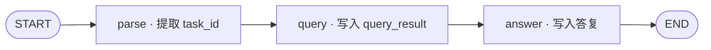
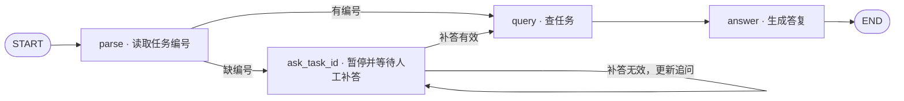

# Week11 · LangGraph 专项学习

**当前进度**　Day1 至 Day6 已完成（2026-11-23），下一阶段为 Day7 框架对比与验收。本周用 Week6 的 Mock API 练习显式的只读查询工作流。[V4 学习计划](/home/xumaozhou/Music/agent_engineer_learning_plan_v4_mcp.md#L375)

## Day1 · State、节点与边

今天用一个问题走完最小流程。例如输入「请查询任务 12345 的当前状态」，最终拿到任务编号、API 结果以及「任务 12345 当前状态为 RUNNING。」这句答复。



| 概念 | 在 Day1 中的作用 |
|---|---|
| **State** | 当前运行里供节点读取的数据。初始只有 `question`，后来逐步累计 `task_id`、`query_result` 和 `answer`。 |
| **Node** | 读取自己需要的字段并返回本节点的更新。例如 `parse` 只返回 `{"task_id": "12345"}`，LangGraph 将它合并到含原问题的 State。 |
| **Edge** | 规定当前节点结束后进入哪个节点。这里四条固定边定义了依赖顺序，使 `query` 读取到任务编号，`answer` 读取到查询结果。 |

Agents SDK 的 Session 用于保存和读取跨轮消息历史。Day1 的 LangGraph State 用于传递本次运行内的业务数据，每次调用以新问题开始。Week11 Day4 再用 Checkpointer 练习按 `thread_id` 保存和恢复图的状态。[LangGraph Graph API](https://docs.langchain.com/oss/python/langgraph/graph-api)

### 状态图实现

`build_day1_graph(query_task)` 注册三个节点、连接四条边并返回编译后的图。调用方提供的 `query_task` 接收任务编号并返回 Week6 的 `BusinessResult`。使用 `graph.invoke({"question": ...})` 获取合并后的最终 State，使用 `graph.stream(..., stream_mode="updates")` 查看各节点分别写入的字段。[代码入口](../langgraph_learning/day1.py#L48) · [LangGraph Streaming](https://docs.langchain.com/oss/python/langgraph/streaming)

### 测试数据与验收

Day1 离线测试 **4 项通过**。

四道用例来自现有 Week6 Mock API。每道题提供 `input.question`、Mock 身份 `subject_id` 和参考结果 `expected`。前三题查询成功，任务状态分别为 `RUNNING`、`SUCCESS`、`FAILED`。第四题由 Mock 返回 `NOT_FOUND`，答复报告当前状态无法确认。[用例文件](/media/xumaozhou/data/AI/local_agent_test/week11_langgraph/day1_cases.json)

- **数据核对。** 验证任务编号提取、Mock API 返回和固定答复。
- **最终 State。** 验证四题都保留原问题、写入正确的结果，每题查询恰好一次。
- **节点更新。** 通过 `stream_mode="updates"` 验证节点执行顺序和各自更新的字段。
- **独立运行。** 对同一个编译好的图连续传入不同问题，验证两次查询分别使用各自的编号。

在主项目根目录运行。当前项目环境使用 LangGraph `1.2.20`。

```bash
RUN_WEEK11_DAY1=1 .venv/bin/python -B -m pytest tests/test_week11_day1.py -v -p no:cacheprovider
```

只检查数据时可省略 `RUN_WEEK11_DAY1=1`。用例目录可由 `WEEK11_DATASET` 指定。

## Day2 · 条件分支、循环与退出

Day2 用 `add_conditional_edges` 在节点执行后读取 State，决定接下来走哪条边。输入的 `request` 包含原问题、是否查询当前状态、是否解释规则和可选的任务编号。工具和结果结构沿用 Week6、Week9 和 Week10 的练习。参考答案由测试在图运行后核对。[Day2 图构建](../langgraph_learning/day2.py#L116) · [LangGraph 条件边](https://docs.langchain.com/oss/python/langgraph/graph-api#conditional-edges)


例如「我猜任务 12345 是 FAILED，查一下再解释」，实际查询返回 `RUNNING`。组合路径先检索「RUNNING 状态的业务含义是什么？」。第一次为空时，用 `RUNNING` 补查一次。每次检索消耗一个候选词，命中或耗尽都会到达 `finish`。两次均为空时，结果保留已确认的 `RUNNING`，同时标明 `NO_KNOWLEDGE_EVIDENCE`。仅 RAG 路径直接使用原问题，一次搜索后结束。[检索准备和退出实现](../langgraph_learning/day2.py#L79)

### 条件分支实现

1. `route_after_plan` 读取 `route` 和 `request.task_id`。仅 RAG 返回 `"prepare_search"`。需要查状态时，缺编号返回 `"finish"`，有编号返回 `"query"`。返回值就是下一个节点的名称。[首次分支](../langgraph_learning/day2.py#L40)
2. `route_after_search` 读取 `evidence`、`search_attempts` 和候选词数量。只有证据为空且还剩候选词时返回 `"search"`，其他情况返回 `"finish"`。例如第一次搜索后次数已为 1，候选数为 2，此时证据为空就进入第二次搜索。[检索回环](../langgraph_learning/day2.py#L58)

### 测试一 · 样例与数据源核对

用例包含九题。任务响应来自 Week6 Mock API，知识原文取自 Week9 的 `KB006.md` 第 6 行。测试核对三种意图路线、模拟任务状态和知识原文。[用例文件](/media/xumaozhou/data/AI/local_agent_test/week11_langgraph/day2_cases.json) · [测试入口](../tests/test_week11_day2.py#L38)

### 测试二 · 入口分支

测试构造仅解释规则、仅查状态和组合请求，验证规则问题即使带有示例编号也直接检索，任务编号为空时走结束分支。[测试入口](/home/xumaozhou/Music/harnessPrototype/tests/test_week11_day2.py:57)

### 测试三 · 检索回环

测试构造两条候选词的 State，验证首次未命中时继续，取得证据或用完第二条时结束。[测试入口](/home/xumaozhou/Music/harnessPrototype/tests/test_week11_day2.py:68)

### 测试四 · 图执行验收

运行全部九题，核对节点访问顺序、实际工具参数、最终状态、停止原因和文档命中。重点检查缺参时零调用、业务查询查无任务或返回空数据时不检索、组合检索最多两次。测试额外设置图步数上限，便于定位意外回环。[测试入口](/home/xumaozhou/Music/harnessPrototype/tests/test_week11_day2.py:78)

### 运行验收

Day2 离线验收 **4 项通过**，其中图执行测试覆盖全部 **9 个场景**。Day1 和 Day2 合计 **8 项通过**。

在项目根目录运行。省略开关时只运行测试一。可通过 `WEEK11_DATASET` 指定用例目录，通过 `WEEK9_RAG_DATASET` 指定知识目录。

```bash
RUN_WEEK11_DAY2=1 .venv/bin/python -B -m pytest tests/test_week11_day2.py -v -p no:cacheprovider
```

## Day3 · 多节点失败处理与重试

Day3 在 Day2 的查询和检索节点前加入预算检查。Week6 Service 已把 HTTP 超时和权限拒绝转换为 `BusinessResult.error_code`，因此图用条件边读取业务结果，决定是否再次进入 `query`。测试中的 API Client 每次只发起一次请求，便于将图中的查询次数和工具调用对齐。[Day3 图构建](../langgraph_learning/day3.py#L55)

| 限制 | 默认值 | 到达上限后的行为 |
|---|---:|---|
| `max_query_attempts` | 2 | 包含首次查询。持续超时达到上限时保留 `TIMEOUT` 并结束。 |
| `max_tool_calls` | 4 | 查询、重试和检索共享预算，失败调用也占一次。下一次工具调用被拦截时返回 `TOOL_BUDGET_EXHAUSTED`。 |
| `max_steps` | 12 | 对应 LangGraph 的 `recursion_limit`，也覆盖选路和准备检索词等节点。图超步数时抛出 `GraphRecursionError`。 |

`FORBIDDEN` 一次即结束。知识检索为空时沿用 Day2 的候选词回环，候选词用完后返回 `NO_KNOWLEDGE_EVIDENCE` 并保留已查到的事实。如果第一次查询超时后仍符合重试条件，却已经用完总预算，图会进入 `query` 节点并在发起工具调用前拦住。此时结束原因是 `TOOL_BUDGET_EXHAUSTED`，首次超时仍可在节点更新中看到。节点访问次数与真实工具次数可分别从节点更新和调用记录中核对。[LangGraph 超步限制](https://docs.langchain.com/oss/python/langgraph/graph-api#recursion-limit)

### 重试与预算实现

1. `should_retry_query(result, attempts, max_attempts)` 只在查询返回 `status="error"` 和 `error_code="TIMEOUT"`，并且已发起次数小于上限时返回 `True`。如首次超时且上限为 2，则允许再查一次。[查询重试判断](../langgraph_learning/day3.py#L34)
2. `reserve_tool_call(used, limit)` 在仍有名额时返回下一次调用的累计数 `used + 1`，额度用完时返回 `None`。两个工具节点在调用前都使用这个返回值。[工具预算判断](../langgraph_learning/day3.py#L45)

### 测试一 · 数据与 Mock 核对

用例包含九题，引用 Week9 的 `KB006.md`。测试先单独核对 Week6 的正常任务、持续超时和权限拒绝。首查超时后恢复的题使用固定的超时结果，再交给 Week6 Mock 查询真实用例状态。[Day3 用例数据](/media/xumaozhou/data/AI/local_agent_test/week11_langgraph/day3_cases.json) · [Mock 核对](../tests/test_week11_day3.py#L39)

### 测试二、三 · 重试判断与工具预算

用固定的 `BusinessResult` 和计数核对超时是否仍能重试，并检查零预算、剩余一次和已耗尽这些边界。[重试测试](../tests/test_week11_day3.py#L51) · [预算测试](../tests/test_week11_day3.py#L65)

### 测试四、五 · 图的执行轨迹与步数上限

逐题核对节点顺序、实际工具次数、每次查询的错误码和最终停止原因。步数测试另将步数上限设为 2，在有工具预算时确认图仍会触发 `GraphRecursionError`。[执行轨迹](../tests/test_week11_day3.py#L74) · [步数上限](../tests/test_week11_day3.py#L118)

### 运行验收

Day3 离线验收 **5 项通过**，图执行覆盖全部 **9 个场景**。Day1 至 Day3 回归共 **13 项通过**。

在项目根目录运行。省略开关时只运行数据核对，数据目录仍可通过 `WEEK11_DATASET` 和 `WEEK9_RAG_DATASET` 指定。

```bash
RUN_WEEK11_DAY3=1 .venv/bin/python -B -m pytest tests/test_week11_day3.py -v -p no:cacheprovider
```

## Day4 · Checkpointer、Thread 和持久化

Day4 给已经完成的 Day1 查询图接入 SQLite Checkpointer。仍然走 `parse → query → answer`，执行期间自动保存各阶段的 State。比如在同一线程先查任务 `12345`，再查任务 `23456`。读取最新快照会得到第二个任务，读取第一个任务对应的 `checkpoint_id` 可以看到当时保存的状态。查看快照只访问数据库，业务 API 调用发生在 `invoke` 执行图时。[Day4 代码](../langgraph_learning/day4.py#L49) · [LangGraph Checkpointers](https://docs.langchain.com/oss/python/langgraph/checkpointers)

| 概念 | 在 Day4 中的作用 |
|---|---|
| `thread_id` | 标识一组有关联的图运行。如用同一线程执行两次查询，两次执行的快照都可从该线程查出。 |
| `checkpoint_id` | 定位该线程历史中的某一份快照。省略时 `get_state` 读取最新快照。 |
| `StateSnapshot` | `values` 保存业务字段，`next` 记录接下来待执行的节点。执行结束时 `next` 是空元组。可以用 `get_state_history` 依次检查这些快照。 |
| 模型 Context | 一次模型请求实际携带的消息和证据。Day4 的查询图用固定答复，快照保存的是原问题、任务编号、查询结果和答复。接入模型时由调用方挑选本次请求需要的 State 字段。 |

### 线程与快照配置

`checkpoint_config(thread_id, checkpoint_id)` 返回的配置可直接传给图的 `invoke`、`get_state` 或 `get_state_history`。`configurable.thread_id` 始终提供。读取最新快照时省略 `checkpoint_id`，读取指定历史快照时在 `configurable` 中加入该字段。[配置实现](../langgraph_learning/day4.py#L17)

### 测试一、二 · 用例引用和配置结构

`day4_cases.json` 引用 Day1 的三道查询用例，指定两个有历史的线程和一个未使用的线程。测试核对引用和线程分组，并检查最新快照和指定快照所需的两种配置结构。[Day4 用例数据](/media/xumaozhou/data/AI/local_agent_test/week11_langgraph/day4_cases.json) · [配置验收](../tests/test_week11_day4.py#L44)

### 测试三、四 · 历史快照与线程隔离

对线程 A 连续运行两个不同任务，从历史中核对已结束快照的顺序，并读取第一次运行保存的快照。隔离测试让两个线程写入同一个数据库，分别读取自己的结果，未使用的线程返回空 State。[历史验收](../tests/test_week11_day4.py#L68) · [隔离验收](../tests/test_week11_day4.py#L99)

### 测试五 · 进程退出后回读

子进程用项目的 Python 运行一次 Mock 查询并关闭 SQLite。子进程退出后，pytest 进程重新打开数据库，按同一个 `thread_id` 读取结果。测试还核对 `query_result` 仍是 `BusinessResult`，且回读时工具调用次数为零。SQLite 文件由 pytest 写到临时目录。[持久化验收](../tests/test_week11_day4.py#L120)

### 运行验收

Day4 离线验收 **5 项通过**，包括历史快照、线程隔离和跨进程回读。Day1 至 Day4 回归共 **18 项通过**。

主项目 `.venv` 已安装 `langgraph-checkpoint-sqlite`。在新环境中可用项目 Python 安装 Week11 依赖。在项目根目录运行下列命令，省略开关时只核对用例引用。[Week11 依赖](../langgraph_learning/requirements.txt)

```bash
RUN_WEEK11_DAY4=1 .venv/bin/python -B -m pytest tests/test_week11_day4.py -v -p no:cacheprovider
```

## Day5 · Interrupt / Resume 与人工补参

Day5 让图在缺少任务编号时把控制交给用户。比如用户提出「请帮我查一下任务的当前状态」，首次 `invoke` 到达 `ask_task_id`，调用端从 `__interrupt__` 取得追问，Checkpointer 保存原问题和待执行节点。用户补答「23456」后，调用端以同一个 `thread_id` 调用 `graph.invoke(Command(resume="23456"), config)`。恢复调用只携带补答，原问题从检查点读取。[Day5 图构建](../langgraph_learning/day5.py#L70) · [LangGraph Interrupts](https://docs.langchain.com/oss/python/langgraph/interrupts)



恢复时 LangGraph 会从 `ask_task_id` 节点开头重新执行。此时 `interrupt` 返回用户补答，节点只负责校验和更新 State。查询放在后续的 `query` 节点，所以首次暂停和无效补答都不会触发业务调用。无效补答通过条件边重新进入追问节点，每次等待都需要调用端提供新的补答。[节点实现](../langgraph_learning/day5.py#L37) · [人工补答验证](https://docs.langchain.com/oss/python/langgraph/interrupts#validating-human-input)

### 人工补参实现

`ask_task_id(state)` 把追问交给 `interrupt`。恢复时把返回的补答交由 `_apply_task_id_reply` 生成状态更新。比如补答 `" 23456 "` 会写入 `task_id="23456"` 并清除原追问。无效补答会更新追问文案，条件边引导图再次暂停。[补参实现](../langgraph_learning/day5.py#L37)

### 测试一、二 · 数据引用和直接查询

用例复用 Day1 的 `12345` 和 `23456`。测试先核对任务编号与参考数据，再检查已给出编号时直接查询并生成答复。[用例数据](/media/xumaozhou/data/AI/local_agent_test/week11_langgraph/day5_cases.json) · [直接查询验收](../tests/test_week11_day5.py#L58)

### 测试三、四 · 恢复位置和无效补答

检查暂停快照的 `next` 是否指向 `ask_task_id`，再观察有效补答后的节点顺序 `ask_task_id → query → answer`。逐一发送空串、字母、全角数字和整数，验证图继续等待且查询次数保持为零。有效补答后查询一次。[恢复位置](../tests/test_week11_day5.py#L75) · [无效补答](../tests/test_week11_day5.py#L100)

### 测试五 · 重新打开 SQLite 后恢复

在第一次打开图时暂停并关闭连接。随后重新用同一个数据库文件编译图，读取待补参快照，再用同一线程的 `Command(resume=...)` 继续。测试确认原问题得以保留，查询恰好一次。SQLite 文件由 pytest 写入临时目录。[持久化恢复验收](../tests/test_week11_day5.py#L123)

### 运行验收

Day5 离线验收 **5 项通过**，覆盖恢复节点顺序、无效补答和 SQLite 重开后继续执行。Day1 至 Day5 离线回归共 **23 项通过**。

在项目根目录运行。省略开关时只核对用例引用。

```bash
RUN_WEEK11_DAY5=1 .venv/bin/python -B -m pytest tests/test_week11_day5.py -v -p no:cacheprovider
```

## Day6 · 工具副作用与恢复测试

Day6 练习在一次工具调用之后暂停。图先核验权限并查询任务，把结果和缓存时间存入 SQLite，再暂停等待用户确认。调用端用同一个 `thread_id` 提交 `Command(resume=True)` 或 `Command(resume=False)`。同意后重新校验权限，通过后才决定使用刚才的结果还是补查。缓存时间 `cached_at` 由图的时钟记录，测试通过推进这个时钟来模拟等待时间。[图的实现](../langgraph_learning/day6.py#L61)

恢复时，`review` 节点从开头重新执行，`interrupt` 返回本次提交的决定。首查放在已经完成的 `prefetch` 节点，正常恢复时不会重跑。需要更新数据时，图才经过 `refresh`，因此可以分别检查节点执行顺序和实际查询次数。[LangGraph Interrupts](https://docs.langchain.com/oss/python/langgraph/interrupts#side-effects-called-before-interrupt-must-be-idempotent)

### 恢复动作与结果

`decide_resume_action` 根据用户决定、当前读权限、缓存年龄和有效期选出恢复动作。图据此决定是否补查、是否生成答复，以及如何记录停止原因。比如查询后过了 10 秒且仍有权限，复用已有结果。在默认 60 秒有效期下，恰好过了 60 秒就补查一次。负年龄也补查，以处理时钟回拨。[恢复决策](../langgraph_learning/day6.py#L36)

| 恢复时的条件 | 返回动作 | 图执行后的结果 |
|---|---|---|
| 用户拒绝 | `reject` | `cancelled / USER_REJECTED`，本次恢复不查权限、不查询 |
| 用户同意，读权限已被撤销 | `forbidden` | `error / FORBIDDEN`，本次恢复不查询 |
| 用户同意、有权限，且缓存仍有效 | `reuse` | 复用结果生成答复，累计查询 1 次 |
| 用户同意、有权限，且缓存已到期或年龄为负 | `refresh` | 补查一次，成功后用新结果生成答复。补查失败时保留错误原因，清除当前 State 中的旧结果 |

### 测试一 · 用例数据

`day6_cases.json` 引用 Day1 的 `W11D1-01`，由 Week6 Mock API 提供任务 `12345` 初始状态 `RUNNING`。测试检查基准用例查询成功，以及 Day6 用例覆盖四种恢复动作和恰好到期的场景。[Day6 用例](/media/xumaozhou/data/AI/local_agent_test/week11_langgraph/day6_cases.json) · [数据检查](../tests/test_week11_day6.py#L31)

### 测试二 · 恢复决策边界

直接给恢复决策函数传入同意状态、权限和缓存年龄。依次核对拒绝、无权、刚查询、到期前、恰好到期和时钟回拨时应返回的动作。[决策测试](../tests/test_week11_day6.py#L42)

### 测试三 · 恢复轨迹和工具次数

逐个执行 `day6_cases.json` 的五个场景。首次运行查询一次并在 `review` 暂停。恢复后对比节点顺序、权限检查次数、查询次数和最终结果。状态变更场景中，过期后补查返回 `SUCCESS`，最终答复也要反映这份新结果。补查超时、权限撤销和拒绝场景都检查最终 State 中的查询结果与答复是否已清除。[轨迹测试](../tests/test_week11_day6.py#L68)

### 测试四 · 首次权限拒绝

使用 Day1 的任务编号，将首次权限校验设成拒绝，检查是否直接结束、保留 `FORBIDDEN` 且查询次数为零。[首次权限测试](../tests/test_week11_day6.py#L131)

### 测试五 · 重新打开 SQLite 后复用结果

首次查询使用 Day1 的 Mock API，暂停后关闭 SQLite。重新打开同一个数据库，使用同一个线程恢复。时钟只推进半个有效期，检查是否重新核验权限、从 SQLite 读取原有结果、生成预期答复，以及恢复时是否未再次查询。[持久化恢复测试](../tests/test_week11_day6.py#L147)

### 运行验收

Day6 离线验收 **5 项通过**，Day1 至 Day6 离线回归 **28 项通过**。

在项目根目录运行。测试使用 Mock API 和 pytest 临时目录中的 SQLite。

```bash
RUN_WEEK11_DAY6=1 .venv/bin/python -B -m pytest tests/test_week11_day6.py -v -p no:cacheprovider
```
