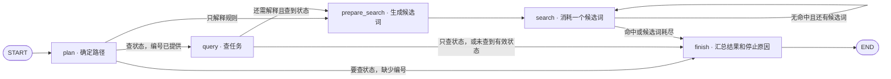

# Week11 · LangGraph 专项学习

**当前进度**　Day1 至 Day2 已完成（2026-11-23），下一阶段为 Day3 多节点失败处理与重试。本周用 Week6 的 Mock API 练习显式的只读查询工作流。[V4 学习计划](/home/xumaozhou/Music/agent_engineer_learning_plan_v4_mcp.md#L375)

## Day1 · State、节点与边

今天用一个问题走完最小流程。例如输入「请查询任务 12345 的当前状态」，最终拿到任务编号、API 结果以及「任务 12345 当前状态为 RUNNING。」这句答复。


| 概念 | 在 Day1 中的作用 |
|---|---|
| **State** | 当前运行里供节点读取的数据。初始只有 `question`，后来逐步累计 `task_id`、`query_result` 和 `answer`。 |
| **Node** | 读取自己需要的字段并返回本节点的更新。例如 `parse` 只返回 `{"task_id": "12345"}`，LangGraph 将它合并到含原问题的 State。 |
| **Edge** | 规定当前节点结束后进入哪个节点。这里四条固定边定义了依赖顺序，使 `query` 读取到任务编号，`answer` 读取到查询结果。 |

Agents SDK 的 Session 用于保存和读取跨轮消息历史。Day1 的 LangGraph State 用于传递本次运行内的业务数据，每次调用以新问题开始。Week11 Day4 再用 Checkpointer 练习按 `thread_id` 保存和恢复图的状态。[LangGraph Graph API](https://docs.langchain.com/oss/python/langgraph/graph-api)

### 状态图实现

`build_day1_graph(query_task)` 注册三个节点、连接四条边并返回编译后的图。调用方提供的 `query_task` 接收任务编号并返回 Week6 的 `BusinessResult`。使用 `graph.invoke({"question": ...})` 获取合并后的最终 State，使用 `graph.stream(..., stream_mode="updates")` 查看各节点分别写入的字段。[代码入口](../langgraph_learning/day1.py#L47) · [LangGraph Streaming](https://docs.langchain.com/oss/python/langgraph/streaming)

### 测试数据与验收

Day1 离线测试 **4 项通过**。

四道用例来自现有 Week6 Mock API。每道题提供 `input.question`、Mock 身份 `subject_id` 和参考结果 `expected`。前三题查询成功，任务状态分别为 `RUNNING`、`SUCCESS`、`FAILED`。第四题由 Mock 返回 `NOT_FOUND`，答复报告当前状态无法确认。[用例文件](/media/xumaozhou/data/AI/local_agent_test/week11_langgraph/day1_cases.json)

- **数据核对。** 验证任务编号提取、Mock API 返回和固定答复。
- **最终 State。** 验证四题都保留原问题、写入正确的结果，每题查询恰好一次。
- **节点更新。** 通过 `stream_mode="updates"` 验证节点执行顺序和各自更新的字段。
- **独立运行。** 对同一个编译好的图连续传入不同问题，验证两次查询分别使用各自的编号。

在主项目根目录运行。当前项目环境使用 LangGraph `1.2.20`。

```bash
RUN_WEEK11_DAY1=1 .venv/bin/python -B -m pytest tests/test_week11_day1.py -v -p no:cacheprovider
```

只检查数据时可省略 `RUN_WEEK11_DAY1=1`。用例目录可由 `WEEK11_DATASET` 指定。

## Day2 · 条件分支、循环与退出

Day2 用 `add_conditional_edges` 在节点执行后读取 State，决定接下来走哪条边。输入的 `request` 包含原问题、是否查询当前状态、是否解释规则和可选的任务编号。工具和结果结构沿用 Week6、Week9 和 Week10 的练习。参考答案由测试在图运行后核对。[Day2 图构建](../langgraph_learning/day2.py#L116) · [LangGraph 条件边](https://docs.langchain.com/oss/python/langgraph/graph-api#conditional-edges)



例如「我猜任务 12345 是 FAILED，查一下再解释」，实际查询返回 `RUNNING`。组合路径先检索「RUNNING 状态的业务含义是什么？」。第一次为空时，用 `RUNNING` 补查一次。每次检索消耗一个候选词，命中或耗尽都会到达 `finish`。两次均为空时，结果保留已确认的 `RUNNING`，同时标明 `NO_KNOWLEDGE_EVIDENCE`。仅 RAG 路径直接使用原问题，一次搜索后结束。[检索准备和退出实现](../langgraph_learning/day2.py#L79)

### 条件分支实现

1. `route_after_plan` 读取 `route` 和 `request.task_id`。仅 RAG 返回 `"prepare_search"`。需要查状态时，缺编号返回 `"finish"`，有编号返回 `"query"`。返回值就是下一个节点的名称。[首次分支](../langgraph_learning/day2.py#L40)
2. `route_after_search` 读取 `evidence`、`search_attempts` 和候选词数量。只有证据为空且还剩候选词时返回 `"search"`，其他情况返回 `"finish"`。例如第一次搜索后次数已为 1，候选数为 2，此时证据为空就进入第二次搜索。[检索回环](../langgraph_learning/day2.py#L58)

### 测试一 · 样例与数据源核对

用例包含九题。任务响应来自 Week6 Mock API，知识原文取自 Week9 的 `KB006.md` 第 6 行。测试核对三种意图路线、模拟任务状态和知识原文。[用例文件](/media/xumaozhou/data/AI/local_agent_test/week11_langgraph/day2_cases.json) · [测试入口](../tests/test_week11_day2.py#L38)

### 测试二 · 入口分支

测试构造仅解释规则、仅查状态和组合请求，验证规则问题即使带有示例编号也直接检索，任务编号为空时走结束分支。[测试入口](/home/xumaozhou/Music/harnessPrototype/tests/test_week11_day2.py:57)

### 测试三 · 检索回环

测试构造两条候选词的 State，验证首次未命中时继续，取得证据或用完第二条时结束。[测试入口](/home/xumaozhou/Music/harnessPrototype/tests/test_week11_day2.py:68)

### 测试四 · 图执行验收

运行全部九题，核对节点访问顺序、实际工具参数、最终状态、停止原因和文档命中。重点检查缺参时零调用、业务查询查无任务或返回空数据时不检索、组合检索最多两次。测试额外设置图步数上限，便于定位意外回环。[测试入口](/home/xumaozhou/Music/harnessPrototype/tests/test_week11_day2.py:78)

### 运行验收

Day2 离线验收 **4 项通过**，其中图执行测试覆盖全部 **9 个场景**。Day1 和 Day2 合计 **8 项通过**。

在项目根目录运行。省略开关时只运行测试一。可通过 `WEEK11_DATASET` 指定用例目录，通过 `WEEK9_RAG_DATASET` 指定知识目录。

```bash
RUN_WEEK11_DAY2=1 .venv/bin/python -B -m pytest tests/test_week11_day2.py -v -p no:cacheprovider
```
