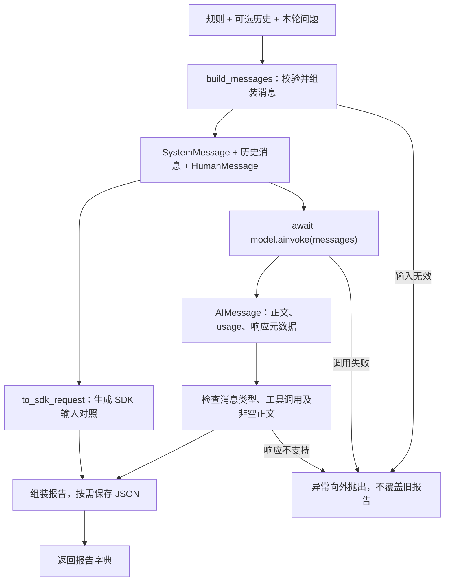
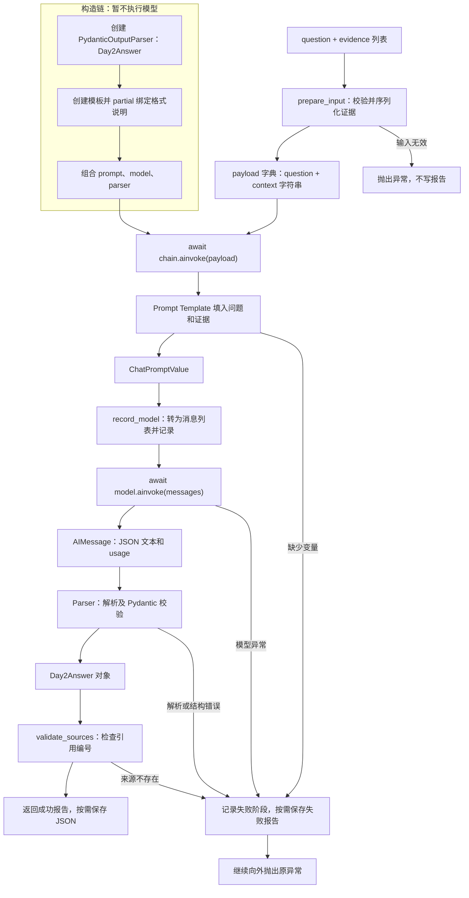
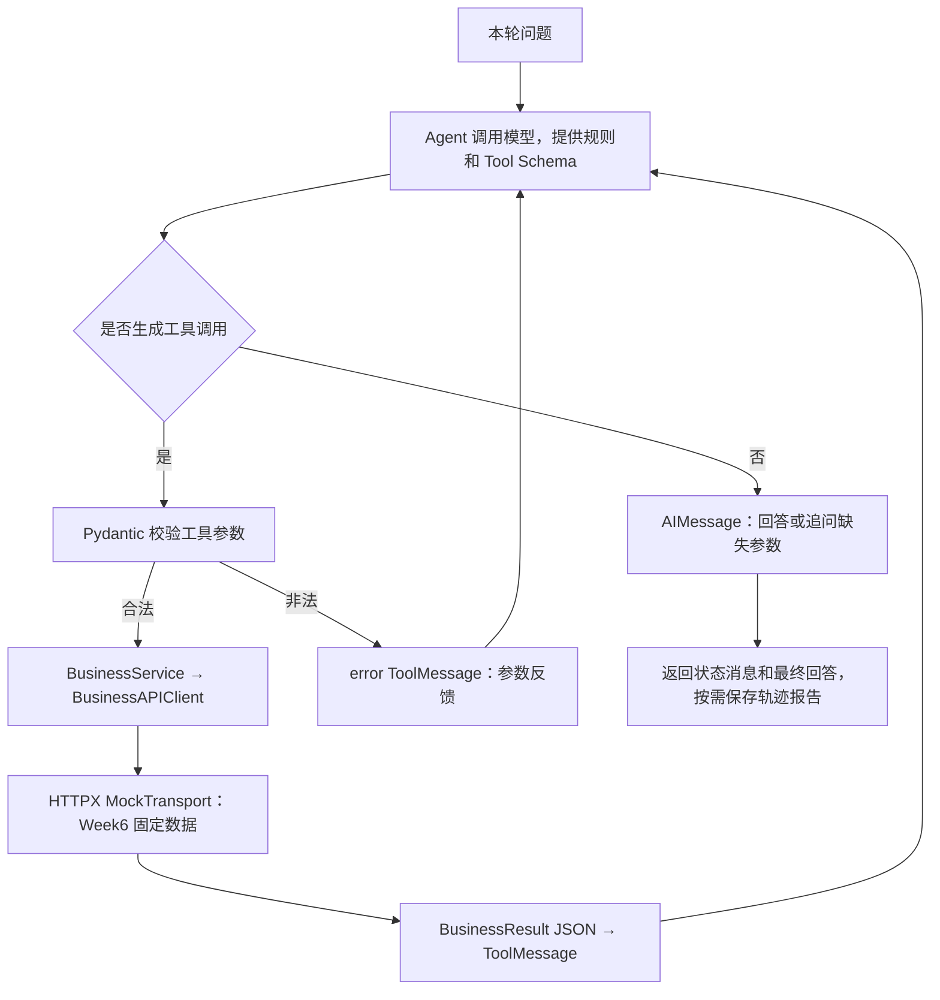
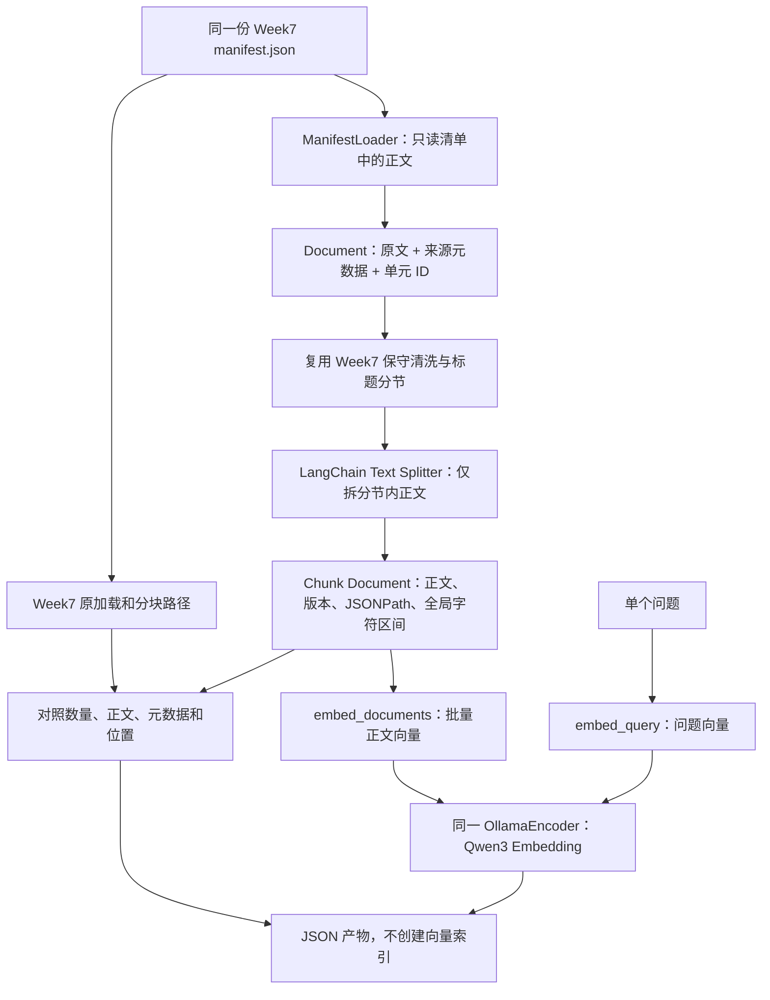
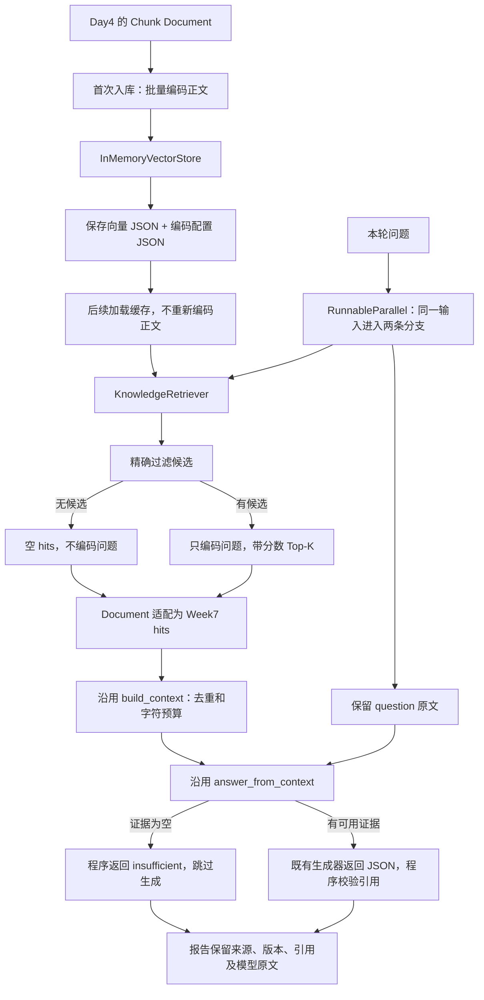

# Week8：LangChain 学习

> 基准计划：`/home/xumaozhou/Music/agent_engineer_learning_plan_v4_mcp.md`。
> 当前进度（2026-11-13）：**Day1～Day6 已完成，下一步 Day7：框架对比周验收**。
> 默认使用主项目 `.venv`；知识库代码放在 `rag/`，关联测试放在 `tests/`。主项目的 Agents SDK 和 Week7 既有实现保持原样。

向量库与检索链的完成记录见 [Day5 章节](#day5)；SDK 工具集成的实现与逐项验收见 [Day6 章节](#day6)。

## Day1 完成记录

- 两个关键步骤已实现：展开历史消息，await 模型的 ainvoke 接口。
- 完整离线回归：29 passed、1 skipped；跳过项为显式真实模型测试。
- 用户运行真实测试通过；助手核对实际报告，消息顺序为 system/human/ai/human，回答正确保留任务标识 00123。
- 报告保留了实际 usage、AIMessage 正文及 SDK 输入对照；本次提交前未重复调用真实模型。
- 本地报告为 `artifacts/day1/real_model/report.json`，运行产物和独立虚拟环境均不提交。

## Day1 学什么、验收什么

今天先理解模型调用和消息格式，不开始 RAG 重构。需要掌握的是：

| 学习内容 | 可以展示的验收结果 |
|---|---|
| LangChain 的组成 | 说明 core、模型适配包和高层 Agent 各自负责什么 |
| Message 是输入输出的数据对象 | 能区分 SystemMessage、HumanMessage、AIMessage，解释顺序和正文来源 |
| Model 是模型调用接口 | 通过一次 ainvoke 得到 AIMessage，读取 content 和实际 usage |
| 多轮上下文由调用方组织 | 证明同一个模型实例不会自动携带上次问题，历史需明确传入 |
| 与 Agents SDK 对照 | 说明规则对应 Agent.instructions，对话列表对应 Runner 的 input |
| 模型调用与 Agent Run 的边界 | 明白 ainvoke 返回一条消息，不会替你执行本项目的工具循环和 Session 管理 |

今天不要求手写 HTTP、另写测试框架或接入业务工具。Prompt Template、Runnable 组合和 Parser 是 Day2 内容；Tools/Agent 是 Day3 内容。

### 包和组件如何理解

| 名称 | 本日作用 |
|---|---|
| `langchain-core` | 提供消息对象、聊天模型接口及离线 Fake ChatModel 等基础能力 |
| `langchain-openai` | 提供 ChatOpenAI，把统一模型接口适配到兼容的 Chat Completions API |
| `ChatOpenAI` | 本日通过明确的 base_url 调用已有 DeepSeek，不代表请求被发送给 OpenAI |
| `langchain` 高层包 | 后续 Agent 学习再按需要安装；Day1 无需先安装整个框架 |
| LangGraph | 本日仅知道它与高层 Agent 的关系，状态图专项留给后续计划 |

本日使用 DeepSeek 的文本兼容接口，不承诺 ChatOpenAI 能保留该服务的全部专有功能。

## 代码结构与两个关键步骤回顾

| 文件 | 职责 |
|---|---|
| [day1.py](day1.py) | 消息组装、SDK 对照、一次异步调用与报告保存 |
| [requirements.txt](requirements.txt) | 固定本次验证过的直接依赖版本 |
| [test_week8_day1.py](../tests/test_week8_day1.py) | 已提供的离线测试和显式真实测试 |

### Day1 流程图



`sdk_request` 只进入对照报告，不传给 LangChain 模型，也没有执行 Agents SDK Runner。
实际模型输入始终为 `messages`，模型原始返回为 `AIMessage`。

| 练习标识 | 输入 | 已完成的输出 |
|---|---|---|
| `W8D1-1` | instructions、history_messages、question | 一个 messages 列表：规则在最前，本轮问题在最后 |
| `W8D1-2` | model 和 messages | await 一次异步模型接口，得到 response: AIMessage |

两处均已实现：使用 `*history_messages` 展开历史消息，使用 `await model.ainvoke(messages)` 调用模型。
每个函数的 docstring 已说明参数、输出、异常和支持范围，关键代码旁保留原理注释。

### 输入与输出的具体含义

```python
instructions = "根据用户提供的信息简洁回答。"
history = [
    {"role": "user", "content": "任务标识为字符串 00123。"},
    {"role": "assistant", "content": "已知任务标识为字符串 00123。"},
]
question = "刚才的任务标识是什么？请保留前导零。"
```

对应的 LangChain 消息类型顺序是 `system → human → ai → human`。
Message 的 `.type` 使用 human/ai；转换到 HTTP 或 SDK 输入时，对应 role=user/assistant。
不能把 `.type` 字符串直接当成所有接口的 role 值。

本日只支持非空纯文本消息。工具结果、多模态内容块、SDK 的完整 Session 条目不属于这个转换器的输入范围。
history 是调用方显式提供的记录；模型实例不会自动把之前的调用放进下一次输入。

报告包括：

| 字段 | 含义 |
|---|---|
| `messages` | 本次实际传入模型的 type/content，便于查看角色及顺序 |
| `sdk_request.instructions` | 对应 SDK 的 Agent instructions；本日只展示，不执行 SDK |
| `sdk_request.input` | 对应 Runner.run 的纯文本对话 input |
| `response` | AIMessage 的 type 和原始纯文本 content |
| `usage` | AIMessage.usage_metadata，缺失时保持 null，不猜测 Token 数量 |
| `response_metadata` | 只导出返回中存在的 model_name、finish_reason |
| `elapsed_seconds` | 本次模型接口调用及返回检查的耗时 |

### 和当前 Agents SDK 的区别

| 对比点 | 本日 LangChain 调用 | 当前项目 Agents SDK |
|---|---|---|
| 规则 | 列表中的 SystemMessage | Agent(instructions=...) |
| 用户输入与历史 | HumanMessage / AIMessage 列表 | Runner.run(agent, input=...) 的文本或消息列表 |
| 单次返回 | AIMessage，读取 content | RunResult，读取 final_output 等运行结果 |
| 工具执行 | 本日不执行，收到工具调用会明确报错 | Runner 结合工具定义管理 Agent Loop |
| 历史保存 | 本日由调用方明确传 history | 当前项目使用 Session，并在 Runner 中传入 |

这里是同一段文本的接口对照，不是把完整 SDK 运行结果、工具调用或 Session 无损转换为 LangChain。
现有 SDK 调用入口可参看 [agentLite.py](../agentLite.py) 的 `simpleCallLLM`。

## 环境与数据来源

### Python 环境

Day1～Day4 最初使用 `langchain_learning/.venv`。从 Day5 收尾起，按用户要求统一使用主项目 `.venv`（Python 3.10）。
当前主项目环境已安装本周依赖；需要重新安装时，在仓库根目录执行：

```bash
.venv/bin/python -m pip install -r langchain_learning/requirements.txt
```

已固定 `langchain-core==1.7.6`、`langchain-openai==1.7.4` 以及本次 pytest 版本。
其余为解析得到的传递依赖；requirements.txt 不是包含所有平台依赖的完整锁文件。
IDE 中运行测试时，选择主项目 `.venv/bin/python`。
未安装 LangChain 等依赖时，测试可能因 importorskip 跳过；跳过不表示验收通过。

### 测试数据来源

所有消息、假响应和错误状态都定义在 `tests/test_week8_day1.py`，无需另找数据集：

- **消息样例**：中文任务标识 `00123`，用于观察前导零及原文保留。
- **Fake ChatModel**：LangChain 自带 FakeMessagesListChatModel，返回测试指定的 AIMessage。
- **HTTP Mock**：httpx.MockTransport 返回合成 Chat Completions 响应、usage 和 401/429/500；不访问 DeepSeek。
- **真实测试**：使用同样的消息历史和问题，沿用项目现有 DeepSeek Key；不使用 Week7 知识库。

离线测试的固定回答和 usage 都是合成值，只验证消息及接口处理，不代表真实模型表现或真实成本。
代码关闭本次调用的 LangSmith 远程追踪；HTTP 客户端由已提供的代码管理，异常不自动重试。

## 运行命令与产物

均在仓库根目录执行。

### 1. 只运行已提供代码的自检

```bash
RUN_WEEK8_DAY1=0 RUN_WEEK8_DAY1_LLM=0 \
.venv/bin/python -B -m pytest tests/test_week8_day1.py \
-q -s -p no:cacheprovider
```

本次框架自检已通过：18 passed、12 skipped。
只执行已提供的参数、SDK 对照、Mock HTTP 及 CLI 保护测试；设置 RUN_WEEK8_DAY1=1 可启用完整流程。

### 2. 完整离线验收

```bash
RUN_WEEK8_DAY1=1 RUN_WEEK8_DAY1_LLM=0 \
.venv/bin/python -B -m pytest tests/test_week8_day1.py \
-q -s -p no:cacheprovider
```

两处关键步骤已完成，当前仓库实现的完整离线验收结果为 29 passed、1 skipped。
唯一跳过项为真实模型测试。沙箱内的异步线程唤醒受限时需在正常本地终端运行，本日没有为了绕过环境问题改写 LangChain。

### 3. 显式真实调用

完成离线验收后，确保当前终端已配置既有 DeepSeek `OPENAI_API_KEY`：

```bash
RUN_WEEK8_DAY1=1 RUN_WEEK8_DAY1_LLM=1 \
.venv/bin/python -B -m pytest \
tests/test_week8_day1.py::test_real_model_messages_and_leading_zero \
-v -s -p no:cacheprovider
```

用户已运行真实测试并确认通过，助手已核对本地报告中的实际输入与返回内容。下方命令用于显式重跑。
真实测试会调用一次 DeepSeek，不下载本地模型。通过后仍需阅读 report.json，解释消息顺序、返回类型及 SDK 对照。

也可使用已提供的 CLI，手动观察一次不带历史的调用：

```bash
.venv/bin/python -B -m langchain_learning.day1 --real-llm \
  --question '字符串任务标识 00123 为什么不应该转成整数？'
```

CLI 的规则使用 DEFAULT_INSTRUCTIONS；history 的传入由真实 pytest 展示。

### 输出位置

| 文件 | 来源 |
|---|---|
| `langchain_learning/artifacts/day1/offline/report.json` | 完整离线测试，假回答及假 usage |
| `langchain_learning/artifacts/day1/real_model/report.json` | 显式真实 pytest 或 CLI 的实际返回 |

pytest 可使用 `WEEK8_DAY1_OUTPUT` 修改产物根目录，CLI 使用 `--output`。
同名报告只在成功后覆盖；失败时旧文件可能仍在，不能据此认定本次成功。产物及虚拟环境均已 Git 忽略。

## 测试一：SDK 消息对照保留角色和原文

函数：`test_provided_sdk_comparison_preserves_roles_and_text`，默认执行。

- **数据来源**：测试内的规则、任务标识历史和本轮问题。
- **流程**：直接构造 LangChain 消息 → to_sdk_request → 修改返回字典。
- **检查点**：规则独立为 instructions，其他消息按 user/assistant 映射；正文及顺序不变；副本修改不影响原消息。
- **输出**：pytest 断言结果，不生成文件。

## 测试二：不支持的消息不能冒充已转换

函数：`test_provided_sdk_comparison_rejects_unsupported_messages`，默认执行，五组输入。

- **数据来源**：空列表、缺少规则、重复规则、工具消息和内容块。
- **流程**：尝试 SDK 输入对照转换。
- **检查点**：明确抛 ValueError，不把本日未支持的格式悄悄转成文本。
- **输出**：pytest 断言结果。

## 测试三：输入错误在消息组装前报错

函数：`test_provided_input_validation_runs_before_todo`，默认执行，六组输入。

- **数据来源**：空白规则、空问题、错误历史类型、非法 role、空正文和额外字段。
- **流程**：调用 build_messages 的已提供校验部分。
- **检查点**：先抛 ValueError，不依赖后续消息组装和模型调用。
- **输出**：pytest 断言结果，不请求模型。

## 测试四：真实模型配置需要既有凭据

函数：`test_provided_model_requires_existing_key`，默认执行。

- **数据来源**：删除本测试进程的 Key 环境变量，另注入假 Key 配合空模型名。
- **流程**：调用 build_model 的配置检查，不调用模型。
- **检查点**：缺 Key 明确提示；模型名必须非空，不读取 IDE 或磁盘中的其他凭据。
- **输出**：pytest 断言结果。

## 测试五：适配器确实发送正确 HTTP 消息

函数：`test_provided_chat_adapter_sends_roles_to_mock_api`，默认执行。

- **数据来源**：固定 HTTP 成功响应和假 usage，完全使用 MockTransport。
- **流程**：ChatOpenAI.ainvoke → Mock HTTP → AIMessage。
- **检查点**：请求为 DeepSeek 的 chat/completions 路径；消息角色为 system/user；正文保持；返回 content 和 usage 正确。
- **输出**：内存中的请求记录及 pytest 断言结果；不输出凭据。

## 测试六：HTTP 失败不自动重复请求

函数：`test_provided_http_failure_is_not_retried`，默认执行，三种状态。

- **数据来源**：HTTP Mock 的 401、429、500。
- **流程**：调用模型适配器并捕获 APIStatusError。
- **检查点**：保留实际状态码，每种情况只发送一次请求；不伪造文本回答。
- **输出**：pytest 断言结果。

## 测试七：CLI 显式真实开关

函数：`test_provided_cli_requires_explicit_real_flag`，默认执行。

- **数据来源**：提供问题但省略 --real-llm 的子进程命令。
- **流程**：执行独立模块 CLI。
- **检查点**：明确拒绝，不初始化真实模型请求。
- **输出**：子进程提示和 pytest 结果。

## 测试八：Message 类型、顺序与原文

函数：`test_message_order_types_and_original_text`，设置 RUN_WEEK8_DAY1=1 启用，三组历史输入。

- **数据来源**：None、空历史、两条文本历史，以及带空格和换行的规则/问题。
- **流程**：build_messages → 核对消息类和内容。
- **检查点**：规则在前，本轮问题在后；历史 human/ai 顺序准确；不 strip 原文，不修改输入列表。
- **输出**：pytest 断言结果。

## 测试九：一次异步调用和可读报告

函数：`test_one_async_call_records_aimessage_usage_and_sdk_comparison`，设置 RUN_WEEK8_DAY1=1 启用。

- **数据来源**：LangChain Fake ChatModel 返回固定 AIMessage、usage 和响应元数据。
- **流程**：build_messages → ainvoke 一次 → AIMessage → SDK 对照和 JSON 报告。
- **检查点**：实际消息一致，返回类型为 ai，usage 原值保留，只导出规定的元数据字段；不把响应当 SDK RunResult。
- **输出**：`artifacts/day1/offline/report.json`。

## 测试十：模型实例不会自动携带历史

函数：`test_model_instance_does_not_implicitly_keep_history`，设置 RUN_WEEK8_DAY1=1 启用。

- **数据来源**：同一个 Fake ChatModel 的两次调用；第二次没有传 history。
- **流程**：分别运行两个问题，检查第二次的实际输入。
- **检查点**：第二次只有规则和当前问题，不包含第一轮的任务标识；缺失 usage 保持 null。
- **输出**：pytest 断言结果。替身的固定回答不用于证明模型记忆能力，重点是检查实际输入。

## 测试十一：模型异常传播与旧报告保留

函数：`test_model_failure_propagates_and_preserves_old_report`，设置 RUN_WEEK8_DAY1=1 启用，两类异常。

- **数据来源**：RuntimeError、httpx.ReadTimeout 和临时旧报告。
- **流程**：执行 run_query，模型调用时抛错。
- **检查点**：异常原样传播，调用一次，旧文件不被写成假成功。
- **输出**：pytest 临时目录中的 `report.json` 保持原内容。

## 测试十二：错误类型、空响应和工具调用的边界

函数：`test_invalid_or_tool_response_is_not_a_completed_text_answer`，设置 RUN_WEEK8_DAY1=1 启用，四组响应。

- **数据来源**：HumanMessage、空白 AIMessage、内容块 AIMessage、含工具调用的 AIMessage。
- **流程**：替身返回上述消息，run_query 检查。
- **检查点**：本日只接受非空纯文本 AIMessage，不冒充已执行工具或已支持多模态。
- **输出**：pytest 断言结果。

## 测试十三：真实消息与前导零

函数：`test_real_model_messages_and_leading_zero`，需显式开启真实开关。

- **数据来源**：同样的中文历史及问题，既有 DeepSeek 配置。
- **流程**：一次真实 ainvoke → 保存消息、AIMessage 与 SDK 输入对照。
- **检查点**：历史确实发送，回答保留 00123，输出类型为 ai；usage 有则保留，无则不猜。
- **输出**：`artifacts/day1/real_model/report.json`，需阅读实际内容完成概念验收。

## 官方资料

- [LangChain Models](https://docs.langchain.com/oss/python/langchain/models)：模型调用接口与参数。
- [LangChain Messages](https://docs.langchain.com/oss/python/langchain/messages)：消息类型、content 与 usage_metadata。
- [LangChain Unit Testing](https://docs.langchain.com/oss/python/langchain/test/unit-testing)：Fake ChatModel 等离线测试方法。

今天验收时，能拿一份 report.json 解释 Model、Message、SDK Run 各做什么即可；不要求提前做 Runnable 链、工具循环或知识检索。

<a id="day2"></a>

## Day2：Prompt Template、Runnable 与 Parser

实现：[day2.py](day2.py)。测试：[test_week8_day2.py](../tests/test_week8_day2.py)。
沿用 Day1 的 build_model；当前默认环境为主项目 `.venv`。本日不新增依赖、不下载模型，三个关键步骤及验收均已完成。

### Day2 完成记录

- 已实现消息模板、partial 格式说明绑定、Runnable 管道组合和异步执行。
- 当前代码的完整离线验收：33 passed、2 skipped；两条跳过项为显式真实模型用例。
- 用户运行两条真实模型测试并确认通过；助手已核对实际输入、原始回答和解析结果。
- NOT_FOUND 问题返回 answered，引用 S1，回答正确区分“查询未找到”与“任务执行失败”。
- 任务 12345 当前状态的问题返回 insufficient，来源为空，明确说明缺少实时状态证据。
- 两条真实调用均为 execution_status=succeeded、model_calls=1、error=null；回答内容与本次证据范围一致。
- 真实报告见 `artifacts/day2/real_model/answered_report.json` 和 `insufficient_report.json`。本次收尾未重复请求真实模型；产物和虚拟环境不提交。

### 学习内容与具体验收

| 学习内容 | 验收时要能展示或解释的结果 |
|---|---|
| Prompt Template | 同一个模板填入不同问题与证据，正确生成 system/human 消息 |
| partial 绑定 | 输出格式说明预先绑定，运行时只需要 question/context 两个变量 |
| Runnable 与管道组合 | 能说明每一步接收什么、返回什么，构造链时不立即调用模型 |
| PydanticOutputParser | 模型返回 JSON 文本后，得到 Day2Answer 对象，而不是直接把字符串当结构化结果 |
| 错误传播 | 缺少变量、模型异常、输出无法解析或字段不合规时，异常向外传播，不伪造成功、不自动重试 |
| 解析的边界 | 能区分结构有效、来源存在以及事实被证据支持这三个层次 |

本日只练习固定证据的调用链，没有 Retriever、Agent Loop 或工具执行。
证据已经由测试或调用方提供；检索仍按后续 Day4/Day5 学习任务安排。

### 数据如何经过整条链

图示为当前 `run_chain` 的实际处理流程。构造链只连接组件，不调用模型。



模型响应通过观察器记录到 `raw_response`，再交给 Parser；即使解析失败，仍能查看模型原文。
`validate_sources` 是 Parser 之后的独立检查；两者都不能代替事实支持性的语义复核。

这里的管道写法是 `prompt | model | parser`。`|` 组成 RunnableSequence：上一步的结果直接成为下一步输入。
Runnable 是统一的执行接口，不表示会自动创建 Agent、保存会话或执行工具。
构造链之后，可以同步 `chain.invoke(payload)`，也可以异步 `await chain.ainvoke(payload)`。

**为什么 Day1 给 ainvoke 传消息，Day2 却可以给 ainvoke 传字典？**

Day1 调用的是模型，模型需要消息；Day2 调用的是整条链，第一步 Prompt Template 需要变量字典。
模板先把字典转换为 ChatPromptValue，模型收到的是转换后的提示内容。
链的入口和返回值取决于首尾组件，不能只根据方法名 ainvoke 判断数据类型。

### 已完成的三个关键步骤

| 练习标识 | 函数 | 输入 | 已完成的输出 |
|---|---|---|---|
| `W8D2-1` | build_prompt | 两段模板常量、parser | ChatPromptTemplate：创建 system/human 模板，partial 绑定 format_instructions |
| `W8D2-2` | build_chain | prompt、model、parser | prompt → model → parser 的 Runnable 链 |
| `W8D2-3` | run_chain | chain、payload | await 链后得到 answer: Day2Answer |

三处均已实现并通过离线测试；输入校验、报告保存、模型适配器和测试替身沿用练习框架。
每个函数的 docstring 已写清输入、输出与异常；模型观察器也已提供，只记录消息和响应再转发，不增加模型调用。

### 输入和结构化输出

输入 evidence 是一个列表，例如：

```json
[
  {
    "source_id": "S1",
    "text": "NOT_FOUND 表示本次查询没有找到指定任务，不等于任务执行失败。"
  }
]
```

prepare_input 负责把证据列表转换为 context JSON 文本。证据中的花括号只是正文，不会作为模板变量再次求值。
parser.get_format_instructions() 生成输出格式说明，partial 将它预先绑定到模板中。

解析后的两种合法结果示例：

```json
{
  "status": "answered",
  "answer": "NOT_FOUND 表示查询未找到，不代表任务执行失败。",
  "source_ids": ["S1"]
}
```

```json
{
  "status": "insufficient",
  "answer": "缺少任务 12345 当前的实时状态数据，需要实时查询。",
  "source_ids": []
}
```

这些字段和校验已提供：回答不能空白，来源不能重复，answered 必须有来源，insufficient 必须没有来源，拒绝额外字段。
Parser 只负责提取、解析和结构校验；不存在的 S99 可以先通过结构校验，再由 validate_sources 拒绝。
即使 source_id 存在，也必须人工看回答是否曲解证据，不能把结构校验当成语义正确率。

本日没有使用提供商原生 Schema 约束，也没有配置修复模型或重试 Parser。
PydanticOutputParser 自身能处理 JSON 围栏等文本格式；“解析成功”不证明模型原始输出每个字节都符合纯 JSON。

### 数据来源、执行边界与产物

- 测试数据全部定义在 `tests/test_week8_day2.py`。NOT_FOUND 事实取自 Week7 合成 FAQ 的含义，作为小段固定证据直接传入，不读取或重建 Week7 索引。
- 离线响应来自 LangChain 自带 Fake ChatModel；无效 JSON、错误字段、假来源及异常由测试注入。
- 离线 usage 为固定合成数值，只验证字段传递，不表示真实模型成本。
- 真实测试使用相同问题和证据，沿用 Day1 DeepSeek 配置；不读取评估参考答案来组装模型回答。
- 本日研究纯链的数据流，空证据也会调用一次模型来说明不足。正式 RAG 的“无候选跳过模型”策略保留在 Week7 实现中。

| 报告字段 | 含义 |
|---|---|
| execution_status | succeeded 或 failed，表示链是否执行成功 |
| input | 实际传给链的 question/context 字典 |
| messages | 实际传给模型的消息，不是仅供展示的模板草稿 |
| raw_response | Parser 前的原始模型正文；解析失败时保留，便于定位 |
| answer | 解析及来源检查后的字典；执行失败时为 null |
| usage / model_calls | 实际响应 usage 或 null，以及本次观察到的模型调用次数 |
| error | 失败阶段 prompt/model/parser/source_validation 及异常类型；不保存任意异常正文 |
| elapsed_seconds | 本次链执行耗时 |

`execution_status=succeeded` 与 `answer.status=insufficient` 可以同时出现：合理说明不足是正常结果。
异常仍然抛给调用方；报告中的阶段字段只辅助定位，不会吞掉错误。

| 文件 | 产生方式 |
|---|---|
| artifacts/day2/offline/answered_report.json | 完整离线测试的固定输出，假响应与假 usage |
| artifacts/day2/real_model/answered_report.json | 真实测试：解释 NOT_FOUND |
| artifacts/day2/real_model/insufficient_report.json | 真实测试：缺少任务实时状态证据 |
| artifacts/day2/real_model/cli_report.json | 已提供 CLI 的默认输出 |
| failure_report.json / parser_failure.json / source_failure.json | pytest 临时目录中的注入错误记录 |

以上固定目录均位于 langchain_learning/ 下，沿用 artifacts 忽略规则。
pytest 可用 WEEK8_DAY2_OUTPUT 修改产物根目录，CLI 用 --output。
和 Day1 不同，run_chain 在执行失败时也会保存本次失败记录并覆盖旧报告；输入校验失败发生在执行前，不写报告。

### 运行命令

**已提供部分的独立自检：**

```bash
RUN_WEEK8_DAY2=0 RUN_WEEK8_DAY2_LLM=0 \
.venv/bin/python -B -m pytest tests/test_week8_day2.py \
-q -s -p no:cacheprovider
```

框架准备阶段已运行：22 passed、13 skipped。此命令只验证已提供的 Schema、输入、Parser 及 CLI，不执行完整链。

**当前代码的完整离线验收：**

```bash
RUN_WEEK8_DAY2=1 RUN_WEEK8_DAY2_LLM=0 \
.venv/bin/python -B -m pytest tests/test_week8_day2.py \
-q -s -p no:cacheprovider
```

当前仓库实现已通过完整离线验证：33 passed、2 skipped，跳过两条真实模型用例。
普通离线测试不访问 DeepSeek，不下载模型，也不需要 Key。

**真实两组验证（离线通过后显式启用）：**

确保终端已有项目的 DeepSeek OPENAI_API_KEY，再执行：

```bash
RUN_WEEK8_DAY2=1 RUN_WEEK8_DAY2_LLM=1 \
.venv/bin/python -B -m pytest \
tests/test_week8_day2.py::test_real_prompt_model_parser \
-v -s -p no:cacheprovider
```

该命令分别运行“有依据回答”和“信息不足”两条问题，每条调用模型一次。用户已运行并确认通过，助手已对照实际报告复核回答内容。
自动测试检查运行、格式、来源编号及预期状态；本日两条回答的事实支持性另外通过阅读证据与回答进行核对。

也可执行一个固定证据的 CLI 演示：

```bash
.venv/bin/python -B -m langchain_learning.day2 --real-llm \
  --question 'NOT_FOUND 是不是表示任务执行失败？'
```

### 测试一（Day2）：输出 Schema 的一致性

函数：`test_provided_answer_schema_rejects_invalid_data`，默认执行，八组错误数据。

- **数据来源**：未知 status、空白回答、来源为空/重复/错误类型、insufficient 带来源及额外字段。
- **流程**：直接调用 Day2Answer.model_validate。
- **检查点**：字段类型及状态关系受校验，不能只保证 JSON 可解析。
- **输出**：pytest 结果，无文件。

### 测试二（Day2）：输入参数校验

函数：`test_provided_input_validation`，默认执行，七组错误数据。

- **数据来源**：空问题、错误证据类型、缺字段、空白正文或编号、重复编号。
- **流程**：调用 prepare_input。
- **检查点**：执行模型前拒绝输入错误。
- **输出**：pytest 结果，无文件。

### 测试三（Day2）：原文和花括号作为数据保留

函数：`test_provided_input_preserves_literal_braces_and_original_data`，默认执行。

- **数据来源**：带换行和空格的问题，以及含 {question} 和 JSON 花括号的证据正文。
- **流程**：序列化证据，再对照原对象。
- **检查点**：原文不被修改，输入列表不变；允许空证据列表。
- **输出**：pytest 结果，无文件。

### 测试四（Day2）：Parser 的输入输出类型

函数：`test_provided_parser_returns_pydantic_object`，默认执行，两种格式。

- **数据来源**：固定 JSON 回答，以及包在 json 代码围栏内的相同回答。
- **流程**：AIMessage → parser.invoke → Day2Answer。
- **检查点**：得到 Pydantic 对象，并理解 Parser 可处理围栏，不能用它证明原始输出一定是纯 JSON。
- **输出**：pytest 结果，无文件。

### 测试五（Day2）：无法解析或结构无效

函数：`test_provided_parser_reports_unparseable_or_invalid_output`，默认执行。

- **数据来源**：not JSON 文本，以及 answered 却缺少来源的 JSON。
- **流程**：直接调用 Parser。
- **检查点**：统一向外抛 OutputParserException，不返回半份合法结果。
- **输出**：pytest 结果，无文件。

### 测试六（Day2）：结构有效不代表来源存在

函数：`test_provided_parser_validity_does_not_prove_source_exists`，默认执行。

- **数据来源**：符合 Schema 但引用 S99 的回答，本次只有 S1。
- **流程**：先通过 Pydantic，再检查来源编号。
- **检查点**：来源存在性是额外校验，不能仅靠字段类型保证。
- **输出**：pytest 结果，无文件。

### 测试七（Day2）：CLI 真实开关

函数：`test_provided_cli_requires_explicit_real_flag`，默认执行。

- **数据来源**：子进程命令，提供问题但省略 --real-llm。
- **流程**：执行模块入口。
- **检查点**：明确拒绝，不触发真实模型调用。
- **输出**：子进程提示及 pytest 结果。

### 测试八（Day2）：模板变量、规则与消息类型

函数：`test_prompt_binds_schema_and_only_exposes_runtime_variables`，设置 RUN_WEEK8_DAY2=1 时启用。

- **数据来源**：Parser 格式说明和含字面花括号的证据。
- **流程**：创建模板 → invoke 输入字典 → to_messages。
- **检查点**：运行时变量只有 question/context；Schema 在 system，问题和证据在 human；正文不会被二次当模板解析。
- **输出**：pytest 结果，无文件。

### 测试九（Day2）：管道逐步传递数据

函数：`test_runnable_pipeline_transfers_prompt_to_model_and_parsed_object`，设置 RUN_WEEK8_DAY2=1 时启用。

- **数据来源**：RunnableLambda 模型替身，固定 AIMessage JSON。
- **流程**：同步执行 prompt → model → parser。
- **检查点**：模型实际收到 ChatPromptValue，最终得到 Day2Answer 对象。
- **输出**：pytest 结果，无文件。

### 测试十（Day2）：缺少变量阻断后续步骤

函数：`test_missing_prompt_variable_stops_before_model`，设置 RUN_WEEK8_DAY2=1 时启用。

- **数据来源**：只提供 question，没有 context。
- **流程**：调用 chain.invoke。
- **检查点**：模板阶段抛 KeyError，模型替身未被调用。
- **输出**：pytest 结果，无文件。

### 测试十一（Day2）：完整异步链与实际轨迹

函数：`test_async_chain_records_actual_messages_raw_and_parsed_answer`，设置 RUN_WEEK8_DAY2=1 时启用。

- **数据来源**：固定证据与 LangChain Fake ChatModel，usage 为合成数据。
- **流程**：run_chain → 消息记录 → 模型原文 → Parser → 来源校验 → 保存。
- **检查点**：只调用一次模型，实际消息准确，原始输出和解析结果都保留，输入不变。
- **输出**：artifacts/day2/offline/answered_report.json。

### 测试十二（Day2）：信息不足是正常结果

函数：`test_insufficient_is_successful_execution_not_exception`，设置 RUN_WEEK8_DAY2=1 时启用，两组证据。

- **数据来源**：无关的静态证据或空证据，以及固定 insufficient 响应。
- **流程**：仍运行本日纯链，由模型替身说明缺失实时信息。
- **检查点**：execution_status=succeeded，answer.status=insufficient，不把拒答当运行失败。
- **输出**：pytest 临时目录的 insufficient_report.json。

### 测试十三（Day2）：模型失败的阶段与传播

函数：`test_model_failure_preserves_stage_without_parsing_or_retry`，设置 RUN_WEEK8_DAY2=1 时启用，两类异常。

- **数据来源**：运行异常、HTTP 超时，异常正文包含不应写入报告的示例内容。
- **流程**：模型步骤抛错，保存失败报告后继续向外抛出。
- **检查点**：stage=model，没有原始响应和答案，只调用一次，不泄露任意异常正文。
- **输出**：pytest 临时目录的 failure_report.json。

### 测试十四（Day2）：解析失败保留原文

函数：`test_parser_failure_keeps_raw_response_and_propagates`，设置 RUN_WEEK8_DAY2=1 时启用，两类输出。

- **数据来源**：not JSON 或未知 status 的模型原文。
- **流程**：模型已成功返回，Parser 抛出异常。
- **检查点**：stage=parser，保留 raw_response，answer=null，不自动调用修复模型。
- **输出**：pytest 临时目录的 parser_failure.json。

### 测试十五（Day2）：Parser 之后检查来源

函数：`test_unknown_source_is_detected_after_successful_parsing`，设置 RUN_WEEK8_DAY2=1 时启用。

- **数据来源**：格式正确但引用 S99 的模型输出。
- **流程**：Parser 成功 → validate_sources 失败。
- **检查点**：stage=source_validation，原文保留，没有成功答案。
- **输出**：pytest 临时目录的 source_failure.json。

### 测试十六（Day2）：两种真实结构化回答

函数：`test_real_prompt_model_parser`，需额外开启真实开关，参数化运行两条。

- **数据来源**：相同固定证据，分别询问 NOT_FOUND 含义和任务当前状态，使用既有 DeepSeek。
- **流程**：变量字典 → 模板 → 一次模型调用 → Parser → 来源校验。
- **检查点**：第一条 answered 且引用 S1；第二条 insufficient 且不编造来源；两条均正常完成。
- **输出**：real_model/answered_report.json、real_model/insufficient_report.json；需人工阅读实际回答。

### Day2 官方资料与最后验收说明

- [LangChain Structured Output](https://docs.langchain.com/oss/python/langchain/structured-output)：结构化输出及链上的解析错误传播。
- [LangChain Core 参考](https://reference.langchain.com/python/langchain-core/)：ChatPromptTemplate、Runnable 与 Parser 的接口。

完成后，能拿一份报告讲清：为什么链接收字典、模型收到什么、Parser 输出什么、失败停在哪一步，以及结构正确为何不等于事实正确。

<a id="day3"></a>

## Day3：LangChain Tools、Pydantic 与 Agent（已完成）

实现：[day3.py](day3.py)。测试：[test_week8_day3.py](../tests/test_week8_day3.py)。
三个关键步骤及本日验收均已完成。使用同一 Week6 Mock 业务层理解工具参数与 Agent 循环。

### Day3 完成记录

- 任务 ID 的 ASCII 数字约束、两个带 args_schema 的 Tool 及 create_agent 组装均已实现。
- system_prompt 已显式传入 DAY3_INSTRUCTIONS，模型实际输入和报告中的规则一致。
- 当前代码完整离线验收：36 passed、4 skipped；跳过项均为显式真实模型用例。
- 用户运行四项真实模型测试并确认通过；助手已逐份核对工具参数、业务结果和最终回答。
- task：原样传入字符串 12345，回答 RUNNING，并区分查询 status 与任务 data.state。
- engine：精确查询 import_std、limit=3，返回原序前三条；回答明确总数为 12、本次仅为部分记录。
- missing：缺少 ID/编码时追问，没有生成工具调用或请求业务 API。
- not_found：原样查询 99999，正确解释 NOT_FOUND，不据此猜测任务执行状态。
- 四项 execution_status 均为 succeeded；三项查询各调用一次工具，缺参场景零工具调用。查询场景各有两条模型响应，缺参场景一条。
- 报告位于 `artifacts/day3/real_model/`。本次收尾没有重复调用真实模型；产物和虚拟环境不提交。

| 学习内容 | 练习及验收目标 |
|---|---|
| Tool 与 Schema | 沿用 Week6 的 Mock 业务查询，理解工具名称、说明和参数 Schema 如何提供给模型 |
| Pydantic 参数校验 | 定义明确的参数类型与限制，验证合法参数可执行，非法参数不能进入业务请求 |
| 简单 Agent | 观察问题 → 模型生成工具调用 → 程序执行 → ToolMessage → 模型回答的完整过程 |
| 与 Agents SDK 对照 | 说明 LangChain 工具封装与 SDK `@function_tool` 的共同职责，以及 Agent 与单次模型调用的区别 |

继续使用独立学习目录，业务响应采用 Mock；真实 LLM 用例仍通过独立开关显式启用。
验收重点是工具选择、参数校验、执行轨迹与回答依据。本日不接入 RAG，也不迁移主项目编排。

### Day3 环境与复用关系

`requirements.txt` 已补充 `langchain==1.4.9`，用于 `create_agent`；保留既有 core/openai 版本。
另固定 `mcp==2.1.1`，原因是复用的 `week6.py` 在模块顶部导入 MCP 类型；本日不启动 MCP Server 或子进程。
Day3 最初安装到独立环境；当前已统一使用主项目 `.venv`。需要重新安装时执行：

```bash
.venv/bin/python -m pip install -r langchain_learning/requirements.txt
```

| 代码 | 本日职责 |
|---|---|
| `week6.py` | 复用 TASKS、BusinessService、BusinessAPIClient、Mock HTTP、权限判断和结果限长 |
| `langchain_learning/day1.py` | 复用 DeepSeek 的 ChatOpenAI 适配器，不新增模型配置 |
| `langchain_learning/day3.py` | 参数模型、工具包装、Agent 组装与轨迹报告 |
| `tests/test_week8_day3.py` | 已提供的离线模型脚本、断言、真实测试与开关 |

`langchain.tools.tool`、`langchain.agents.create_agent` 都是第三方接口，已在 day3.py 顶部导入。
高层 Agent 内部使用 LangGraph，本日只使用它完成最小工具循环，不提前学习状态图设计或持久化。

### 已完成的三个步骤：输入、输出与边界

| 标识与位置 | 输入 | 已完成的实现 | 输出或效果 |
|---|---|---|---|
| `W8D3-1`，QueryTaskInput.task_id | strict 配置及字符串字段 | Field.pattern 限制全串为一个或多个 ASCII 数字 | Schema 可展示格式约束；拒绝 abc、空白和全角数字，保留 00123 |
| `W8D3-2`，build_tools | service、两个已有查询函数、两种参数模型 | tool 通过 args_schema 分别包装两个函数 | 返回两个 BaseTool，支持 invoke/ainvoke；校验通过才执行函数 |
| `W8D3-3`，build_agent | model、tools、DAY3_INSTRUCTIONS | create_agent 显式接收 model、tools、system_prompt | 返回可执行 Agent，创建时不请求模型或业务接口 |

三个位置均已实现并通过离线验收。Mock API、HTTP 错误映射、报告和测试模型沿用框架代码，Agent Loop 由 LangChain 编排。

参数约定：

- `task_id`：严格字符串，全串 ASCII 数字；`"00123"` 保持原样，不能转成整数。strict 拒绝整数和 bool，pattern 约束字符串内容。
- `engine_code`：非空、非纯空白的字符串，按字段精确匹配，不 strip 或归一化后再查询。
- `limit`：真正的整数，范围 1～100，默认 100；字符串 `"3"` 和 bool 均拒绝。
- `service/client/token`：由程序提供和管理，不进入模型填写的工具参数。

工具函数已经返回 BusinessResult 的 JSON 字符串，含 status/source/data/error_code/truncated 等。
`args_schema` 约束输入；业务输出的校验和限长复用已有层，不把输入 Schema 当作输出 Schema。
本日 Agent 最终返回自然语言文本，不增加一套最终回答 JSON 规范。

### Day3 工作流



Day2 是固定 `prompt → model → parser`；Day3 的 Agent 会根据模型返回决定是否执行工具，再把结果传回模型。
通常一次查询经历两次模型响应，但这不是固定次数；参数修正会增加轮次，缺参追问可完全不调用业务工具。

必须区分三类结果：

1. **直接工具校验失败**：`tool.invoke` 抛 ValidationError，业务函数与 HTTP 都未执行。
2. **Agent 内的参数校验失败**：当前框架会返回 error ToolMessage，模型可以修改参数再请求；是否修改取决于后续模型响应，不是工具自动重试 HTTP。
3. **业务查询返回 NOT_FOUND/FORBIDDEN**：这是合法的业务 JSON。ToolMessage 本身可能为 success，但其 JSON 中的 status=error；不能把工具执行成功等同于业务查询成功。

模型异常、未处理的程序异常和图步数超限会向外抛出，本日没有添加通用修复中间件。
`recursion_limit` 限制图执行步数，不等同于工具次数；另有整体 timeout_seconds，均由提供的 run_agent 管理。

### 测试数据来源

| 数据 | 来源及含义 |
|---|---|
| 任务 12345 | Week6 TASKS，alice 可读，data.state=RUNNING，engineCode=import_std |
| import_std 前 3 条 | Week6 Mock 中 alice 可见共 12 条，按原顺序返回 12345/20000/20001，status=partial |
| 任务 34567 | 属于 bob，alice 查询得到 FORBIDDEN |
| 任务 99999 / 00123 | Mock 中不存在，返回 NOT_FOUND；00123 同时验证前导零原样传递 |
| engine_not_found | 查询成功但无记录，status=empty |
| 模型离线响应 | tests 文件中的 ScriptedModel，按脚本依次返回 AIMessage 工具调用和最终文本 |
| 模型真实响应 | 沿用 DeepSeek；只替换模型，业务接口仍是同一套 Mock |

没有新增数据目录，所需固定数据已在 week6.py 和本测试中。
ScriptedModel 基于 LangChain GenericFakeChatModel，补充 Agent 需要的 bind_tools；不访问网络。
离线脚本只能证明调度、校验与消息传递，不能证明模型会自行选择正确工具或进行参数修正。

### 命令、报告与检查顺序

以下命令均在仓库根目录执行，使用 `.venv/bin/python`。

**第一步：基础部分的独立自检。**

```bash
RUN_WEEK8_DAY3=0 RUN_WEEK8_DAY3_LLM=0 \
.venv/bin/python -B -m pytest tests/test_week8_day3.py \
-q -s -p no:cacheprovider
```

框架准备阶段自检：11 passed、29 skipped。此命令仅检查基础部分，跳过完整流程的 25 项和真实模型 4 项。
新增依赖后的 Day1、Day2 完整离线回归：62 passed、3 skipped；三条真实模型用例均未启用。

**第二步：当前实现的完整离线验收。**

```bash
RUN_WEEK8_DAY3=1 RUN_WEEK8_DAY3_LLM=0 \
.venv/bin/python -B -m pytest tests/test_week8_day3.py \
-q -s -p no:cacheprovider
```

当前仓库实现已通过完整离线验收：36 passed、4 skipped，四项真实模型用例未启用。

**第三步：离线通过后，显式启用真实模型。**

```bash
RUN_WEEK8_DAY3=1 RUN_WEEK8_DAY3_LLM=1 \
.venv/bin/python -B -m pytest \
tests/test_week8_day3.py::test_real_agent_selects_tool_and_preserves_arguments \
-v -s -p no:cacheprovider
```

需要既有 DeepSeek OPENAI_API_KEY。参数化运行四个问题；一次 Agent 任务可能调用模型多次。
用户已运行并确认四项通过，助手已对照各份 ToolMessage 复核最终回答；本次收尾未重复执行。
后续重跑仍需显式启用。业务数据保持 Mock，不连接真实业务系统；自动断言不能替代对回答内容的复核。

也可独立运行一次真实模型 + Mock 业务演示：

```bash
.venv/bin/python -B -m langchain_learning.day3 --real-llm \
  --question '查询任务 12345 的状态，并说明来源。'
```

| 输出文件 | 由哪个测试生成 | 内容 |
|---|---|---|
| artifacts/day3/offline/tool_schemas.json | 测试六 | 工具名称、说明、输入 Schema |
| artifacts/day3/offline/query_report.json | 测试九 | 完整的一次查询轨迹 |
| artifacts/day3/offline/correction_report.json | 测试十 | 非法参数反馈、脚本修正后的调用与结果 |
| artifacts/day3/real_model/task_report.json | 测试十四，task | 真实模型按 ID 查询 |
| artifacts/day3/real_model/engine_report.json | 测试十四，engine | 真实模型按编码查询部分列表 |
| artifacts/day3/real_model/missing_report.json | 测试十四，missing | 缺 ID 时不调用工具的回答 |
| artifacts/day3/real_model/not_found_report.json | 测试十四，not_found | 未找到任务时的工具结果和回答 |
| artifacts/day3/real_model/cli_report.json | CLI | 命令行单次真实演示 |
| failure_report.json / step_limit_report.json | 测试四 / 十三，pytest 临时目录 | 运行异常或步数限制的错误类型 |

固定路径均相对于 langchain_learning/。pytest 可用 WEEK8_DAY3_OUTPUT 改输出根目录；CLI 使用 --output。
产物沿用 artifacts 忽略规则，不提交；模型调用关闭本次 LangSmith 远程追踪。

报告阅读方式：

- `messages` 是 Agent 返回的状态消息，通常为 human → ai(tool_calls) → tool → ai；system_prompt 在模型节点注入，另记为 instructions。
- `tool_calls` 保存名称、参数和原始 id；`tool_results` 的 call_id 与之配对，content 为业务 JSON 或框架校验反馈。
- `final_answer` 是最后一条 AIMessage 文本；有答案不代表答案语义已正确。
- `usage` 在所有返回 AIMessage 都含实际 usage 时才相加，否则保持 null。离线假模型不提供 usage。
- 运行失败时保存本次错误类型并覆盖旧报告；Agent 未返回完整状态时，不伪造中断前轨迹。输入参数无效时不开始执行，也不写报告。

### 测试一（Day3）：已提供的列表参数约束

函数：`test_provided_engine_schema_rejects_invalid_arguments`，默认执行，八组输入。

- **数据来源**：空编码、错误类型、非法条数、bool、字符串条数和额外 token 字段。
- **流程**：直接调用 QueryTasksInput；同时检查默认 limit 和编码原文。
- **检查点**：类型严格、范围有效、拒绝额外参数；保留字符串原值。
- **输出**：pytest 结果，无文件，不执行工具。

### 测试二（Day3）：复用的业务数据与精确查询

函数：`test_provided_business_data_is_same_week6_mock`，默认执行。

- **数据来源**：Week6 的任务 12345 与 import_std 列表。
- **流程**：直接调用 Service → Client → Mock HTTP。
- **检查点**：RUNNING 状态正确；精确编码匹配、列表原序、total=12、只返回 3 条且标记 partial；请求均为 GET。
- **输出**：pytest 结果，无文件，不调用模型。

### 测试三（Day3）：CLI 显式真实开关

函数：`test_provided_cli_requires_explicit_real_flag`，默认执行。

- **数据来源**：只有 question、没有 --real-llm 的子进程命令。
- **流程**：进入 CLI，在创建模型前拒绝。
- **检查点**：明确提示开关，Agent 构造和真实请求都不会执行。
- **输出**：pytest 和 CLI 提示，无报告。

### 测试四（Day3）：执行异常记录

函数：`test_provided_runner_saves_safe_failure_without_fake_usage`，默认执行。

- **数据来源**：已提供的 BrokenAgent，抛 RuntimeError；异常正文包含不应导出的示例内容。
- **流程**：run_agent 执行失败 → 保存报告 → 继续向外抛出。
- **检查点**：只记录异常类型，不包含任意异常正文；答案和 usage 均为 null。
- **输出**：pytest 临时目录 failure_report.json。

### 测试五（Day3）：任务 ID 的格式与身份

函数：`test_task_id_schema_preserves_string_identity_and_rejects_invalid_values`，设置 RUN_WEEK8_DAY3=1 时启用，八组非法输入。

- **数据来源**：空白、字母、前后空格、全角数字、整数、bool 和 None，以及合法 00123。
- **流程**：调用 QueryTaskInput，使用 Field.pattern 约束。
- **检查点**：只接收全串 ASCII 数字字符串，保留前导零。
- **输出**：pytest 结果，无文件，不请求 API。

### 测试六（Day3）：工具定义及输入 Schema

函数：`test_tool_schemas_names_descriptions_and_program_side_dependencies`，设置 RUN_WEEK8_DAY3=1 时启用。

- **数据来源**：build_tools 产生的两个 BaseTool。
- **流程**：导出工具名、说明、Schema，不执行工具。
- **检查点**：字段、必填参数、默认值和 pattern 正确，禁止额外字段；客户端、权限和 Token 没有成为模型参数。
- **输出**：offline/tool_schemas.json。

### 测试七（Day3）：直接工具调用的业务结果与配对

函数：`test_direct_tools_keep_business_contract_and_call_id`，设置 RUN_WEEK8_DAY3=1 时启用，六种业务场景。

- **数据来源**：正常任务、前导零 ID、无权限、不存在、空列表和截断列表。
- **流程**：给工具传入带 name/args/id/type 的 ToolCall 字典 → Service → Mock HTTP → ToolMessage。
- **检查点**：call_id 保留；业务状态、错误码和来源保留；原始参数不变；不返回 Token/owner；每次一次 HTTP。
- **输出**：pytest 结果，无文件。

### 测试八（Day3）：直接调用时参数错误先于业务执行

函数：`test_direct_tool_validation_stops_before_service_and_http`，设置 RUN_WEEK8_DAY3=1 时启用，五组错误。

- **数据来源**：缺 ID、字母 ID、整数 ID、额外 token 和 bool limit。
- **流程**：通过 tool.invoke 传参数，并记录是否进入 Service 和 HTTP。
- **检查点**：抛 ValidationError，业务函数与 HTTP 都未执行。
- **输出**：pytest 结果，无文件。

### 测试九（Day3）：Agent 完整工具循环

函数：`test_agent_tool_loop_records_result_before_final_answer`，设置 RUN_WEEK8_DAY3=1 时启用。

- **数据来源**：假模型先请求 query_task(12345)，再返回固定回答；业务查询用真实 Mock 链路。
- **流程**：构造 Agent → 第一条 AIMessage 工具调用 → ToolMessage → 第二条 AIMessage 最终回答。
- **检查点**：构造阶段没有请求；两种工具已绑定；规则注入实际模型输入；第二次模型输入包含工具结果；call_id 配对，一次 HTTP。
- **输出**：offline/query_report.json。

### 测试十（Day3）：Agent 内的参数反馈与修正

函数：`test_agent_validation_feedback_allows_a_scripted_correction`，设置 RUN_WEEK8_DAY3=1 时启用。

- **数据来源**：脚本先传整数 12345，再改为字符串，最后回答。
- **流程**：第一次参数校验失败生成 error ToolMessage；下一次合法调用进入业务层。
- **检查点**：两条 ToolMessage 的状态分别 error/success，保留各自 call_id；模型响应三次，HTTP 只有一次。
- **输出**：offline/correction_report.json。脚本修正不代表真实模型一定能修正。

### 测试十一（Day3）：缺参数时不查询

函数：`test_missing_id_asks_without_calling_business_api`，设置 RUN_WEEK8_DAY3=1 时启用。

- **数据来源**：没有 ID 的问题，假模型返回追问。
- **流程**：Agent 直接结束，不产生工具调用。
- **检查点**：无 ToolCall、ToolMessage 或 HTTP；保留追问文本。
- **输出**：pytest 结果，无文件。

### 测试十二（Day3）：独立任务不自动共享历史

函数：`test_repeated_agent_runs_do_not_automatically_share_history`，设置 RUN_WEEK8_DAY3=1 时启用。

- **数据来源**：同一个 Agent 的两个独立问题、两条固定回答。
- **流程**：先后两次 run_agent，每次只提供本轮 HumanMessage。
- **检查点**：第二次模型输入只有规则和第二个问题，没有第一次内容；没有配置 Checkpointer 或 Session。
- **输出**：pytest 结果，无文件。

### 测试十三（Day3）：限制无法结束的工具循环

函数：`test_graph_step_limit_stops_repeated_tool_calls`，设置 RUN_WEEK8_DAY3=1 时启用。

- **数据来源**：假模型连续返回合法查询调用，不给最终回答。
- **流程**：run_agent 使用 recursion_limit=3，达到图步数限制后抛出 GraphRecursionError。
- **检查点**：没有无限循环；记录实际异常类型，不猜测未返回的 usage。
- **输出**：pytest 临时目录 step_limit_report.json。

### 测试十四（Day3）：真实模型选择工具和传递参数

函数：`test_real_agent_selects_tool_and_preserves_arguments`，需额外开启真实开关，四个问题。

| 场景 | 输入 | 自动检查 |
|---|---|---|
| task | 查询任务 12345 | query_task，字符串 ID 正确，查询 success |
| engine | import_std 前 3 条 | query_tasks_by_engine，编码和 limit 正确，查询 partial |
| missing | 只有查询意图，缺任务 ID | 不产生工具调用或业务 HTTP |
| not_found | 查询 99999 | 原样传递 ID，业务返回 error/NOT_FOUND |

- **数据来源**：模型为既有 DeepSeek，业务为同一 Week6 MockTransport。
- **流程**：问题 → 自主选择工具和参数 → 实际工具执行 → 最终回答 → 保存报告。
- **检查点**：任务正常结束；有参数的场景恰好一次匹配工具调用，缺参场景零调用；校验原始参数与实际业务结果。
- **输出**：real_model/task_report.json、engine_report.json、missing_report.json、not_found_report.json。
- **语义复核**：确认 RUNNING 的来源、列表总数/截断说明、缺参时的追问，以及 NOT_FOUND 没有被解释成任务失败。自动通过不替代这一步。

### 与 Agents SDK 的对照与 Day3 完成标准

| 对照点 | LangChain 本日练习 | 既有 Agents SDK |
|---|---|---|
| 工具封装 | tool + args_schema | @function_tool 根据函数定义生成工具 |
| 参数约束 | 显式 Pydantic 模型 | SDK 生成的工具 Schema、既有参数及业务校验 |
| 隐藏业务依赖 | 闭包捕获 service | 项目既有工具通过 context 获取依赖 |
| 执行编排 | create_agent 返回可执行对象 | Agent 定义 + Runner.run |
| 工具轨迹 | AIMessage.tool_calls 和 ToolMessage.tool_call_id | Function Call、Function Call Output 及 call_id |

这张表是接口职责对照，不是两套 SDK 的无损转换器，也没有在本日重新运行 Agents SDK。
本日已通过离线用例与显式真实用例。复盘时能拿轨迹解释参数由谁生成、由谁校验、业务结果如何回到模型，以及工具执行状态和业务查询状态的区别。

官方资料：[Tools](https://docs.langchain.com/oss/python/langchain/tools)、[Agents](https://docs.langchain.com/oss/python/langchain/agents)、[工具循环的离线测试](https://docs.langchain.com/oss/python/langchain/test/unit-testing)。

<a id="day4"></a>

## Day4：Document、Loader、Text Splitter 与 Embeddings（已完成）

实现：[rag/langchain_preparation.py](../rag/langchain_preparation.py)。测试：[test_week8_day4.py](../tests/test_week8_day4.py)。
本日已把 Week7 的文档准备流程接到 LangChain 组件接口，三个学习点及四处关键实现均已完成。

### Day4 完成记录

- 已实现原文/元数据到 Document 的转换、Text Splitter 构造及两种 Embedding 入口。
- 当前代码完整离线验收：35 passed、1 skipped；跳过项为显式真实 Ollama 测试。
- 用户运行真实本地测试并确认通过，包含首块向量与 Week7 入口的数值对照；助手本轮读取产物复核，没有重复推理。
- 真实报告：18 份来源文件 → 20 个正文单元 → 64 个 Chunk，same_chunks=true；正文、ID、顺序和完整元数据与 Week7 一致。
- qwen3-embedding:0.6b 返回 64 条正文向量和 1 条问题向量，均为 1024 维；Chunk ID 对应、维数、有限性和非零检查通过。
- 对照报告和向量保存在 `artifacts/day4/local_model/`，模型及运行产物不提交。
- 本日只完成文档准备与编码；检索及回答质量留到 Day5 和后续学习，不把向量格式正确等同于语义质量通过。

### 今天学习什么、验收什么

| 学习内容 | 可展示的验收结果 |
|---|---|
| Document | 能区分 page_content 正文、metadata 来源信息及 id；转换时不丢版本、scope 和 JSONPath |
| Loader | 通过 BaseLoader 的 load/lazy_load 按同一清单加载，说明为什么不能递归扫描整个练习目录 |
| Text Splitter | 理解字符长度、重叠、分隔符和 start_index；不跨标题节或正文单元混块，保留流程元数据 |
| Embeddings 接口 | 正文批量 embed_documents 返回二维数组；问题 embed_query 返回一维向量 |
| 与 Week7 对照 | 对同一语料和规则检查块正文、数量、ID、元数据和位置，而不是只看“代码能运行” |

本日止于 Document → Chunk → 向量，不建索引、不检索、不调用回答模型或 Agent。
向量库和 Retriever 是 Day5 内容；Day4 不需要 DeepSeek Key，也没有在线回答型 LLM 测试。

### 文件、依赖和复用边界

| 文件或组件 | 本日职责 |
|---|---|
| rag/langchain_preparation.py | 自定义 Loader、Document 转换、LangChain 节内分块、Embeddings 适配和报告 |
| rag/preprocessing.py | 复用清单校验、保守清洗、JSON 正文适配、标题/代码围栏规则和定位；同时作为 Week7 对照路径 |
| rag/embeddings.py | 复用既有 OllamaEncoder、query 前缀及向量校验，不重新实现 HTTP |
| tests/test_week8_day4.py | 提供合成文件、人工向量、Mock HTTP、断言及真实本地模型开关 |

Day4 新增依赖只有 `langchain-text-splitters==1.1.3`，已检查与既有 core 版本兼容；当前主项目环境也已安装。
新增依赖后的 Day1～Day3 完整离线回归：98 passed、7 skipped；七项真实模型用例均未启用。
以后重新安装使用：

```bash
.venv/bin/python -m pip install -r langchain_learning/requirements.txt
```

本日不安装 langchain-community 或另一套 Ollama 适配包：ManifestLoader 遵循 BaseLoader 接口，读取规则由现有清单决定；Week7Embeddings 遵循 Embeddings 接口，后端仍是已有模型。
这样保留相同数据结构、模型和查询前缀，也方便 Day5 接入要求 Embeddings 对象的组件。

### 已完成的三个学习点与四处关键实现

| 标识 | 函数 | 输入 | 已完成的输出 |
|---|---|---|---|
| W8D4-1 | to_document | KnowledgeDocument；已复制 metadata 并补充 doc_id/segment_id/section_path | Document，id 为 doc_id:segment_id，page_content 保留原文，metadata 使用已准备的副本 |
| W8D4-2 | make_splitter | 已校验的 max_chars/overlap/mode，以及 options 字典 | 用 options 构造 RecursiveCharacterTextSplitter |
| W8D4-3a | Week7Embeddings.embed_documents | list[str] 正文和 self.encoder | 调用 embed_texts 的 document 入口，返回 list[list[float]] |
| W8D4-3b | Week7Embeddings.embed_query | str 问题和 self.encoder | 将问题作为单元素列表交给 query 入口，再返回对应的一维 list[float] |

四处均已实现并通过离线验收；Loader 主循环、标题解析、HTTP、向量校验和报告保存复用已提供代码。
Document、RecursiveCharacterTextSplitter、Embeddings 均为文件顶部已导入的 LangChain 接口；embed_texts 是 Week7 既有函数。

### 数据如何流动



Loader 的原文保持 BOM/CRLF 等不变；清洗只在分块阶段做，规则与 Week7 相同。
标题解析仍复用 Week7；每个节内部的长度切分由 LangChain 执行，不是把 Week7 分好的最终块换一种对象类型。

### 分块规则与位置的含义

两种模式都先按 Week7 标题规则分节，代码围栏里的 `#` 不作标题；JSON 的 sections 分开处理。

| 模式 | 节内规则 | overlap 的含义 | 用途 |
|---|---|---|---|
| aligned（默认） | separators 只含空字符串，按字符窗口切分 | 同一节内相邻窗口重叠固定字符数 | 与 Week7 相同规则对照 |
| recursive | 优先段落、换行、中文句号等，最后按字符兜底 | 重叠目标上限，实际不一定满额 | 观察自然边界对切点的影响 |

默认 max_chars=500、overlap=50，长度按 Python len(str) 计字符，不是 Token。
`strip_whitespace=False`、`keep_separator=True` 保留正文；纯空白块按约定跳过。

位置分两层：

- `start_index` 是 LangChain 返回的**本节内**字符起点，仅作为中间结果。
- Chunk metadata.start_char/end_char 是**清洗后的整个正文单元**中的左闭右开区间；代码会加回该节的起点。
- MD/TXT 的 start_line/end_line 为源文件 1-based 行号；JSON 不使用拼接后的虚假行号，保留 json_path，行号为 null。
- 文档单元 ID 如 KB001:body；Chunk ID 如 KB001:body:0000，同一 JSON 的 json-0/json-1 保持区分。

当前实现的完整离线对照中，两种模式都得到 64 块且与 Week7 完全一致：这批内容在节内没有触发不同切点。
因此专门提供了长段落合成测试来观察两种模式的差异，不能为了展示差异强行改动知识正文。

### Embedding 的两个入口

```text
embed_documents([正文1, 正文2]) → [[向量1...], [向量2...]]
embed_query(一个问题)          → [问题向量...]
```

底层 OllamaEncoder 的 document 入口直接编码正文，query 入口添加既有的 Qwen 检索说明。
适配器不能把问题误走 document 入口，也不能把 metadata 或整个 Document 对象当正文编码。
空文档列表不请求模型；非法文本、条数/维数不符、零向量、NaN 等由已有函数拒绝；模型异常向外抛出。

### 测试数据从哪里来

| 数据 | 来源 |
|---|---|
| 完整知识集 | `/media/xumaozhou/data/AI/local_agent_test/week7_rag_basics/manifest.json`，同一批 18 份文件：15 MD、2 TXT、1 JSON |
| 正文单元 | 17 份文本 + JSON 的 3 个 section，共 20 个；默认规则共 64 块 |
| 合成小语料 | 本测试 small_dataset 在 pytest 临时目录生成：MD/TXT/JSON，含 BOM、CRLF、标题、代码围栏、正文外说明和嵌套元数据 |
| 长段落样例 | 测试内的中文段落，用于观察字符窗口与递归分隔的差异 |
| 离线向量 | FixedEncoder 按文本长度返回三维人工向量，仅检查调用、顺序和绑定，不代表语义质量 |
| HTTP 响应 | httpx.MockTransport 返回固定向量，检查同一 Qwen 前缀和请求格式，不连接 Ollama |
| 真实推理 | 已安装的本地 Ollama 模型 qwen3-embedding:0.6b，不下载新模型，不请求在线生成服务 |

可以用 WEEK7_RAG_DATASET 指向同一语料的其他目录；完整对照会核验 18/20/64 的既有基准。
加载器只读清单文件，不扫描 README、问题集或参考答案。测试对源文件做哈希核对，确认没有改写。

### 运行顺序与命令

在仓库根目录执行。

**第一步：辅助部分的独立自检。**

```bash
RUN_WEEK8_DAY4=0 RUN_WEEK8_DAY4_MODEL=0 \
.venv/bin/python -B -m pytest tests/test_week8_day4.py \
-q -s -p no:cacheprovider
```

框架准备阶段自检：14 passed、22 skipped。此命令只检查辅助代码，跳过完整流程的 21 项和真实本地推理 1 项。

**第二步：当前实现的完整离线验收。**

```bash
RUN_WEEK8_DAY4=1 RUN_WEEK8_DAY4_MODEL=0 \
.venv/bin/python -B -m pytest tests/test_week8_day4.py \
-q -s -p no:cacheprovider
```

当前仓库实现已通过：35 passed、1 skipped，唯一跳过项为真实本地推理。
此命令使用完整知识集做加载/分块对照，但向量使用人工值或 HTTP Mock，不进行真实模型推理。

也可以只做加载、分块和对照，直接查看输出文件：

```bash
.venv/bin/python -B -m rag.langchain_preparation \
  --output langchain_learning/artifacts/day4/preprocess
```

改为 `--mode recursive` 可观察另一种节内切分方式；换模式时建议指定另一输出目录，便于对照。

**第三步：离线通过后，显式运行真实本地 Embedding。**

```bash
RUN_WEEK8_DAY4=1 RUN_WEEK8_DAY4_MODEL=1 \
.venv/bin/python -B -m pytest \
tests/test_week8_day4.py::test_local_ollama_embeddings_match_week7_backend \
-v -s -p no:cacheprovider
```

需要已启动的 Ollama 服务及已拉取的 qwen3-embedding:0.6b。用户已运行并确认通过，助手已核对实际产物；本次收尾未重复执行。
该测试编码 64 个正文块、一个问题，并额外编码第一块与 Week7 入口做数值对照；不评估检索或回答质量。
本日真实开关叫 MODEL，不是 LLM；不需要 OPENAI_API_KEY。

### 输出文件与阅读方式

预处理 CLI 默认输出到 `langchain_learning/artifacts/day4/preprocess/`；完整语料测试分别写入 aligned/ 和 recursive/；真实测试写入 local_model/。
pytest 可以通过 WEEK8_DAY4_OUTPUT 改根目录，CLI 使用 --output。

| 文件名 | 内容 | 由哪些测试/流程产生 |
|---|---|---|
| documents.json | Loader 输出的正文原文、单元 ID 和元数据 | 测试十五/十六/十七、CLI |
| chunks.json | LangChain 分块后的正文、Chunk ID 和位置元数据 | 同上 |
| week7_chunks.json | Week7 原分块结果，使用同一导出格式 | 同上 |
| comparison_report.json | 数量、same_chunks、逐单元对照、编码模式和实际维数 | 同上 |
| embedded_chunks.json | 每个 chunk_id 对应的向量，顺序与 chunks.json 一致 | 测试十五的临时目录、测试十七；CLI 显式加 --local-model 时 |
| query_embedding.json | 原始问题及一维问题向量 | 同上 |

测试十五写 pytest 临时目录，其余固定产物仍在 Week8 的 artifacts 下，沿用忽略规则。
`same_chunks` 比较顺序、ID、正文和完整元数据，不只比较数量。
未提供 embeddings 时 embedding_mode=not_run、dimensions=null；人工向量标为 offline_fixture，真实编码标为 local_model。
失败会向外抛出，不写成功产物；同目录的旧文件不会自动清空，阅读时以本次执行结果及 comparison_report 中的模式为准。

### 测试一（Day4）：已提供的 Chunk 转换与定位

函数：`test_provided_chunk_conversion_keeps_locations_and_isolates_metadata`，默认执行，MD/JSON 两组。

- **数据来源**：测试内构造的 KnowledgeChunk，JSON 带 JSONPath。
- **流程**：调用 chunk_document，再导出普通字典并修改元数据。
- **检查点**：正文、ID、字符区间保留，嵌套元数据互相隔离。
- **输出**：pytest 结果，无文件，不调用 Loader 主流程或模型。

### 测试二（Day4）：分块配置的前置校验

函数：`test_provided_split_options_fail_before_exercise`，默认执行，七组非法配置。

- **数据来源**：非正长度、bool/小数长度、负重叠、重叠等于块长、bool 重叠和未知模式。
- **流程**：调用 make_splitter，在构造对象前检查参数。
- **检查点**：明确抛 ValueError，不让配置错误混入实际拆分。
- **输出**：pytest 结果，无文件。

### 测试三（Day4）：空列表与错误文档类型

函数：`test_provided_empty_or_invalid_document_lists`，默认执行。

- **数据来源**：空列表，以及混入普通字符串的列表。
- **流程**：调用 split_documents。
- **检查点**：空列表返回空列表；错误类型被拒绝，不创建 Splitter 或调用模型。
- **输出**：pytest 结果，无文件。

### 测试四（Day4）：运行配置先于加载校验

函数：`test_provided_invalid_run_config_stops_before_loading`，默认执行，四组。

- **数据来源**：不匹配的 embeddings/模式、缺模型标识和空白问题，数据集路径故意不存在。
- **流程**：调用 run_preparation，在读取语料前检查参数。
- **检查点**：抛 ValueError，不读文件、不产生输出目录。
- **输出**：pytest 结果，无文件。

### 测试五（Day4）：Document 的正文、身份与元数据

函数：`test_document_conversion_preserves_raw_text_identity_and_metadata`，设置 RUN_WEEK8_DAY4=1 时启用。

- **数据来源**：带 BOM/CRLF、scope 和标题路径的 KnowledgeDocument。
- **流程**：执行 to_document，然后修改返回对象。
- **检查点**：id、page_content、metadata 对应正确；Loader 阶段未清洗；深拷贝隔离输入。
- **输出**：pytest 结果，无文件。

### 测试六（Day4）：Manifest Loader 只加载正文

函数：`test_manifest_loader_keeps_order_and_json_body_boundaries`，设置 RUN_WEEK8_DAY4=1 时启用。

- **数据来源**：临时 MD/TXT/JSON 小语料，顺序故意与文件名排序不同，包含非知识说明。
- **流程**：分别使用继承的 load 和实现的 lazy_load。
- **检查点**：顺序正确；三文件产生四正文单元；JSONPath 和标题路径保留；README/notice 未进入正文，源文件不变。
- **输出**：pytest 结果，无文件。

### 测试七（Day4）：源文件异常不能静默跳过

函数：`test_loader_propagates_bad_source_errors`，设置 RUN_WEEK8_DAY4=1 时启用，三组。

- **数据来源**：在临时语料副本中删除文件、写入非法 UTF-8 或非法 JSON。
- **流程**：ManifestLoader 尝试读取。
- **检查点**：分别保留 FileNotFoundError、UnicodeDecodeError、JSONDecodeError，不伪造完整加载结果。
- **输出**：pytest 结果；仅修改测试临时数据。

### 测试八（Day4）：字符窗口与精确重叠

函数：`test_aligned_splitter_uses_character_windows_and_exact_overlap`，设置 RUN_WEEK8_DAY4=1 时启用。

- **数据来源**：15 个可区分的中文字符，max_chars=6、overlap=2。
- **流程**：创建 Splitter，调用其 create_documents。
- **检查点**：四块正文对应已知窗口，start_index 正确，相邻块重叠 2 字符；按字符而非 UTF-8 字节计算。
- **输出**：pytest 结果，无文件。

### 测试九（Day4）：标题、代码围栏和来源回溯

函数：`test_chunks_keep_titles_code_fences_and_exact_source_locations`，设置 RUN_WEEK8_DAY4=1 时启用。

- **数据来源**：同一合成小语料，含围栏中的伪标题与多段 JSON 正文。
- **流程**：Loader → split_documents；与 Week7 原路径独立生成的结果对照。
- **检查点**：切点、ID、完整元数据一致；代码内的 # 不是标题；每块能回溯正文，非空白字符无遗漏，输入及其他块的元数据不受修改影响。
- **输出**：pytest 结果，无文件。

### 测试十（Day4）：递归分隔如何改变切点

函数：`test_recursive_separator_mode_changes_cuts_and_keeps_coverage`，设置 RUN_WEEK8_DAY4=1 时启用。

- **数据来源**：中文长段落合成文本，段间有双换行。
- **流程**：同一文本分别使用 aligned/recursive 分块。
- **检查点**：两模式切点不同，但最大长度、正文覆盖和位置回溯有效；递归模式的实际重叠不超过目标上限。
- **输出**：pytest 结果，无文件，不用完整语料强造差异。

### 测试十一（Day4）：两种 Embedding 入口和数组形状

函数：`test_embeddings_adapter_uses_correct_entry_and_array_shape`，设置 RUN_WEEK8_DAY4=1 时启用，两组入口。

- **数据来源**：FixedEncoder 的人工向量以及含空格的正文/问题。
- **流程**：调用 embed_documents/embed_query，记录底层入口及实参。
- **检查点**：批量正文保持二维顺序；单问题返回一维向量；不修改原文，空文档批次不请求编码器。
- **输出**：pytest 结果，无文件。

### 测试十二（Day4）：Qwen 查询前缀与 HTTP Mock

函数：`test_adapter_preserves_qwen_query_prefix_on_mock_http`，设置 RUN_WEEK8_DAY4=1 时启用。

- **数据来源**：原 OllamaEncoder 接口、固定正文/问题和 MockTransport 响应。
- **流程**：通过 LangChain 适配器调用两个编码入口，记录实际 /api/embed 请求正文。
- **检查点**：文档原样编码；查询仍有原 Qwen Instruct/Query 前缀；同一模型，truncate=false。
- **输出**：pytest 结果；全部 HTTP 在本地 Mock，不访问 Ollama。

### 测试十三（Day4）：非法向量不能流入后续流程

函数：`test_embeddings_reject_invalid_model_vectors`，设置 RUN_WEEK8_DAY4=1 时启用，六组。

- **数据来源**：空/条数不符、零向量、bool、NaN 和混合维数的人工返回。
- **流程**：经适配器调用已有 embed_texts 的校验。
- **检查点**：明确抛 ValueError，不以错误向量生成成功结果。
- **输出**：pytest 结果，无文件。

### 测试十四（Day4）：模型异常与空白问题

函数：`test_embeddings_preserve_model_errors_and_reject_blank_query`，设置 RUN_WEEK8_DAY4=1 时启用。

- **数据来源**：会抛 RuntimeError 的假编码器，以及纯空白问题。
- **流程**：调用正文/问题入口。
- **检查点**：模型异常原样向外传播；空白问题在请求编码器前拒绝。
- **输出**：pytest 结果，无文件。

### 测试十五（Day4）：完整小流程和向量绑定

函数：`test_small_preparation_saves_comparison_and_bound_vectors`，设置 RUN_WEEK8_DAY4=1 时启用。

- **数据来源**：合成小语料、FixedEncoder 人工向量。
- **流程**：run_preparation 完成两版预处理对照与两种编码，写出 JSON。
- **检查点**：same_chunks=true；正文/问题入口各调用一次；向量按原序绑定 chunk_id，报告与文件一致，源文件哈希不变。
- **输出**：pytest 临时目录 artifacts 下的六个 JSON 文件，向量模式标为 offline_fixture。

### 测试十六（Day4）：完整 Week7 知识集对照

函数：`test_week7_corpus_comparison_preserves_same_sources`，设置 RUN_WEEK8_DAY4=1 时启用，两种模式。

- **数据来源**：原 Week7 的 18 份文件，不使用临时副本替换知识集。
- **流程**：分别运行 aligned/recursive 的加载、清洗、分节、分块和对照，不编码。
- **检查点**：18 文件、20 正文单元、Week7 基准 64 块；aligned 必须完全一致；两模式的来源、版本、scope、JSONPath 和覆盖都有效，源文件哈希不变。
- **输出**：artifacts/day4/aligned/、recursive/ 下的四个预处理 JSON；终端打印 same_chunks。

### 测试十七（Day4）：真实本地 Embedding 对照

函数：`test_local_ollama_embeddings_match_week7_backend`，额外开启 MODEL 才执行。

- **数据来源**：同一 64 块和固定问题、已安装的真实 Qwen3 Embedding。
- **流程**：LangChain 接口编码文档与问题；额外经 Week7 入口编码第一块做数值对照。
- **检查点**：分块仍对齐，向量维数有效且问题/正文一致，第一块向量在容差内一致；不把 shape 检查当成检索效果评估。
- **输出**：artifacts/day4/local_model/ 下的六个 JSON 文件。

### Day4 完成标准

本日已通过完整离线测试和显式本地 Embedding 测试。
能拿 documents.json、chunks.json 和 comparison_report.json 说明 Document/Chunk 的差别、来源怎样保留、重叠在哪里，以及框架接口和底层模型分别负责什么。

官方资料：[Document 与知识准备](https://docs.langchain.com/oss/python/langchain/knowledge-base)、[LangChain Core 接口](https://reference.langchain.com/python/langchain-core/)、[Text Splitters 接口](https://reference.langchain.com/python/langchain-text-splitters/)。

<a id="day5"></a>

## Day5：Vector Store、Retriever 与 RAG 重构（已完成）

代码：[rag/langchain_rag.py](../rag/langchain_rag.py)。测试：[test_week8_day5.py](../tests/test_week8_day5.py)。
三个关键连接点已完成，离线测试、真实 Ollama 检索及两项 DeepSeek 回答均已通过。

### Day5 完成记录（2026-11-12）

- 已实现批量入库、精确过滤的 Retriever，以及保留原问题的 Runnable 回答链。
- 完整离线验收：39 passed、3 skipped；跳过项为显式真实模型测试。
- 用户已运行真实 Ollama 的 15 题检索；助手复核报告：13 题有预期文档组，召回率均为 100%；另 2 题不适用召回率。所有版本检查通过，排序与 Week7 一致。
- 两项真实回答均正常完成：NOT_FOUND 的四条结论均有对应证据支持；实时状态问题返回 insufficient，明确缺少实时 API 结果，没有编造当前状态。
- 实际消息包含报告中的 Context，引用摘录与原文一致，来源均为 current、版本 2.0。真实索引为 64 个 Chunk、1024 维向量，回答测试复用了已保存的索引。
- 默认环境已统一为主项目 `.venv`；运行产物和虚拟环境不提交。本次收尾只重跑离线测试，真实结果来自用户运行及本地报告复核。

### 学习与验收目标

| 内容 | 验收时能展示的行为 |
|---|---|
| Vector Store | 把 Day4 Chunk Document 批量入库，保留 ID、正文及来源；区分建库和查询 |
| JSON 缓存 | 保存/加载后继续查询，加载不重新编码正文；模型、查询前缀和维数不能混用 |
| Retriever | 按问题检索，先精确过滤再 Top-K，返回保留来源、版本和分数的 Document |
| Runnable 链 | 保留原问题，执行检索，组装 Context，再调用已有回答层 |
| 引用与边界 | 引用能回到 source/version/原文；无证据跳过生成，静态文档不能冒充实时状态 |
| Week7 对照 | 原有 15 个问题仍可进入检索，使用相同向量时与原实现对照；真实检索与真实回答分开验证 |

本日采用 core 自带的 InMemoryVectorStore，小语料逐个计算余弦相似度，不增加数据库服务或 ANN 索引。
本日没有把检索工具集成到主项目 Agent；LangChain 与 Agents SDK 的集成是 Day6 内容。

### 文件与数据来源

| 文件/数据 | 用途 |
|---|---|
| rag/langchain_preparation.py | 直接复用 Day4 Loader、分块和 Week7Embeddings，默认仍为同一 64 块 |
| rag/langchain_rag.py | 向量库建库/缓存、Retriever、旧结果格式适配、Runnable 链与报告 |
| rag/answering.py | 沿用 Week7 的 Context 预算、RagAnswer、逐字摘录校验和 DeepSeekGenerator |
| rag/eval_cases_day6.json | 原有 15 个固定问题和过滤条件；参考要点只在测试侧使用，不传给模型 |
| tests/test_week8_day5.py | 合成小语料、人工向量、假生成器、断言和三个真实测试场景 |
| Week7 manifest.json | 原 18 份知识文件、20 正文单元；不扫描参考答案或 README |

Day5 新增 `numpy==2.2.6`，供 InMemoryVectorStore 计算余弦；当前主项目环境已安装。
准备 Day5 时，原独立环境中的 Day1～Day4 完整离线回归为 133 passed、8 skipped，全部真实模型用例未启用。
重建环境时仍执行：

```bash
.venv/bin/python -m pip install -r langchain_learning/requirements.txt
```

模型沿用本地 qwen3-embedding:0.6b 和既有 DeepSeek 配置。真实验收已完成；不请求业务 API。
代码只新增在 `rag/`；Week7 已有实现和主项目 Agent 保持原样。

### 已完成的三个学习点

| 标识/函数 | 输入 | 已完成的关键动作 | 输出 |
|---|---|---|---|
| W8D5-1，build_store | owned：已深拷贝的 Chunk Document 列表；store 已创建 | 调用 store.add_documents，使用 documents 参数传 owned | 库内保存正文向量、原 ID 与元数据；该动作在建库时编码正文 |
| W8D5-2，KnowledgeRetriever._get_relevant_documents | query、self.k、已提供的 predicate | 调用 self.store.similarity_search_with_score，传问题、k 和 filter | pairs 为 [(Document, float), ...]；后续分数/副本处理已提供 |
| W8D5-3，build_rag_chain | retriever、documents_to_hits、answer_step | 用 RunnableParallel 保留 question 并检索 hits，再通过管道接回答步骤 | 输入字符串，await chain.ainvoke 后返回回答及引用报告 |

原三处填空现已完成，源码中保留学习点说明。创建 InMemoryVectorStore 和组装链本身不调用模型；build_store 的入库步骤编码正文，链执行时编码问题并按证据情况调用生成模型。
RunnableParallel、RunnablePassthrough、RunnableLambda、InMemoryVectorStore 均已在源码顶部导入。
函数 docstring 写有实参名、输入输出及完整管道组成；文件保存、旧格式转换、Context 和引用校验无需重写。
generate 是调用方传入的异步可调用对象，不是新增填空：离线 EvidenceGenerator 已在测试中定义，真实 DeepSeekGenerator 沿用 Week7。
它接收两条消息 list[dict]、返回 JSON 字符串；链会把这份结果交给已有 RagAnswer 和引用校验处理。

### 流程图与调用边界



建库阶段编码正文；查询阶段只编码问题。若首次尚未建库，prepare_store 仍需先完成入库；“无候选不编码”指之后的查询阶段。
过滤条件由调用方或测试用例明确提供，支持 engine_code/knowledge_status/version 精确匹配，条件之间为 AND；不让模型自行猜测版本过滤。

普通 `store.as_retriever()` 返回 Document 时不附带分数。本例提供 KnowledgeRetriever，继承 BaseRetriever，调用带分数接口并将真实分数放入 metadata.retrieval_score。
该临时字段只写到结果副本，随后适配为 Week7 的 `{score, chunk}`；库内元数据和原文不被修改。
当前内存库的分数是余弦相似度，越高越相似；其他向量库可能返回距离，不能直接套用相同含义。

### 缓存和报告怎样阅读

| 文件 | 作用 |
|---|---|
| knowledge_store.json | LangChain dump 的 ID、正文、元数据和向量，重排为中文可读 JSON |
| knowledge_store.config.json | schema_version、模型名、query_instruction、embedding_mode、条数和维数 |
| offline/retrieval_comparison.json | 15 题的人工向量对照：问题、过滤条件、命中 ID、来源和版本 |
| local_model/retrieval_report.json | 真实本地 15 题检索结果、文档组召回、版本检查及同分顺序信息 |
| real_model/grounded_report.json | 真实有依据回答、实际 Context、原文摘录与解析后的来源 |
| real_model/realtime_report.json | 真实实时问题拒答及其依据范围 |

固定根目录为 `langchain_learning/artifacts/day5/`；两个库文件放在对应测试目录，真实测试共用 local_model/ 下的库。
pytest 可用 WEEK8_DAY5_OUTPUT 改产物根目录，CLI 可用 --store/--output；产物和虚拟环境不提交。

模型名、查询前缀或 artificial/local 模式不一致时，加载明确失败，不能只因维数相同就复用。
源文档变化后须显式 rebuild=True 或 CLI --rebuild；当前没有自动检测知识更新，也不在加载失败后悄悄重建。
两个库文件需要一起保存，本练习不实现多文件事务。

### 测试顺序与命令

以下命令在仓库根目录执行。

**1. 填写前检查已提供部分。**

```bash
RUN_WEEK8_DAY5=0 RUN_WEEK8_DAY5_MODEL=0 RUN_WEEK8_DAY5_LLM=0 \
.venv/bin/python -B -m pytest tests/test_week8_day5.py \
-q -s -p no:cacheprovider
```

框架自检：15 passed、27 skipped。跳过完整流程 24 项及真实推理 3 项。

**2. 填完后运行完整离线测试。**

```bash
RUN_WEEK8_DAY5=1 RUN_WEEK8_DAY5_MODEL=0 RUN_WEEK8_DAY5_LLM=0 \
.venv/bin/python -B -m pytest tests/test_week8_day5.py \
-q -s -p no:cacheprovider
```

当前仓库实现已通过完整离线验证：39 passed、3 skipped；三项真实模型测试保持关闭。
普通测试的人工向量/假生成器没有语义推理能力。沙箱存在异步线程限制时，在正常本地终端执行，不为环境问题改写 Runnable。

**3. 显式运行真实 Ollama 的 15 题检索，不调用 DeepSeek。**

```bash
RUN_WEEK8_DAY5=1 RUN_WEEK8_DAY5_MODEL=1 RUN_WEEK8_DAY5_LLM=0 \
.venv/bin/python -B -m pytest \
tests/test_week8_day5.py::test_local_ollama_retrieval_on_fifteen_questions \
-v -s -p no:cacheprovider
```

需要已启动的 Ollama 和已拉取的 qwen3-embedding:0.6b。首次建库编码 64 块，后续加载不重复编码正文。
每题使用本次问题向量和同一库的向量与 Week7 对照，不为了对照再次请求同一个问题向量。
沿用每题过滤条件，默认 K=5；W7D6-08 沿用已验证的 K=10。
同分结果可能在两实现间换序，测试允许分数容差内的同分差异，报告保留 same_ranked_ids 供查看。

**4. 显式运行两项真实 RAG 回答。**

```bash
RUN_WEEK8_DAY5=1 RUN_WEEK8_DAY5_MODEL=1 RUN_WEEK8_DAY5_LLM=1 \
.venv/bin/python -B -m pytest \
tests/test_week8_day5.py::test_real_rag_answers_use_existing_generation_layer \
-v -s -p no:cacheprovider
```

需要既有 DeepSeek OPENAI_API_KEY；模型调用仍由 Week7 DeepSeekGenerator 处理，不读取或记录密钥。
两题分别解释 NOT_FOUND 和询问任务 12345 当前状态；自动检查 answered/insufficient、引用原文和来源版本后，还需阅读回答是否受证据支持。
用户已运行第 3、4 步，助手已复核检索报告、实际回答及对应证据。本次收尾不重复调用真实模型；15 题检索和两题回答分别验收，不把检索通过描述为 15 条生成回答全部通过。

可选 CLI：完成填空和离线验收后，执行一次 Ollama + DeepSeek 演示：

```bash
.venv/bin/python -B -m rag.langchain_rag --real-llm \
  --question 'NOT_FOUND 是不是表示任务执行失败？'
```

CLI 默认过滤 knowledge_status=current，支持 --engine-code、--version、--k；这些条件属于程序配置。

### 测试一（Day5）：非法 Chunk 在编码前拒绝

函数：`test_provided_invalid_chunks_are_rejected_before_embedding`，默认执行，三组。

- **数据来源**：合成 Chunk 列表，注入重复 ID、缺 source 或查询临时分数。
- **流程**：调用 build_store 的前置校验。
- **检查点**：抛 ValueError，编码器未被调用；不能自动生成新 ID 掩盖来源问题。
- **输出**：pytest 结果，无文件。

### 测试二（Day5）：保存/加载不重新编码

函数：`test_provided_persistence_roundtrip_never_embeds`，默认执行。

- **数据来源**：测试直接构造的 LangChain 人工向量库，避免依赖学生填空。
- **流程**：save_store → 两个 JSON → load_store。
- **检查点**：恢复后的正文、元数据和向量一致，模型零调用，文件正文可读。
- **输出**：pytest 临时目录 knowledge_store.json 和 knowledge_store.config.json。

### 测试三（Day5）：不兼容或损坏的缓存

函数：`test_provided_incompatible_or_corrupt_cache_is_rejected`，默认执行，六组。

- **数据来源**：临时库副本，修改模型、查询前缀、向量模式、维数、向量或版本。
- **流程**：尝试加载，不重建。
- **检查点**：明确抛 ValueError，模型零调用；人工向量不能作为本地真实模型缓存。
- **输出**：pytest 临时 JSON，无固定报告。

### 测试四（Day5）：检索配置校验

函数：`test_provided_retrieval_config_validation_has_no_model_calls`，默认执行，五组。

- **数据来源**：非法 K、未知过滤字段、空版本和超范围分数阈值。
- **流程**：构造 Retriever。
- **检查点**：校验先于问题编码，不触发模型。
- **输出**：pytest 结果，无文件。

### 测试五（Day5）：批量入库及元数据隔离

函数：`test_build_store_encodes_once_and_owns_metadata`，设置 RUN_WEEK8_DAY5=1 启用。

- **数据来源**：四条不同流程/版本的合成 Chunk、人工编码器。
- **流程**：执行你填写的入库操作，再修改原输入元数据。
- **检查点**：正文只批量编码一次，ID 原样保留，原输入与库相互隔离。
- **输出**：pytest 结果，无文件。

### 测试六（Day5）：先过滤再 Top-K，只编码问题

函数：`test_retriever_prefilters_exact_metadata_and_only_encodes_query`，设置 RUN_WEEK8_DAY5=1 启用。

- **数据来源**：人工向量刻意让历史版和相似流程排得更靠前，目标只有 current/import_std。
- **流程**：Retriever 执行带过滤的带分数查询，再转换为 Week7 hits。
- **检查点**：仍召回目标而非先取 K 后过滤为空；只编码问题一次，分数为真实余弦值；来源/版本保留，库内元数据不变。
- **输出**：pytest 结果，无文件。

### 测试七（Day5）：Runnable 与旧回答层连接

函数：`test_rag_chain_keeps_question_context_and_resolved_citations`，设置 RUN_WEEK8_DAY5=1 启用。

- **数据来源**：人工向量库；假生成器从本次 Context 生成带原文摘录的固定回答。
- **流程**：同一问题进入保留/检索分支 → Context → 原回答层 → 引用解析。
- **检查点**：原问题不丢失；问题只编码一次、生成器只调用一次；规则与证据分开，引用解析到 GOOD 的 source/version。
- **输出**：pytest 结果，无文件；不代表真实模型语义测试。

### 测试八（Day5）：没有可用证据时跳过生成

函数：`test_no_usable_evidence_skips_generation`，设置 RUN_WEEK8_DAY5=1 启用，三组。

- **数据来源**：无匹配版本、Context 预算过小、相似度阈值过高。
- **流程**：运行已有库的查询链。
- **检查点**：统一 insufficient、无引用、生成零调用；无候选还应跳过问题编码，另两种情况允许一次问题编码。
- **输出**：pytest 临时 empty.json。

### 测试九（Day5）：坏回答不能伪装成信息不足

函数：`test_invalid_answer_propagates_and_keeps_raw_output`，设置 RUN_WEEK8_DAY5=1 启用，两组。

- **数据来源**：非法 JSON 和引用 S99 的假模型输出。
- **流程**：回答层解析/引用校验失败，run_rag 保存错误后继续抛出。
- **检查点**：执行状态 failed，保留真实原文和异常类型，不改成正常 insufficient。
- **输出**：pytest 临时 failure.json。

### 测试十（Day5）：缓存命中不读源文档、不编码正文

函数：`test_prepare_store_reuses_cache_without_reading_sources_or_embedding`，设置 RUN_WEEK8_DAY5=1 启用。

- **数据来源**：同一 Week7 完整知识集，第一次用人工向量建库。
- **流程**：再次 prepare_store 时让 Loader 一经调用就失败。
- **检查点**：第二次仍成功 loaded，缓存保持一致，模型零调用；无需重新读取源文档。
- **输出**：pytest 临时 knowledge_store.json 及配置文件。

### 测试十一（Day5）：原有 15 题离线检索对照

函数：`test_fifteen_week7_questions_match_baseline_with_same_fixture_vectors`，设置 RUN_WEEK8_DAY5=1 启用，15 题。

- **数据来源**：原 Week7 cases 文件、同一 64 块及人工三维向量。
- **流程**：LangChain Retriever 与原 search_knowledge 使用同一批向量和过滤条件。
- **检查点**：数量、分数、完整来源字段、版本过滤一致；同分允许换序；查询时没有正文编码。
- **输出**：offline/retrieval_comparison.json，记录已完成题数及各题来源。这里只测实现对照，不使用预期文档组评语义召回。

### 测试十二（Day5）：真实 Ollama 的 15 题检索

函数：`test_local_ollama_retrieval_on_fifteen_questions`，额外开启 MODEL。

- **数据来源**：同一知识集、实际 Qwen3 向量及原 15 题的预期文档组/版本。
- **流程**：建立或加载真实库，逐题检索；重放本次问题向量做 Week7 对照。
- **检查点**：两个实现检索分数及来源兼容，版本正确；有预期文档组的题目须全部召回，无预期组记为不适用。
- **输出**：local_model/knowledge_store.json、配置文件及 retrieval_report.json；不调用 DeepSeek。

### 测试十三（Day5）：真实带引用回答与实时拒答

函数：`test_real_rag_answers_use_existing_generation_layer`，DAY5/MODEL/LLM 均启用，两题。

- **数据来源**：真实 Qwen3 检索结果和既有 DeepSeek，不把评估参考项放入提示词。
- **流程**：运行检索链、预算 Context、生成、JSON 结构与原文引用校验。
- **检查点**：NOT_FOUND 得到 answered 和真实来源/版本；实时问题得到 insufficient、无伪造引用。
- **输出**：real_model/grounded_report.json、realtime_report.json。仍需人工核对结论与证据是否对应，以及拒答理由是否正确。

### Day5 完成标准与范围

完成三个关键填空，通过离线测试、真实检索和两项真实回答，再阅读实际引用与拒答内容。
能解释“何时编码正文/问题、Retriever 返回什么、过滤由谁提供、模型看到了哪些证据、引用如何保留来源和版本”，即达到本日目标。
引用编号存在且摘录属于原文，只能证明结构和引用匹配，不能自动证明生成结论被充分支持。

官方资料：[向量库与 Retriever](https://docs.langchain.com/oss/python/langchain/knowledge-base)、[LangChain Core 接口](https://reference.langchain.com/python/langchain-core/)。

<a id="day6"></a>

## Day6：LangChain 与 Agents SDK 的集成边界（已完成）

实现：[sdk_rag.py](../rag/sdk_rag.py)。测试：[test_week8_day6.py](../tests/test_week8_day6.py)。
三个关键连接点已完成，完整离线验收及两项真实对照均已通过。

### Day6 完成记录（2026-11-13）

- 已完成 Retriever 异步调用、Function Tool 注册及 Runner 注入本轮 context 三个学习点。
- 当前仓库完整离线验收：22 passed、2 skipped；跳过项为显式真实模型测试。
- 用户已运行两项真实对照，助手复核本地六份报告：两题均成功执行直接链和 SDK 工具闭环，每题两条路径的 Context 相同。
- NOT_FOUND 问题的两份回答均正确区分查询未找到与任务执行失败，结论有对应原文支持；实时状态问题均返回 insufficient，明确缺少实时 API 查询结果。
- SDK 每题实际执行一次 search_knowledge 和两次模型请求；call_id、query、工具返回证据及最终引用对应，来源保留 current 状态和 2.0 版本。
- 真实用量仅记录 SDK 报告值，不补算既有直接生成器没有提供的用量，也不据单次耗时给出性能结论。
- 默认使用主项目 `.venv`；运行产物不提交。本次收尾只运行离线测试，没有重复调用真实模型。

### 学习内容与验收目标

| 学习内容 | 验收时需要解释或展示 |
|---|---|
| Retriever 是可复用组件 | 同一个 Day5 Retriever 可以被 Runnable 链调用，也可以在 SDK Function Tool 中调用 |
| 工具 Schema 与本地 context | 模型只提供 query；索引、k、过滤条件、预算由程序注入，不出现在工具参数 Schema 中 |
| SDK 的工具闭环 | 第一次模型响应要求检索；工具实际执行；SDK 将结果交给模型继续生成回答 |
| 引用与版本保留 | 工具返回预算内原文及 source/version，最终引用只在本次实际返回的 Context 中查找 |
| 两种写法的边界 | Day5 由程序固定安排检索后生成；Day6 由 SDK 执行工具调用及后续模型步骤，检索工具本身不生成答案 |
| 空证据与执行错误 | 无证据可以返回 insufficient；超时、调用失败、虚构引用必须作为执行失败记录 |

完成标准已达到：三个连接点通过完整离线测试，两项真实对照已执行，并核对了实际工具调用、证据和回答。
本日独立的 SDK Agent 示例使用主项目相同的 Agent、Runner、Function Tool 接口；`agentLite.py` 与通用 `agentPrompts.py` 保持现有实现。
以后需要接入某个已有 Agent 时，可把 `search_knowledge` 加到该 Agent 的 tools，并由 Runner 注入对应 context；不同 Agent 的输出契约需要在接入时明确。

### 文件、数据与依赖来源

| 文件/数据 | 来源和用途 |
|---|---|
| rag/sdk_rag.py | 新增 SDK 连接层；包含工具、本轮 context、Agent 组装和执行报告 |
| rag/langchain_rag.py | 复用 Day5 的 Retriever、索引保存/加载、Document 适配及直接 RAG 链 |
| rag/answering.py | 复用 ContextBundle、字符预算、RagAnswer 和引用校验 |
| tests/test_week8_day6.py | 合成两份知识、人工三维向量、ScriptedModel、完整断言和真实测试入口 |
| Week7 知识清单 | 真实对照仍使用原 18 份文档、20 个正文单元及 64 个 Chunk |
| Day5 local_model/knowledge_store.json | 默认复用已经验证的 Qwen3 索引；不存在时通过 Day5 prepare_store 建库 |

默认使用主项目 `.venv`。现有 `openai-agents==0.22.2` 和 `langchain-core==1.7.6` 已满足本日要求，不需要另装 LangChain 集成包。
离线数据和模型脚本都在测试文件中，无需手写新数据、下载模型或配置真实业务 API。
真实调用沿用已有 DeepSeek `OPENAI_API_KEY`；该变量在本项目中保存 DeepSeek 凭据，不新增 OpenAI 平台密钥。

### 已完成的三个学习点

| 标识 | 函数与输入 | 已完成的动作 | 该行输出 |
|---|---|---|---|
| W8D6-1 | retrieve_context：已配置的 retriever、问题 query | await Retriever 的 ainvoke，赋给 documents | list[Document]；来源和本次分数都在结果中 |
| W8D6-2 | build_sdk_rag_agent：SDK Model | 将已有 search_knowledge FunctionTool 放进 tools 列表 | list[FunctionTool]，交给 Agent 构造器 |
| W8D6-3 | run_sdk_rag：agent、question、本次 state、max_turns | await Runner.run，传本轮 context、步数限制及禁用远程追踪的 RunConfig | RunResult，赋给 result；最终输出由 output_type 转成 RagAnswer |

原三处单行填空现已完成，源码保留学习点说明。函数注释写明参数和返回类型。
状态记录、JSON 保存、证据适配、预算、Schema 与引用校验均已提供。

### 两种流程的对照

```mermaid
flowchart TB
    question["同一个问题、索引和过滤配置"] --> direct["Day5：程序调用 Retriever"]
    direct --> directContext["预算内 Context"]
    directContext --> generator["已有生成器：一次模型调用"]
    generator --> check["共同的 RagAnswer 与引用校验"]
    question --> sdk["Day6：SDK Runner 调用模型"]
    sdk --> call["模型请求 search_knowledge：只给 query"]
    call --> tool["Function Tool：注入本地 context"]
    tool --> retriever["LangChain Retriever.ainvoke"]
    retriever --> evidence["适配与预算：返回 evidence JSON"]
    evidence --> continuation["SDK 将工具结果交给模型继续回答"]
    continuation --> check
```

本地 context 保存的是依赖和执行记录；模型看到的是工具返回的 evidence JSON。两者不是同一份数据。
context 中的 Retriever 含向量库和编码器，不会整体序列化后发给模型。
工具返回值是逐字证据而不是另一份 LLM 总结，避免在工具内部嵌套调用 Day5 的整条回答链。

本日每次 Run 只允许成功进入一次检索，第二次调用在再次编码前停止；SDK max_turns 另行限制模型步骤。
这个限制让 S1/S2 编号只属于一份 Context，不需要实现多次检索的编号合并。后续扩展时再设计合并规则。

Day5 的直接链在无证据时可由程序跳过生成；Day6 通常仍有两次模型步骤：请求工具、接收空 evidence 后生成拒答。
因此“工具没有调用回答型 LLM”和“整次 Agent Run 没有模型调用”必须区分。

### 运行顺序与产物

在仓库根目录执行。只检查框架辅助部分时：

```bash
RUN_WEEK8_DAY6=0 RUN_WEEK8_DAY6_LLM=0 \
.venv/bin/python -B -m pytest tests/test_week8_day6.py -q -s -p no:cacheprovider
```

运行当前实现的完整离线验收：

```bash
RUN_WEEK8_DAY6=1 RUN_WEEK8_DAY6_LLM=0 \
.venv/bin/python -B -m pytest tests/test_week8_day6.py -q -s -p no:cacheprovider
```

框架自检为 9 passed、15 skipped；当前仓库完整离线验收为 22 passed、2 skipped，跳过两项真实对照。
测试使用仓库既有的本地 TraceProvider 隔离方式，不向外网导出追踪，也不依赖终端代理初始化远程导出器。

离线通过后，再显式运行真实对照：

```bash
RUN_WEEK8_DAY6=1 RUN_WEEK8_DAY6_LLM=1 \
.venv/bin/python -B -m pytest \
tests/test_week8_day6.py::test_real_direct_chain_and_sdk_tool -v -s -p no:cacheprovider
```

这条命令运行两道题，每题分别执行 Day5 直接链和 Day6 SDK 工具闭环。常见情况下每题为一次直接生成及两次 SDK 模型步骤；实际请求数以 SDK 报告为准。
需要已启动的 Ollama、已拉取的 qwen3-embedding:0.6b，以及可用的既有 DeepSeek 配置。用户已运行并通过，助手复核实际报告；本次收尾没有重复调用。

| 输出文件，根目录为 langchain_learning/artifacts/day6/ | 内容 |
|---|---|
| offline/sdk_report.json | 脚本模型驱动的真实 SDK 工具闭环、call_id、证据、引用和合成 usage |
| offline/comparison_report.json | 同一人工向量下，两种写法的 Context 与引用对照 |
| real_model/grounded_direct.json、grounded_sdk.json | NOT_FOUND 问题的两条真实执行路径 |
| real_model/realtime_direct.json、realtime_sdk.json | 实时状态问题的两条真实执行路径 |
| real_model/grounded_comparison.json、realtime_comparison.json | 两条路径的完整报告及 same_context 对照值 |

WEEK8_DAY6_OUTPUT 可修改报告根目录；WEEK8_DAY6_STORE 可修改真实索引路径。
默认读取 Day5 的索引，报告目录的改变不会自动改变索引路径。源文档或模型变更时按 Day5 的显式重建约定处理。
独立路径报告会记录失败和异常阶段；comparison 文件只在两条路径均执行成功后产生。
不要用旧 comparison 文件判断本次执行成功，先查看本次 pytest 结果及对应 direct/sdk 报告。

### 测试一（Day6）：工具 Schema 只暴露 query

函数：`test_provided_tool_schema_only_exposes_query`，默认执行。

- **数据来源**：实际 `@function_tool` 生成的工具对象。
- **流程**：检查工具说明与输入 JSON Schema。
- **检查点**：必填字段只有字符串 query；索引、过滤配置和 wrapper 没有进入模型参数。
- **输出**：pytest 结果，无文件。

### 测试二（Day6）：只验证本次实际返回的 Context

函数：`test_provided_validation_uses_this_runs_context`，默认执行，三组。

- **数据来源**：合成 GOOD 片段和错误回答，分别模拟未检索、S99 及引用旧版原文。
- **流程**：直接调用已提供的最终校验函数。
- **检查点**：没有检索不能通过；Context 外来源和摘录不能借用其他历史知识补齐。
- **输出**：pytest 结果，无文件。

### 测试三（Day6）：非法 query 不执行检索

函数：`test_provided_bad_query_never_reaches_retriever`，默认执行，四组。

- **数据来源**：空串、空白、None、整数，使用真实 ToolContext 调用工具。
- **流程**：SDK 参数校验或工具非空校验先行拒绝。
- **检查点**：工具未进入检索步骤，没有编码器调用或正常空证据返回。
- **输出**：pytest 结果，无文件。

### 测试四（Day6）：检索异常不冒充空结果

函数：`test_provided_tool_error_is_not_empty_evidence`，默认执行。

- **数据来源**：测试侧注入的 TimeoutError，不访问网络。
- **流程**：工具记录实际失败类型，再抛出异常。
- **检查点**：没有成功 Context，记录为 failed，调用方收到异常。
- **输出**：pytest 结果，无固定报告。

### 测试五（Day6）：异步调用 Retriever 与预算

函数：`test_retrieve_context_reuses_day5_contract`，完整离线开关启用，三组。

- **数据来源**：人工三维向量、旧版和当前版两条知识，以及不存在的版本或过小预算。
- **流程**：异步调用 Retriever，Document → hits → Context。
- **检查点**：只选当前版，source/version 保留；无候选不编码，预算不足可检索但无可用 Context；不编码正文。
- **输出**：pytest 结果，无文件。

### 测试六（Day6）：注册工具与结构化输出

函数：`test_agent_registers_tool_and_existing_output_contract`，完整离线开关启用。

- **数据来源**：空脚本模型和实际检索 FunctionTool。
- **流程**：将 FunctionTool 注册到 Agent。
- **检查点**：tools 中注册正确对象，output_type 复用 RagAnswer，构造不执行模型或 MCP。
- **输出**：pytest 结果，无文件。

### 测试七（Day6）：完整 SDK 工具闭环

函数：`test_sdk_loop_returns_tool_evidence_to_model`，完整离线开关启用。

- **数据来源**：ScriptedModel 先产生工具调用，再根据第二次请求中的实际工具输出组织假回答；移除测试中的 API Key。
- **流程**：由 Runner 真正调用工具，再继续模型步骤。
- **检查点**：两次脚本模型步骤，一次问题编码；call_id 对应，Context 确实进入第二次请求，最终引用解析到 GOOD。
- **输出**：offline/sdk_report.json；脚本 usage 是合成值，不能当作真实模型用量。

### 测试八（Day6）：空证据也完成 SDK 拒答

函数：`test_empty_evidence_still_finishes_sdk_loop`，完整离线开关启用，两组。

- **数据来源**：不存在的版本和只能容纳一个字符的预算。
- **流程**：工具返回空 evidence，SDK 继续执行脚本模型的拒答步骤。
- **检查点**：insufficient、无引用，仍有两次模型步骤；无候选不编码问题，预算不足允许一次问题编码。
- **输出**：pytest 结果，无固定报告。

### 测试九（Day6）：跳过工具直接回答被拒绝

函数：`test_answer_without_retrieval_is_rejected_and_recorded`，完整离线开关启用。

- **数据来源**：脚本模型第一步就返回格式正确的回答。
- **流程**：SDK 返回后，程序检查本次是否有成功检索。
- **检查点**：不能只凭格式正确通过，记录 citation_validation 阶段失败。
- **输出**：pytest 临时目录 no_tool.json。

### 测试十（Day6）：错误引用保留定位证据

函数：`test_bad_citation_preserves_answer_and_actual_evidence`，完整离线开关启用，两组。

- **数据来源**：SDK 正常检索后，脚本模型返回 S99 或旧版片段的摘录。
- **流程**：格式解析成功，最终引用校验失败。
- **检查点**：保存实际回答、实际 Context 和失败阶段，不替换成正常 insufficient。
- **输出**：pytest 临时目录 unknown_source.json、invented_quote.json。

### 测试十一（Day6）：限制重复检索

函数：`test_second_search_stops_before_more_embedding`，完整离线开关启用。

- **数据来源**：脚本模型连续两步都要求检索。
- **流程**：第一次成功，第二次在编码前停止；当前 SDK 将普通工具异常包装为 UserError。
- **检查点**：只有一次编码和一份成功证据，报告停在 sdk_run，不无限重试。
- **输出**：pytest 临时目录 second_search.json。

### 测试十二（Day6）：Run 之间隔离本地状态

函数：`test_runs_have_separate_local_context`，完整离线开关启用。

- **数据来源**：同一向量库上先运行有结果查询，再运行无匹配版本查询。
- **流程**：两次调用 run_sdk_rag，分别创建 state。
- **检查点**：第二轮没有借用第一轮的来源；第一轮报告保持原样，每轮只有自己的调用记录。
- **输出**：pytest 结果，无固定报告。

### 测试十三（Day6）：直接链与 SDK 工具对照

函数：`test_direct_chain_and_sdk_tool_share_context`，完整离线开关启用。

- **数据来源**：同一问题、向量库、K、过滤条件和人工向量；两种替身都读取本次实际证据。
- **流程**：分别执行 Day5 的 run_rag 和 Day6 的 run_sdk_rag。
- **检查点**：Context、结构化回答及引用相同；每条路径各编码一次问题，没有工具内嵌套生成。
- **输出**：offline/comparison_report.json。这里只证明接口与数据流兼容，不证明语义质量。

### 测试十四（Day6）：两道真实问题的两种执行路径

函数：`test_real_direct_chain_and_sdk_tool`，额外启用真实开关，两题。

- **数据来源**：原 Week7 知识、真实 Qwen3 向量与既有 DeepSeek；问题为 NOT_FOUND 的含义和任务 12345 的当前状态。
- **流程**：同一知识库分别执行直接链及 SDK 闭环，保留每条路径的报告。
- **检查点**：前者 answered 且引用当前版原文；后者 insufficient 且无伪造引用；SDK 确实执行一次检索。
- **输出**：real_model/ 下六份 direct/sdk/comparison 文件；还需人工阅读结论与证据是否对应。

模型生成的检索 query 如果改写原问题，可能改变 Top-K；报告保留 query 和 same_context 供定位，不强行要求两份自然语言回答逐字相同。
SDK 报告中的 usage 仅代表 SDK 路径；既有直接生成器没有提供用量，不能据此捏造另一条路径的 Token 数。
本日耗时只用于观察，正式复杂度、延迟及 Token 对照留到 Day7；当前先把连接边界解释清楚。

官方资料：[OpenAI Agents SDK](https://developers.openai.com/api/docs/guides/agents/sdk)、[Agent 与工具定义](https://developers.openai.com/api/docs/guides/agents/define-agents)、[LangChain Retriever](https://docs.langchain.com/oss/python/langchain/knowledge-base)。
