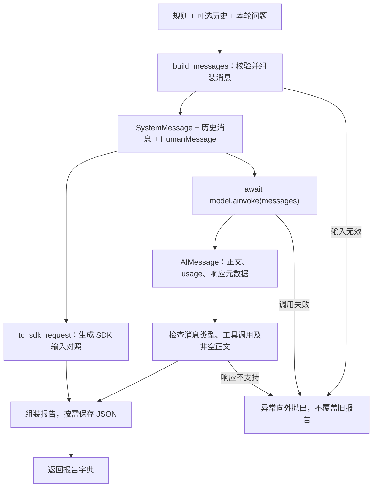
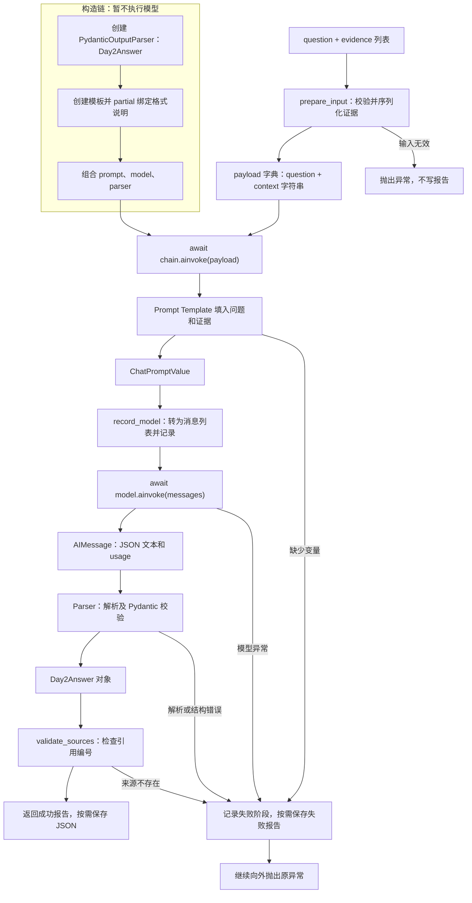
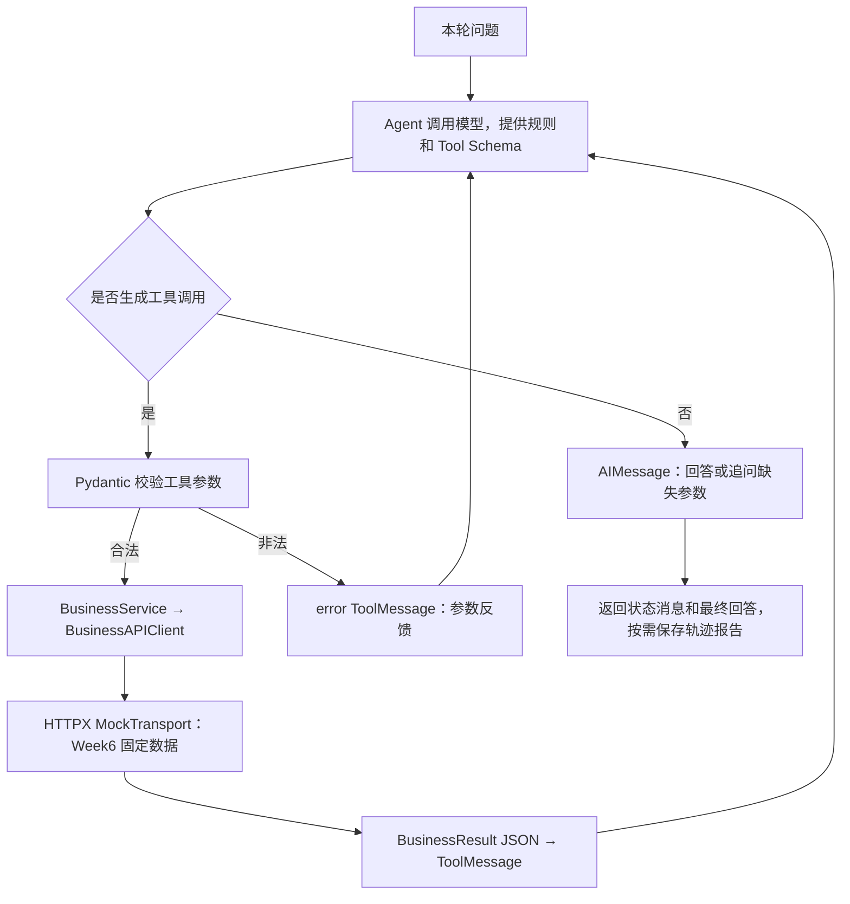

# Week8：LangChain 学习

> 基准计划：`/home/xumaozhou/Music/agent_engineer_learning_plan_v4_mcp.md`。
> 当前进度（2026-11-10）：**Day1～Day3 已完成；下一阶段为 Day4：Document、Loader、Text Splitter 与 Embedding**。
> 本目录为独立练习，测试仍放在仓库 `tests/`。主项目的 Agents SDK 和 Week7 RAG 保持现有实现。

Day2 的完成记录见 [Day2 章节](#day2)；Day3 的完成记录、代码入口和逐项测试见 [Day3 章节](#day3)。

## Day1 完成记录

- 两个关键步骤已实现：展开历史消息，await 模型的 ainvoke 接口。
- 完整离线回归：29 passed、1 skipped；跳过项为显式真实模型测试。
- 用户运行真实测试通过；助手核对实际报告，消息顺序为 system/human/ai/human，回答正确保留任务标识 00123。
- 报告保留了实际 usage、AIMessage 正文及 SDK 输入对照；本次提交前未重复调用真实模型。
- 本地报告为 `artifacts/day1/real_model/report.json`，运行产物和独立虚拟环境均不提交。

## Day1 学什么、验收什么

今天先理解模型调用和消息格式，不开始 RAG 重构。需要掌握的是：

| 学习内容 | 可以展示的验收结果 |
|---|---|
| LangChain 的组成 | 说明 core、模型适配包和高层 Agent 各自负责什么 |
| Message 是输入输出的数据对象 | 能区分 SystemMessage、HumanMessage、AIMessage，解释顺序和正文来源 |
| Model 是模型调用接口 | 通过一次 ainvoke 得到 AIMessage，读取 content 和实际 usage |
| 多轮上下文由调用方组织 | 证明同一个模型实例不会自动携带上次问题，历史需明确传入 |
| 与 Agents SDK 对照 | 说明规则对应 Agent.instructions，对话列表对应 Runner 的 input |
| 模型调用与 Agent Run 的边界 | 明白 ainvoke 返回一条消息，不会替你执行本项目的工具循环和 Session 管理 |

今天不要求手写 HTTP、另写测试框架或接入业务工具。Prompt Template、Runnable 组合和 Parser 是 Day2 内容；Tools/Agent 是 Day3 内容。

### 包和组件如何理解

| 名称 | 本日作用 |
|---|---|
| `langchain-core` | 提供消息对象、聊天模型接口及离线 Fake ChatModel 等基础能力 |
| `langchain-openai` | 提供 ChatOpenAI，把统一模型接口适配到兼容的 Chat Completions API |
| `ChatOpenAI` | 本日通过明确的 base_url 调用已有 DeepSeek，不代表请求被发送给 OpenAI |
| `langchain` 高层包 | 后续 Agent 学习再按需要安装；Day1 无需先安装整个框架 |
| LangGraph | 本日仅知道它与高层 Agent 的关系，状态图专项留给后续计划 |

本日使用 DeepSeek 的文本兼容接口，不承诺 ChatOpenAI 能保留该服务的全部专有功能。

## 代码结构与两个关键步骤回顾

| 文件 | 职责 |
|---|---|
| [day1.py](day1.py) | 消息组装、SDK 对照、一次异步调用与报告保存 |
| [requirements.txt](requirements.txt) | 固定本次验证过的直接依赖版本 |
| [test_week8_day1.py](../tests/test_week8_day1.py) | 已提供的离线测试和显式真实测试 |

### Day1 流程图



`sdk_request` 只进入对照报告，不传给 LangChain 模型，也没有执行 Agents SDK Runner。
实际模型输入始终为 `messages`，模型原始返回为 `AIMessage`。

| 练习标识 | 输入 | 已完成的输出 |
|---|---|---|
| `W8D1-1` | instructions、history_messages、question | 一个 messages 列表：规则在最前，本轮问题在最后 |
| `W8D1-2` | model 和 messages | await 一次异步模型接口，得到 response: AIMessage |

两处均已实现：使用 `*history_messages` 展开历史消息，使用 `await model.ainvoke(messages)` 调用模型。
每个函数的 docstring 已说明参数、输出、异常和支持范围，关键代码旁保留原理注释。

### 输入与输出的具体含义

```python
instructions = "根据用户提供的信息简洁回答。"
history = [
    {"role": "user", "content": "任务标识为字符串 00123。"},
    {"role": "assistant", "content": "已知任务标识为字符串 00123。"},
]
question = "刚才的任务标识是什么？请保留前导零。"
```

对应的 LangChain 消息类型顺序是 `system → human → ai → human`。
Message 的 `.type` 使用 human/ai；转换到 HTTP 或 SDK 输入时，对应 role=user/assistant。
不能把 `.type` 字符串直接当成所有接口的 role 值。

本日只支持非空纯文本消息。工具结果、多模态内容块、SDK 的完整 Session 条目不属于这个转换器的输入范围。
history 是调用方显式提供的记录；模型实例不会自动把之前的调用放进下一次输入。

报告包括：

| 字段 | 含义 |
|---|---|
| `messages` | 本次实际传入模型的 type/content，便于查看角色及顺序 |
| `sdk_request.instructions` | 对应 SDK 的 Agent instructions；本日只展示，不执行 SDK |
| `sdk_request.input` | 对应 Runner.run 的纯文本对话 input |
| `response` | AIMessage 的 type 和原始纯文本 content |
| `usage` | AIMessage.usage_metadata，缺失时保持 null，不猜测 Token 数量 |
| `response_metadata` | 只导出返回中存在的 model_name、finish_reason |
| `elapsed_seconds` | 本次模型接口调用及返回检查的耗时 |

### 和当前 Agents SDK 的区别

| 对比点 | 本日 LangChain 调用 | 当前项目 Agents SDK |
|---|---|---|
| 规则 | 列表中的 SystemMessage | Agent(instructions=...) |
| 用户输入与历史 | HumanMessage / AIMessage 列表 | Runner.run(agent, input=...) 的文本或消息列表 |
| 单次返回 | AIMessage，读取 content | RunResult，读取 final_output 等运行结果 |
| 工具执行 | 本日不执行，收到工具调用会明确报错 | Runner 结合工具定义管理 Agent Loop |
| 历史保存 | 本日由调用方明确传 history | 当前项目使用 Session，并在 Runner 中传入 |

这里是同一段文本的接口对照，不是把完整 SDK 运行结果、工具调用或 Session 无损转换为 LangChain。
现有 SDK 调用入口可参看 [agentLite.py](../agentLite.py) 的 `simpleCallLLM`。

## 环境与数据来源

### 独立 Python 环境

本次已创建并安装：`langchain_learning/.venv`，使用 Python 3.10。
主项目 `.venv` 未安装或升级 LangChain。以后重建独立环境时执行：

```bash
.venv/bin/python -m venv langchain_learning/.venv
langchain_learning/.venv/bin/python -m pip install -r langchain_learning/requirements.txt
```

已固定 `langchain-core==1.7.6`、`langchain-openai==1.7.4` 以及本次 pytest 版本。
其余为解析得到的传递依赖；requirements.txt 不是包含所有平台依赖的完整锁文件。
IDE 中运行本日测试时，应选择 `langchain_learning/.venv/bin/python`。
若误用未安装 LangChain 的主环境，本组测试会整体跳过，并提示正确环境。

### 测试数据来源

所有消息、假响应和错误状态都定义在 `tests/test_week8_day1.py`，无需另找数据集：

- **消息样例**：中文任务标识 `00123`，用于观察前导零及原文保留。
- **Fake ChatModel**：LangChain 自带 FakeMessagesListChatModel，返回测试指定的 AIMessage。
- **HTTP Mock**：httpx.MockTransport 返回合成 Chat Completions 响应、usage 和 401/429/500；不访问 DeepSeek。
- **真实测试**：使用同样的消息历史和问题，沿用项目现有 DeepSeek Key；不使用 Week7 知识库。

离线测试的固定回答和 usage 都是合成值，只验证消息及接口处理，不代表真实模型表现或真实成本。
代码关闭本次调用的 LangSmith 远程追踪；HTTP 客户端由已提供的代码管理，异常不自动重试。

## 运行命令与产物

均在仓库根目录执行。

### 1. 只运行已提供代码的自检

```bash
RUN_WEEK8_DAY1=0 RUN_WEEK8_DAY1_LLM=0 \
langchain_learning/.venv/bin/python -B -m pytest tests/test_week8_day1.py \
-q -s -p no:cacheprovider
```

本次框架自检已通过：18 passed、12 skipped。
只执行已提供的参数、SDK 对照、Mock HTTP 及 CLI 保护测试；设置 RUN_WEEK8_DAY1=1 可启用完整流程。

### 2. 完整离线验收

```bash
RUN_WEEK8_DAY1=1 RUN_WEEK8_DAY1_LLM=0 \
langchain_learning/.venv/bin/python -B -m pytest tests/test_week8_day1.py \
-q -s -p no:cacheprovider
```

两处关键步骤已完成，当前仓库实现的完整离线验收结果为 29 passed、1 skipped。
唯一跳过项为真实模型测试。沙箱内的异步线程唤醒受限时需在正常本地终端运行，本日没有为了绕过环境问题改写 LangChain。

### 3. 显式真实调用

完成离线验收后，确保当前终端已配置既有 DeepSeek `OPENAI_API_KEY`：

```bash
RUN_WEEK8_DAY1=1 RUN_WEEK8_DAY1_LLM=1 \
langchain_learning/.venv/bin/python -B -m pytest \
tests/test_week8_day1.py::test_real_model_messages_and_leading_zero \
-v -s -p no:cacheprovider
```

用户已运行真实测试并确认通过，助手已核对本地报告中的实际输入与返回内容。下方命令用于显式重跑。
真实测试会调用一次 DeepSeek，不下载本地模型。通过后仍需阅读 report.json，解释消息顺序、返回类型及 SDK 对照。

也可使用已提供的 CLI，手动观察一次不带历史的调用：

```bash
langchain_learning/.venv/bin/python -B -m langchain_learning.day1 --real-llm \
  --question '字符串任务标识 00123 为什么不应该转成整数？'
```

CLI 的规则使用 DEFAULT_INSTRUCTIONS；history 的传入由真实 pytest 展示。

### 输出位置

| 文件 | 来源 |
|---|---|
| `langchain_learning/artifacts/day1/offline/report.json` | 完整离线测试，假回答及假 usage |
| `langchain_learning/artifacts/day1/real_model/report.json` | 显式真实 pytest 或 CLI 的实际返回 |

pytest 可使用 `WEEK8_DAY1_OUTPUT` 修改产物根目录，CLI 使用 `--output`。
同名报告只在成功后覆盖；失败时旧文件可能仍在，不能据此认定本次成功。产物及独立环境均已 Git 忽略。

## 测试一：SDK 消息对照保留角色和原文

函数：`test_provided_sdk_comparison_preserves_roles_and_text`，默认执行。

- **数据来源**：测试内的规则、任务标识历史和本轮问题。
- **流程**：直接构造 LangChain 消息 → to_sdk_request → 修改返回字典。
- **检查点**：规则独立为 instructions，其他消息按 user/assistant 映射；正文及顺序不变；副本修改不影响原消息。
- **输出**：pytest 断言结果，不生成文件。

## 测试二：不支持的消息不能冒充已转换

函数：`test_provided_sdk_comparison_rejects_unsupported_messages`，默认执行，五组输入。

- **数据来源**：空列表、缺少规则、重复规则、工具消息和内容块。
- **流程**：尝试 SDK 输入对照转换。
- **检查点**：明确抛 ValueError，不把本日未支持的格式悄悄转成文本。
- **输出**：pytest 断言结果。

## 测试三：输入错误在消息组装前报错

函数：`test_provided_input_validation_runs_before_todo`，默认执行，六组输入。

- **数据来源**：空白规则、空问题、错误历史类型、非法 role、空正文和额外字段。
- **流程**：调用 build_messages 的已提供校验部分。
- **检查点**：先抛 ValueError，不依赖后续消息组装和模型调用。
- **输出**：pytest 断言结果，不请求模型。

## 测试四：真实模型配置需要既有凭据

函数：`test_provided_model_requires_existing_key`，默认执行。

- **数据来源**：删除本测试进程的 Key 环境变量，另注入假 Key 配合空模型名。
- **流程**：调用 build_model 的配置检查，不调用模型。
- **检查点**：缺 Key 明确提示；模型名必须非空，不读取 IDE 或磁盘中的其他凭据。
- **输出**：pytest 断言结果。

## 测试五：适配器确实发送正确 HTTP 消息

函数：`test_provided_chat_adapter_sends_roles_to_mock_api`，默认执行。

- **数据来源**：固定 HTTP 成功响应和假 usage，完全使用 MockTransport。
- **流程**：ChatOpenAI.ainvoke → Mock HTTP → AIMessage。
- **检查点**：请求为 DeepSeek 的 chat/completions 路径；消息角色为 system/user；正文保持；返回 content 和 usage 正确。
- **输出**：内存中的请求记录及 pytest 断言结果；不输出凭据。

## 测试六：HTTP 失败不自动重复请求

函数：`test_provided_http_failure_is_not_retried`，默认执行，三种状态。

- **数据来源**：HTTP Mock 的 401、429、500。
- **流程**：调用模型适配器并捕获 APIStatusError。
- **检查点**：保留实际状态码，每种情况只发送一次请求；不伪造文本回答。
- **输出**：pytest 断言结果。

## 测试七：CLI 显式真实开关

函数：`test_provided_cli_requires_explicit_real_flag`，默认执行。

- **数据来源**：提供问题但省略 --real-llm 的子进程命令。
- **流程**：执行独立模块 CLI。
- **检查点**：明确拒绝，不初始化真实模型请求。
- **输出**：子进程提示和 pytest 结果。

## 测试八：Message 类型、顺序与原文

函数：`test_message_order_types_and_original_text`，设置 RUN_WEEK8_DAY1=1 启用，三组历史输入。

- **数据来源**：None、空历史、两条文本历史，以及带空格和换行的规则/问题。
- **流程**：build_messages → 核对消息类和内容。
- **检查点**：规则在前，本轮问题在后；历史 human/ai 顺序准确；不 strip 原文，不修改输入列表。
- **输出**：pytest 断言结果。

## 测试九：一次异步调用和可读报告

函数：`test_one_async_call_records_aimessage_usage_and_sdk_comparison`，设置 RUN_WEEK8_DAY1=1 启用。

- **数据来源**：LangChain Fake ChatModel 返回固定 AIMessage、usage 和响应元数据。
- **流程**：build_messages → ainvoke 一次 → AIMessage → SDK 对照和 JSON 报告。
- **检查点**：实际消息一致，返回类型为 ai，usage 原值保留，只导出规定的元数据字段；不把响应当 SDK RunResult。
- **输出**：`artifacts/day1/offline/report.json`。

## 测试十：模型实例不会自动携带历史

函数：`test_model_instance_does_not_implicitly_keep_history`，设置 RUN_WEEK8_DAY1=1 启用。

- **数据来源**：同一个 Fake ChatModel 的两次调用；第二次没有传 history。
- **流程**：分别运行两个问题，检查第二次的实际输入。
- **检查点**：第二次只有规则和当前问题，不包含第一轮的任务标识；缺失 usage 保持 null。
- **输出**：pytest 断言结果。替身的固定回答不用于证明模型记忆能力，重点是检查实际输入。

## 测试十一：模型异常传播与旧报告保留

函数：`test_model_failure_propagates_and_preserves_old_report`，设置 RUN_WEEK8_DAY1=1 启用，两类异常。

- **数据来源**：RuntimeError、httpx.ReadTimeout 和临时旧报告。
- **流程**：执行 run_query，模型调用时抛错。
- **检查点**：异常原样传播，调用一次，旧文件不被写成假成功。
- **输出**：pytest 临时目录中的 `report.json` 保持原内容。

## 测试十二：错误类型、空响应和工具调用的边界

函数：`test_invalid_or_tool_response_is_not_a_completed_text_answer`，设置 RUN_WEEK8_DAY1=1 启用，四组响应。

- **数据来源**：HumanMessage、空白 AIMessage、内容块 AIMessage、含工具调用的 AIMessage。
- **流程**：替身返回上述消息，run_query 检查。
- **检查点**：本日只接受非空纯文本 AIMessage，不冒充已执行工具或已支持多模态。
- **输出**：pytest 断言结果。

## 测试十三：真实消息与前导零

函数：`test_real_model_messages_and_leading_zero`，需显式开启真实开关。

- **数据来源**：同样的中文历史及问题，既有 DeepSeek 配置。
- **流程**：一次真实 ainvoke → 保存消息、AIMessage 与 SDK 输入对照。
- **检查点**：历史确实发送，回答保留 00123，输出类型为 ai；usage 有则保留，无则不猜。
- **输出**：`artifacts/day1/real_model/report.json`，需阅读实际内容完成概念验收。

## 官方资料

- [LangChain Models](https://docs.langchain.com/oss/python/langchain/models)：模型调用接口与参数。
- [LangChain Messages](https://docs.langchain.com/oss/python/langchain/messages)：消息类型、content 与 usage_metadata。
- [LangChain Unit Testing](https://docs.langchain.com/oss/python/langchain/test/unit-testing)：Fake ChatModel 等离线测试方法。

今天验收时，能拿一份 report.json 解释 Model、Message、SDK Run 各做什么即可；不要求提前做 Runnable 链、工具循环或知识检索。

<a id="day2"></a>

## Day2：Prompt Template、Runnable 与 Parser

实现：[day2.py](day2.py)。测试：[test_week8_day2.py](../tests/test_week8_day2.py)。
沿用 Day1 独立环境和 build_model，不新增依赖、不下载模型。三个关键步骤及本日验收均已完成。

### Day2 完成记录

- 已实现消息模板、partial 格式说明绑定、Runnable 管道组合和异步执行。
- 当前代码的完整离线验收：33 passed、2 skipped；两条跳过项为显式真实模型用例。
- 用户运行两条真实模型测试并确认通过；助手已核对实际输入、原始回答和解析结果。
- NOT_FOUND 问题返回 answered，引用 S1，回答正确区分“查询未找到”与“任务执行失败”。
- 任务 12345 当前状态的问题返回 insufficient，来源为空，明确说明缺少实时状态证据。
- 两条真实调用均为 execution_status=succeeded、model_calls=1、error=null；回答内容与本次证据范围一致。
- 真实报告见 `artifacts/day2/real_model/answered_report.json` 和 `insufficient_report.json`。本次收尾未重复请求真实模型；产物和虚拟环境不提交。

### 学习内容与具体验收

| 学习内容 | 验收时要能展示或解释的结果 |
|---|---|
| Prompt Template | 同一个模板填入不同问题与证据，正确生成 system/human 消息 |
| partial 绑定 | 输出格式说明预先绑定，运行时只需要 question/context 两个变量 |
| Runnable 与管道组合 | 能说明每一步接收什么、返回什么，构造链时不立即调用模型 |
| PydanticOutputParser | 模型返回 JSON 文本后，得到 Day2Answer 对象，而不是直接把字符串当结构化结果 |
| 错误传播 | 缺少变量、模型异常、输出无法解析或字段不合规时，异常向外传播，不伪造成功、不自动重试 |
| 解析的边界 | 能区分结构有效、来源存在以及事实被证据支持这三个层次 |

本日只练习固定证据的调用链，没有 Retriever、Agent Loop 或工具执行。
证据已经由测试或调用方提供；检索仍按后续 Day4/Day5 学习任务安排。

### 数据如何经过整条链

图示为当前 `run_chain` 的实际处理流程。构造链只连接组件，不调用模型。



模型响应通过观察器记录到 `raw_response`，再交给 Parser；即使解析失败，仍能查看模型原文。
`validate_sources` 是 Parser 之后的独立检查；两者都不能代替事实支持性的语义复核。

这里的管道写法是 `prompt | model | parser`。`|` 组成 RunnableSequence：上一步的结果直接成为下一步输入。
Runnable 是统一的执行接口，不表示会自动创建 Agent、保存会话或执行工具。
构造链之后，可以同步 `chain.invoke(payload)`，也可以异步 `await chain.ainvoke(payload)`。

**为什么 Day1 给 ainvoke 传消息，Day2 却可以给 ainvoke 传字典？**

Day1 调用的是模型，模型需要消息；Day2 调用的是整条链，第一步 Prompt Template 需要变量字典。
模板先把字典转换为 ChatPromptValue，模型收到的是转换后的提示内容。
链的入口和返回值取决于首尾组件，不能只根据方法名 ainvoke 判断数据类型。

### 已完成的三个关键步骤

| 练习标识 | 函数 | 输入 | 已完成的输出 |
|---|---|---|---|
| `W8D2-1` | build_prompt | 两段模板常量、parser | ChatPromptTemplate：创建 system/human 模板，partial 绑定 format_instructions |
| `W8D2-2` | build_chain | prompt、model、parser | prompt → model → parser 的 Runnable 链 |
| `W8D2-3` | run_chain | chain、payload | await 链后得到 answer: Day2Answer |

三处均已实现并通过离线测试；输入校验、报告保存、模型适配器和测试替身沿用练习框架。
每个函数的 docstring 已写清输入、输出与异常；模型观察器也已提供，只记录消息和响应再转发，不增加模型调用。

### 输入和结构化输出

输入 evidence 是一个列表，例如：

```json
[
  {
    "source_id": "S1",
    "text": "NOT_FOUND 表示本次查询没有找到指定任务，不等于任务执行失败。"
  }
]
```

prepare_input 负责把证据列表转换为 context JSON 文本。证据中的花括号只是正文，不会作为模板变量再次求值。
parser.get_format_instructions() 生成输出格式说明，partial 将它预先绑定到模板中。

解析后的两种合法结果示例：

```json
{
  "status": "answered",
  "answer": "NOT_FOUND 表示查询未找到，不代表任务执行失败。",
  "source_ids": ["S1"]
}
```

```json
{
  "status": "insufficient",
  "answer": "缺少任务 12345 当前的实时状态数据，需要实时查询。",
  "source_ids": []
}
```

这些字段和校验已提供：回答不能空白，来源不能重复，answered 必须有来源，insufficient 必须没有来源，拒绝额外字段。
Parser 只负责提取、解析和结构校验；不存在的 S99 可以先通过结构校验，再由 validate_sources 拒绝。
即使 source_id 存在，也必须人工看回答是否曲解证据，不能把结构校验当成语义正确率。

本日没有使用提供商原生 Schema 约束，也没有配置修复模型或重试 Parser。
PydanticOutputParser 自身能处理 JSON 围栏等文本格式；“解析成功”不证明模型原始输出每个字节都符合纯 JSON。

### 数据来源、执行边界与产物

- 测试数据全部定义在 `tests/test_week8_day2.py`。NOT_FOUND 事实取自 Week7 合成 FAQ 的含义，作为小段固定证据直接传入，不读取或重建 Week7 索引。
- 离线响应来自 LangChain 自带 Fake ChatModel；无效 JSON、错误字段、假来源及异常由测试注入。
- 离线 usage 为固定合成数值，只验证字段传递，不表示真实模型成本。
- 真实测试使用相同问题和证据，沿用 Day1 DeepSeek 配置；不读取评估参考答案来组装模型回答。
- 本日研究纯链的数据流，空证据也会调用一次模型来说明不足。正式 RAG 的“无候选跳过模型”策略保留在 Week7 实现中。

| 报告字段 | 含义 |
|---|---|
| execution_status | succeeded 或 failed，表示链是否执行成功 |
| input | 实际传给链的 question/context 字典 |
| messages | 实际传给模型的消息，不是仅供展示的模板草稿 |
| raw_response | Parser 前的原始模型正文；解析失败时保留，便于定位 |
| answer | 解析及来源检查后的字典；执行失败时为 null |
| usage / model_calls | 实际响应 usage 或 null，以及本次观察到的模型调用次数 |
| error | 失败阶段 prompt/model/parser/source_validation 及异常类型；不保存任意异常正文 |
| elapsed_seconds | 本次链执行耗时 |

`execution_status=succeeded` 与 `answer.status=insufficient` 可以同时出现：合理说明不足是正常结果。
异常仍然抛给调用方；报告中的阶段字段只辅助定位，不会吞掉错误。

| 文件 | 产生方式 |
|---|---|
| artifacts/day2/offline/answered_report.json | 完整离线测试的固定输出，假响应与假 usage |
| artifacts/day2/real_model/answered_report.json | 真实测试：解释 NOT_FOUND |
| artifacts/day2/real_model/insufficient_report.json | 真实测试：缺少任务实时状态证据 |
| artifacts/day2/real_model/cli_report.json | 已提供 CLI 的默认输出 |
| failure_report.json / parser_failure.json / source_failure.json | pytest 临时目录中的注入错误记录 |

以上固定目录均位于 langchain_learning/ 下，沿用 artifacts 忽略规则。
pytest 可用 WEEK8_DAY2_OUTPUT 修改产物根目录，CLI 用 --output。
和 Day1 不同，run_chain 在执行失败时也会保存本次失败记录并覆盖旧报告；输入校验失败发生在执行前，不写报告。

### 运行命令

**已提供部分的独立自检：**

```bash
RUN_WEEK8_DAY2=0 RUN_WEEK8_DAY2_LLM=0 \
langchain_learning/.venv/bin/python -B -m pytest tests/test_week8_day2.py \
-q -s -p no:cacheprovider
```

框架准备阶段已运行：22 passed、13 skipped。此命令只验证已提供的 Schema、输入、Parser 及 CLI，不执行完整链。

**当前代码的完整离线验收：**

```bash
RUN_WEEK8_DAY2=1 RUN_WEEK8_DAY2_LLM=0 \
langchain_learning/.venv/bin/python -B -m pytest tests/test_week8_day2.py \
-q -s -p no:cacheprovider
```

当前仓库实现已通过完整离线验证：33 passed、2 skipped，跳过两条真实模型用例。
普通离线测试不访问 DeepSeek，不下载模型，也不需要 Key。

**真实两组验证（离线通过后显式启用）：**

确保终端已有项目的 DeepSeek OPENAI_API_KEY，再执行：

```bash
RUN_WEEK8_DAY2=1 RUN_WEEK8_DAY2_LLM=1 \
langchain_learning/.venv/bin/python -B -m pytest \
tests/test_week8_day2.py::test_real_prompt_model_parser \
-v -s -p no:cacheprovider
```

该命令分别运行“有依据回答”和“信息不足”两条问题，每条调用模型一次。用户已运行并确认通过，助手已对照实际报告复核回答内容。
自动测试检查运行、格式、来源编号及预期状态；本日两条回答的事实支持性另外通过阅读证据与回答进行核对。

也可执行一个固定证据的 CLI 演示：

```bash
langchain_learning/.venv/bin/python -B -m langchain_learning.day2 --real-llm \
  --question 'NOT_FOUND 是不是表示任务执行失败？'
```

### 测试一（Day2）：输出 Schema 的一致性

函数：`test_provided_answer_schema_rejects_invalid_data`，默认执行，八组错误数据。

- **数据来源**：未知 status、空白回答、来源为空/重复/错误类型、insufficient 带来源及额外字段。
- **流程**：直接调用 Day2Answer.model_validate。
- **检查点**：字段类型及状态关系受校验，不能只保证 JSON 可解析。
- **输出**：pytest 结果，无文件。

### 测试二（Day2）：输入参数校验

函数：`test_provided_input_validation`，默认执行，七组错误数据。

- **数据来源**：空问题、错误证据类型、缺字段、空白正文或编号、重复编号。
- **流程**：调用 prepare_input。
- **检查点**：执行模型前拒绝输入错误。
- **输出**：pytest 结果，无文件。

### 测试三（Day2）：原文和花括号作为数据保留

函数：`test_provided_input_preserves_literal_braces_and_original_data`，默认执行。

- **数据来源**：带换行和空格的问题，以及含 {question} 和 JSON 花括号的证据正文。
- **流程**：序列化证据，再对照原对象。
- **检查点**：原文不被修改，输入列表不变；允许空证据列表。
- **输出**：pytest 结果，无文件。

### 测试四（Day2）：Parser 的输入输出类型

函数：`test_provided_parser_returns_pydantic_object`，默认执行，两种格式。

- **数据来源**：固定 JSON 回答，以及包在 json 代码围栏内的相同回答。
- **流程**：AIMessage → parser.invoke → Day2Answer。
- **检查点**：得到 Pydantic 对象，并理解 Parser 可处理围栏，不能用它证明原始输出一定是纯 JSON。
- **输出**：pytest 结果，无文件。

### 测试五（Day2）：无法解析或结构无效

函数：`test_provided_parser_reports_unparseable_or_invalid_output`，默认执行。

- **数据来源**：not JSON 文本，以及 answered 却缺少来源的 JSON。
- **流程**：直接调用 Parser。
- **检查点**：统一向外抛 OutputParserException，不返回半份合法结果。
- **输出**：pytest 结果，无文件。

### 测试六（Day2）：结构有效不代表来源存在

函数：`test_provided_parser_validity_does_not_prove_source_exists`，默认执行。

- **数据来源**：符合 Schema 但引用 S99 的回答，本次只有 S1。
- **流程**：先通过 Pydantic，再检查来源编号。
- **检查点**：来源存在性是额外校验，不能仅靠字段类型保证。
- **输出**：pytest 结果，无文件。

### 测试七（Day2）：CLI 真实开关

函数：`test_provided_cli_requires_explicit_real_flag`，默认执行。

- **数据来源**：子进程命令，提供问题但省略 --real-llm。
- **流程**：执行模块入口。
- **检查点**：明确拒绝，不触发真实模型调用。
- **输出**：子进程提示及 pytest 结果。

### 测试八（Day2）：模板变量、规则与消息类型

函数：`test_prompt_binds_schema_and_only_exposes_runtime_variables`，设置 RUN_WEEK8_DAY2=1 时启用。

- **数据来源**：Parser 格式说明和含字面花括号的证据。
- **流程**：创建模板 → invoke 输入字典 → to_messages。
- **检查点**：运行时变量只有 question/context；Schema 在 system，问题和证据在 human；正文不会被二次当模板解析。
- **输出**：pytest 结果，无文件。

### 测试九（Day2）：管道逐步传递数据

函数：`test_runnable_pipeline_transfers_prompt_to_model_and_parsed_object`，设置 RUN_WEEK8_DAY2=1 时启用。

- **数据来源**：RunnableLambda 模型替身，固定 AIMessage JSON。
- **流程**：同步执行 prompt → model → parser。
- **检查点**：模型实际收到 ChatPromptValue，最终得到 Day2Answer 对象。
- **输出**：pytest 结果，无文件。

### 测试十（Day2）：缺少变量阻断后续步骤

函数：`test_missing_prompt_variable_stops_before_model`，设置 RUN_WEEK8_DAY2=1 时启用。

- **数据来源**：只提供 question，没有 context。
- **流程**：调用 chain.invoke。
- **检查点**：模板阶段抛 KeyError，模型替身未被调用。
- **输出**：pytest 结果，无文件。

### 测试十一（Day2）：完整异步链与实际轨迹

函数：`test_async_chain_records_actual_messages_raw_and_parsed_answer`，设置 RUN_WEEK8_DAY2=1 时启用。

- **数据来源**：固定证据与 LangChain Fake ChatModel，usage 为合成数据。
- **流程**：run_chain → 消息记录 → 模型原文 → Parser → 来源校验 → 保存。
- **检查点**：只调用一次模型，实际消息准确，原始输出和解析结果都保留，输入不变。
- **输出**：artifacts/day2/offline/answered_report.json。

### 测试十二（Day2）：信息不足是正常结果

函数：`test_insufficient_is_successful_execution_not_exception`，设置 RUN_WEEK8_DAY2=1 时启用，两组证据。

- **数据来源**：无关的静态证据或空证据，以及固定 insufficient 响应。
- **流程**：仍运行本日纯链，由模型替身说明缺失实时信息。
- **检查点**：execution_status=succeeded，answer.status=insufficient，不把拒答当运行失败。
- **输出**：pytest 临时目录的 insufficient_report.json。

### 测试十三（Day2）：模型失败的阶段与传播

函数：`test_model_failure_preserves_stage_without_parsing_or_retry`，设置 RUN_WEEK8_DAY2=1 时启用，两类异常。

- **数据来源**：运行异常、HTTP 超时，异常正文包含不应写入报告的示例内容。
- **流程**：模型步骤抛错，保存失败报告后继续向外抛出。
- **检查点**：stage=model，没有原始响应和答案，只调用一次，不泄露任意异常正文。
- **输出**：pytest 临时目录的 failure_report.json。

### 测试十四（Day2）：解析失败保留原文

函数：`test_parser_failure_keeps_raw_response_and_propagates`，设置 RUN_WEEK8_DAY2=1 时启用，两类输出。

- **数据来源**：not JSON 或未知 status 的模型原文。
- **流程**：模型已成功返回，Parser 抛出异常。
- **检查点**：stage=parser，保留 raw_response，answer=null，不自动调用修复模型。
- **输出**：pytest 临时目录的 parser_failure.json。

### 测试十五（Day2）：Parser 之后检查来源

函数：`test_unknown_source_is_detected_after_successful_parsing`，设置 RUN_WEEK8_DAY2=1 时启用。

- **数据来源**：格式正确但引用 S99 的模型输出。
- **流程**：Parser 成功 → validate_sources 失败。
- **检查点**：stage=source_validation，原文保留，没有成功答案。
- **输出**：pytest 临时目录的 source_failure.json。

### 测试十六（Day2）：两种真实结构化回答

函数：`test_real_prompt_model_parser`，需额外开启真实开关，参数化运行两条。

- **数据来源**：相同固定证据，分别询问 NOT_FOUND 含义和任务当前状态，使用既有 DeepSeek。
- **流程**：变量字典 → 模板 → 一次模型调用 → Parser → 来源校验。
- **检查点**：第一条 answered 且引用 S1；第二条 insufficient 且不编造来源；两条均正常完成。
- **输出**：real_model/answered_report.json、real_model/insufficient_report.json；需人工阅读实际回答。

### Day2 官方资料与最后验收说明

- [LangChain Structured Output](https://docs.langchain.com/oss/python/langchain/structured-output)：结构化输出及链上的解析错误传播。
- [LangChain Core 参考](https://reference.langchain.com/python/langchain-core/)：ChatPromptTemplate、Runnable 与 Parser 的接口。

完成后，能拿一份报告讲清：为什么链接收字典、模型收到什么、Parser 输出什么、失败停在哪一步，以及结构正确为何不等于事实正确。

<a id="day3"></a>

## Day3：LangChain Tools、Pydantic 与 Agent（已完成）

实现：[day3.py](day3.py)。测试：[test_week8_day3.py](../tests/test_week8_day3.py)。
三个关键步骤及本日验收均已完成。使用同一 Week6 Mock 业务层理解工具参数与 Agent 循环。

### Day3 完成记录

- 任务 ID 的 ASCII 数字约束、两个带 args_schema 的 Tool 及 create_agent 组装均已实现。
- system_prompt 已显式传入 DAY3_INSTRUCTIONS，模型实际输入和报告中的规则一致。
- 当前代码完整离线验收：36 passed、4 skipped；跳过项均为显式真实模型用例。
- 用户运行四项真实模型测试并确认通过；助手已逐份核对工具参数、业务结果和最终回答。
- task：原样传入字符串 12345，回答 RUNNING，并区分查询 status 与任务 data.state。
- engine：精确查询 import_std、limit=3，返回原序前三条；回答明确总数为 12、本次仅为部分记录。
- missing：缺少 ID/编码时追问，没有生成工具调用或请求业务 API。
- not_found：原样查询 99999，正确解释 NOT_FOUND，不据此猜测任务执行状态。
- 四项 execution_status 均为 succeeded；三项查询各调用一次工具，缺参场景零工具调用。查询场景各有两条模型响应，缺参场景一条。
- 报告位于 `artifacts/day3/real_model/`。本次收尾没有重复调用真实模型；产物和虚拟环境不提交。

| 学习内容 | 练习及验收目标 |
|---|---|
| Tool 与 Schema | 沿用 Week6 的 Mock 业务查询，理解工具名称、说明和参数 Schema 如何提供给模型 |
| Pydantic 参数校验 | 定义明确的参数类型与限制，验证合法参数可执行，非法参数不能进入业务请求 |
| 简单 Agent | 观察问题 → 模型生成工具调用 → 程序执行 → ToolMessage → 模型回答的完整过程 |
| 与 Agents SDK 对照 | 说明 LangChain 工具封装与 SDK `@function_tool` 的共同职责，以及 Agent 与单次模型调用的区别 |

继续使用独立学习目录，业务响应采用 Mock；真实 LLM 用例仍通过独立开关显式启用。
验收重点是工具选择、参数校验、执行轨迹与回答依据。本日不接入 RAG，也不迁移主项目编排。

### Day3 环境与复用关系

`requirements.txt` 已补充 `langchain==1.4.9`，用于 `create_agent`；保留既有 core/openai 版本。
另固定 `mcp==2.1.1`，原因是复用的 `week6.py` 在模块顶部导入 MCP 类型；本日不启动 MCP Server 或子进程。
本轮已安装到 Week8 独立环境，主项目 `.venv` 不变。以后重建环境仍执行：

```bash
langchain_learning/.venv/bin/python -m pip install -r langchain_learning/requirements.txt
```

| 代码 | 本日职责 |
|---|---|
| `week6.py` | 复用 TASKS、BusinessService、BusinessAPIClient、Mock HTTP、权限判断和结果限长 |
| `langchain_learning/day1.py` | 复用 DeepSeek 的 ChatOpenAI 适配器，不新增模型配置 |
| `langchain_learning/day3.py` | 参数模型、工具包装、Agent 组装与轨迹报告 |
| `tests/test_week8_day3.py` | 已提供的离线模型脚本、断言、真实测试与开关 |

`langchain.tools.tool`、`langchain.agents.create_agent` 都是第三方接口，已在 day3.py 顶部导入。
高层 Agent 内部使用 LangGraph，本日只使用它完成最小工具循环，不提前学习状态图设计或持久化。

### 已完成的三个步骤：输入、输出与边界

| 标识与位置 | 输入 | 已完成的实现 | 输出或效果 |
|---|---|---|---|
| `W8D3-1`，QueryTaskInput.task_id | strict 配置及字符串字段 | Field.pattern 限制全串为一个或多个 ASCII 数字 | Schema 可展示格式约束；拒绝 abc、空白和全角数字，保留 00123 |
| `W8D3-2`，build_tools | service、两个已有查询函数、两种参数模型 | tool 通过 args_schema 分别包装两个函数 | 返回两个 BaseTool，支持 invoke/ainvoke；校验通过才执行函数 |
| `W8D3-3`，build_agent | model、tools、DAY3_INSTRUCTIONS | create_agent 显式接收 model、tools、system_prompt | 返回可执行 Agent，创建时不请求模型或业务接口 |

三个位置均已实现并通过离线验收。Mock API、HTTP 错误映射、报告和测试模型沿用框架代码，Agent Loop 由 LangChain 编排。

参数约定：

- `task_id`：严格字符串，全串 ASCII 数字；`"00123"` 保持原样，不能转成整数。strict 拒绝整数和 bool，pattern 约束字符串内容。
- `engine_code`：非空、非纯空白的字符串，按字段精确匹配，不 strip 或归一化后再查询。
- `limit`：真正的整数，范围 1～100，默认 100；字符串 `"3"` 和 bool 均拒绝。
- `service/client/token`：由程序提供和管理，不进入模型填写的工具参数。

工具函数已经返回 BusinessResult 的 JSON 字符串，含 status/source/data/error_code/truncated 等。
`args_schema` 约束输入；业务输出的校验和限长复用已有层，不把输入 Schema 当作输出 Schema。
本日 Agent 最终返回自然语言文本，不增加一套最终回答 JSON 规范。

### Day3 工作流



Day2 是固定 `prompt → model → parser`；Day3 的 Agent 会根据模型返回决定是否执行工具，再把结果传回模型。
通常一次查询经历两次模型响应，但这不是固定次数；参数修正会增加轮次，缺参追问可完全不调用业务工具。

必须区分三类结果：

1. **直接工具校验失败**：`tool.invoke` 抛 ValidationError，业务函数与 HTTP 都未执行。
2. **Agent 内的参数校验失败**：当前框架会返回 error ToolMessage，模型可以修改参数再请求；是否修改取决于后续模型响应，不是工具自动重试 HTTP。
3. **业务查询返回 NOT_FOUND/FORBIDDEN**：这是合法的业务 JSON。ToolMessage 本身可能为 success，但其 JSON 中的 status=error；不能把工具执行成功等同于业务查询成功。

模型异常、未处理的程序异常和图步数超限会向外抛出，本日没有添加通用修复中间件。
`recursion_limit` 限制图执行步数，不等同于工具次数；另有整体 timeout_seconds，均由提供的 run_agent 管理。

### 测试数据来源

| 数据 | 来源及含义 |
|---|---|
| 任务 12345 | Week6 TASKS，alice 可读，data.state=RUNNING，engineCode=import_std |
| import_std 前 3 条 | Week6 Mock 中 alice 可见共 12 条，按原顺序返回 12345/20000/20001，status=partial |
| 任务 34567 | 属于 bob，alice 查询得到 FORBIDDEN |
| 任务 99999 / 00123 | Mock 中不存在，返回 NOT_FOUND；00123 同时验证前导零原样传递 |
| engine_not_found | 查询成功但无记录，status=empty |
| 模型离线响应 | tests 文件中的 ScriptedModel，按脚本依次返回 AIMessage 工具调用和最终文本 |
| 模型真实响应 | 沿用 DeepSeek；只替换模型，业务接口仍是同一套 Mock |

没有新增数据目录，所需固定数据已在 week6.py 和本测试中。
ScriptedModel 基于 LangChain GenericFakeChatModel，补充 Agent 需要的 bind_tools；不访问网络。
离线脚本只能证明调度、校验与消息传递，不能证明模型会自行选择正确工具或进行参数修正。

### 命令、报告与检查顺序

以下命令均在仓库根目录执行，使用 `langchain_learning/.venv/bin/python`。

**第一步：基础部分的独立自检。**

```bash
RUN_WEEK8_DAY3=0 RUN_WEEK8_DAY3_LLM=0 \
langchain_learning/.venv/bin/python -B -m pytest tests/test_week8_day3.py \
-q -s -p no:cacheprovider
```

框架准备阶段自检：11 passed、29 skipped。此命令仅检查基础部分，跳过完整流程的 25 项和真实模型 4 项。
新增依赖后的 Day1、Day2 完整离线回归：62 passed、3 skipped；三条真实模型用例均未启用。

**第二步：当前实现的完整离线验收。**

```bash
RUN_WEEK8_DAY3=1 RUN_WEEK8_DAY3_LLM=0 \
langchain_learning/.venv/bin/python -B -m pytest tests/test_week8_day3.py \
-q -s -p no:cacheprovider
```

当前仓库实现已通过完整离线验收：36 passed、4 skipped，四项真实模型用例未启用。

**第三步：离线通过后，显式启用真实模型。**

```bash
RUN_WEEK8_DAY3=1 RUN_WEEK8_DAY3_LLM=1 \
langchain_learning/.venv/bin/python -B -m pytest \
tests/test_week8_day3.py::test_real_agent_selects_tool_and_preserves_arguments \
-v -s -p no:cacheprovider
```

需要既有 DeepSeek OPENAI_API_KEY。参数化运行四个问题；一次 Agent 任务可能调用模型多次。
用户已运行并确认四项通过，助手已对照各份 ToolMessage 复核最终回答；本次收尾未重复执行。
后续重跑仍需显式启用。业务数据保持 Mock，不连接真实业务系统；自动断言不能替代对回答内容的复核。

也可独立运行一次真实模型 + Mock 业务演示：

```bash
langchain_learning/.venv/bin/python -B -m langchain_learning.day3 --real-llm \
  --question '查询任务 12345 的状态，并说明来源。'
```

| 输出文件 | 由哪个测试生成 | 内容 |
|---|---|---|
| artifacts/day3/offline/tool_schemas.json | 测试六 | 工具名称、说明、输入 Schema |
| artifacts/day3/offline/query_report.json | 测试九 | 完整的一次查询轨迹 |
| artifacts/day3/offline/correction_report.json | 测试十 | 非法参数反馈、脚本修正后的调用与结果 |
| artifacts/day3/real_model/task_report.json | 测试十四，task | 真实模型按 ID 查询 |
| artifacts/day3/real_model/engine_report.json | 测试十四，engine | 真实模型按编码查询部分列表 |
| artifacts/day3/real_model/missing_report.json | 测试十四，missing | 缺 ID 时不调用工具的回答 |
| artifacts/day3/real_model/not_found_report.json | 测试十四，not_found | 未找到任务时的工具结果和回答 |
| artifacts/day3/real_model/cli_report.json | CLI | 命令行单次真实演示 |
| failure_report.json / step_limit_report.json | 测试四 / 十三，pytest 临时目录 | 运行异常或步数限制的错误类型 |

固定路径均相对于 langchain_learning/。pytest 可用 WEEK8_DAY3_OUTPUT 改输出根目录；CLI 使用 --output。
产物沿用 artifacts 忽略规则，不提交；模型调用关闭本次 LangSmith 远程追踪。

报告阅读方式：

- `messages` 是 Agent 返回的状态消息，通常为 human → ai(tool_calls) → tool → ai；system_prompt 在模型节点注入，另记为 instructions。
- `tool_calls` 保存名称、参数和原始 id；`tool_results` 的 call_id 与之配对，content 为业务 JSON 或框架校验反馈。
- `final_answer` 是最后一条 AIMessage 文本；有答案不代表答案语义已正确。
- `usage` 在所有返回 AIMessage 都含实际 usage 时才相加，否则保持 null。离线假模型不提供 usage。
- 运行失败时保存本次错误类型并覆盖旧报告；Agent 未返回完整状态时，不伪造中断前轨迹。输入参数无效时不开始执行，也不写报告。

### 测试一（Day3）：已提供的列表参数约束

函数：`test_provided_engine_schema_rejects_invalid_arguments`，默认执行，八组输入。

- **数据来源**：空编码、错误类型、非法条数、bool、字符串条数和额外 token 字段。
- **流程**：直接调用 QueryTasksInput；同时检查默认 limit 和编码原文。
- **检查点**：类型严格、范围有效、拒绝额外参数；保留字符串原值。
- **输出**：pytest 结果，无文件，不执行工具。

### 测试二（Day3）：复用的业务数据与精确查询

函数：`test_provided_business_data_is_same_week6_mock`，默认执行。

- **数据来源**：Week6 的任务 12345 与 import_std 列表。
- **流程**：直接调用 Service → Client → Mock HTTP。
- **检查点**：RUNNING 状态正确；精确编码匹配、列表原序、total=12、只返回 3 条且标记 partial；请求均为 GET。
- **输出**：pytest 结果，无文件，不调用模型。

### 测试三（Day3）：CLI 显式真实开关

函数：`test_provided_cli_requires_explicit_real_flag`，默认执行。

- **数据来源**：只有 question、没有 --real-llm 的子进程命令。
- **流程**：进入 CLI，在创建模型前拒绝。
- **检查点**：明确提示开关，Agent 构造和真实请求都不会执行。
- **输出**：pytest 和 CLI 提示，无报告。

### 测试四（Day3）：执行异常记录

函数：`test_provided_runner_saves_safe_failure_without_fake_usage`，默认执行。

- **数据来源**：已提供的 BrokenAgent，抛 RuntimeError；异常正文包含不应导出的示例内容。
- **流程**：run_agent 执行失败 → 保存报告 → 继续向外抛出。
- **检查点**：只记录异常类型，不包含任意异常正文；答案和 usage 均为 null。
- **输出**：pytest 临时目录 failure_report.json。

### 测试五（Day3）：任务 ID 的格式与身份

函数：`test_task_id_schema_preserves_string_identity_and_rejects_invalid_values`，设置 RUN_WEEK8_DAY3=1 时启用，八组非法输入。

- **数据来源**：空白、字母、前后空格、全角数字、整数、bool 和 None，以及合法 00123。
- **流程**：调用 QueryTaskInput，使用 Field.pattern 约束。
- **检查点**：只接收全串 ASCII 数字字符串，保留前导零。
- **输出**：pytest 结果，无文件，不请求 API。

### 测试六（Day3）：工具定义及输入 Schema

函数：`test_tool_schemas_names_descriptions_and_program_side_dependencies`，设置 RUN_WEEK8_DAY3=1 时启用。

- **数据来源**：build_tools 产生的两个 BaseTool。
- **流程**：导出工具名、说明、Schema，不执行工具。
- **检查点**：字段、必填参数、默认值和 pattern 正确，禁止额外字段；客户端、权限和 Token 没有成为模型参数。
- **输出**：offline/tool_schemas.json。

### 测试七（Day3）：直接工具调用的业务结果与配对

函数：`test_direct_tools_keep_business_contract_and_call_id`，设置 RUN_WEEK8_DAY3=1 时启用，六种业务场景。

- **数据来源**：正常任务、前导零 ID、无权限、不存在、空列表和截断列表。
- **流程**：给工具传入带 name/args/id/type 的 ToolCall 字典 → Service → Mock HTTP → ToolMessage。
- **检查点**：call_id 保留；业务状态、错误码和来源保留；原始参数不变；不返回 Token/owner；每次一次 HTTP。
- **输出**：pytest 结果，无文件。

### 测试八（Day3）：直接调用时参数错误先于业务执行

函数：`test_direct_tool_validation_stops_before_service_and_http`，设置 RUN_WEEK8_DAY3=1 时启用，五组错误。

- **数据来源**：缺 ID、字母 ID、整数 ID、额外 token 和 bool limit。
- **流程**：通过 tool.invoke 传参数，并记录是否进入 Service 和 HTTP。
- **检查点**：抛 ValidationError，业务函数与 HTTP 都未执行。
- **输出**：pytest 结果，无文件。

### 测试九（Day3）：Agent 完整工具循环

函数：`test_agent_tool_loop_records_result_before_final_answer`，设置 RUN_WEEK8_DAY3=1 时启用。

- **数据来源**：假模型先请求 query_task(12345)，再返回固定回答；业务查询用真实 Mock 链路。
- **流程**：构造 Agent → 第一条 AIMessage 工具调用 → ToolMessage → 第二条 AIMessage 最终回答。
- **检查点**：构造阶段没有请求；两种工具已绑定；规则注入实际模型输入；第二次模型输入包含工具结果；call_id 配对，一次 HTTP。
- **输出**：offline/query_report.json。

### 测试十（Day3）：Agent 内的参数反馈与修正

函数：`test_agent_validation_feedback_allows_a_scripted_correction`，设置 RUN_WEEK8_DAY3=1 时启用。

- **数据来源**：脚本先传整数 12345，再改为字符串，最后回答。
- **流程**：第一次参数校验失败生成 error ToolMessage；下一次合法调用进入业务层。
- **检查点**：两条 ToolMessage 的状态分别 error/success，保留各自 call_id；模型响应三次，HTTP 只有一次。
- **输出**：offline/correction_report.json。脚本修正不代表真实模型一定能修正。

### 测试十一（Day3）：缺参数时不查询

函数：`test_missing_id_asks_without_calling_business_api`，设置 RUN_WEEK8_DAY3=1 时启用。

- **数据来源**：没有 ID 的问题，假模型返回追问。
- **流程**：Agent 直接结束，不产生工具调用。
- **检查点**：无 ToolCall、ToolMessage 或 HTTP；保留追问文本。
- **输出**：pytest 结果，无文件。

### 测试十二（Day3）：独立任务不自动共享历史

函数：`test_repeated_agent_runs_do_not_automatically_share_history`，设置 RUN_WEEK8_DAY3=1 时启用。

- **数据来源**：同一个 Agent 的两个独立问题、两条固定回答。
- **流程**：先后两次 run_agent，每次只提供本轮 HumanMessage。
- **检查点**：第二次模型输入只有规则和第二个问题，没有第一次内容；没有配置 Checkpointer 或 Session。
- **输出**：pytest 结果，无文件。

### 测试十三（Day3）：限制无法结束的工具循环

函数：`test_graph_step_limit_stops_repeated_tool_calls`，设置 RUN_WEEK8_DAY3=1 时启用。

- **数据来源**：假模型连续返回合法查询调用，不给最终回答。
- **流程**：run_agent 使用 recursion_limit=3，达到图步数限制后抛出 GraphRecursionError。
- **检查点**：没有无限循环；记录实际异常类型，不猜测未返回的 usage。
- **输出**：pytest 临时目录 step_limit_report.json。

### 测试十四（Day3）：真实模型选择工具和传递参数

函数：`test_real_agent_selects_tool_and_preserves_arguments`，需额外开启真实开关，四个问题。

| 场景 | 输入 | 自动检查 |
|---|---|---|
| task | 查询任务 12345 | query_task，字符串 ID 正确，查询 success |
| engine | import_std 前 3 条 | query_tasks_by_engine，编码和 limit 正确，查询 partial |
| missing | 只有查询意图，缺任务 ID | 不产生工具调用或业务 HTTP |
| not_found | 查询 99999 | 原样传递 ID，业务返回 error/NOT_FOUND |

- **数据来源**：模型为既有 DeepSeek，业务为同一 Week6 MockTransport。
- **流程**：问题 → 自主选择工具和参数 → 实际工具执行 → 最终回答 → 保存报告。
- **检查点**：任务正常结束；有参数的场景恰好一次匹配工具调用，缺参场景零调用；校验原始参数与实际业务结果。
- **输出**：real_model/task_report.json、engine_report.json、missing_report.json、not_found_report.json。
- **语义复核**：确认 RUNNING 的来源、列表总数/截断说明、缺参时的追问，以及 NOT_FOUND 没有被解释成任务失败。自动通过不替代这一步。

### 与 Agents SDK 的对照与 Day3 完成标准

| 对照点 | LangChain 本日练习 | 既有 Agents SDK |
|---|---|---|
| 工具封装 | tool + args_schema | @function_tool 根据函数定义生成工具 |
| 参数约束 | 显式 Pydantic 模型 | SDK 生成的工具 Schema、既有参数及业务校验 |
| 隐藏业务依赖 | 闭包捕获 service | 项目既有工具通过 context 获取依赖 |
| 执行编排 | create_agent 返回可执行对象 | Agent 定义 + Runner.run |
| 工具轨迹 | AIMessage.tool_calls 和 ToolMessage.tool_call_id | Function Call、Function Call Output 及 call_id |

这张表是接口职责对照，不是两套 SDK 的无损转换器，也没有在本日重新运行 Agents SDK。
本日已通过离线用例与显式真实用例。复盘时能拿轨迹解释参数由谁生成、由谁校验、业务结果如何回到模型，以及工具执行状态和业务查询状态的区别。

官方资料：[Tools](https://docs.langchain.com/oss/python/langchain/tools)、[Agents](https://docs.langchain.com/oss/python/langchain/agents)、[工具循环的离线测试](https://docs.langchain.com/oss/python/langchain/test/unit-testing)。
