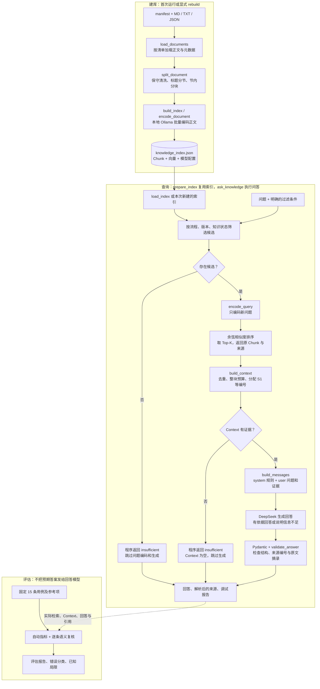

# Week7：RAG 原理与最小 Python 实现

> 学习状态（2026-11-06 用户确认）：**Day1～Day7 全部完成**。
> 基准计划：`/home/xumaozhou/Music/agent_engineer_learning_plan_v4_mcp.md`。
> 本文件汇总原每日 README，统一保存学习内容、代码入口、运行命令、逐项测试说明和验收边界。

## 阅读导航

| 章节 | 主要内容 |
|---|---|
| [系统工作流与原理](#workflow) | 建库、查询、证据引用、评估的整体关系及 Mermaid 架构图 |
| [本周完成记录](#completion) | 已验证的结果与局限 |
| [统一运行入口](#commands) | 全周离线回归及端到端真实演示 |
| [Day1：RAG 与知识数据模型](#day1) | 概念、数据格式、与其他上下文来源的区别 |
| [Day2：加载、清洗与分块](#day2) | 原文到 Chunk，含 12 项独立测试说明 |
| [Day3：Embedding 与相似度](#day3) | 向量、Top-K、热力图，含 20 项独立测试说明 |
| [Day4：持久化索引与检索](#day4) | 保存、加载、过滤与排名，含 18 项独立测试说明 |
| [Day5：Context 与有依据回答](#day5) | 消息组装与引用校验，含 21 项独立测试说明 |
| [Day6：固定问题评估](#day6) | 召回、版本与语义复核，含 20 项独立测试说明 |
| [Day7：完整 RAG 周验收](#day7) | 从原始文件到回答，含 13 项独立测试说明 |

实现统一放在 `rag/`，测试统一放在 `tests/`。下文命令均从仓库根目录执行，使用 `.venv/bin/python`。
每天的“测试一、测试二……”各自独立，均保留数据来源、执行流程、检查点及输出信息。

<a id="workflow"></a>

## 本周系统工作流与关键原理

系统将合成业务资料转换为可检索的证据，在回答前选出相关片段，由生成模型依据这些片段回答。
正文向量由本地 Ollama 的 `qwen3-embedding:0.6b` 生成；回答沿用项目已有 DeepSeek 配置。
索引采用 JSON 文件，检索使用 Python 逐个计算余弦相似度。没有引入 LangChain、向量数据库或新 Agent Loop。

### 架构图



图中表示公共处理阶段的关系。Day6 的 `collect_trace` 直接复用检索与回答接口收集轨迹，
Day7 的 `run_demo` 则增加从原始文件建库和复用索引的统一入口。
解析、模型或引用校验异常会向调用方抛出；Day6 评估入口会记录失败阶段。异常不会伪装成正常信息不足。

### 代码入口与职责

| 环节 | 文件与关键函数 |
|---|---|
| 加载、清洗、分块 | [preprocessing.py](preprocessing.py)：`load_documents`、`clean_text`、`split_document` |
| 向量与数学计算 | [embeddings.py](embeddings.py)：`OllamaEncoder`、`embed_texts`、`cosine_similarity`、`top_k` |
| 建库、持久化、检索 | [retrieval.py](retrieval.py)：`build_index`、`save_index`、`load_index`、`search_knowledge` |
| Context、回答与引用 | [answering.py](answering.py)：`build_context`、`build_messages`、`ask_knowledge`、`validate_answer` |
| 固定问题评估 | [evaluation.py](evaluation.py)：`collect_trace`、`grade_trace`、`run_evaluations`、`apply_reviews` |
| 完整演示入口 | [demo.py](demo.py)：`prepare_index`、`run_demo`，命令为 `python -m rag.demo` |

### 1. 建库与查询为什么要分开

- **建库**：加载原文、保守清洗、分块，对正文批量生成向量，并将 Chunk 与向量一起保存。
- **查询**：从索引加载已有正文向量，只为新问题生成向量，然后计算相似度和排名。
- **重建**：知识原文或编码模型变更后，调用方主动指定 `rebuild=True` 或 CLI 的 `--rebuild`。

这样重复查询不需要重新编码 64 个正文 Chunk。索引本身保存模型名称和查询说明，查询时检查一致性及向量维数。
本地模型同名但实际权重发生变化时，本练习不会自动检测，需要主动重建。

### 2. Chunk 和元数据分别解决什么问题

Chunk 保存可交给模型的正文片段；元数据说明它来自哪里、属于哪个流程、适用哪个版本。
本实现先按标题分节，再在节内按长度分块，避免不同章节或流程被直接拼在一起。

| 信息 | 用途 |
|---|---|
| `doc_id` / `chunk_id` | 标识文档与具体片段，支持去重、召回检查和回溯 |
| `text` / `section_path` | 保存原文和所属章节 |
| `source` / 行号 / `json_path` | 从引用找回原始文件与字段 |
| `engine_code` / `version` / `knowledge_status` | 过滤不适用流程和版本，区分 current 与 historical |
| `scope` / `updated_at` | 记录声明的适用范围和更新时间，辅助判断；不自动构成授权或实时状态证明 |

默认 `max_chars=500`、`overlap=50`，按 Python 字符计数。
overlap 只发生在同一节被拆成多个窗口时，不跨章节。当前样例按标题拆出的节较短，不能据此期待每个 Chunk 都有 50 字符重叠。

### 3. 问题向量如何找到正文

短问题检索较长资料片段属于**非对称语义检索**。问题与正文使用同一 Embedding 模型，
但保留 `encode_query` 和 `encode_document` 两个入口：Qwen 查询说明只加在问题侧，正文保持原样。

```text
相似度 = dot(问题向量, 正文向量) / (问题向量长度 × 正文向量长度)
```

程序先按明确元数据条件过滤，再在候选中计算余弦相似度，按分数降序取 Top-K。
分数表示向量接近程度，不是事实正确率；当前版本与历史版本即使语义相似，也不能混用。
无候选时直接返回空列表，不编码问题；有候选时才请求问题向量。

### 4. 检索结果如何成为模型真正看到的 Context

`build_context` 按排名去重并选择能够完整装入预算的片段，保留正文、来源和元数据，分配本次请求的 `S1/S2/...` 编号。
预算使用完整 JSON 序列化文本的字符数；片段放不下时整块跳过，并记录在 `omitted_chunk_ids`，继续尝试后续较短片段。

因此，**检索到的片段不一定全部进入 Context**。`k=10` 和“模型看到 10 个片段”不是同一件事。
`max_context_chars` 也不是模型实际 Token 用量，不包含完整 system 消息的所有开销。

`build_messages` 把行为规则和输出 Schema 放入 system，将问题及检索证据作为 user 数据。
程序分配来源编号，模型只输出本次编号和原文摘录，完整来源由程序解析，避免让模型编造路径。

### 5. 结构化回答和语义正确性各检查什么

| 层次 | 本实现检查的内容 |
|---|---|
| Pydantic | `answered` / `insufficient` 与 claims、missing_information 是否一致 |
| 引用校验 | source_id 是否在本次 Context 中，quote 是否为对应正文里的非空原文 |
| 语义复核 | 引用是否真的支持结论，是否遗漏问题必要要点，是否混用版本或编造实时状态 |

Context 为空时，程序直接返回 insufficient 并跳过生成。
Context 非空但不包含足以回答问题的事实时，由生成模型说明不足；实时问题可能走这条路径。
引用文字存在，只能证明“引用可回溯”，还不能自动证明“模型的解释成立”。

### 6. 本周实际遇到的检索问题

Day6 的 W7D6-08 询问 import_std 2.0 交付前是否需要人工复核。
默认 K=5 命中了 KB002 的标题和版本说明，却没有命中排第 6 的 `KB002:body:0005` 交付规则。
模型据此返回 insufficient 符合当时证据；单独将该题 K 调为 10 后，关键片段进入 Context，回答正确引用了人工复核要求。

这说明：文档组召回率为 1，只表示命中文档，不保证关键段落充分。排查时应按“检索 → Context → 回答”顺序看实际内容。

<a id="completion"></a>

## 本周完成记录与验收边界

| 日期/阶段 | 已验证的结果 |
|---|---|
| Day1 | 用户已确认完成 RAG、知识元数据、Session、Memory 与实时 API 的概念学习 |
| Day2 | 加载 18 份合成资料，得到 20 个正文单元和 64 个 Chunk，保留来源和定位 |
| Day3 | 本地 `qwen3-embedding:0.6b` 编码、1024 维向量、余弦相似度、Top-K 和热力图 |
| Day4 | JSON 索引可保存、加载、过滤检索；新进程查询复用正文向量 |
| Day5 | 用户运行两组真实回答测试通过，助手已核对有引用回答与实时证据不足结果 |
| Day6 | 15 条真实流程自动检查通过；本次助手逐条语义复核为 15 supported，并已合并报告 |
| Day7 | 17 项离线测试通过、1 项真实测试默认跳过；用户显式运行真实测试通过，助手核对两份实际回答 |

Day7 真实结果：首次 `index_mode=built`，18 份资料、64 个 Chunk、1024 维；再次 `index_mode=loaded`。
知识回答中关于 NOT_FOUND 的三条结论都有原文支持；实时问题正确说明需要实时 API，没有编造任务状态。

本轮全周离线回归结果：**242 passed、6 skipped**。六项跳过均为显式开关关闭的真实模型测试，本轮未重新调用真实模型。

证据保存在本地 `artifacts/day6/real_model/` 和 `artifacts/day7/real_model/`，沿用 Git 忽略规则。
本次语义判断来自助手逐条复核，不能写成独立人工验收或生产通过。重新生成回答后需要重新核对。

### 当前局限

- 仅验证合成学习资料；未连接真实任务 API，也未验证真实业务权限。
- 过滤条件由调用方或用例明确提供，未验证模型自动解析问题中的流程和版本。
- 小数据量逐个计算相似度；未实现 Hybrid Search、Rerank 或 ANN。
- 清洗只处理编码标记和换行，不能代替敏感信息识别与脱敏。
- 未实现任意格式文档解析、索引增量更新、自动刷新或模型权重变更检测。
- 文档组召回、引用校验、真实语义正确性是不同层次，不能互相替代。

<a id="commands"></a>

## 统一运行入口

### 全周离线回归

```bash
RUN_WEEK7_DAY2=1 \
RUN_WEEK7_DAY3=1 RUN_WEEK7_DAY3_MODEL=0 \
RUN_WEEK7_DAY4=1 RUN_WEEK7_DAY4_MODEL=0 \
RUN_WEEK7_DAY5=1 RUN_WEEK7_DAY5_LLM=0 \
RUN_WEEK7_DAY6=1 RUN_WEEK7_DAY6_LLM=0 \
RUN_WEEK7_DAY7=1 RUN_WEEK7_DAY7_LLM=0 \
.venv/bin/python -B -m pytest \
  tests/test_rag_preprocessing.py tests/test_rag_embeddings.py \
  tests/test_rag_retrieval.py tests/test_rag_answering.py \
  tests/test_rag_evaluation.py tests/test_rag_demo.py \
  -q -s -p no:cacheprovider
```

离线流程使用固定向量/手写回答或 HTTP Mock，不调用 Ollama 和 DeepSeek。
各日真实模型命令、测试数据来源及输出文件在下面对应章节中保留。

### 端到端真实周验收

需要 Ollama 已启动且模型已拉取，终端配置项目现有 DeepSeek `OPENAI_API_KEY`。

```bash
RUN_WEEK7_DAY7=1 RUN_WEEK7_DAY7_LLM=1 \
.venv/bin/python -B -m pytest \
tests/test_rag_demo.py::test_real_full_build_then_reuse_for_realtime_question \
-v -s -p no:cacheprovider
```

此测试重新编码正文，保留 `grounded_report.json` 和 `realtime_report.json`，需分别核对结论与证据。
直接 CLI 演示、重建参数和 Day6 评估命令见对应章节。

<a id="day1"></a>

## Day1：RAG 全链路与知识数据模型

**状态：已完成。** 本日侧重概念与资料辨认，没有新增 Python 算法或真实模型测试。

RAG 是 Retrieval-Augmented Generation，即检索增强生成：根据问题检索知识片段，
把适用片段作为本轮 Context 交给模型，模型依据这些证据回答。这不等于把文档重新训练进模型。

### 不同数据来源分别负责什么

| 来源 | 保存/提供的信息 | 使用边界 |
|---|---|---|
| Session | 当前会话的用户输入、回答和工具交互历史 | 历史说法不自动升级为事实 |
| 长期 Memory | 经确认的偏好、项目约定或经验 | 需判断适用范围，不代替知识与实时查询 |
| RAG 知识库 | SOP、FAQ、参数、字段定义等可追溯资料 | 可保存当前有效规则，也可保存历史版本，需筛选适用版本 |
| 实时 API | 某任务此刻的状态、当前列表或当前访问结果 | 需要实际调用与来源，不能从静态说明推断 |

知识库并非全部都是“过期信息”：current 资料可以说明当前有效的规则，但无法证明某个任务此刻运行到哪一步。

### 知识数据模型

本周约定正文为 `text`，来源、版本等放在 `metadata`。源清单中每份文件至少保留：

| 字段 | 作用 |
|---|---|
| `doc_id` | 唯一标识来源文档 |
| `source` | 相对知识数据集根目录的源文件路径 |
| `version` | 规则版本，不能仅按相似度混合新旧规定 |
| `scope` | 声明的适用范围示例，不等于自动授权 |
| `updated_at` | 资料更新时间线索，不证明实时状态或永远有效 |

本周另外使用 `engine_code` 区分流程，使用 `knowledge_status=current/historical` 区分知识状态。
来源相同的多个 JSON section 共用 doc_id，使用 segment_id 和 JSONPath 区分具体正文单元。

### 资料来源与概念验收

资料来自 `/media/xumaozhou/data/AI/local_agent_test/week7_rag_basics/manifest.json` 声明的 18 份合成文件。
验收时能根据问题解释选哪份资料、是否需要历史版本，以及是否应改用实时 API。

例如：当前 limit 规则参考 KB008，历史 1.0 limit 规则参考 KB009；任务 12345 当前是否完成需要实时查询。
Day1 的输出是概念理解和资料选择说明，后续 Day2 才开始生成 Chunk 等代码产物。

<a id="day2"></a>

## Day2：文档加载、清洗与分块

本日目标：用简单 Python 代码把知识文件转换为可追溯的 Chunk，保留正文、标题层级和元数据。暂不涉及 Embedding、向量索引、检索或调用 LLM。

### 实现与复习入口

`rag/preprocessing.py` 中的三个处理函数均已实现，关键流程旁已添加注释。
复习时建议按下表顺序阅读；后续练习只在关键算法和流程步骤处留空，不要求从零编写整个函数。

| 函数 | 输入 | 输出 | 练习重点 |
|---|---|---|---|
| `load_documents` | 含 `manifest.json` 的目录 | `list[KnowledgeDocument]` | 按清单加载、保留原文和元数据，复用 JSON 适配器 |
| `clean_text` | 单个正文字符串 | 清洗后的字符串 | 去除开头 BOM、统一换行，保留正文结构 |
| `split_document` | 单个 Document、`max_chars`、`overlap` | `list[KnowledgeChunk]` | Markdown 标题分节、节内长度分块、保留来源 |

详细参数、异常与边界要求写在函数 docstring 中。

已提供的 `read_manifest`、`resolve_source_path`、`load_json_sections` 和 `make_chunk` 分别负责清单检查、路径解析、JSON 正文提取和 Chunk 构造，无须重写。

### 数据来源与处理架构

两类测试数据：

- **临时小样例**：测试文件自行在 pytest 的 `tmp_path` 下创建，包括中文、BOM、CRLF、标题、代码围栏及错误文件。不会修改已有业务文件。
- **Week7 知识样例**：此前准备的合成业务知识，默认目录为 `/media/xumaozhou/data/AI/local_agent_test/week7_rag_basics`。只加载 `manifest.json` 列出的 18 份文件：15 份 Markdown、2 份 TXT、1 份 JSON。

JSON 适配器按 `sections[i].text` 提取正文，每节一个 Document。因此 18 份文件产生 **20 个正文单元**。JSON 的 `notice`、数据集 README、练习问题和格式示例不进入知识正文。

```text
manifest.json
    ↓ load_documents（保留原文）
KnowledgeDocument[]
    ↓ clean_text
清洗后的正文
    ↓ split_document（内部也调用 clean_text）
KnowledgeChunk[]
    ↓ 测试检查、导出
JSON 调试产物
```

清洗与分块测试直接构造输入，不要求加载函数先通过。完整样例测试再串起整个流程。

#### 本日约定

1. 清洗只移除开头一个 BOM，并把 CRLF/CR 转为 LF。保留空行、缩进、尾部空格、代码和标识符；不要对全文调用 `strip()`。
2. `max_chars` 按 Python 字符数计算，**不是 Token 数**。重叠仅发生在同一标题节内，不能跨标题或文档。
3. Markdown 只要求识别行首 1～6 个 `#` 后接空格的标题；三个反引号或波浪号围栏内的标题样式文本不分节。不要求实现完整 Markdown 解析器。
4. TXT 不解析 Markdown；JSON 保留适配器给出的标题路径。
5. 不改输入对象、源文件或元数据；当前版本和历史版本都加载，版本选择留给后续检索处理。
6. 只使用已有合成样例。基础清洗不承担敏感信息识别或脱敏；这组测试也不证明任意外部文档已完成脱敏。

#### 来源字段如何理解

| 字段 | 含义 |
|---|---|
| `doc_id` | 来源文件的知识标识，同一个 JSON 文件的多个正文单元共用它 |
| `segment_id` | 文件内正文单元：文本为 `body`，JSON 为 `json-0` 等 |
| `metadata` | 清单中除 `doc_id` 外的全部字段，包括来源、版本、scope、日期和业务编码 |
| `section_path` | Markdown 标题层级；JSON 为文档标题和 section 标题 |
| `start_char` / `end_char` | 清洗后正文内的 `[start_char, end_char)` 字符区间，不是原文件字节偏移 |
| `start_line` / `end_line` | MD/TXT 原文件的行号，从 1 开始，包含两端；JSON 为 `None` |
| `metadata.json_path` | JSON 原字段位置，例如 `$.sections[0].text`，与 `source` 配合回溯 |
| `chunk_id` | `doc_id:segment_id:编号`，编号从 `0000` 开始，同样输入应得到同样结果 |

### 运行方式

在仓库根目录执行。无需安装新依赖或下载模型。

**框架自检**：两个辅助函数的测试执行，32 个流程验收用例默认跳过。

```bash
.venv/bin/python -B -m pytest tests/test_rag_preprocessing.py -q -s -p no:cacheprovider
```

**执行全部验收**：

```bash
RUN_WEEK7_DAY2=1 .venv/bin/python -B -m pytest tests/test_rag_preprocessing.py -q -s -p no:cacheprovider
```

只检查某个函数时可以加 `-k`，例如：

```bash
RUN_WEEK7_DAY2=1 .venv/bin/python -B -m pytest tests/test_rag_preprocessing.py -q -k clean_text
```

如果样例目录不同，设置 `WEEK7_RAG_DATASET`。该目录仍需是同一组 Week7 样例，完整验收会检查固定文档数量和历史版本标识。

下面每节对应一个测试函数；参数化测试会执行多组输入。

### 测试一：JSON 正文与字段定位自检

函数：`test_provided_json_adapter_keeps_source_paths`，默认执行。

- **数据来源**：临时清单及含两个 section 的 JSON。
- **执行流程**：调用已提供的清单读取、JSON 适配函数。
- **检查点**：正文顺序、`doc_id`、`segment_id`、标题路径和 JSONPath 正确；`notice` 不进入正文。
- **输出**：pytest 断言结果，无导出文件。

### 测试二：原文定位与元数据复制自检

函数：`test_provided_chunk_locator_and_metadata_isolation`，默认执行。

- **数据来源**：直接构造带 BOM/CRLF 的 Markdown 和一个 JSON 正文单元。
- **执行流程**：调用已提供的 `make_chunk`，修改其中一个 Chunk 的元数据。
- **检查点**：Markdown 的原行号正确；JSON 不伪造行号；修改 Chunk 不影响输入和其他 Chunk。
- **输出**：pytest 断言结果，无导出文件。

### 测试三：按清单加载文件

函数：`test_load_documents_uses_manifest_and_preserves_raw_text`。

- **数据来源**：临时目录的 MD/TXT/JSON，以及清单外 README；另覆盖无后缀的 Markdown 文件。
- **执行流程**：调用你实现的 `load_documents`，与原文件字节和清单逐项对照。
- **检查点**：按清单顺序返回四个正文单元；按 `format` 判断格式；保留 BOM/CRLF 和全部元数据；不加载辅助 README；源文件不变。
- **输出**：pytest 断言结果，无导出文件。

### 测试四：加载错误不能静默跳过

函数：`test_load_documents_does_not_silently_skip_errors`，三组输入。

- **数据来源**：临时样例，分别制造文件缺失、非法 UTF-8 和损坏 JSON。
- **执行流程**：调用 `load_documents`，捕获并检查异常类型。
- **检查点**：分别抛出 `FileNotFoundError`、`UnicodeDecodeError`、`JSONDecodeError`，不能返回缺少文档的成功结果。
- **输出**：pytest 断言结果；仅修改临时测试副本。

### 测试五：保守清洗

函数：`test_clean_text_is_conservative_and_idempotent`，五组输入。

- **数据来源**：测试内定义的中文、BOM、混合换行、空行、缩进和代码文本。
- **执行流程**：调用 `clean_text`，与明确的预期字符串比较，并再次清洗。
- **检查点**：仅转换约定字符，正文不丢失；空串正常；对这些输入重复清洗结果不变。
- **输出**：pytest 断言结果，无导出文件。

### 测试六：分块参数边界

函数：`test_split_rejects_invalid_budget`，九组输入。

- **数据来源**：空正文和非法 `max_chars` / `overlap`。
- **执行流程**：调用 `split_document`。
- **检查点**：长度必须为正整数，重叠必须为非负整数且小于长度；拒绝 bool、字符串、小数。空正文也先校验参数。
- **输出**：pytest 断言结果，预期抛出 `ValueError`。

### 测试七：长度与重叠窗口

函数：`test_split_plain_text_has_bounded_windows`，三组输入。

- **数据来源**：十个汉字，`max_chars=4`，重叠分别为 0、1、3。
- **执行流程**：调用 `split_document`，核对每块字符区间。
- **检查点**：窗口长度和步长准确、最后一块到正文末尾即停止；正文完整覆盖、内容与区间一致、ID 稳定、元数据保留。
- **输出**：pytest 断言结果，无导出文件。

### 测试八：Markdown 标题边界

函数：`test_split_markdown_respects_heading_boundaries`。

- **数据来源**：导言、三级导入标题和独立导出标题组成的短文档。
- **执行流程**：以较小长度分块，独立核对已知的标题位置和路径，再重复调用。
- **检查点**：标题层级正确；正文不丢失；分块和重叠不跨节；输入不变；重复执行得到相同 Chunk。
- **输出**：pytest 断言结果，无导出文件。

### 测试九：代码围栏中的伪标题

函数：`test_markdown_headings_inside_code_fences_are_not_sections`，四组输入。

- **数据来源**：分别使用反引号和波浪号围栏的 Markdown，代码内包含 `## not a heading`；另覆盖较短或不同字符的内部围栏。
- **执行流程**：设置足够大长度，使每个真正标题节各生成一块。
- **检查点**：代码内的 `#` 不产生新节，较短或不同字符的围栏不能提前结束代码块；缩进与代码原文保留，围栏外真实标题仍正常分节。
- **输出**：pytest 断言结果，无导出文件。

### 测试十：空正文处理

函数：`test_split_empty_documents_returns_no_chunks`，三组输入。

- **数据来源**：空串、纯空白、带 BOM 和换行的空正文。
- **执行流程**：用合法参数调用 `split_document`。
- **检查点**：全部返回空列表，不生成无意义的空白 Chunk。
- **输出**：pytest 断言结果，无导出文件。

### 测试十一：TXT 与 JSON 不套用 Markdown 规则

函数：`test_text_and_json_use_their_own_structure`。

- **数据来源**：以 `#` 开头的普通 TXT，以及临时 JSON 的两个 section。
- **执行流程**：分别分块，再修改一个结果的嵌套元数据。
- **检查点**：TXT 的 `#` 当普通文本；JSON 保留原标题路径和 JSONPath；跨 section 的 Chunk ID 唯一；嵌套元数据互不影响。
- **输出**：pytest 断言结果，无导出文件。

### 测试十二：完整 Week7 样例验收

函数：`test_week7_samples_end_to_end`。

- **数据来源**：已有的 18 份 Week7 合成知识文件与清单。
- **执行流程**：加载 → 清洗 → 分块（500 字符、重叠 50）→ 核对区间、元数据及原文件哈希 → 导出。
- **检查点**：18 份文件得到 20 个正文单元；历史版本 KB003/KB009 保留；Chunk 唯一、长度合规、可回溯且覆盖正文；处理不修改输入及源文件。
- **输出**：通过本测试后在 pytest 临时目录生成以下文件，使用 `-s` 可看到目录路径。

| 文件 | 内容 |
|---|---|
| `loaded_documents.json` | 加载后的正文单元及元数据 |
| `cleaned_documents.json` | 清洗后的正文单元 |
| `chunks.json` | 全部 Chunk、标题路径与定位字段 |
| `day2_report.json` | 本次完整样例检查通过标记、文档数、Chunk 数及参数 |

`day2_report.json` 只代表测试十二的断言通过；全部学习验收以整组 pytest 结果为准。

完成后还需人工抽查 `chunks.json` 中一个 Markdown Chunk 和一个 JSON Chunk，依据 `source` 与行号/JSONPath 找回原文，并解释为什么没有跨流程混块。本日不会验证检索效果或回答质量。

<a id="day3"></a>

## Day3：Embedding、余弦相似度与 Top-K

本日将文本转换成向量，理解余弦相似度，排序取 Top-K，并输出相似度热力图。
实现位于 `rag/embeddings.py`，测试位于 `tests/test_rag_embeddings.py`。

> 学习状态（2026-11-05）：**Week7 Day3 已完成。**
> 离线验收通过；真实 Ollama 模型验收由用户运行并确认通过。
> 本地报告记录：`qwen3-embedding:0.6b`，64 个 Chunk，1024 维向量。

### 学习目标与验收边界

- 能解释“文本 → 向量 → 相似度 → 排名”的处理过程。
- 能用手算样例验证同向、垂直、反向及向量长度对余弦相似度的影响。
- 使用一个实际本地 Embedding 模型编码问题与 Day2 Chunk，保存向量、分数和来源。
- 查看热力图与 Top-K 原文，说明语义匹配与字面关键词匹配的区别。

固定向量测试通过只说明计算与流程正确；完成 Day3 还需要运行真实模型实验，并人工检查语义相关性。
本日不实现持久化向量索引，不调用生成式 LLM，不根据二维降维坐标做检索。

### 三个关键原理回顾

三个关键表达式均已完成，复习时按下表定位。

| 位置 | 关键变量 | 当前实现 | 关键原理 |
|---|---|---|---|
| `embed_texts` | `encode`、`texts` | 一次调用 `encode(texts)` | 批量编码；每条文本对应一个向量 |
| `cosine_similarity` | `left_unit`、`right_unit` | 对应分量乘积求和 | 两个单位向量的点积等于余弦相似度 |
| `top_k` | `scores = [(行号, 分数), ...]` | `sorted` 排序后切片 | 分数降序；同分按行号升序，随后取前 K 项 |

各函数 docstring 已说明参数、返回值、异常与调用方式。输入检查、Ollama 适配器、单位化、矩阵构造、绘图、JSON 保存和测试替身均已提供。
`embed_texts` 只需把 `texts` 传给已选好的编码方法，不传模型 SDK 的专用选项。

### 数据来源与流程

| 数据 | 来源 | 用途 |
|---|---|---|
| 四个人工二维向量及手算矩阵 | 测试内 `VECTORS` / `EXPECTED_MATRIX` | 校验数学计算与绘图；不是模型输出 |
| 四句合成中文及对应固定向量 | 测试内 `FixedEncoder` | 校验完整流程和来源绑定；不证明语义效果 |
| Day2 Chunk | 已有 Week7 样例目录；运行时复用 Day2 重新加载和分块 | 真实模型实验，不依赖 `/tmp` 中的旧产物 |
| 问题 | 测试内的“任务查不到时应该先检查什么？”或命令行 `--query` | 编码后计算与 Chunk 的相似度 |

默认样例目录：`/media/xumaozhou/data/AI/local_agent_test/week7_rag_basics`。
可通过 `WEEK7_RAG_DATASET` 修改测试数据目录。

```text
Day2 加载和分块 → Chunk 正文 → encode_document → Chunk 向量
                                     ↓               ↓
问题文本 → encode_query → 问题向量 → 余弦相似度 → Top-K + 原文来源

Chunk 向量两两比较 → N×N 相似度矩阵 → PNG 热力图
```

问题与正文使用**同一个模型**。短问题检索较长片段属于非对称检索场景，因此保留 `encode_query` / `encode_document` 两个入口。
本日固定使用 `qwen3-embedding:0.6b`；按 [Qwen 官方示例](https://huggingface.co/Qwen/Qwen3-Embedding-0.6B#usage)，适配器只给问题添加以下格式，正文原样发送：

```text
Instruct: Given a user question, retrieve relevant passages that answer the question
Query:原始问题
```

这段说明由 `OllamaEncoder` 组装，原始问题和 Chunk 不会被修改。若以后更换模型，应按新模型要求检查说明格式。

### 安装与运行

以下命令均在仓库根目录执行。画图使用 Matplotlib；HTTP 请求复用项目已有的 `httpx`。真实模型由本地 Ollama 服务运行，无须安装 Sentence Transformers 或 Ollama Python SDK。

#### 1. 运行框架自检与人工向量热力图预览

```bash
.venv/bin/python -m pip install 'matplotlib>=3.7,<4'
.venv/bin/python -B -m pytest tests/test_rag_embeddings.py -q -s -p no:cacheprovider
```

默认运行框架和 HTTP Mock 自检；算法和真实模型测试需通过后面的环境变量显式启用。
热力图保存在 `rag/artifacts/day3/preview/similarity_heatmap.png`，旁边的 `preview_data.json` 记录手写向量与矩阵。

#### 2. 运行完整离线验收

```bash
RUN_WEEK7_DAY3=1 .venv/bin/python -B -m pytest tests/test_rag_embeddings.py -q -s -p no:cacheprovider
```

此命令使用固定向量，不下载模型、不联网。完整流程产物保存在 `rag/artifacts/day3/offline_fixture/`。
只检查某一原理可添加 `-k cosine_similarity`、`-k top_k` 或 `-k embed_texts`。

#### 3. 检查本地 Ollama 服务

你已经通过 `ollama pull qwen3-embedding:0.6b` 拉取模型，无须再下载其他模型。
确认 Ollama 服务已启动，且能看到该模型：

```bash
ollama list
```

如果服务尚未运行，在另一个终端执行 `ollama serve`；已有服务时不重复启动。
默认访问 `http://localhost:11434`。代码使用 [Ollama `/api/embed` 接口](https://docs.ollama.com/api/embed)，一次请求传入一个文本列表，按返回顺序读取 `embeddings`。
请求设置 `truncate=false`，超出模型上下文时直接报错，不静默截断正文。

#### 4. 运行真实模型验收

```bash
RUN_WEEK7_DAY3=1 RUN_WEEK7_DAY3_MODEL=1 \
.venv/bin/python -B -m pytest tests/test_rag_embeddings.py -q -s -k local_model_experiment -p no:cacheprovider
```

该测试连接本地 Ollama，不调用公网模型，不需要 API Key。硬件调度由 Ollama 管理。
产物保存在 `rag/artifacts/day3/local_model/`。模型缺失、连接失败、HTTP 错误、超时或响应格式不正确时直接失败，不自动拉取模型，也不退回固定向量。

可选环境变量：

| 变量 | 默认值 | 作用 |
|---|---|---|
| `OLLAMA_URL` | `http://localhost:11434` | Ollama 服务根地址 |
| `OLLAMA_EMBED_MODEL` | `qwen3-embedding:0.6b` | 已拉取的模型名称 |
| `OLLAMA_EMBED_TIMEOUT` | `120` | 每次批量请求的超时秒数；首次加载较慢时可增大 |

也可直接运行完整实验：

```bash
.venv/bin/python -B -m rag.embeddings \
  --model qwen3-embedding:0.6b \
  --ollama-url http://localhost:11434 \
  --timeout 120 \
  --query '任务查不到时应该先检查什么？' \
  --output rag/artifacts/day3/local_model
```

测试产物根目录可通过 `RAG_DAY3_OUTPUT` 修改；同一目录下再次运行会覆盖同名结果。
`rag/artifacts/` 已设置为 Git 忽略，不会混入代码提交。Ollama 继续使用自己的模型存储目录。

### 如何阅读结果

| 文件 | 内容 |
|---|---|
| `similarity_heatmap.png` | Chunk×Chunk 余弦相似度；红色较高、蓝色较低，固定色标 -1～1 |
| `similarity_matrix.json` | 与图片相同顺序的短标签及完整数值矩阵 |
| `embedded_chunks.json` | 每个短标签对应的 Chunk、向量、`doc_id`、来源、标题和原文位置 |
| `day3_report.json` | 数据模式、模型名称、维数、问题向量、Top-K 分数及完整 Chunk 信息；Ollama 实验另记录服务地址和查询说明 |

热力图使用 `C01` 等短标签，避免依赖本地中文字体；用 `embedded_chunks.json` 找回中文原文。
对角线应接近 1，矩阵应对称。高相似度不保证规则适用，特别是历史版本与当前版本可能都很相似。
负分表示向量方向关系，不能直接解释成“业务含义相反”。

下列每节对应一个独立测试函数。

### 测试一：人工向量热力图预览

函数：`test_provided_heatmap_preview`，默认执行。

- **数据来源**：四个人工二维向量及手算矩阵。
- **流程**：直接把已知矩阵传给绘图函数，不依赖余弦计算函数。
- **检查点**：生成有效 PNG，数据文件明确标为人工向量，不宣称真实语义效果。
- **输出**：`preview/similarity_heatmap.png`、`preview/preview_data.json`。

### 测试二：热力图参数检查

函数：`test_provided_heatmap_rejects_bad_input`，默认执行。

- **数据来源**：测试内空矩阵、标签不匹配或重复、NaN、越界值和错误文件后缀。
- **流程**：调用绘图函数并捕获异常。
- **检查点**：非法参数抛出 `ValueError`。
- **输出**：pytest 结果，无正式产物。

### 测试三：Ollama 配置检查

函数：`test_provided_ollama_rejects_bad_config`，默认执行。

- **数据来源**：空模型名、无效服务地址、非法超时和说明参数。
- **流程**：构造 `OllamaEncoder`，不连接服务。
- **检查点**：非法配置抛 `ValueError`，不开始请求。
- **输出**：pytest 结果。

### 测试四：问题与正文编码入口

函数：`test_embed_texts_calls_correct_encoder`。

- **数据来源**：两句中文与 `FixedEncoder` 的固定向量。
- **流程**：分别以 query、document 模式批量编码。
- **检查点**：选对入口；只传文本列表；模型只被调用一次；条数、顺序正确，输入不变。
- **输出**：pytest 结果。

### 测试五：空文本批次与非法输入

函数：`test_embed_texts_empty_and_bad_inputs`。

- **数据来源**：空批次、空白文本、非字符串、非法 kind。
- **流程**：调用编码函数，检查测试替身的调用记录。
- **检查点**：空批次返回空列表；非法输入报错；两者都不调用模型。
- **输出**：pytest 结果。

### 测试六：模型输出校验

函数：`test_embed_texts_rejects_bad_model_output`。

- **数据来源**：固定编码器返回错误条数、零向量、NaN、Infinity、bool 或字符串。
- **流程**：编码后由已提供代码检查返回值。
- **检查点**：拒绝无法用于余弦计算的结果，不继续输出成功报告。
- **输出**：pytest 结果。

### 测试七：维数不齐与推理异常

函数：`test_embed_texts_rejects_mixed_dimensions_and_propagates_error`。

- **数据来源**：不同维数的固定向量及主动抛错的模型替身。
- **流程**：分别调用编码函数。
- **检查点**：维数不齐抛 `ValueError`，模型异常原样传播。
- **输出**：pytest 结果。

### 测试八：余弦相似度手算对照

函数：`test_cosine_similarity_matches_hand_calculation`。

- **数据来源**：同向、垂直、反向、长度不同及非整数分数的五组向量。
- **流程**：调用你填写的余弦计算，与手算值比较。
- **检查点**：结果约为 1、0、-1 或指定值；不把模长当相似度；输入不变。
- **输出**：pytest 结果。

### 测试九：非法向量

函数：`test_cosine_similarity_rejects_invalid_vectors`。

- **数据来源**：空向量、零向量、维数不同、非有限值及 bool。
- **流程**：调用余弦函数。
- **检查点**：明确抛 `ValueError`，不返回 NaN 或看似有效的分数。
- **输出**：pytest 结果。

### 测试十：两两相似度矩阵

函数：`test_pairwise_matrix_is_symmetric_and_matches_expected`。

- **数据来源**：四个人工向量与完整手算答案。
- **流程**：计算 4×4 矩阵，逐行检查。
- **检查点**：数值正确、矩阵对称、对角线约为 1；空批次得到空矩阵。
- **输出**：pytest 结果。

### 测试十一：Top-K 排名

函数：`test_top_k_orders_scores_and_breaks_ties_by_index`。

- **数据来源**：包含同向不同长度、垂直和反向的候选向量。
- **流程**：计算问题相似度，按你填写的规则排序取 K 项。
- **检查点**：降序、同分稳定、下标准确；K 超过候选数返回全部；空候选返回空列表；输入不变。
- **输出**：pytest 结果。

### 测试十二：K 参数边界

函数：`test_top_k_rejects_invalid_budget`。

- **数据来源**：0、负数、bool 和小数 K。
- **流程**：调用 Top-K 函数。
- **检查点**：抛 `ValueError`。
- **输出**：pytest 结果。

### 测试十三：离线完整流程

函数：`test_offline_pipeline_exports_sources_scores_and_heatmap`。

- **数据来源**：四句合成中文、测试侧构造的 Chunk 和固定编码器。
- **流程**：正文编码 → 问题编码 → 相似度 → Top-K → 矩阵 → 导出。
- **检查点**：已知排名与分数正确；向量、短标签与原文来源一一对应；输入不变。
- **输出**：`offline_fixture/` 下的四个标准产物。此处语义关系由测试人工设定，不是模型学出来的。

### 测试十四：真实本地模型实验

函数：`test_local_model_experiment`，必须另行显式启用。

- **数据来源**：Ollama 已拉取的 Qwen3 Embedding 模型、Day2 的 Week7 合成语料、固定中文问题。
- **流程**：重新生成 Chunk，经本地 `/api/embed` 编码正文与带检索说明的问题，计算并导出。
- **检查点**：实际向量有限且同维；来源保留；Top-K 数量与分数合法；矩阵对称、对角线约为 1。不同模型不强制同一语义分数或排名。
- **输出**：`local_model/` 下的四个标准产物。

### 测试十五：Ollama 请求格式与问题说明

函数：`test_provided_ollama_sends_batch_and_formats_query`，默认执行。

- **数据来源**：两句中文和 `httpx.MockTransport` 返回的固定向量。
- **流程**：直接调用适配器的两个入口，走实际 JSON 请求构造与响应解析。
- **检查点**：URL、POST 方法、模型名、批次顺序、超时、`truncate=false` 正确；只有问题添加说明，原输入不变。
- **输出**：pytest 结果，不连接真实服务。

### 测试十六：空批次与无效问题不请求服务

函数：`test_provided_ollama_empty_and_invalid_texts_never_request`，默认执行。

- **数据来源**：空批次、空白问题、非字符串和非列表输入。
- **流程**：直接调用适配器，若触发 HTTP 请求则测试失败。
- **检查点**：空批次返回空列表；无效原文直接报错，不能因添加说明而误通过检查。
- **输出**：pytest 结果。

### 测试十七：HTTP 错误传播

函数：`test_provided_ollama_propagates_http_error`，默认执行。

- **数据来源**：Mock 返回 404 和 500 JSON 错误。
- **流程**：请求一次并检查异常。
- **检查点**：保留 `HTTPStatusError` 和状态码，不重试、不自动下载、不返回人工向量。
- **输出**：pytest 结果。

### 测试十八：连接错误与超时

函数：`test_provided_ollama_propagates_transport_error`，默认执行。

- **数据来源**：Mock 分别抛 `ConnectError` 和 `ReadTimeout`。
- **流程**：调用一次批量编码。
- **检查点**：原异常类型传给调用方，不伪装成成功结果。
- **输出**：pytest 结果。

### 测试十九：HTTP 成功后的响应校验

函数：`test_provided_ollama_rejects_bad_response`，默认执行。

- **数据来源**：Mock 返回 HTTP 200，但内容缺字段、有 error、条数不符、零向量或非数字。
- **流程**：走实际响应结构与向量检查。
- **检查点**：非法结果抛 `ValueError`，HTTP 200 本身不代表编码成功。
- **输出**：pytest 结果。

### 测试二十：非法 JSON 响应

函数：`test_provided_ollama_rejects_invalid_json`，默认执行。

- **数据来源**：Mock 返回非 JSON 正文。
- **流程**：调用适配器并解析响应。
- **检查点**：保留 `JSONDecodeError`，不继续计算分数。
- **输出**：pytest 结果。

最后人工检查：打开热力图，选择一个高分片段对照原文，再查看问题的 Top-K，解释至少一个“词面不同但语义接近”或“词面相似但业务条件不同”的例子。测试通过不能代替这一步，也不意味着已完成后续检索质量验收。

绘图实现参考 [Matplotlib 热力图示例](https://matplotlib.org/stable/gallery/images_contours_and_fields/image_annotated_heatmap.html)。

<a id="day4"></a>

## Day4：持久化索引与 Retriever

本日实现文件：`rag/retrieval.py`。测试文件：`tests/test_rag_retrieval.py`。
采用 **JSON 保存索引 + Python 逐个计算相似度**，复用 Day2/Day3，不安装新数据库或检索框架。

> 学习状态（2026-11-05）：**Week7 Day4 已完成。**
> 离线验收：42 passed、1 skipped；真实 Ollama 查询验收：1 passed。
> 已验证保存、加载、过滤、来源回溯，以及新进程查询时只编码问题、不重新编码正文。

### 学习内容与验收标准

| 学习内容 | 验收标准 |
|---|---|
| Index 保存什么 | 能说明正文、向量、来源及模型配置的对应关系 |
| 建库与查询的区别 | 建库批量编码正文；查询只编码新问题，复用已有正文向量 |
| Retriever 如何返回结果 | 命中包含原文、分数、doc_id、source、version 和原文定位 |
| 候选过滤与排名 | 先按明确元数据条件过滤，再取 Top-K；过滤后仍能映射回正确 Chunk |
| 持久化与重启 | 索引保存后，新 Python 进程可以加载并检索，无需重编码正文 |

本日不生成回答、不组装 LLM Prompt、不评估完整问答质量，也不实现 ANN、Hybrid Search 或 Rerank。

### 三个关键步骤回顾

三个关键步骤均已实现，可按下表复习建库与查询的不同处理流程。

| 位置 | 输入 | 当前实现 | 理解重点 |
|---|---|---|---|
| `build_index` | 正文列表 `texts`、编码器 | 生成 `vectors` | 建库时一次批量编码正文 |
| `search_knowledge` 前半段 | 索引、`filters`、`_matches_filters` | 生成 `candidate_indices` | 先过滤，并保存候选在原索引中的下标 |
| `search_knowledge` 结果循环 | `local_index`、候选下标列表 | 得到 `original_index` | Top-K 返回的是候选内位置，需要映射回原 Chunk |

函数 docstring 已写明输入、输出、异常与边界。保存/加载、Day3 导入、参数检查、元数据匹配、问题编码、Top-K 调用和命令行均已提供。

### 数据来源与处理架构

**离线数据**由测试内生成，包含四个合成 Chunk 和固定二维向量：

| 原下标 | doc_id | 流程 | 状态 | 与固定问题的预设相似度 |
|---|---|---|---|---|
| 0 | D0 | export_std | current | 1.0 |
| 1 | D1 | import_std | historical | 1.0 |
| 2 | D2 | import_std | current | 0.8 |
| 3 | D3 | import_std | current | 0.0 |

D2 是带 JSONPath 的 JSON 正文单元，其他记录是普通文本。向量关系是人工设定的，不代表真实模型的中文理解。
筛选 `import_std + current` 后，候选下标 0 对应原下标 2，应该返回 D2。直接拿候选下标查原列表会误返回 D0，本日专门测试这一点。

**真实数据**复用 Day3 的两份已有文件：

- `rag/artifacts/day3/local_model/embedded_chunks.json`：Chunk 与向量。
- `rag/artifacts/day3/local_model/day3_report.json`：模型名、查询说明、条数和维数。

```text
新知识建库：Chunk → build_index（批量正文编码）→ KnowledgeIndex
已有向量导入：Day3 两份产物 → import_day3_artifacts → KnowledgeIndex
                                                        ↓
                                                save_index → JSON 文件
                                                        ↓
新进程：load_index → 条件过滤 → 编码新问题 → Top-K → 映射原 Chunk → 返回结果
```

CLI 的 `build` 使用第二条导入路径，不调用 `build_index`，也不请求模型。“新知识首次入库”的 `build_index` 流程由离线测试覆盖。
每次查询都重新加载/编码所有正文，会失去持久化索引的意义。

### 索引与检索接口

`KnowledgeIndex` 保存模型名、查询说明、Chunk 列表和对应向量列表；维数从实际向量推导。
JSON 文件包括 `schema_version=1`、`embedding` 配置和 `items`。每个 item 同时保存一个 Chunk 及其 vector。

| 函数 | 输入 | 输出与作用 |
|---|---|---|
| `build_index` | Chunk 列表、编码器 | 新建索引；不修改输入 |
| `save_index` | 索引、文件路径 | 保存完整 JSON，返回路径；不请求模型 |
| `load_index` | 文件路径 | 校验并恢复索引；不读取源文件、不请求模型 |
| `import_day3_artifacts` | Day3 真实产物目录 | 复用已有向量，拒绝错误模式或不一致的条数/维数 |
| `search_knowledge` | 问题、索引、编码器、K、可选过滤和分数门槛 | 返回带分数与完整 Chunk 的列表 |

检索结果的单项结构：

```text
{
  "score": 相似度,
  "chunk": {
    "chunk_id": 原 Chunk ID,
    "doc_id": 来源文档 ID,
    "text": 原片段正文,
    "metadata": {"source": 来源, "version": 版本, ...},
    ...原有标题路径、字符区间、行号或 JSONPath...
  }
}
```

过滤参数支持 `engine_code`、`knowledge_status`、`version`，按字段精确相等，多个条件之间为 AND。
函数默认不过滤；CLI 默认只查 `current`，通过 `--knowledge-status all` 可以包含历史资料。
这些条件是检索适用范围筛选，不替代业务授权检查。

`min_score=None` 默认关闭分数门槛；设置后只返回达到门槛的项，不保证凑满 K。
分数门槛不是通用的“事实可信度”，需要结合模型和任务观察。
零候选返回 `[]`，且不请求模型。

查询编码器的模型名称和查询说明必须与索引一致，问题向量也必须同维。
同名模型的实际权重若被替换，仍应主动重建索引；本练习不管理模型摘要或复杂版本迁移。
来源路径保持 Day2 的原值，回溯相对路径时仍需配合同一知识数据集根目录。

### 运行命令

均在仓库根目录执行，无新依赖。

#### 1. 已提供代码的离线自检

```bash
.venv/bin/python -B -m pytest tests/test_rag_retrieval.py -q -s -p no:cacheprovider
```

默认执行保存、加载、错误校验及 Day3 导入测试；完整检索流程和真实模型测试需通过后面的环境变量显式启用。

#### 2. 运行完整离线验收

```bash
RUN_WEEK7_DAY4=1 RUN_WEEK7_DAY4_MODEL=0 \
.venv/bin/python -B -m pytest tests/test_rag_retrieval.py -q -s -p no:cacheprovider
```

只使用固定向量，不请求 Ollama。新进程测试也使用测试侧的固定问题向量。
可加 `-k filters` 查看候选筛选测试，或 `-k fresh_process` 单独验证重启。

#### 3. 复用 Day3 真实向量建立本地索引

```bash
.venv/bin/python -B -m rag.retrieval build
```

不调用模型，将 Day3 已有真实向量导入并保存为：
`rag/artifacts/day4/local_model/knowledge_index.json`。
如果 Day3 产物位于其他目录，使用 `--day3-dir /实际目录`。

#### 4. 完成检索步骤后，真实模型查询

确认 Ollama 服务已启动且仍有索引记录的模型，再执行：

```bash
.venv/bin/python -B -m rag.retrieval search \
  --query '任务查不到时应该先检查什么？' \
  --knowledge-status current \
  --k 3
```

该命令每次启动一个新进程，加载索引，并只为新问题调用一次 Ollama。
结果写入 `rag/artifacts/day4/local_model/search_results.json`。
需要明确流程时添加 `--engine-code import_std`；服务地址和请求超时可通过 `--ollama-url`、`--timeout` 设置。

真实 pytest 验收命令：

```bash
RUN_WEEK7_DAY4=1 RUN_WEEK7_DAY4_MODEL=1 \
.venv/bin/python -B -m pytest tests/test_rag_retrieval.py -q -s \
  -k real_ollama_query -p no:cacheprovider
```

该测试导入 Day3 真实向量、保存索引，再通过新进程 CLI 查询。可选环境变量：

| 变量 | 默认值 | 用途 |
|---|---|---|
| `RAG_DAY4_OUTPUT` | 仓库下的 `rag/artifacts/day4` | pytest 的固定产物根目录 |
| `RAG_DAY3_MODEL_OUTPUT` | 仓库下的 `rag/artifacts/day3/local_model` | 真实测试读取的 Day3 产物目录 |
| `OLLAMA_URL` | `http://localhost:11434` | 真实测试使用的服务地址 |
| `OLLAMA_EMBED_TIMEOUT` | `120` | 真实查询请求超时秒数 |

模型名称与查询说明直接来自索引，不另外设置一个可能冲突的模型名。
以上环境变量作用于 pytest；CLI 使用对应的命令行参数。
固定产物目录重新运行会覆盖同名文件；`rag/artifacts/` 已被 Git 忽略。

### 测试一：索引保存与加载

函数：`test_provided_index_round_trip_preserves_sources`，默认执行。

- **数据来源**：测试侧构造的四条合成知识及二维向量。
- **流程**：保存 JSON → 加载 → 对照原始索引，再修改加载结果。
- **检查点**：正文、向量、模型配置、元数据及 JSONPath 完整；中文可读；修改副本不影响原对象。
- **输出**：pytest 临时目录的 `knowledge_index.json`。

### 测试二：损坏索引不能静默加载

函数：`test_provided_load_rejects_corrupt_index`，默认执行。

- **数据来源**：合法临时索引，逐项破坏版本、维数、向量、ID 或来源字段。
- **流程**：改写临时副本后加载。
- **检查点**：未知格式版本、bool 维数、缺字段、零向量、维数不齐和重复 ID 均被拒绝。
- **输出**：pytest 结果；仅修改临时文件。

### 测试三：文件与 JSON 错误

函数：`test_provided_load_reports_missing_file_and_invalid_json`，默认执行。

- **数据来源**：不存在的路径、损坏的 JSON 字符串。
- **流程**：调用加载函数。
- **检查点**：保留 `FileNotFoundError` 和 `JSONDecodeError`，不返回半份索引。
- **输出**：pytest 结果。

### 测试四：保存前先检查数据

函数：`test_provided_save_validates_before_overwriting`，默认执行。

- **数据来源**：已有临时文件及 Chunk/向量数量不一致的索引。
- **流程**：尝试保存非法索引。
- **检查点**：报错后原文件内容保持不变。
- **输出**：pytest 临时文件与断言结果。

### 测试五：导入 Day3 格式产物

函数：`test_provided_import_day3_vectors_without_reembedding`，默认执行。

- **数据来源**：测试侧模拟的 Day3 报告及向量文件，不是真实模型输出。
- **流程**：读取两份文件并恢复索引。
- **检查点**：模型配置、正文和向量一一对应；导入过程不需要编码器。
- **输出**：pytest 结果。

### 测试六：Day3 文件一致性

函数：`test_provided_import_rejects_inconsistent_day3_files`，默认执行。

- **数据来源**：临时 Day3 格式产物，修改模式、条数、维数或删除查询说明。
- **流程**：执行导入。
- **检查点**：拒绝人工演示模式及不完整、不一致的报告。
- **输出**：pytest 结果。

### 测试七：索引导入命令

函数：`test_provided_build_command_imports_day3_files`，默认执行。

- **数据来源**：临时 Day3 格式合成文件。
- **流程**：在新 Python 进程执行 `rag.retrieval build`，再加载输出索引。
- **检查点**：命令成功，内容与输入一致，不连接模型服务。
- **输出**：pytest 临时目录的 `knowledge_index.json`。

### 测试八：新知识批量建库

函数：`test_build_encodes_documents_once_and_copies_chunks`。

- **数据来源**：四个合成 Chunk 和 `FixedEncoder`。
- **流程**：调用你补全的 `build_index`。
- **检查点**：正文按顺序一次编码；索引配置正确；嵌套元数据独立复制。
- **输出**：pytest 结果。

### 测试九：空索引

函数：`test_build_empty_index_never_requests_model`。

- **数据来源**：空 Chunk 列表和固定编码器。
- **流程**：建库 → 保存 → 加载。
- **检查点**：空索引可往返，维数为 0，不请求模型。
- **输出**：临时 `empty.json`。

### 测试十：检索输出结构与来源

函数：`test_search_returns_scores_original_chunks_and_sources`。

- **数据来源**：已知四条索引及固定问题向量。
- **流程**：不加过滤查询 Top-3，并修改返回结果。
- **检查点**：排名和分数符合手算；返回完整原 Chunk；只编码问题一次；结果修改不影响索引。
- **输出**：pytest 结果。

### 测试十一：先过滤再排名、映射原始下标

函数：`test_search_filters_before_ranking_and_maps_original_indices`。

- **数据来源**：高分但流程或版本不适用的 D0/D1，以及真正匹配条件的 D2/D3。
- **流程**：分别按流程、状态、版本或组合条件查询；关键场景只取 Top-1。
- **检查点**：先筛候选；候选下标 0 映射到原下标 2，正确返回 D2；K 超过候选数时不补入其他记录。
- **输出**：pytest 结果。

### 测试十二：没有候选时不调用模型

函数：`test_no_candidates_and_empty_index_never_request_model`。

- **数据来源**：无精确流程匹配的过滤条件、空索引。
- **流程**：执行检索并查看模型替身调用记录。
- **检查点**：返回 `[]`，调用记录为空；`import` 不能子串匹配 `import_std`。
- **输出**：pytest 结果。

### 测试十三：分数门槛

函数：`test_score_threshold_does_not_pad_results`。

- **数据来源**：适用候选得分为 0.8 和 0.0，配合四组门槛。
- **流程**：过滤后检索并应用 `min_score`。
- **检查点**：门槛包含等值边界；结果不足 K 时直接少返回，全部低于门槛则返回空列表。
- **输出**：pytest 结果。

### 测试十四：非法查询配置

函数：`test_invalid_search_options_never_request_model`。

- **数据来源**：非法 K、未知过滤字段、空过滤值、非法状态、NaN 和越界门槛。
- **流程**：尝试检索。
- **检查点**：抛 `ValueError`，不请求模型。
- **输出**：pytest 结果。

### 测试十五：模型配置与维数一致性

函数：`test_model_configuration_and_query_dimensions_must_match`。

- **数据来源**：修改了模型名或查询说明的编码器，以及三维问题向量。
- **流程**：在二维索引上发起查询。
- **检查点**：模型配置不同在请求前拒绝；问题向量维数不同在排名前拒绝。
- **输出**：pytest 结果。

### 测试十六：离线完整流程

函数：`test_offline_build_save_reload_and_search`。

- **数据来源**：四条合成 Chunk、固定正文与问题向量。
- **流程**：建库 → 保存 → 加载 → 过滤检索 → 导出。
- **检查点**：命中 D2；正文编码一次、问题编码一次；来源与模型配置完整。
- **输出**：固定目录 `offline_fixture/` 下的 `knowledge_index.json`、`search_results.json`、`day4_report.json`。

### 测试十七：真正的新进程重启

函数：`test_fresh_process_loads_index_and_searches_without_reembedding`。

- **数据来源**：保存后的临时索引与子进程内固定问题向量。
- **流程**：启动新 Python 解释器，只从文件加载索引后检索。
- **检查点**：仍返回 D2 和 0.8 分；子进程若尝试编码正文会主动报错。
- **输出**：pytest 临时目录的 `knowledge_index.json` 和 `fresh_process_results.json`；`-s` 可查看目录。

### 测试十八：复用 Day3 向量的真实查询

函数：`test_real_ollama_query_uses_saved_day3_vectors`，需另行显式启用。

- **数据来源**：Day3 真实本地模型产物、固定中文问题、本地 Ollama。
- **流程**：导入并保存索引，再由新进程 CLI 编码一个问题并查询。
- **检查点**：返回三个当前版本片段，分数降序且合法，保留原文及来源；不强制不同模型得到同一排名。
- **输出**：固定目录 `local_model/` 下的 `knowledge_index.json`、`search_results.json`。

完成自动测试后，人工从一个命中结果找到原文，并说明它为何适用于当前问题。Day4 的结构与持久化验收通过，不等于完成 Day6 的召回质量评估。

<a id="day5"></a>

## Day5：Context 组装与有依据回答

实现：`rag/answering.py`。测试：`tests/test_rag_answering.py`。
沿用现有 **Ollama Embedding + DeepSeek 生成**：前者检索证据，后者阅读证据并回答。

> 学习状态（2026-11-05）：**Week7 Day5 已完成。**
> 离线验收：47 passed、2 skipped；两组真实模型测试由用户运行，2 passed。
> 已对照报告核验：NOT_FOUND 回答的三条结论均有 KB012 原文支持；实时状态问题正确说明信息不足。

### 学习内容与验收标准

| 学习内容 | 验收标准 |
|---|---|
| Retrieval 与 Generation 的分工 | 检索返回原片段，生成结论不能冒充工具或文档原文 |
| Context 选择与预算 | 只发送选中的完整片段，保留来源，不超字符预算 |
| Instructions 与本轮输入 | 规则放 system，问题和检索证据放 user；文档内容作为数据处理 |
| 引用与来源解析 | 每条结论有证据编号和原文摘录，程序能映射回本次 Context 的原 Chunk |
| 信息不足 | 无证据时不调用生成模型；静态资料不能证明实时状态时明确说明不足 |

程序检查的是结构、引用范围和逐字摘录。即使摘录确实存在，也不自动证明模型结论被摘录充分支持，仍需人工对照原文。本日不实现 Day6 的成组问答质量评估。

### 三个关键步骤回顾

三个关键步骤均已实现，可按下表复习 Context 选择、消息角色与引用校验。

| 位置 | 输入变量 | 当前实现 | 原理 |
|---|---|---|---|
| `build_context` | `candidate_text`、`max_chars` | `fits` | 加入完整证据后仍在预算内，等于预算也允许 |
| `build_messages` | `system_text`、`user_text` | `messages` | 按 system、user 的顺序组装两条 role/content 消息 |
| `validate_answer` | `sources_by_id`、`citation.source_id` | `source` | 只在本次 Context 的编号映射中查找，未知编号得到 None |

保存文件、引用摘录检查、Pydantic 输出结构、API 请求和错误处理不需要你重新实现。

### 测试数据来源与整体流程

| 数据 | 来源 | 使用范围 |
|---|---|---|
| 四条合成知识与固定向量 | `tests/test_rag_answering.py` 内的 `TEXTS`、`hits`、`index` | 完整离线流程；第四条为历史规则，用来检查是否错误进入模型输入 |
| 固定 JSON 回答 | 测试内的 `FixedGenerator` | 只验证流程和引用，不代表真实模型理解能力 |
| API 请求与响应 | `httpx.MockTransport`、显式测试假 Key | 验证 DeepSeek 参数和异常，不访问公网 |
| 真实知识索引 | `rag/artifacts/day4/local_model/knowledge_index.json` | 显式真实验收；沿用此前的合成 Week7 知识 |
| 真实问题 | 一个 NOT_FOUND 解释问题、一个当前任务状态问题 | 检查有引用回答与信息不足两条路径 |

```text
问题 + Day4 索引
    ↓ search_knowledge（当前版本过滤，只编码问题）
检索结果 hits
    ↓ build_context（去重、完整片段预算、分配 S1/S2/...）
ContextBundle
    ├─ 无片段 → 程序直接返回 insufficient，不调用生成器
    └─ 有片段 → build_messages → DeepSeek / 固定回答替身
                                  ↓
                     RagAnswer 结构检查 → validate_answer
                                  ↓
                  结论 + 引用摘录 + 原始 Chunk + 调试产物
```

Embedding 模型和生成模型是两个不同模型。已有 `qwen3-embedding:0.6b` 用来生成向量，不能代替生成回答的 `deepseek-flash`。
本实现不创建新的 Agent/Session，也不改 `agentPrompts.py` 的通用提示词。RAG 专用规则放在 `rag/answering.py` 的 `RAG_ANSWER_INSTRUCTIONS`。

### 输入输出约定

#### Context

`build_context(hits, max_chars=6000)` 返回 `ContextBundle`：

- `text`：完整序列化的证据 JSON；字符预算包含正文、编号、分数和元数据。
- `sources`：`[{source_id, score, chunk}, ...]`，与 `text` 一致的引用映射。
- `omitted_chunk_ids`：因预算放不下而跳过的原 Chunk ID。

按检索顺序逐个尝试，相同 `chunk_id` 去重；片段放不下就跳过，继续尝试后续较短片段。
正文不截断、不改写。S1/S2/... 在本次 Context 内连续编号，不是全局文档 ID。
所有片段放不下时返回空 Context。

`max_chars` 是 Python 字符数，不是 Token；不包含 system、问题或模型输出预算。

#### 模型消息

`build_messages(question, context)` 返回两条消息：

```text
[
  {"role": "system", "content": 规则与输出结构},
  {"role": "user", "content": 原始问题与本次检索证据}
]
```

Context 中的角色声明或命令仍属于文档数据，不应升级成 system 指令。
离线测试只检查消息分层和内容去向，不能据此宣称模型绝不会受提示词注入影响。

#### 模型回答

```json
{
  "status": "answered",
  "claims": [
    {
      "text": "NOT_FOUND 不代表任务执行失败。",
      "citations": [
        {
          "source_id": "S1",
          "quote": "NOT_FOUND 表示未找到任务，不等于任务执行失败。"
        }
      ]
    }
  ],
  "missing_information": ""
}
```

上述正文来自离线合成样例；真实模型必须引用当次实际证据。
证据不足时结构为：

```json
{
  "status": "insufficient",
  "claims": [],
  "missing_information": "缺少任务当前状态，需要调用实时 API。"
}
```

当前练习采用保守的二选一，不实现部分回答。`answered` 必须有带引用结论且缺失信息为空；`insufficient` 必须没有结论并说明缺失信息。
引用路径不由模型填写，程序根据 `source_id` 解析到原 Chunk 的 `doc_id`、`metadata.source/version` 和定位字段。
不允许引用已检索到但没有进入 Context 的片段；`quote` 必须是对应正文中的非空白逐字摘录。

#### 生成器接口

`generate(messages)` 是异步可调用对象：输入两条消息，返回 JSON 字符串。
`FixedGenerator` 用于离线测试；`DeepSeekGenerator` 使用现有环境变量 `OPENAI_API_KEY` 中的 DeepSeek Key，不保存或打印密钥。
[DeepSeek JSON 模式](https://api-docs.deepseek.com/guides/json_mode/)只约束 JSON 格式，字段与引用仍由程序验证；适配器拒绝空正文和未完整结束的输出。
失败时保留 HTTP、超时、结构或引用异常，不无限重试，不把故障伪装成“信息不足”。

### 运行命令

在仓库根目录执行，无新增依赖。

#### 1. 框架和生成接口 Mock 自检

```bash
.venv/bin/python -B -m pytest tests/test_rag_answering.py -q -s -p no:cacheprovider
```

默认只运行已提供代码的测试；不用真实 Key，不访问 Ollama 或 DeepSeek。

#### 2. 完整离线验收

```bash
RUN_WEEK7_DAY5=1 RUN_WEEK7_DAY5_LLM=0 \
.venv/bin/python -B -m pytest tests/test_rag_answering.py -q -s -p no:cacheprovider
```

全部使用固定向量、固定回答或 HTTP Mock。产物保存在 `rag/artifacts/day5/offline_fixture/answer_report.json`。

#### 3. 真实回答验收（另行显式启用）

需要保留 Day4 索引、启动 Ollama，并配置既有 DeepSeek Key。不要把 Key 写进命令行、代码或报告。

```bash
RUN_WEEK7_DAY5=1 RUN_WEEK7_DAY5_LLM=1 \
.venv/bin/python -B -m pytest tests/test_rag_answering.py -q -s \
  -k real_retrieval_and_grounded_answer -p no:cacheprovider
```

会执行两组问题，调用本地 Ollama 编码问题，并把选中的合成片段发送到 DeepSeek 生成回答，产生真实模型调用成本。
Embedding 正文向量仍复用 Day4 索引，不重新编码全部文档。

也可单独运行一个问题：

```bash
.venv/bin/python -B -m rag.answering \
  --question 'NOT_FOUND 是任务失败吗？查不到时应该先核对什么？' \
  --context-chars 6000 \
  --output rag/artifacts/day5/real_model/answer_report.json
```

CLI 默认只检索当前版本，支持 `--engine-code`、`--min-score`、`--k`、`--index` 和 `--ollama-url`。

| 测试环境变量 | 默认值 | 作用 |
|---|---|---|
| `RAG_DAY5_OUTPUT` | 仓库下的 `rag/artifacts/day5` | pytest 产物根目录 |
| `RAG_DAY5_INDEX` | 仓库下的 `rag/artifacts/day4/local_model/knowledge_index.json` | 真实测试索引 |
| `OLLAMA_URL` | `http://localhost:11434` | 真实测试的本地向量服务地址 |
| `RAG_GENERATION_MODEL` | `deepseek-flash` | 真实测试的生成模型 |
| `OPENAI_API_KEY` | 项目既有环境配置 | DeepSeek 认证，只在真实生成适配器中使用 |

CLI 使用自己的命令行参数；同一输出目录重新运行会覆盖同名文件。`rag/artifacts/` 已被 Git 忽略。

### 如何阅读产物

| 文件 | 来源 | 主要内容 |
|---|---|---|
| `offline_fixture/answer_report.json` | 离线完整流程 | 人工向量与固定回答，不代表真实语义能力 |
| `real_model/grounded_report.json` | 真实 NOT_FOUND 问题 | 检索结果、最终 Context、实际消息、结论与解析后的引用 |
| `real_model/realtime_report.json` | 真实当前状态问题 | 信息不足结论、缺失信息及模型输入 |
| `real_model/answer_report.json` | CLI 默认输出 | 单个问题的完整调试记录 |

重点查看 `retrieved_chunk_ids` 与 `context.sources` 的差异、`context.omitted_chunk_ids`、`messages` 和 `resolved_citations`。
`generation_called=false` 表示没有证据、由程序直接拒答；不是模型故障。

下面每节对应一个测试函数。

### 测试一：回答结构校验

函数：`test_provided_answer_schema_rejects_invalid_payload`，默认执行。

- **数据来源**：测试内固定 JSON，分别修改状态、结论、引用或增加未知字段。
- **流程**：直接执行 Pydantic 校验。
- **检查点**：无引用结论、状态不一致、空缺失说明、非法编号与未知字段均被拒绝。
- **输出**：pytest 结果。

### 测试二：空 Context 直接说明不足

函数：`test_provided_empty_context_refuses_without_generation`，默认执行。

- **数据来源**：空检索列表及禁止调用的生成器替身。
- **流程**：创建空 Context，执行回答流程。
- **检查点**：返回 insufficient，没有结论、引用或模型消息，不调用生成器。
- **输出**：pytest 结果。

### 测试三：零候选不调用两个模型

函数：`test_provided_no_candidates_skip_embedding_and_generation`，默认执行。

- **数据来源**：合成索引与无法匹配的流程条件。
- **流程**：执行检索到回答的完整空结果分支。
- **检查点**：Embedding 与生成器均无调用，返回信息不足。
- **输出**：pytest 结果。

### 测试四：生成请求契约

函数：`test_provided_deepseek_request_contract`，默认执行。

- **数据来源**：HTTP Mock、固定消息与显式测试假 Key。
- **流程**：执行真实适配器的序列化、HTTP 请求和响应解析。
- **检查点**：模型、消息、JSON 模式、超时、输出上限正确，一次请求返回原始 JSON 字符串。
- **输出**：pytest 结果，不访问公网。

### 测试五：生成器配置错误

函数：`test_provided_deepseek_configuration_guard`，默认执行。

- **数据来源**：临时移除 Key 的测试环境、空模型名、非法超时。
- **流程**：构造生成适配器。
- **检查点**：配置不完整立即报错，不发起请求、不泄露 Key。
- **输出**：pytest 结果；测试结束后环境变量自动恢复。

### 测试六：HTTP 错误传播

函数：`test_provided_deepseek_propagates_http_errors`，默认执行。

- **数据来源**：Mock 返回 401、429、500。
- **流程**：调用生成器并检查调用次数。
- **检查点**：保留 HTTPStatusError，不重试、不伪装成信息不足。
- **输出**：pytest 结果。

### 测试七：连接与超时错误

函数：`test_provided_deepseek_propagates_transport_errors`，默认执行。

- **数据来源**：Mock 抛出连接错误或读取超时。
- **流程**：调用生成适配器。
- **检查点**：保留原异常类型。
- **输出**：pytest 结果。

### 测试八：不完整生成响应

函数：`test_provided_deepseek_rejects_incomplete_responses`，默认执行。

- **数据来源**：缺失 choices/message、空正文、未正常结束的 Mock 响应。
- **流程**：走实际响应检查。
- **检查点**：HTTP 成功也不能把空内容或被截断回答当成有效输出。
- **输出**：pytest 结果。

### 测试九：Context 顺序与来源保留

函数：`test_context_preserves_order_sources_and_input`。

- **数据来源**：前三条合成检索结果。
- **流程**：执行你补全的 Context 构建，再修改返回对象。
- **检查点**：原文、全部来源、顺序、连续编号正确，输入不受修改影响。
- **输出**：pytest 结果。

### 测试十：整块预算与等值边界

函数：`test_context_budget_is_whole_chunk_and_inclusive`。

- **数据来源**：放不下的长片段和恰好放得下的短片段。
- **流程**：按预算依次尝试加入 Context。
- **检查点**：长片段跳过并记录；短片段完整保留、编号仍从 S1 开始；等于预算也接受。
- **输出**：pytest 结果。

### 测试十一：去除重复 Chunk

函数：`test_context_deduplicates_chunk_ids`。

- **数据来源**：重复出现的同一 Chunk，加一个不同 Chunk。
- **流程**：构建 Context。
- **检查点**：重复正文只进入一次，编号连续。
- **输出**：pytest 结果。

### 测试十二：非法预算

函数：`test_context_rejects_invalid_budget`。

- **数据来源**：零、负数、bool 和小数预算。
- **流程**：调用 Context 构建。
- **检查点**：抛 ValueError。
- **输出**：pytest 结果。

### 测试十三：规则与证据的角色分离

函数：`test_messages_separate_rules_question_and_evidence`。

- **数据来源**：正常片段中加入一条伪指令，以及独立问题。
- **流程**：执行消息组装。
- **检查点**：规则仅在 system，问题与完整 Context 在 user；伪指令没有进入 system；输入不变。
- **输出**：pytest 结果；不证明真实模型完全免疫提示词注入。

### 测试十四：引用解析到原文

函数：`test_citations_resolve_to_selected_original_sources`。

- **数据来源**：两个已选片段及带正确引用的固定回答。
- **流程**：根据编号解析引用。
- **检查点**：结论索引、摘录和原 Chunk 对应；返回副本不影响 Context。
- **输出**：pytest 结果。

### 测试十五：拒绝伪造引用

函数：`test_citations_reject_unknown_or_fabricated_evidence`。

- **数据来源**：未知编号、虚构摘录、引用错片段、空白摘录。
- **流程**：结构校验后执行引用校验。
- **检查点**：全部拒绝，不能因为来源编号格式正确就接受回答。
- **输出**：pytest 结果。

### 测试十六：不能引用预算外片段

函数：`test_cannot_cite_retrieved_but_budget_excluded_chunk`。

- **数据来源**：检索到两个片段，但预算只允许第一个进入 Context。
- **流程**：固定回答尝试引用第二个片段。
- **检查点**：报错；引用校验只看最终 Context，不偷用完整原检索列表。
- **输出**：pytest 结果。

### 测试十七：模型实际输入与调用次数

函数：`test_answer_call_uses_selected_context_once`。

- **数据来源**：已选 Context 与固定回答生成器。
- **流程**：调用一次生成器、解析回答、解析引用。
- **检查点**：生成器收到的消息与报告一致；只调用一次；引用全部可解析。
- **输出**：pytest 结果。

### 测试十八：离线完整 RAG 回答

函数：`test_offline_retrieval_context_and_answer_pipeline`。

- **数据来源**：包含历史规则的合成索引、固定向量与固定回答。
- **流程**：当前版本检索 → Context → 生成 → 引用解析 → 保存。
- **检查点**：只编码一个问题，不重编码正文；历史规则不进入模型输入；输入索引不变。
- **输出**：`offline_fixture/answer_report.json`。

### 测试十九：生成故障不能伪装成拒答

函数：`test_generation_failure_is_not_misreported_as_insufficient`。

- **数据来源**：非法 JSON、非法结构、抛异常的生成器。
- **流程**：执行回答流程。
- **检查点**：保留结构或模型异常，一次调用后报错，而不是返回看似正常的 insufficient。
- **输出**：pytest 结果。

### 测试二十：全部片段超预算

函数：`test_all_chunks_over_budget_skip_generation`。

- **数据来源**：两个正常片段、仅一个字符的合法预算。
- **流程**：构建空 Context 后执行回答。
- **检查点**：记录两个遗漏 ID，不调用生成器，明确说明证据不足。
- **输出**：pytest 结果。

### 测试二十一：真实生成与实时信息边界

函数：`test_real_retrieval_and_grounded_answer`，另行显式启用，两组问题。

- **数据来源**：Day4 真实索引、本地 Ollama、现有 DeepSeek 配置。
- **流程**：真实检索后，把最终 Context 发给生成模型并执行结构与引用校验。
- **检查点**：NOT_FOUND 解释问题应回答并引用原文；当前任务状态问题应说明静态证据不足，不能捏造完成状态。
- **输出**：`real_model/grounded_report.json`、`real_model/realtime_report.json`。

人工验收时，逐条对照 `claims.text` 与 `resolved_citations.quote`，说明模型做了哪些归纳、哪些事实直接来自文档，以及缺少哪些信息。不要只凭 JSON 校验通过就认定答案正确。

<a id="day6"></a>

## Day6：最小 RAG Evals 与错误分析

实现：`rag/evaluation.py`。用例：`rag/eval_cases_day6.json`。测试：`tests/test_rag_evaluation.py`。
沿用 Day4 索引、Ollama Embedding 和 Day5 DeepSeek 回答，不修改检索或生成主流程。

### 学习状态：已完成

2026-11-06 用户确认 Week7 Day6 学习完成；本周 Day1～Day7 现已全部完成。

- Day6 完整离线验收：43 passed、1 skipped；跳过项为真实模型测试。
- Week7 Day2～Day6 联合离线回归：225 passed、5 skipped；真实模型开关均关闭。
- 已保存的真实评估：15 条流程运行完成，自动检查全部通过，无执行异常。
- 本次助手逐条语义复核：15 条 supported；离线合并后最终通过 15 条、失败 0 条、待复核 0 条。复核来源已标明为助手，没有冒充独立人工验收。
- 错误分析实例：W7D6-08 的交付证据原排第 6，默认 K=5 未召回；单独调整为 K=10 后进入 Context，回答正确引用该证据。

本次流程中 14 条调用生成模型，W7D6-02 无候选时由程序直接返回信息不足。
文档组召回均值为 1.0，分母是 13 条有目标文档组的用例；不代表任意问题都能召回关键段落。
过滤条件由用例明确提供，未验证模型自动解析过滤条件或真实业务 API 状态。

本地证据见 `artifacts/day6/real_model/` 下的 `evaluation_report.json`、`manual_reviews.json` 和 `semantic_review.md`；运行产物沿用 `.gitignore`，不纳入代码提交。

### 学习内容与验收标准

| 学习内容 | 验收标准 |
|---|---|
| 固定问题与预期来源 | 理解 15 条问题的适用版本、目标文档和参考事实 |
| 检索与 Context 分阶段观察 | 能区分没召回目标文档，还是召回后未装入 Context |
| 元数据适用性 | 能发现当前问题混入历史版本或错误流程的片段 |
| 引用检查与语义判断的边界 | 知道原文摘录存在不等于生成结论成立，能人工识别曲解或虚构 |
| 评估结果与错误分析 | 保存 15 条真实运行记录，逐条复核并说明失败原因；不要求第一次质量就全部通过 |

离线注入错误的测试用于练习归因，不证明真实模型能力。真实结果没有某类错误时，也不需要编造错误；可以结合注入测试解释如何定位。

### 三个关键步骤回顾

三个关键步骤均已完成，按下表复习文档组召回、全部版本检查以及 False/None 的区别。

| 函数 | 变量/辅助函数 | 已完成的内容 |
|---|---|---|
| `document_group_recall` | `expected_groups`、去重后的 `present_docs` | 统计至少命中一篇允许文档的预期组数 |
| `check_versions` | `chunks`、`case`、`_version_matches` | 判断所有片段是否适用，空列表也要正确处理 |
| `classify_failures` | `value`，取值 True/False/None | 只把明确的 False 判为失败，不把 None 当失败 |

函数输入输出和边界都写在 docstring 中。文件读写、批量运行、阶段轨迹、异常记录、报告汇总及人工复核合并不需要再手写。

### 15 条用例的数据来源

原始知识仍来自 `/media/xumaozhou/data/AI/local_agent_test/week7_rag_basics/knowledge/`，均为既有合成资料。
本日根据原文编写独立评估文件，没有把参考答案加入知识索引。

| 用例 | 问题重点 | 预期来源或结果 |
|---|---|---|
| W7D6-01 | NOT_FOUND 是否等于任务失败 | KB012 |
| W7D6-02 | 不存在的 import_std 3.0 规则 | 信息不足；版本过滤后无候选 |
| W7D6-03 | FORBIDDEN 是否能推断任务状态 | KB010 或 KB011 |
| W7D6-04 | 查询成功与 state=FAILED | KB006 |
| W7D6-05 | task_id 的前导零 | KB007 |
| W7D6-06 | 2.0 版 limit | KB008 |
| W7D6-07 | 历史 1.0 版 limit | KB009 |
| W7D6-08 | import_std 2.0 人工复核 | KB002 |
| W7D6-09 | import_std 1.0 历史交付规则 | KB003 |
| W7D6-10 | import_standard 的职责 | KB004 |
| W7D6-11 | items 与 total | KB008 或 KB014 |
| W7D6-12 | 截断预览与全量统计 | KB014 或 KB017 |
| W7D6-13 | 只读请求重试次数与例外 | KB013 |
| W7D6-14 | INFO 正文包含 ERROR 子串 | KB017 |
| W7D6-15 | 任务此刻是否完成 | 信息不足，需要实时 API |

用例中的 `question` 和 `filters` 是请求输入；`expected_*`、允许版本和 `reference_points` 是评估参考。
用例可选字段 `k` 覆盖批量运行的默认检索数量（默认 5），必须是正整数。
`W7D6-08` 单独设置 `k=10`，用于扩大召回范围；其余用例沿用默认值。
实际使用值保存在逐条报告的 `retrieval_k` 中。Context 字符预算仍然生效，增大 k 不保证所有片段都能进入 Context。
本日过滤条件由用例显式提供，不测试 Agent 是否会自动从自然语言解析过滤条件。
生成模型只接收 Day5 组装的“问题 + 最终 Context”，不接收用例 ID、预期文档、参考事实或评估结果。

### 指标和判断边界

#### 文档组召回率

`expected_doc_groups` 使用“组内可替代、组间都需要”的形式：

```text
[["KB008", "KB014"], ["KB007"]]
```

这表示需要两类来源：第一类命中 KB008/KB014 任意一个即可，第二类需要 KB007。
只命中 KB014 时召回率为 1/2；同一文档有十个 Chunk 也不能重复加分。
当前 15 条用例中，13 条有预期文档组；两条信息不足问题不强行指定目标文档。

没有预期组时返回 `None`，汇总时不进入召回均值分母。有预期组但没有命中则是 `0`。
检索接口失败、根本没得到检索结果时也是未知，不能猜成 0 或满分。

此指标只看 doc_id，不检查具体 Chunk 是否包含全部所需事实。命中了文档标题却没命中关键正文，可能召回指标仍通过，但人工会发现回答遗漏。

#### 自动检查

| 检查/标签 | 含义 |
|---|---|
| `retrieval_error` | 未召回预期文档组 |
| `context_error` | 目标已召回，但最终 Context 缺少它；上游本就未召回时不重复归因 |
| `version_error` | 检索或 Context 中存在不适用版本/知识状态 |
| `scope_error` | 结果不符合明确请求的 engine_code |
| `answer_status_error` | 应回答却拒答，或应说明不足却回答 |
| `citation_error` | 引用来源或原文摘录校验失败 |
| `unnecessary_generation` | 没有 Context 却调用了生成器 |
| `incomplete_trace` | 没有异常记录，但执行轨迹缺少必要阶段结果 |

接口和输出格式异常另记 `retrieval_execution_error`、`context_build_error`、`generation_error`、`answer_format_error` 等标签。
标签可以同时出现，定位时先看上游阶段，不能仅凭标签就断定是模型还是程序的责任。

检查值 `True` 为通过、`False` 为失败、`None` 为未检查或不适用。
自动检查通过记为 `automated_passed=true`，不等于最终语义通过。

#### 人工语义复核

| verdict | 含义 |
|---|---|
| `pending` | 尚未核对原文 |
| `supported` | 结论/拒答理由受证据支持，并覆盖问题要点 |
| `hallucination` | 虚构事实、曲解摘录或把静态知识当实时事实 |
| `incomplete` | 有依据，但遗漏问题中的必要要点 |

判为 hallucination/incomplete 时，`notes` 必须说明理由。
自动通过且人工 supported 才是 `final_status=passed`；未复核是 `needs_review`，已有失败则为 `failed`。
没有额外请求 LLM API 作为自动裁判，也没有用关键词出现次数代替语义判断。本次已保存的逐条语义结论来自助手阅读复核，来源已明确标注。

### 处理架构与产物

```text
固定 15 条用例
    ↓ 每条只传 question/filters 进入 RAG
Day4 检索 → Day5 Context → 生成 → 结构与引用校验
    ↓ 逐阶段保存，包括出错前已得到的数据
自动指标和错误标签 → 待人工复核
    ↓ 离线合并人工 verdict/notes
最终通过/失败与错误分布
```

单条模型失败会被记录，后续用例继续；评估器自身未完成的 TODO 或实现错误不会被当成模型错误吞掉。
报告会保留原始生成文本，便于定位格式、编号或摘录错误；异常只记录阶段、类型和可用 HTTP 状态码，不保存任意异常正文或请求认证头。

| 文件 | 内容 |
|---|---|
| `cases/W7D6-xx.json` | 单条问题、参考项、检索片段、Context、实际消息、原始输出、异常和检查结果 |
| `evaluation_report.json` | 全部条目与汇总，便于离线复查 |
| `summary.json` | 召回均值与分母、自动通过数、人工待复核数、最终通过/失败数、错误分布 |
| `manual_reviews_template.json` | 所有用例的 pending 模板，不包含已确认的人工结论 |
| `manual_reviews.json` | 由你复制模板并填写的人工复核文件 |

每条完成后就保存，不等全部结束才写文件。目录重复运行会覆盖同名结果；重新生成回答后应重新人工复核，不能直接套用旧回答的复核结论。
评估文件不属于知识语料，不要写入原知识清单。

### 运行命令

在仓库根目录执行，无新依赖。

#### 1. 框架离线自检

```bash
.venv/bin/python -B -m pytest tests/test_rag_evaluation.py -q -s -p no:cacheprovider
```

默认只运行已提供代码。只读知识清单，使用固定回答和固定向量，不调用模型。

#### 2. 完成三个步骤后的完整离线验收

```bash
RUN_WEEK7_DAY6=1 RUN_WEEK7_DAY6_LLM=0 \
.venv/bin/python -B -m pytest tests/test_rag_evaluation.py -q -s -p no:cacheprovider
```

离线完整批量流程使用两条独立合成用例，验证报告与人工复核机制，不冒充 15 条真实语义评估。
固定产物目录：`rag/artifacts/day6/offline_fixture/`。

#### 3. 真实 15 条问题评估（另行显式启用）

需要保留 Day4 索引、启动 Ollama、在当前终端配置既有 DeepSeek `OPENAI_API_KEY`。
下面保留显式重跑命令，重跑后需重新复核回答。

```bash
RUN_WEEK7_DAY6=1 RUN_WEEK7_DAY6_LLM=1 \
.venv/bin/python -B -m pytest tests/test_rag_evaluation.py -q -s \
  -k real_rag_evaluation -p no:cacheprovider
```

默认 Top-K=5、Context 预算 9000 字符。每条最多一次问题编码和一次生成，没有候选时两个模型都跳过。
会调用本地 Ollama 与 DeepSeek，产生真实生成费用；正文向量仍复用索引。

这里 **pytest 通过只说明 15 条跑完且没有执行、格式或引用校验异常**。召回、版本、回答状态等自动指标仍可能失败，语义仍需人工复核，不能把这一行 pytest 当作 RAG 质量全通过。

也可直接运行批量评估，便于调整 K 或 Context 预算做对照实验：

```bash
.venv/bin/python -B -m rag.evaluation run --real-models \
  --k 5 --context-chars 9000 \
  --output rag/artifacts/day6/real_model
```

不加 `--real-models` 时命令会直接拒绝执行。不要为追求满分而把参考答案塞进 Prompt。

#### 4. 人工复核并离线汇总

真实批量完成后：

```bash
cp rag/artifacts/day6/real_model/manual_reviews_template.json \
   rag/artifacts/day6/real_model/manual_reviews.json
```

逐条打开 `cases/W7D6-xx.json`，对照回答、引用、原文和 `reference_points`，修改复核文件，例如：

```json
{
  "reviews": [
    {"case_id": "W7D6-01", "verdict": "supported", "notes": "结论与 KB012 原文一致"},
    {"case_id": "W7D6-02", "verdict": "hallucination", "notes": "示意：若模型编造了不存在的 3.0 步骤，应记录具体虚构内容"}
  ]
}
```

示例第二项只说明格式，不是预先判定真实结果。允许先复核一部分条目，其余保持 pending。

```bash
.venv/bin/python -B -m rag.evaluation review \
  --report rag/artifacts/day6/real_model/evaluation_report.json \
  --reviews rag/artifacts/day6/real_model/manual_reviews.json
```

此命令不调用模型，会重算自动指标、合并人工判断，并更新逐条报告和汇总。

| 测试环境变量 | 默认值/用途 |
|---|---|
| `RAG_DAY6_OUTPUT` | 仓库下的 `rag/artifacts/day6`，pytest 产物根目录 |
| `RAG_DAY6_CASES` | 本模块的固定 15 条用例文件 |
| `RAG_DAY6_INDEX` | `rag/artifacts/day4/local_model/knowledge_index.json` |
| `WEEK7_RAG_DATASET` | 框架测试核对原始知识清单的位置 |
| `OLLAMA_URL` | `http://localhost:11434` |
| `RAG_GENERATION_MODEL` | 既有 `deepseek-flash` 生成模型 |
| `OPENAI_API_KEY` | 既有 DeepSeek 认证，不写入报告或命令行 |

CLI 使用自己的 `--cases`、`--index`、`--output` 参数；`rag/artifacts/` 已被 Git 忽略。

下面每节对应一个测试函数。

### 测试一：15 条用例与知识清单

函数：`test_provided_fifteen_cases_match_knowledge_manifest`，默认执行。

- **数据来源**：固定评估 JSON 与已有 Week7 知识清单。
- **流程**：读取用例，核对目标文档、版本、知识状态及文件存在性。
- **检查点**：15 个唯一 ID；目标来源真实存在且版本一致；两条信息不足问题。
- **输出**：pytest 结果，不调用模型。

### 测试二：用例文件错误

函数：`test_provided_case_loader_rejects_bad_data`，默认执行。

- **数据来源**：临时修改的用例副本。
- **流程**：分别破坏版本、ID、问题、文档组或过滤条件后加载。
- **检查点**：非法用例报错，不带着错误参考项运行真实评估。
- **输出**：pytest 临时文件与结果。

### 测试三：执行轨迹与参考答案隔离

函数：`test_provided_trace_records_stages_without_sending_gold`，默认执行。

- **数据来源**：合成索引、固定回答和带唯一参考标记的用例。
- **流程**：真实执行 Day4/Day5 代码，由替身提供问题向量和生成文本。
- **检查点**：保存实际消息和原始输出；只编码问题；参考标记不进入模型消息。
- **输出**：pytest 结果。

### 测试四：阶段错误与部分数据保留

函数：`test_provided_trace_preserves_partial_results_and_errors`，默认执行。

- **数据来源**：模拟检索异常、生成超时、坏 JSON、未知引用编号。
- **流程**：运行执行轨迹收集。
- **检查点**：阶段与异常类型准确；出错前的检索结果、Context、原始回答仍被保留。
- **输出**：pytest 结果，不打印密钥或任意异常正文。

### 测试五：汇总中的未知值与待复核

函数：`test_provided_summary_excludes_unknown_recall_and_pending_passes`，默认执行。

- **数据来源**：人工构造的两条汇总输入，一条召回率为 None。
- **流程**：写汇总和批量报告。
- **检查点**：None 不进入均值分母，pending 不算最终通过，全部未知时均值仍为 None。
- **输出**：临时 `summary.json`、`evaluation_report.json`。

### 测试六：真实调用显式开关

函数：`test_provided_cli_requires_explicit_real_flag`，默认执行。

- **数据来源**：未带真实调用确认参数的 CLI 命令。
- **流程**：新进程启动 `rag.evaluation run`。
- **检查点**：直接拒绝，不调用 Ollama 或 DeepSeek。
- **输出**：pytest 结果。

### 测试七：文档组召回计算

函数：`test_document_group_recall_counts_groups_not_chunks`。

- **数据来源**：重复 Chunk、可替代文档组、部分命中、零命中和无预期组。
- **流程**：调用你填写的召回函数。
- **检查点**：按组计数，重复文档不加分；部分命中 0.5，无预期组为 None。
- **输出**：pytest 结果。

### 测试八：全部片段的版本适用性

函数：`test_version_check_requires_all_chunks_to_apply`。

- **数据来源**：正确版本、混入历史版本、错误知识状态和空片段列表。
- **流程**：调用版本检查。
- **检查点**：必须每条都适用，不能一条正确就判全组通过；空列表为 True。
- **输出**：pytest 结果；是否召回仍由独立指标判断。

### 测试九：False 与 None

函数：`test_failure_labels_distinguish_false_from_unknown`。

- **数据来源**：同时包含 True、False、None 的检查字典及非法数字值。
- **流程**：分类错误标签。
- **检查点**：只为 False 生成标签，不能把 None 当失败，拒绝非布尔检查值。
- **输出**：pytest 结果。

### 测试十：自动通过还需人工确认

函数：`test_automatic_pass_still_requires_manual_review`。

- **数据来源**：来源、引用与回答状态均正确的固定执行记录。
- **流程**：先自动评分，再给出人工 supported。
- **检查点**：最初 needs_review；人工支持后才 passed；不修改原轨迹。
- **输出**：pytest 结果。

### 测试十一：不完整轨迹不能通过

函数：`test_incomplete_trace_is_not_automatically_passed`。

- **数据来源**：没有异常记录，但移除了检索、Context 和回答的轨迹。
- **流程**：尝试评分。
- **检查点**：标为 incomplete_trace，不把没检查当作成功。
- **输出**：pytest 结果。

### 测试十二：引用存在但结论虚构

函数：`test_manual_review_detects_hallucination_even_with_valid_quote`。

- **数据来源**：正确摘录搭配“所有任务都完成”的不受支持结论。
- **流程**：先做自动检查，再输入人工 hallucination 及理由。
- **检查点**：自动引用检查可能通过；人工复核后最终失败，标记 answer_hallucination。
- **输出**：pytest 结果；展示自动引用检查的实际边界。

### 测试十三：错误阶段归因

函数：`test_error_tags_locate_retrieval_context_version_and_answer`。

- **数据来源**：分别注入错误召回、Context 放不下、历史版本和不必要拒答。
- **流程**：运行固定流程并评分。
- **检查点**：分别出现 retrieval/context/version/answer_status 标签；上游未召回时不额外怪罪 Context。
- **输出**：pytest 结果。

### 测试十四：信息不足没有伪造召回分数

函数：`test_abstention_case_has_no_fake_retrieval_score`。

- **数据来源**：没有目标文档组、过滤后无候选的信息不足问题。
- **流程**：执行并评分。
- **检查点**：召回率及对应检查为 None，合理拒答仍可自动通过其他检查。
- **输出**：pytest 结果。

### 测试十五：离线批量与人工合并

函数：`test_offline_batch_saves_reports_and_applies_reviews`。

- **数据来源**：两条合成问题、固定向量和固定回答，不使用 15 条真实题的预设答案来冒充模型。
- **流程**：批量运行 → 保存 → 写人工结论 → 离线合并。
- **检查点**：自动通过仍 pending；人工确认后才更新最终通过数。
- **输出**：`offline_fixture/` 下的完整报告、逐条记录和人工复核示例。

### 测试十六：单条模型失败后继续

函数：`test_batch_continues_after_generation_error`。

- **数据来源**：首次生成抛错、后续成功的替身。
- **流程**：顺序执行两条问题。
- **检查点**：两条都有记录，第一条保留失败阶段和 Context，第二条仍能正常检查。
- **输出**：pytest 临时目录中的批量报告及单条文件。

### 测试十七：人工复核输入检查

函数：`test_manual_review_rejects_inconsistent_input`。

- **数据来源**：未知 ID、重复 ID、判定幻觉却没有理由的人工文件。
- **流程**：尝试离线合并。
- **检查点**：明确报错，不静默套用到错误用例。
- **输出**：pytest 临时文件与结果。

### 测试十八：真实 15 条批量评估

函数：`test_real_rag_evaluation_records_fifteen_cases`，需另行显式启用。

- **数据来源**：固定 15 条问题、Day4 真实索引、Ollama 和既有 DeepSeek 配置。
- **流程**：逐条检索、生成、评分和保存。
- **检查点**：15 条都已运行、没有执行/格式/引用异常，人工状态初始为 pending；不要求自动召回等质量指标全通过。
- **输出**：`real_model/` 下的评估报告与人工复核模板。

### 测试十九：按用例覆盖检索 K 值

函数：`test_case_k_overrides_batch_default`，随 Day6 离线练习一起启用。

- **数据来源**：测试文件中的两条合成用例、两段正文、固定向量与固定回答。
- **流程**：以默认 `k=1` 批量执行，第二条用例单独配置 `k=2`，再读取落盘记录。
- **检查点**：两条分别召回 1 和 2 个片段；报告保存实际 `retrieval_k`；覆盖不影响其他用例。
- **输出**：pytest 临时目录下的 `evaluation_report.json`、`summary.json` 和 `cases/SYNTH-EXPANDED.json`。

### 测试二十：拒绝无效的用例 K 值

函数：`test_provided_case_rejects_invalid_k`，默认运行。

- **数据来源**：合成用例分别填入 0、负数、布尔值、小数、字符串和 null。
- **流程**：将用例写为 JSON，再调用 `load_cases` 校验。
- **检查点**：统一拒绝非正整数，不发送模型或网络请求。
- **输出**：pytest 临时目录中的 `cases.json` 及测试结果。

本日最终验收应能拿一条记录解释：问题希望得到什么、检索到了什么、模型看到了什么、回答依据是否成立，以及错误更应归到哪个阶段。

<a id="day7"></a>

## Day7：端到端最小 RAG 周验收

实现：`rag/demo.py`。测试：`tests/test_rag_demo.py`。两个关键流程连接点均已完成。
使用现有 Python、Ollama 和 DeepSeek，不增加依赖，不重写 Day2～Day6 算法。

> 学习状态（2026-11-06 用户确认）：**Week7 Day7 已完成，本周学习全部完成。**
> 离线验收：17 passed、1 skipped；真实周验收由用户运行，1 passed。
> 助手已核对两份实际报告：首次建库有引用回答，再次加载索引后正确说明缺少实时状态证据。

### 计划里的验收目标是什么意思

“提交 load → split → embed → search → answer 的最小脚本和测试”，意思是：
把已经分别实现的步骤接到一个可执行入口，证明原始资料能真正走完整条链路。
不需要把所有函数复制到一个文件，也不要求另写一套 Agent Loop。

```text
首次运行或显式重建
  manifest + MD/TXT/JSON
      → load_documents
      → split_document（内部先 clean_text）
      → build_index（正文批量 Embedding）
      → save_index
      → ask_knowledge（问题 Embedding → Top-K → Context → 生成 → 引用校验）
      → demo_report.json

再次运行
  load_index
      → ask_knowledge（只编码新问题，复用正文向量）
      → demo_report.json
```

“不靠 LangChain 也能运行端到端最小 RAG”，指上述流程由自己的 Python 代码和现有接口串联。
你已经实现的分块、相似度、检索、Context 和引用校验继续复用。

“说明已知局限”，不是再增加功能，而是能结合运行结果解释：

- 命中某篇文档不等于命中能回答问题的段落；Day6 的 W7D6-08 就是实际例子。
- K 过小可能漏证据；K 增大后，Context 字符预算仍可能排除部分片段。
- 原文摘录存在不等于生成结论受到支持，所以还要逐条看回答与引用的关系。
- 静态知识不能证明任务当前状态；没有实时 API 证据时应承认信息不足。
- 已有索引不会自动发现原文或模型权重变化，需要主动重建。
- 当前只有清单声明的 MD/TXT 和约定的 JSON sections 格式；不支持任意文档格式。
- 当前是小数据量逐个算相似度、明确参数过滤；没有自动问题路由、权限系统或生产级检索。

### 本日学习内容与具体验收

| 学习内容 | 实际需要展示什么 |
|---|---|
| 建库阶段的完整数据流 | 从原始 manifest 建出索引，能看到来源、正文、向量和配置 |
| 查询与建库分离 | 同一索引再次查询或新进程重启时，不重新编码正文 |
| 有依据回答 | 普通知识问题返回回答，引用能回到原文，结论被引用支持 |
| 信息不足边界 | 过滤后无证据时不调用生成器；实时问题不能编造任务状态 |
| 错误处理 | 损坏索引或模型故障明确报错，不当成正常拒答或通过 |
| 结果解释 | 能用自己的话讲清一个 Chunk 如何从源文件进入最终引用，以及一项已知局限 |

Day6 的 15 条评估已经完成，本日不再重复写 15 条问答；重点是整合和演示。
这是学习样例验收，不表示真实业务数据或生产环境验收通过。

### 两个关键流程连接点回顾

| 练习标识 | 位置 | 输入 | 已完成的输出 |
|---|---|---|---|
| `TODO(W7D7-1)` | `prepare_index` 建库分支 | `chunks: list[KnowledgeChunk]`、`encoder` | `index: KnowledgeIndex`，复用已有 `build_index` |
| `TODO(W7D7-2)` | `run_demo` | `question`、`index`、`encoder`、异步 `generate`、检索参数 | `result: dict`，await 已有 `ask_knowledge`，透传 `k`、`filters`、`max_context_chars` |

两处已分别调用 `build_index` 和 `await ask_knowledge`，后者透传检索参数。
`prepare_index` 和 `run_demo` 的 docstring 已说明输入、输出、异常及缓存行为。

`generate(messages)` 是 Day5 已有的异步接口：输入 system/user 消息列表，返回符合 `RagAnswer` 的 JSON 字符串。
你不需要手写 HTTP、流式事件、模型适配器或测试替身。

### 数据来源与输出文件

#### 离线测试数据

大部分测试在 pytest 临时目录生成两份独立资料，不使用真实模型：

- 当前 2.0 Markdown：带 BOM 和 CRLF，正文解释 NOT_FOUND。
- 历史 1.0 JSON：两个 sections 正文单元，保留 JSONPath。
- 固定二维向量和手写回答：只证明流程接线、过滤和引用校验，不证明模型语义能力。

完整语料离线测试复用既有 `/media/xumaozhou/data/AI/local_agent_test/week7_rag_basics`：
18 份清单内资料，生成 20 个正文单元和 64 个 Chunk，但仍使用固定向量及手写回答。
可通过 `WEEK7_RAG_DATASET` 改为同一套数据的其他位置。

#### 真实测试数据

同一套 18 份合成知识，从原始文件重新建库，不导入 Day3/Day4 的向量。
使用已下载的 `qwen3-embedding:0.6b` 和项目现有 DeepSeek 配置，不下载新模型。
先提问 NOT_FOUND 的含义，再复用本日索引提问任务 12345 的实时状态。

| 文件 | 内容 |
|---|---|
| `knowledge_index.json` | 本日建立的完整索引，不覆盖 Day4 索引 |
| `demo_report.json` | 最近一次成功运行的问答、Context、引用及索引统计 |
| `grounded_report.json` | 真实 pytest 保留的首次知识回答 |
| `realtime_report.json` | 真实 pytest 保留的第二次实时问题拒答 |

默认固定产物根目录为 `rag/artifacts/day7/`；真实结果放 `real_model/`，完整语料离线结果放 `offline_fixture/`。
pytest 可通过 `RAG_DAY7_OUTPUT` 改变产物根目录，CLI 则使用 `--output`。
临时资料测试产物放 pytest 临时目录。上述产物沿用 Git 忽略规则，不提交向量或模型。

### 运行命令

所有命令均在仓库根目录执行。

#### 1. 只运行框架自检

```bash
RUN_WEEK7_DAY7=0 RUN_WEEK7_DAY7_LLM=0 \
.venv/bin/python -B -m pytest tests/test_rag_demo.py -q -s -p no:cacheprovider
```

此命令只测缓存加载、参数检查和 CLI 开关；完整流程已实现，设置 RUN_WEEK7_DAY7=1 可启用。

#### 2. 完整离线验收

```bash
RUN_WEEK7_DAY7=1 RUN_WEEK7_DAY7_LLM=0 \
.venv/bin/python -B -m pytest tests/test_rag_demo.py -q -s -p no:cacheprovider
```

本命令不调用 Ollama 或 DeepSeek。已运行结果为 17 passed、1 skipped；跳过真实测试。

#### 3. 真实周验收

完成离线验收后，确认 Ollama 已启动，当前终端已有 DeepSeek 的 `OPENAI_API_KEY`：

```bash
RUN_WEEK7_DAY7=1 RUN_WEEK7_DAY7_LLM=1 \
.venv/bin/python -B -m pytest \
tests/test_rag_demo.py::test_real_full_build_then_reuse_for_realtime_question \
-v -s -p no:cacheprovider
```

此测试会重新编码 64 个正文 Chunk，执行两次真实查询/生成。
它不会重跑 Day6 的 15 条评估。pytest 通过后仍需核对两份真实报告的语义。
用户已运行本命令并通过，助手已核对两份真实回答及对应证据。重跑后的输出仍需重新核对。

#### 4. 用一个入口手动演示

首次从原始文件建库；`--rebuild` 明确要求本次重建：

```bash
.venv/bin/python -B -m rag.demo --real-models --rebuild \
  --question 'NOT_FOUND 是不是表示任务执行失败？'
```

再执行一个新 Python 进程，省略 `--rebuild`，复用同目录的索引：

```bash
.venv/bin/python -B -m rag.demo --real-models \
  --question '任务 12345 现在已经完成了吗？请给出当前状态。'
```

第一份 `demo_report.json` 会被第二次成功结果覆盖，需保留时使用不同文件名另存。
第一轮报告应为 `index_mode=built`，第二轮应为 `loaded`；后者不能编码正文。
`--dataset` 指定源目录，`--output` 指定本日索引及报告目录，`--k` 和 `--context-chars` 控制检索与字符预算。
`--engine-code`、`--version` 和 `--knowledge-status` 是明确请求参数，默认状态 current；并非让模型自动推断。

#### 5. 最后需要讲清楚的验收说明

阅读 `grounded_report.json` 和 `realtime_report.json`，用几句话说明：

1. 首次如何从源文件生成 Chunk 和索引，第二次为什么不再处理全部正文。
2. 找一个 `resolved_citations`，沿 `source` 与行号或 JSONPath 回到原文，解释它如何支持结论。
3. 实时问题为什么返回 insufficient，它缺的是哪类证据。
4. 结合 Day6 的 K=5/10 对照，解释命中文档与命中关键段落的区别。

不要求额外写新函数或制作复杂演示材料。

### 测试一：没有源文件也能加载已有索引

函数：`test_provided_reuses_saved_index_without_source_files`，默认执行。

- **数据来源**：临时两份知识及用 Day2/Day4 接口提前保存的索引。
- **流程**：传入不存在的源目录，调用 `prepare_index` 加载已有文件。
- **检查点**：返回 loaded，内容与保存前一致，不编码正文。
- **输出**：临时 `demo/knowledge_index.json`。

### 测试二：损坏索引不自动重建

函数：`test_provided_corrupt_cache_is_not_silently_rebuilt`，默认执行。

- **数据来源**：故意损坏的临时 JSON 索引。
- **流程**：在默认复用模式调用 `prepare_index`。
- **检查点**：抛 JSON 解析异常，保留原文件，不向模型请求。
- **输出**：临时 `broken.json` 及 pytest 结果。

### 测试三：无效请求在建库前拒绝

函数：`test_provided_invalid_input_fails_before_building`，默认执行，六组参数。

- **数据来源**：空问题、非法 K、未知过滤字段和非法字符预算。
- **流程**：在没有索引和源目录时调用 `run_demo`。
- **检查点**：先报参数错误，不读取源文件，不建目录，不请求模型。
- **输出**：pytest 结果；不生成业务文件。

### 测试四：真实 CLI 需要显式开关

函数：`test_provided_cli_requires_explicit_real_flag`，默认执行。

- **数据来源**：子进程命令行，提供问题但省略 `--real-models`。
- **流程**：执行 `python -m rag.demo`。
- **检查点**：明确拒绝，不连接模型，不创建客户端。
- **输出**：子进程错误提示及 pytest 结果。

### 测试五：原始文件到新索引

函数：`test_build_from_raw_documents_preserves_cleaning_and_locations`，设置 RUN_WEEK7_DAY7=1 启用。

- **数据来源**：带 BOM/CRLF 的 Markdown 和历史 JSON，共两个文件、三个正文单元、四个 Chunk。
- **流程**：加载 → 内部清洗/分块 → 正文批量编码 → 保存 → 重新加载。
- **检查点**：只批量编码一次；Chunk 对应清洗正文切片；保留来源和 JSONPath；不改原文件。
- **输出**：临时 `index.json`。

### 测试六：完整建库和问答

函数：`test_full_demo_builds_retrieves_and_answers`，设置 RUN_WEEK7_DAY7=1 启用。

- **数据来源**：同一临时知识、固定向量和手写有引用回答。
- **流程**：调用 `run_demo`，从原始资料走到最终报告。
- **检查点**：正文和问题各编码一次、生成一次；过滤掉历史资料；实际消息一致；来源和行号正确；报告可读且不修改请求参数。
- **输出**：临时 `demo/knowledge_index.json`、`demo/demo_report.json`。

### 测试七：重复查询复用正文向量

函数：`test_repeat_query_loads_index_without_reembedding`，设置 RUN_WEEK7_DAY7=1 启用。

- **数据来源**：首次运行保存的索引及第二个只允许编码问题的替身。
- **流程**：首次完整执行，第二次指定不存在的源目录再次查询。
- **检查点**：built 变为 loaded；只编码新问题，索引文件内容不变。
- **输出**：临时 `demo/` 中的索引和最近一次报告。

### 测试八：原文变化后显式重建

函数：`test_rebuild_explicitly_refreshes_changed_documents`，设置 RUN_WEEK7_DAY7=1 启用。

- **数据来源**：临时 Markdown 原文追加一句新规则。
- **流程**：建库 → 修改原文 → 默认加载 → rebuild=True 重建。
- **检查点**：默认仍为原索引，明确重建才编码正文并包含新规则。
- **输出**：临时 `index.json`。

### 测试九：没有候选时不请求两个模型

函数：`test_no_evidence_skips_query_embedding_and_generation`，设置 RUN_WEEK7_DAY7=1 启用。

- **数据来源**：已有索引，但过滤请求指定不存在的 3.0 版本。
- **流程**：加载索引 → 过滤为空 → 信息不足。
- **检查点**：不编码问题、不生成回答；结果无 claims、无命中 ID。
- **输出**：临时 `demo/demo_report.json`，状态 insufficient。

### 测试十：模型故障不冒充正常回答

函数：`test_generation_error_does_not_overwrite_previous_report`，设置 RUN_WEEK7_DAY7=1 启用。

- **数据来源**：已有索引、旧报告以及抛出异常的生成器。
- **流程**：执行检索和 Context，然后生成失败。
- **检查点**：异常原样抛出，不返回伪造 insufficient；旧报告内容保持不变。
- **输出**：临时 `demo/demo_report.json` 仍是旧结果，因此不能拿旧文件证明本次成功。

### 测试十一：新进程只靠文件完成查询

函数：`test_fresh_process_loads_index_and_answers`，设置 RUN_WEEK7_DAY7=1 启用。

- **数据来源**：提前保存的临时索引；子进程中定义问题编码和生成替身。
- **流程**：启动全新 Python 解释器，加载并执行一次问答。
- **检查点**：不依赖父进程内存；若尝试编码正文直接失败；回答引用 D1。
- **输出**：临时 `demo/knowledge_index.json`、`demo/demo_report.json`。

### 测试十二：既有 18 份语料走完整离线链路

函数：`test_existing_corpus_full_offline_pipeline`，设置 RUN_WEEK7_DAY7=1 启用。

- **数据来源**：Week7 清单内 18 份真实样例文件，但编码和生成均为固定替身。
- **流程**：强制从源文件重建 → 保存 64 个 Chunk → 检索 → 引用回答。
- **检查点**：18 个已入库 doc_id、64 个 Chunk；来源为 KB012 的 JSON 原字段；不调用真实模型。
- **输出**：`offline_fixture/knowledge_index.json` 和 `offline_fixture/demo_report.json`。

### 测试十三：真实完整建库与实时问题边界

函数：`test_real_full_build_then_reuse_for_realtime_question`，需显式开启真实开关。

- **数据来源**：既有 18 份合成资料、真实 Ollama、项目既有 DeepSeek 配置。
- **流程**：从原文重新编码并回答 NOT_FOUND 问题，再用新编码器加载索引回答实时状态问题。
- **检查点**：首次有引用回答，第二次不编码正文且承认实时证据不足；真实状态没有被编造。
- **输出**：`real_model/knowledge_index.json`、`demo_report.json`、`grounded_report.json`、`realtime_report.json`。

最后一条的自动断言仍不能证明语义全正确，需要按前面的四点验收说明核对实际回答。
