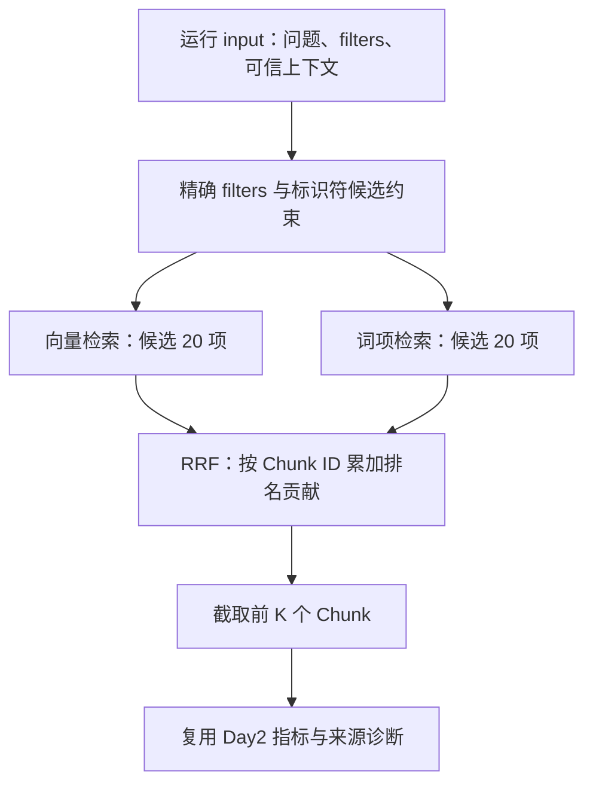
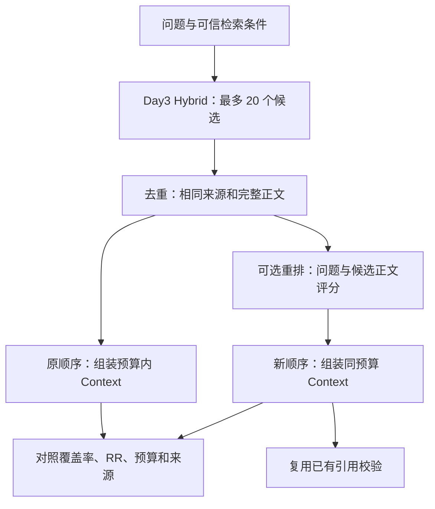

# Week9：RAG 质量优化与评估

> 基准计划：`/home/xumaozhou/Music/agent_engineer_learning_plan_v4_mcp.md`。
>
> 当前进度（2026-11-18）：**Day1～Day5 已完成，下一阶段为 Day6 输出评估与错误归因**。Week7、Week8 已完成。
>
> 默认使用主项目 `.venv/bin/python`；实现放在 `rag/`，测试放在 `tests/`。

## 本周安排

| 日期 | 内容 | 主要产物 |
|---|---|---|
| **Day1（已完成）** | 固定评估集，明确答案依据与拒答边界 | 30 道题、知识快照、运行输入与评分参考 |
| **Day2（已完成）** | Recall@K、MRR 与召回错误分析 | 有分母的检索基线 |
| **Day3（已完成）** | 关键词与向量结合的 Hybrid Search | 精确标识符与语义检索对照 |
| **Day4（已完成）** | 重排、去重和 Context 预算 | 可追溯且集中的证据 |
| **Day5（已完成）** | 生效版本、审核状态和访问权限过滤 | 版本与越权专项测试 |
| Day6 | 检索、引用、回答、拒答分别评估 | 错误归因与人工复核 |
| Day7 | 基础方案与优化方案对照 | 质量、成本与延迟报告 |

<a id="day1"></a>

## Day1：学习内容与验收目标（已完成）

### 完成记录（2026-11-17）

- `reference_is_eligible` 已实现：已发布状态、每个精确过滤条件与全部所需权限同时满足。
- `build_case_input` 已实现：只提取运行 input，并深拷贝嵌套对象，评分参考不会混入请求。
- 主项目 `.venv` 完整离线回归为 **49 passed**；没有调用 Embedding 或回答模型。
- 固定评估集为 **30 题、21 份知识、23 个正文单元、30 条原文证据**，覆盖五类问题；22 题预期回答，8 题预期信息不足。
- 数据 fingerprint：`31c20e959a1b4f0cf11af6a0c3ea5776640774f5446d2970994737c45a542143`。
- 数据与验收产物位于 `/media/xumaozhou/data/AI/local_agent_test/week9_rag_quality/`，其中 `runs/day1/` 保存数据报告和运行请求；外部数据与运行产物不纳入主项目提交。

通过范围为数据契约与参考适用性。实际检索质量、回答语义和 Retriever 权限执行仍在后续阶段验收。

今天建立后续六天共用的评估依据。重点是把“问题、可用证据、答案要求、拒答条件”写清楚，
而不是直接增加 Top-K 或根据模型回答反过来修改参考答案。

| 学习点 | 今日验收 |
|---|---|
| 固定问题覆盖 | 30 道题，覆盖常见、易混淆、未知、历史与权限五类 |
| 可追溯参考 | 有依据回答题包含文档组、实际正文摘录、可接受答案要点 |
| 明确拒答 | 未知、实时、未发布和权限不足分别记录原因及拒答条件 |
| 版本与访问适用性 | 参考证据满足本题版本、状态与可信访问要求 |
| 评估参考隔离 | 运行输入不带标准答案、参考摘录或评分要求，嵌套对象也独立复制 |
| 基线可复现 | 为题库与知识文件记录 SHA256，整体 fingerprint 随输入变化 |

**本日全部离线，不使用 Ollama 或回答模型，不需要新增三方库。**
Day1 通过表示题库结构与参考契约可用；检索指标、真实回答和 Retriever 权限执行分别在后续阶段验证。

### 文件与数据来源

```text
主项目/
├── rag/eval_dataset.py           # 两个关键学习步骤已完成
├── rag/week9.md                  # 本文档
└── tests/test_week9_day1.py       # 测试已全部提供，无需填写

/media/xumaozhou/data/AI/local_agent_test/week9_rag_quality/
├── README.md                    # 题目目录、来源和数据约定
├── manifest.json                # 21 份知识的元数据与文件哈希
├── knowledge/                   # 仅这个目录的清单内文件作为知识正文
│   ├── KB001～KB018              # Week7 原文件副本，字节不变
│   ├── KB019.md                 # ops 才能访问的合成内部演练顺序
│   ├── KB020.md                 # 未发布草案，draft
│   └── KB021.md                 # 已撤销说明，retired
├── eval_cases.json              # 固定 30 题及 expected；禁止入库
└── runs/day1/                   # 完整验收通过后才生成
    ├── dataset_report.json      # 数据校验结果、分类数、哈希和 fingerprint
    └── runtime_inputs.json      # 仅 case_id 与运行 input
```

原始来源：`/media/xumaozhou/data/AI/local_agent_test/week7_rag_basics/`。
原数据不修改；新增三份文档与全部问题均为教学合成内容，不是业务事实或真实权限配置。
18 份旧知识加 3 份新知识，共 21 份文件；KB012 的 JSON 含三个正文单元，因此共加载 23 个正文单元。
现有 Week7/Week8 索引不修改，Week9 数据后续需要单独建索引，不能直接复用缺少新增文档的旧缓存。

### 30 道题的分布

| 分类 | 数量 | 用例 ID | 重点 |
|---|---:|---|---|
| common | 8 | W9D1-01～08 | 当前 SOP、字段、limit、重试和导出要求 |
| ambiguous | 8 | W9D1-09～16 | NOT_FOUND/FORBIDDEN/FAILED、相似编码、部分结果与子串误判 |
| unknown | 5 | W9D1-17～21 | 缺少版本、实时状态/列表、未规定 SLA、未发布规范 |
| historical | 4 | W9D1-22～25 | 回溯 1.0 版，并分别引用新旧版做对照 |
| permission | 5 | W9D1-26～30 | 未授权、已授权、正文伪造身份、公开规则与错误权限组 |

22 题预期 `answered`，8 题预期 `insufficient`。
W9D1-26、27、30 的问题完全相同，可信权限分别为空、ops、support；这使权限差异可以单独检验。
W9D1-28 则在正文自称拥有 ops，但可信上下文没有授予，仍应拒答。

### 输入与评分参考的格式

每条用例只有四个顶层字段：`case_id`、`category`、`input`、`expected`。

| 位置 | 含义 | 能否送入运行流程 |
|---|---|---|
| input.question | 实际问题 | 用于检索和回答 |
| input.filters | 明确的流程、版本或知识状态条件，允许 `{}` | 程序用于匹配，不是标准答案 |
| input.access_context | subject_id 与 granted_scopes | 模拟可信程序授权，由程序使用 |
| expected.status | answered 或 insufficient | 仅评分 |
| expected.doc_groups | 预期答案文档组；组间均需命中，组内可替代 | 仅评分 |
| expected.evidence | doc_id、segment_id、逐字 quote | 仅评分；不是预先喂给模型的证据 |
| expected.acceptable_points | 应涵盖的语义要点，不要求逐字复述 | 仅评分与人工复核 |
| expected.refusal_condition / refusal_reason | 何时拒答及拒答原因，回答题为 null | 仅评分 |
| expected.forbidden_doc_ids | 本题不能用于回答的来源 | 仅评分；不能当作运行过滤的答案提示 |

拒答题没有目标答案文档时，`doc_groups=[]`。可以保存公开边界说明作为参考 evidence，
例如“静态知识不能确认当前任务状态”；它不是该任务当前状态的目标答案文档。
后续这种题的 Recall/MRR 应标为不适用，不能计成召回满分。

`scope` 是沿用的主题/适用范围标签；`required_scopes` 是本练习新增的文档访问要求。
访问要求采用“全部满足”：要求 `['ops', 'audit']`，仅有 `['ops']` 不够；要求为空表示公开。
问题中的自我授权不改变 `access_context`。当前函数只检查参考数据的适用性，
尚未让既有检索器执行访问控制；Day5 会验证实际检索与上下文中的权限过滤。

### 已完成的两个关键步骤

实现文件：[eval_dataset.py](eval_dataset.py)。测试由助手提供，不需要重写。

| 标记 | 函数 | 输入 | 输出与关键原理 |
|---|---|---|---|
| W9D1-1 | reference_is_eligible | manifest 文档记录、case.input | bool；已发布状态、所有精确过滤条件、全部访问权限必须同时满足 |
| W9D1-2 | build_case_input | 完整 case | 独立深拷贝的 case.input；使用明确字段提取，隔离参考答案与嵌套可变对象 |

两个函数的 docstring 已写明字段、空值含义、边界与示例。
其余格式检查、清单加载、JSON 正文提取、哈希、证据校验和落盘均已实现。
默认测试保留基础自检；完整契约验收仍需显式开启环境变量，避免把默认跳过误认为完整通过。

### 测试代码的大体架构

`load_benchmark` 先校验题目结构；`read_manifest` / `load_documents` 复用现有知识加载器。
`validate_benchmark` 再核对覆盖、哈希、文档组、原文摘录与参考适用性。
最后 `write_dataset_report` 调用 `build_case_input` 导出运行输入和数据报告。

默认执行框架自检。设置 `RUN_WEEK9_DAY1=1` 才启用参考适用性、输入隔离和完整报告测试。
异常用例复制输入到 pytest 临时目录后再篡改，不修改正式数据。

### 测试一：30 题覆盖与答案契约

- **函数**：`test_provided_thirty_cases_cover_all_five_categories`。
- **数据来源**：正式数据集的 `eval_cases.json`。
- **目标与检查**：30 个唯一 ID、五类及其固定数量、22/8 的回答/拒答分布；每题有答案要点，回答题有证据，拒答题有条件与原因。
- **输出**：pytest 断言结果；不落盘。默认执行。

### 测试二：清单加载与原文证据

- **函数**：`test_provided_manifest_only_loads_knowledge_and_every_quote_exists`。
- **数据来源**：`manifest.json`、21 份 `knowledge/` 文件和用例 evidence。
- **目标与检查**：加载 23 个正文单元；逐文件 SHA256 正确；逐条摘录存在于指定 doc_id/segment_id；清单没有把题库和运行报告当成知识。
- **输出**：pytest 断言结果；不落盘。默认执行。

### 测试三：权限对照与草稿/失效反例

- **函数**：`test_provided_permission_pairs_and_unpublished_negative_documents`。
- **数据来源**：W9D1-02、21、26～30。
- **目标与检查**：同题不同权限有不同预期；未授权题的评分参考不包含受限正文；当前规则明确排除草稿与失效说明。
- **输出**：pytest 断言结果；不落盘。仅验证题目设计，默认执行。

### 测试四：非法输入结构

- **函数**：`test_provided_loader_rejects_invalid_contracts`，18 个参数用例。
- **数据来源**：复制题库到 `tmp_path`，单独构造一个无效字段。
- **目标与检查**：布尔 schema、重复 ID、空问题、错误分类、非法 filter、无效权限、缺失字段、评分字段进入 input、缺少文档组/拒答条件等均抛 `ValueError`。
- **输出**：pytest 临时目录中的 `eval_cases.json`；默认执行。

### 测试五：知识文件发生变化

- **函数**：`test_provided_validation_detects_changed_source_before_reference_checks`。
- **数据来源**：知识副本，向 KB001 追加文本但保留原哈希。
- **目标与检查**：在参考适用性检查前检测文件变化，不继续使用旧快照。
- **输出**：临时数据副本；默认执行。

### 测试六：报告目录边界

- **函数**：`test_provided_output_cannot_overwrite_input_directories`。
- **数据来源**：pytest 临时路径。
- **目标与检查**：拒绝将报告写到数据根目录或知识目录中，避免与输入混放或覆盖。
- **输出**：无文件；默认执行。

### 测试七：参考文档适用性

- **函数**：`test_reference_eligibility_uses_exact_filters_and_all_required_scopes`，15 个参数用例。
- **数据来源**：测试内的小字典，不需要模型或知识全文。
- **目标与检查**：精确过滤、current/historical、draft/retired、公开文档、错误权限组、多权限必须全满足、正文声明不能授权，以及输入不被修改。
- **输出**：pytest 断言结果；学习点 W9D1-1 已完成，启用 DAY1 后执行。

### 测试八：运行输入与评分参考隔离

- **函数**：`test_runtime_input_excludes_gold_and_has_independent_nested_values`。
- **数据来源**：W9D1-27 副本，额外放入仅供评分的哨兵文本。
- **目标与检查**：输出等于 input，字段严格受限；评分哨兵不泄露；修改 filters 或权限列表不影响原用例，再次调用也不受影响。
- **输出**：pytest 断言结果；学习点 W9D1-2 已完成，启用 DAY1 后执行。

### 测试九：错误参考答案的定位

- **函数**：`test_full_validator_rejects_inconsistent_gold`，9 个参数用例。
- **数据来源**：正式数据集的临时副本。
- **目标与检查**：虚构摘录、错误正文段、未知文档、允许/禁止冲突、版本错误、未授权引用、文档组缺少摘录、题数不足和漏分类均被拒绝。
- **输出**：临时数据副本；参考适用性已实现，启用 DAY1 后执行。

### 测试十：整集验收与产物保存

- **函数**：`test_complete_dataset_report_and_runtime_export`。
- **数据来源**：完整正式数据集；先写临时报告并断言成功，再保存固定产物。
- **目标与检查**：30 题、21 文档、分类/状态计数、来源与适用性校验、稳定 fingerprint；所有导出请求都不带 expected，原始题库不被修改，model_called 为 false。
- **输出**：`runs/day1/dataset_report.json`、`runs/day1/runtime_inputs.json`。
- **启用条件**：`RUN_WEEK9_DAY1=1`。

### 运行命令

从主项目根目录执行。默认先检查已提供的部分：

```bash
.venv/bin/python -B -m pytest tests/test_week9_day1.py -q -p no:cacheprovider
```

执行完整离线验收：

```bash
RUN_WEEK9_DAY1=1 .venv/bin/python -B -m pytest tests/test_week9_day1.py -v -s -p no:cacheprovider
```

只检查某一练习，例如参考文档适用性：

```bash
RUN_WEEK9_DAY1=1 .venv/bin/python -B -m pytest \
tests/test_week9_day1.py::test_reference_eligibility_uses_exact_filters_and_all_required_scopes \
-v -p no:cacheprovider
```

可选环境变量：`WEEK9_RAG_DATASET` 指定数据根目录，`WEEK9_DAY1_OUTPUT` 指定产物目录。
它们不改变题目内容或评分标准。本日没有真实模型测试开关。

### 验收边界与后续使用

本日校验能证明：题库数量和分类达标，评分参考可追溯，参考版本/权限条件一致，输入与参考分离。
不能证明：实际检索召回正确、答案语义正确、现有 Agent 已阻止越权。
答案要点与原文是否充分支持仍需阅读核对；程序只验证摘录存在，不会自动证明所有自然语言主张。

准备阶段的默认自检为 **23 passed、26 skipped**；完成两个步骤后的完整离线验收为 **49 passed**。
默认模式仍保留 26 个显式开启项，复验全部检查应使用上面的完整命令。
18 份旧知识副本已与 Week7 原文件逐字节核对；两次检查均未调用真实模型。

Day2 从这份冻结数据统计召回；Day3～Day5 调整检索与过滤；Day6、Day7 对比回答和质量。
如果发现题库本身标注有误，应先记录更正原因并重新冻结 fingerprint，再让各方案使用相同新版本，
不要为了某一次模型通过而悄悄修改评分参考。

<a id="day2"></a>

## Day2：Recall@K、MRR 与召回质量分析（已完成）

### 完成记录（2026-11-17）

- 已实现目标文档组 Recall@K、首个相关 Chunk 的 RR@K，以及批量 MRR 汇总和逐题诊断。
- Day2 完整离线验收为 **33 passed、1 skipped**；跳过项为需另行开启的真实模型测试。
- 收尾连同 Day1 回归为 **82 passed、1 skipped**，真实推理未在本次回归中重复执行。
- 用户已运行真实 Ollama 检索测试通过；助手从留存命中重新计算了每题指标与批次汇总，结果一致。
- 真实模型为 `qwen3-embedding:0.6b`，索引含 **70 个 Chunk**；30 题全部记录，执行错误 0 题，22 题适用、8 题不适用。
- 基线沿用 Day1 fingerprint：`31c20e959a1b4f0cf11af6a0c3ea5776640774f5446d2970994737c45a542143`。
- 本次收尾执行离线回归；真实结果来自用户运行后保存在外部数据目录的报告，没有调用回答型 LLM。

| K | 平均 Recall@K | MRR@K | 实际算分/计划适用 | 全部目标组命中题数 |
|---|---:|---:|---:|---:|
| 1 | 0.8182 | 0.8182 | 22/22 | 18 |
| 3 | 0.9773 | 0.9015 | 22/22 | 21 |
| 5 | 1.0000 | 0.9015 | 22/22 | 22 |
| 10 | 1.0000 | 0.9015 | 22/22 | 22 |

W9D1-25 在 K=3 时遗漏 KB003，K=5 才覆盖两个目标组。首次相关项的位置保持不变，因此 MRR 没有随之上升。
该题仍召回草稿 KB020 与失效说明 KB021；W9D1-26、28、30 仍召回无权访问的 KB019。
这些已定位问题留给后续状态和权限过滤优化，Day2 完成不代表权限隔离或回答语义验收完成。
K=10 在本批次没有增加目标文档组覆盖，不据此推断其他语料的最优 K。

真实报告位于 `/media/xumaozhou/data/AI/local_agent_test/week9_rag_quality/runs/day2/local_model/`；
本提交保留上述摘要，向量、原始运行报告与外部固定样例不纳入主项目 Git 提交。

本日沿用 Day1 冻结的 30 道题，先建立检索基线，再定位遗漏和不适用来源。
不修改答案标准，不提高某一道题的 K 来隐藏失败，也不调用回答型 LLM。
两个关键计算已在 [retrieval_metrics.py](retrieval_metrics.py) 中实现，测试代码已完整提供。

### 学习目标与验收标准

| 学习内容 | 能展示的验收结果 |
|---|---|
| Recall@K 的含义 | 根据前 K 个 Chunk 判断目标文档组覆盖率；重复文档不能重复加分 |
| RR 与 MRR 的区别 | 单题计算首个相关项排名倒数；MRR 是多题 RR 的平均 |
| 排名单位和截断 | K 按 Chunk 排名计数，先取前 K 项，再按文档组计覆盖 |
| 有分母的统计 | 22 题有目标来源，8 题不适用；执行错误单独统计，不伪装成零分 |
| 召回诊断 | 找出遗漏文档组、非目标来源、禁止来源以及版本/权限不适用来源 |
| 固定基线对照 | 每题只查询一次 max(K)，使用同一排名计算 K=1、3、5、10 |

**本日没有召回率必须达到 100% 的门槛。**
离线验收要求指标算对、报告可追溯；真实检索先记录当前效果和失败样例，后续再优化。
只命中文档 ID 不能保证具体 Chunk 足以支持答案，回答语义支持在后续验收。

### 两个指标怎么理解

今天沿用 Week7 的“预期文档组”口径：`[[A, B], [C]]` 表示需要两类依据，
第一类命中 A 或 B 任意一个即可，第二类需要 C。

```text
Recall@K = 前 K 个 Chunk 覆盖的目标组数 / 目标组总数
RR@K     = 首个相关 Chunk 在前 K 名中的排名倒数；没有命中为 0
MRR@K    = 多道适用问题的 RR@K 平均值
```

例如目标是 `[[A], [C]]`，检索顺序是 `[X, A, A, C]`：

| 截断位置 | 目标覆盖情况 | Recall | RR |
|---|---|---:|---:|
| 前 1 个 Chunk | 没有命中 | 0 | 0 |
| 前 3 个 Chunk | 只覆盖 A 这一组 | 1/2 | 1/2 |
| 前 4 个 Chunk | 覆盖 A、C 两组 | 1 | 1/2 |

两个 A 表示同一文档的不同 Chunk，会占用两个排名位置；不能先去重成 `[X,A,C]` 再取前 3 项。
首次相关项在第 2 位，所以 RR 始终为 1/2；它不表示已覆盖全部需要的依据。
若两道题的 RR 分别是 1 和 1/2，则 MRR 为 0.75。

单题 `doc_groups=[]` 时，两个指标都返回 `None`，含义是不适用。
8 道拒答题仍会记录检索结果和禁止来源，但不计入 Recall/MRR 分母。
平均 Recall 是适用题各自 Recall 的算术平均，不是把所有题的目标组混成一个大分母。
请求失败也不能当成“已成功检索但没命中”：报告同时列出计划适用 22 题与实际算分题数。

### 代码、数据与产物

```text
主项目/
├── rag/retrieval_metrics.py        # 两个指标与评估流程已完成
├── rag/week9.md                   # 逐项说明
└── tests/test_week9_day2.py        # 无需填写测试

/media/xumaozhou/data/AI/local_agent_test/week9_rag_quality/
├── manifest.json                 # Day1 冻结的清单，保持原样
├── eval_cases.json               # Day1 冻结的 30 题，保持原样
├── knowledge/                    # Day1 冻结的 21 份合成知识，保持原样
├── rankings_day2.json            # 新增：人工排名，只用于离线算例和诊断
├── README_day2.md                # 数据说明
└── runs/day2/
    ├── offline/
    │   ├── retrieval_report.json  # 人工排名下的指标、原请求、命中片段、错误
    │   └── retrieval_report.md    # 指标分母与逐题诊断表
    └── local_model/
        ├── retrieval_report.json # 真实 Ollama 检索基线
        ├── retrieval_report.md
        └── index/                # Week9 独立缓存，不覆盖 Week7/Week8 索引
            ├── knowledge_store.json
            ├── knowledge_store.config.json
            └── dataset_fingerprint.json
```

`rankings_day2.json` 全部手写，不是模型输出，也不会参与知识分块入库。
它故意包含错误与遗漏：W9D1-07 没有 KB005；W9D1-25 前三项只覆盖一组；
W9D1-02 包含旧版、草稿和失效文档；W9D1-26/28/30 包含无权访问的 KB019。
测试按这些文档 ID 从现有知识中取不同 Chunk 填充元数据，分数只是人工递减值，不代表语义相似度。

人工排名不改变 Day1 fingerprint；人工样例的 SHA256 会另行写入离线报告的 backend_info。
真实基线复用 Week8 的 ManifestLoader、分块、Week7Embeddings、prepare_store 和 make_retriever。
首次编码 Week9 正文并保存缓存，后续加载缓存只编码问题；快照不匹配会报错，不会静默重建。

### 已完成的关键代码

| 学习点 | 函数 | 已提供部分 | 已实现的关键步骤 |
|---|---|---|---|
| W9D2-1 | recall_at_k | 输入检查、前 K 项、命中文档集合、分母、无目标处理 | 逐组判断是否命中，计算 matched_groups |
| W9D2-2 | reciprocal_rank_at_k | 输入检查、相关文档集合、前 K 项、无目标处理 | 找到首个相关项，按从 1 开始的排名返回倒数；没找到为 0 |

两个函数都有完整的输入输出类型、示例和空列表语义；不需要实现文件读取、HTTP 或整个评估循环。
`summarize_rows` 已实现均值与分母统计，`run_retrieval_evaluation` 已实现逐题记录与阶段异常保存。

### 测试架构与报告边界

数据加载 → 每题提取纯运行 input → retrieve(request, max_k) → 保留原排名 →
计算各 K 的 Recall/RR → 参考适用性诊断 → 汇总 MRR 与分母 → 保存 JSON/Markdown。

检索回调只接收 question、filters、access_context，不接收标准答案、摘录、禁止文档列表或 case_id。
参考项只在检索完成后评分。默认模式保留框架自检，设置 `RUN_WEEK9_DAY2=1` 才执行完整离线验收。

本日真实基线仍是 Week8 的精确 filters，没有新增权限过滤；`access_context` 暂用于评分诊断。
Day1 的 `reference_is_eligible` 在这里检查已召回来源，不改变排名。
报告中的 `ineligible_doc_ids` 和 `forbidden_doc_ids` 用于暴露问题，不能被解释成问题已经被阻止。
`non_target_doc_ids` 只表示不在目标组，可能是有用背景，不能直接当作语义错召回。

### 测试一：固定排名样例与 Day1 快照

- **函数**：`test_provided_rankings_cover_thirty_frozen_cases_and_include_failure_examples`。
- **数据来源**：`rankings_day2.json`、Day1 原知识与题库。
- **目标与检查**：30 道题 ID 全覆盖、文档存在、重复/缺失/越权样例存在，Day1 fingerprint 保持不变。
- **输出**：pytest 断言结果，不落盘；默认执行。

### 测试二：指标参数边界

- **函数**：`test_provided_metric_inputs_reject_invalid_k_groups_and_rankings`，12 个参数用例。
- **数据来源**：测试内的小列表与非法参数。
- **目标与检查**：拒绝零/负数/布尔/字符串 K、空文档组、重复目标组、错误排名类型。
- **输出**：pytest 断言结果；默认执行。

### 测试三：不适用与零分的区别

- **函数**：`test_provided_no_gold_is_not_applicable_even_with_returned_chunks`。
- **数据来源**：无目标组的小列表，包括已有背景返回项的情况。
- **目标与检查**：有无返回片段都不改变无目标组为 None，不能强制计成 0 或 1。
- **输出**：pytest 断言结果；默认执行。

### 测试四：批量均值与统计分母

- **函数**：`test_provided_summary_keeps_denominators_errors_and_none_separate`。
- **数据来源**：人工评分行，含两条有效分数、一条不适用和一条超时。
- **目标与检查**：均值为 0.75，实际算分 2/计划适用 3，错误独立统计；没有有效分数时均值保留 None。
- **输出**：pytest 断言结果；默认执行。

### 测试五：遗漏与禁止来源诊断

- **函数**：`test_provided_diagnostics_expose_misses_and_forbidden_sources`。
- **数据来源**：W9D1-25、26 的人工排名和真实知识元数据。
- **目标与检查**：定位缺少 KB003；未授权题明确记录 KB019 为禁止且不适用来源；拒答题不把所有背景都判为错召回。
- **输出**：pytest 断言结果；默认执行。

### 测试六：损坏的检索结果

- **函数**：`test_provided_bad_retrieval_results_are_rejected`，4 个参数用例。
- **数据来源**：人工命中副本，分别注入未知 doc_id、重复 Chunk ID、篡改版本和 NaN 分数。
- **目标与检查**：拒绝无法追溯或与清单不一致的数据，保留合法的重复文档不同 Chunk。
- **输出**：pytest 断言结果；默认执行。

### 测试七：请求失败的阶段记录

- **函数**：`test_provided_retrieval_errors_are_saved_without_faking_zero_metrics`。
- **数据来源**：30 道题与始终抛 TimeoutError 的回调，不访问网络。
- **目标与检查**：失败后继续记录，30 条错误、0 条实际算分，均值为 None；保存异常类型和阶段，不保存异常正文。
- **输出**：pytest 临时目录的 `retrieval_report.json`、`retrieval_report.md`；默认执行。

### 测试八：人可读报告

- **函数**：`test_provided_report_shows_mrr_denominator_and_diagnostic_columns`。
- **数据来源**：未完成批次的最小报告字典。
- **目标与检查**：显示 MRR、0/22 分母、不适用 8 题、遗漏/禁止/不适用来源等列，不伪装成完整成绩。
- **输出**：内存中的 Markdown；默认执行。

### 测试九：复用既有 LangChain 组件与缓存

- **函数**：`test_provided_langchain_cache_is_reused_and_stale_snapshot_is_rejected`。
- **数据来源**：Day1 知识与人工二维编码器，在临时目录建库。
- **目标与检查**：首次只批量编码正文，加载不重编码，查询只编码问题，快照不匹配显式报错。
- **输出**：pytest 临时目录的索引和快照文件；默认执行，使用现有依赖，无真实模型请求。

### 测试十：手算 Recall/RR 对照

- **函数**：`test_metrics_match_hand_calculated_examples_without_mutating_inputs`，9 个参数用例。
- **数据来源**：测试内的 A/B/C/X 列表。
- **目标与检查**：头部命中、K 外命中、多组覆盖、替代文档、重复文档占位、空结果和无目标；输入不修改。
- **输出**：pytest 断言结果；两个指标已实现，开启 DAY2 后执行。

### 测试十一：30 题完整离线报告

- **函数**：`test_offline_thirty_case_baseline_uses_one_ranking_and_excludes_gold`。
- **数据来源**：Day1 题库与 `rankings_day2.json`，不调用模型。
- **目标与检查**：每题仅一次 max(K) 检索，运行输入无评分参考，22/8 分母正确；检查 W9D1-25 的 0.5→1 覆盖变化和 W9D1-07 的真实遗漏记录。
- **输出**：`runs/day2/offline/retrieval_report.json`、`retrieval_report.md`；开启 DAY2 后执行。
- **限制**：人工排名只证明计算和报告流程，不代表真实检索质量。

### 测试十二：真实 Ollama 检索基线

- **函数**：`test_real_ollama_records_thirty_case_retrieval_baseline`。
- **数据来源**：同一知识和 30 道题，使用已安装的 `qwen3-embedding:0.6b`。
- **目标与检查**：实际建库/加载，逐题查询并记录四个 K 的成绩与诊断，执行错误不能通过；不要求召回满分。
- **输出**：`runs/day2/local_model/retrieval_report.json`、`retrieval_report.md` 及独立 `index/`。
- **启用条件**：DAY2=1 且 MODEL=1；不会在普通测试中联网，不下载模型，不需要 API Key。

### 运行命令

主项目根目录下，先检查已提供的部分：

```bash
.venv/bin/python -B -m pytest tests/test_week9_day2.py -q -p no:cacheprovider
```

运行全部离线测试：

```bash
RUN_WEEK9_DAY2=1 RUN_WEEK9_DAY2_MODEL=0 \
.venv/bin/python -B -m pytest tests/test_week9_day2.py -v -s -p no:cacheprovider
```

真实检索（先启动 `ollama serve`，使用已有模型）：

```bash
RUN_WEEK9_DAY2=1 RUN_WEEK9_DAY2_MODEL=1 \
.venv/bin/python -B -m pytest \
tests/test_week9_day2.py::test_real_ollama_records_thirty_case_retrieval_baseline \
-v -s -p no:cacheprovider
```

可选环境变量：`WEEK9_RAG_DATASET` 指定数据目录，`WEEK9_DAY2_OUTPUT` 指定产物根目录。
确认需要重建时显式设置 `WEEK9_DAY2_REBUILD=1`；默认缓存不匹配会报错，避免混用旧数据。
真实调用可能随缓存状态、候选数量变化；无候选时既有 Retriever 会跳过问题编码。

### 验证记录与边界

准备阶段默认自检为 **23 passed、11 skipped**；完成两个指标后的完整离线验收为 **33 passed、1 skipped**。
默认模式仍主动跳过扩展验收，复验时应使用上面的完整离线命令。
真实 Ollama 的 1 项基线测试由用户单独运行通过，已核对本地报告；本次收尾不重复执行真实推理。
学习完成范围为指标、基线和问题定位，后续继续验证检索优化、证据支持和访问隔离。

<a id="day3"></a>

## Day3：关键词与向量结合的 Hybrid Search（已完成）

### 完成记录（2026-11-17）

- 已完成查询词项覆盖计分、RRF 排名贡献、同路去重与跨路累加，并保留各路排名和原始分数。
- 精确标识符约束同时作用于关键词和混合策略的向量候选，离线反例验证相似编码不会在融合时重新带回。
- 最近一次 Day1～Day3 联合离线验收为 **106 passed、2 skipped**；跳过项是 Day2、Day3 的真实 Ollama 测试。
- 已核对 Day3 的 dense、keyword、hybrid 三份人工向量报告：各记录 30 题，22 题适用、8 题不适用，执行错误均为 0。
- 原 Day1 知识与题库 fingerprint 保持为 `31c20e959a1b4f0cf11af6a0c3ea5776640774f5446d2970994737c45a542143`，Day2 基线报告保持原样。
- 验收产物统一保存到外部数据目录 `runs/day3/offline/`，原始报告、人工反例和向量不纳入主项目 Git 提交。

本次按离线验收标记学习完成。尚未提供真实 Ollama 三策略结果，默认 `runs/day3/local_model/` 下未找到对应报告，
因此不记录真实语义检索提升、性能优势或权限隔离已通过的结论。后续仍可使用保留的真实测试命令补充对照。

今天把关键词检索与既有向量检索组合起来，重点观察错误码和流程编码是否精确匹配。
沿用 Day1 的 30 题、同一知识快照和 Day2 指标；不修改原题答案，也不覆盖 Day2 基线报告。
两个计算片段已在 [hybrid_search.py](hybrid_search.py) 中完成，测试代码已完整提供。

### 学习内容与验收标准

| 学习点 | 可以展示的验收结果 |
|---|---|
| 关键词与语义检索各自的作用 | 对照 dense、keyword、hybrid 三种策略，解释词项匹配与向量相似度的不同 |
| 标识符的精确匹配 | import_std、import_standard、import_std_extra 分开；NOT_FOUND 与 NOT_FOUND_EXTRA、not_found 分开 |
| 词项覆盖分数 | 用查询词项与正文词项的交集计算比例，零命中不返回 |
| 排名融合 | RRF 使用两路排名计算融合分数，保留各路位置与原分数 |
| 候选约束的执行位置 | 标识符规则同时约束关键词和向量候选，避免融合时带回不匹配来源 |
| 固定集效果对照 | 30 题按相同 K=1、3、5、10 记录 Recall/MRR、分母与诊断，不预设混合策略必胜 |

本日使用轻量词项覆盖，中文连续文本取二字片段，英文标识符保留完整原值及大小写。
它不是 BM25，不额外安装分词器、数据库或新本地模型。
RRF 公式参考 [Elastic 官方说明](https://www.elastic.co/docs/reference/elasticsearch/rest-apis/reciprocal-rank-fusion)，当前融合实现使用 Python 标准库。

### RRF 与前一天的 RR 有什么不同

| 名称 | 用途 | 计算依据 | 是否读取评分参考 |
|---|---|---|---|
| RR / MRR | 评估检索结果是否把相关项排在前面 | 首个相关项的倒数排名及多题均值 | 是，检索完成后评分 |
| RRF（Reciprocal Rank Fusion） | 将多路候选排成一份结果 | 各路排名贡献之和 | 否 |

```text
关键词分数 = 命中的查询词项数 / 查询词项总数
RRF 分数   = 各路 1 / (rank_constant + 本路排名) 的和
```

本路排名从 1 开始，默认 `rank_constant=60`；同一 Chunk 两路都排第一时，分数为 `1/61 + 1/61`。
关键词分数、余弦相似度与 RRF 分数含义不同，不能直接相加，也不能跨策略按分数大小判优。
RRF 最终按融合分数降序，同分按 Chunk ID 升序，保留原始排名和分数供排查。

### 混合策略流程



同一路重复出现同一 Chunk 只贡献一次，跨路同一 Chunk 累加；同文档的不同 Chunk 保持独立。
去掉一路中的重复项后，不重新编号后面原有的排名位置。

`filters.engine_code` 有明确值时优先使用；省略时从问题原文提取本语料的 `import_*`、`export_*` 编码。
比较多个流程时允许其并集，不自行选一个。错误码、字段名等正文标识符使用完整 ASCII 词项匹配，
多标识符问题允许不同片段分别命中。这里是有限的确定性规则，不是通用的业务意图识别器。

纯 dense 保留 Day2 的过滤基线；keyword/hybrid 额外执行标识符约束。
因此三组效果差异可能来自候选约束、关键词或融合，不能把全部提升归因于 RRF。
访问权限与草稿/失效文档过滤仍留待 Day5；本日不新增 Agent 或修改通用 Instructions。

### 文件与数据来源

```text
主项目/
├── rag/hybrid_search.py              # 两个计算与候选准备、对照均已完成
├── rag/week9.md                      # 本说明
└── tests/test_week9_day3.py           # 测试完整，无需填写

/media/xumaozhou/data/AI/local_agent_test/week9_rag_quality/
├── manifest.json、knowledge/、eval_cases.json  # 原样沿用 Day1
├── identifier_examples_day3.json     # 新增：8 个合成内存 Chunk、9 个标识符反例
├── README_day3.md
└── runs/day3/
    ├── offline/
    │   ├── comparison_report.json、comparison_report.md
    │   ├── dense/retrieval_report.json、retrieval_report.md
    │   ├── keyword/retrieval_report.json、retrieval_report.md
    │   └── hybrid/retrieval_report.json、retrieval_report.md
    └── local_model/                  # 真实三策略对照采用相同布局
```

反例的 `synthetic/` 路径是模拟来源，只用于测试内存对象，未加入清单，也不混入 30 题指标分母。
其中相似流程文档正文故意提到 import_std，用来证明正文提及不能替代 metadata.engine_code。
纯向量替身故意把 import_standard 排在 import_std 前面，用于检查标识符约束是否真的执行。

真实测试优先加载 `runs/day2/local_model/index/` 的同一向量快照；不存在时在 Day3 独立目录建库。
复用 Day2 的 fingerprint/模型配置检查，加载不会重编码正文。
`SharedQueryEncoder` 让同次对照复用同一问题向量；记录中的耗时受缓存影响，不能作为严格性能结论。
普通测试只使用人工向量，真实 Ollama 需另行显式开启；没有回答型 LLM 测试，不需要 API Key。

### 已完成的两个关键步骤

| 学习点 | 函数 | 已提供 | 已完成的计算 |
|---|---|---|---|
| W9D3-1 | keyword_search | query_tokens、document_tokens、零分处理与排序 | 词项集合交集占查询词项总数的比例 |
| W9D3-2 | reciprocal_rank_fusion | 分支遍历、从 1 开始的 rank、按 ID 累加、去重和排序 | 当前分支的倒数排名 contribution |

两个函数均已写明输入输出、边界和数值示例；不需要自行编写文件读取、模型客户端或整个检索器。

### 测试一：完整词项与中文切片

- **函数**：`test_provided_tokenizer_preserves_complete_identifier_and_chinese_bigrams`。
- **数据来源**：测试内字符串，含 NOT_FOUND_EXTRA、下划线、前缀、中文与版本号。
- **目标与输出**：验证标识符不被拆成子串、大小写不归一化、中文二字片段和版本词项保留；仅 pytest 断言，默认执行。

### 测试二：9 个标识符反例

- **函数**：`test_provided_nine_identifier_examples_use_values_not_substrings`。
- **数据来源**：`identifier_examples_day3.json` 的全部 9 个请求与 8 个合成候选。
- **目标与输出**：精确流程、明确 filter 优先、未知流程、错误码前后缀与大小写、多错误码比较、字段名；输入不修改，仅 pytest 断言，默认执行。

### 测试三：关键词参数校验

- **函数**：`test_provided_keyword_rejects_invalid_k_before_scoring`，4 个参数用例。
- **数据来源**：测试内非法 K：0、负数、布尔和字符串。
- **目标与输出**：在关键词计分前抛 ValueError；默认执行，不调用模型。

### 测试四：空关键词与重复 Chunk

- **函数**：`test_provided_empty_keyword_and_duplicate_chunks_are_handled`。
- **数据来源**：标点问题、空候选，以及合成候选的重复 ID。
- **目标与输出**：空查询词项/空候选返回 []，重复 Chunk ID 被拒绝；仅 pytest 断言，默认执行。

### 测试五：RRF 参数校验

- **函数**：`test_provided_rrf_rejects_invalid_options`，5 个参数用例。
- **数据来源**：非法 k 和 rank_constant。
- **目标与输出**：要求正整数，拒绝布尔、非整数和非正值；仅 pytest 断言，默认执行。

### 测试六：空融合与无效原分数

- **函数**：`test_provided_empty_rrf_and_bad_raw_score`。
- **数据来源**：两路空排名、原始分数 NaN 的合成命中。
- **目标与输出**：空排名返回 []，非有限原分数被拒绝；仅 pytest 断言，默认执行。

### 测试七：共享问题向量

- **函数**：`test_provided_shared_query_encoder_reuses_vectors_without_aliasing`。
- **数据来源**：固定二维编码器，重复 q1 和新问题 q2。
- **目标与输出**：重复问题只编码一次，批量顺序保持，修改返回值不破坏缓存；记录内存调用列表，默认执行。

### 测试八：未知标识符短路

- **函数**：`test_provided_unknown_identifiers_short_circuit_both_branches`。
- **数据来源**：合成小向量库与不存在的 import_stdx 请求。
- **目标与输出**：keyword/hybrid 均返回 []，不请求编码器；仅 pytest 断言，默认执行。

### 测试九：非法策略配置

- **函数**：`test_provided_invalid_search_configuration_never_encodes`，3 个参数用例。
- **数据来源**：未知策略、非法候选数量/常数，以及最终 K 超出固定候选窗口。
- **目标与输出**：请求编码前失败，不因配置错误产生模型调用；仅 pytest 断言，默认执行。

### 测试十：索引加载与快照

- **函数**：`test_provided_store_loading_keeps_snapshot_and_document_vectors`。
- **数据来源**：Day1 原知识，人工向量及 pytest 临时索引。
- **目标与输出**：首次建库、后续加载无重复正文编码，Day1 fingerprint 不变；临时索引，不覆盖正式索引，默认执行。

### 测试十一：关键词分数和原文隔离

- **函数**：`test_keyword_coverage_scores_exact_terms_and_owns_returned_chunks`。
- **数据来源**：合成候选与查询“NOT_FOUND 含义”。
- **目标与输出**：手算命中比例为 0.5，NOT_FOUND_EXTRA 不因子串命中，返回元数据与原输入隔离；开启 DAY3 后执行。

### 测试十二：RRF 累加与同分顺序

- **函数**：`test_rrf_accumulates_ranks_and_keeps_original_scores`。
- **数据来源**：两路手写的三个候选排名与不同原始分数。
- **目标与输出**：双路支持项的分数等于排名贡献之和，保留各路 rank/raw_scores，同分按 ID 排序，不修改输入；开启 DAY3 后执行。

### 测试十三：RRF 去重与来源冲突

- **函数**：`test_rrf_deduplicates_each_branch_but_preserves_rank_positions`。
- **数据来源**：同路重复项、同文档不同 Chunk，以及相同 ID 不同原文的反例。
- **目标与输出**：同路不重复加分、后续排名不重新编号、不同 Chunk 保持独立，来源冲突被拒绝；开启 DAY3 后执行。

### 测试十四：向量结果不能绕过标识符约束

- **函数**：`test_guarded_hybrid_never_reintroduces_similar_engine_from_dense`。
- **数据来源**：人工向量故意把 import_standard 排在 import_std 前面的小库。
- **目标与输出**：dense 基线能暴露错召回，keyword 不编码问题，hybrid 最终只返回正确流程；保留融合分数类型，开启 DAY3 后执行。

### 测试十五：30 题三策略离线对照

- **函数**：`test_offline_thirty_case_three_strategy_reports_exclude_gold`。
- **数据来源**：Day1 知识与 30 道题，使用人工向量，不读取补充反例作为业务知识。
- **目标与输出**：90 次策略调用只接收纯 input，三策略分别记录 30 题、22/8 分母和错误数，保存完整报告树；开启 DAY3 后执行。
- **产物**：`runs/day3/offline/` 的三策略指标与 `comparison_report.json/md`；不能当真实语义检索成绩。

### 测试十六：真实 Ollama 三策略对照

- **函数**：`test_real_ollama_three_strategy_comparison`。
- **数据来源**：同一知识快照、题库与 `qwen3-embedding:0.6b`，优先复用 Day2 索引。
- **目标与输出**：三策略完整记录、无执行错误，保存各 K 的质量与来源诊断；不预设提升门槛，不调用回答模型。
- **产物**：`runs/day3/local_model/`；需同时显式开启 DAY3 和 MODEL。

### 运行命令

在主项目根目录检查已提供的框架：

```bash
.venv/bin/python -B -m pytest tests/test_week9_day3.py -q -p no:cacheprovider
```

运行全部离线验收：

```bash
RUN_WEEK9_DAY3=1 RUN_WEEK9_DAY3_MODEL=0 \
.venv/bin/python -B -m pytest tests/test_week9_day3.py -v -s -p no:cacheprovider
```

真实 Ollama 对照（先启动本地服务，使用已有模型）：

```bash
RUN_WEEK9_DAY3=1 RUN_WEEK9_DAY3_MODEL=1 \
.venv/bin/python -B -m pytest \
tests/test_week9_day3.py::test_real_ollama_three_strategy_comparison \
-v -s -p no:cacheprovider
```

可选配置：`WEEK9_RAG_DATASET`、`WEEK9_DAY3_OUTPUT`、`WEEK9_DAY3_INDEX`。
显式设置 `WEEK9_DAY3_REBUILD=1` 可重建索引，默认改用 Day3 自己的目录；自行指定 INDEX 时以该路径为准。
准备阶段框架自检为 **19 passed、6 skipped**；完成两处计算后的 Day1～Day3 联合离线验收为 **106 passed、2 skipped**。
默认模式仍跳过扩展验收，复验全部离线检查应开启对应 DAY 开关，并关闭各 MODEL 开关。
真实 Ollama 对照不计入当前完成证据，后续可另行运行；主项目仍不调用回答型 LLM 完成本日检索。

<a id="day4"></a>

## Day4：重排、来源内去重与 Context 预算（已完成）

### 完成记录（2026-11-18）

| 验收 | 结果 |
|---|---|
| Day4 离线 | 34 项通过，2 项真实模型测试跳过 |
| Ollama 检索，关闭重排 | 30/30 题完成，0 错误，前后 Context 一致。22 道可计分题平均 Context Recall 为 100%，MRR 为 0.9545 |
| DeepSeek 真实重排 | 3/3 题完成，均调用评分，0 错误。2 道可计分题前后 Context Recall、MRR 均为 1.00，实时状态题不计分 |

两组真实测试复用 Day2 的 70 个向量片段。完整 Context 的峰值估算为 2737，加上 256 的预留额后为 2993，符合 3000 的预算。
提交前 Day1～Day4 离线联合回归为 140 项通过，4 项真实模型测试跳过。
原文复核显示，`W9D1-01` 选入了直接解释 `import_std` 用途的片段，`W9D1-25` 同时选入了 1.0 和 2.0 版的具体交付规则。
两题在重排前已覆盖参考文档组，所以来源组指标保持不变。`W9D1-18` 前后均把需要实时 API 的说明排在首位。

重排收益目前有逐题证据，整体收益仍需更大配对样本。`W9D1-25` 重排后仍保留已撤销的 `KB021`。
关闭重排的 30 题报告还记录了 `W9D1-26`、`W9D1-28`、`W9D1-30` 的越权来源 `KB019`，这些样例留作 Day5 过滤验收。
真实报告分别保存在数据目录的 `runs/day4/local_model/` 与 `runs/day4/real_llm/`。

### 今天学习什么

Day3 负责找候选，今天负责从候选中选择要送给回答模型的证据。学习阶段只构建并检查 Context，
不再次实现回答层，不修改通用 Agent 提示词。版本、草稿/失效状态与访问权限过滤留待 Day5。



“先召回、再重排”的原理可参考 [Sentence Transformers 官方说明](https://www.sbert.net/examples/sentence_transformer/applications/retrieve_rerank/README.html)。
常见实现使用 CrossEncoder；本练习将评分器作为可注入接口：离线注入固定分数，可选真实评分沿用项目已有 DeepSeek。
这里没有安装 CrossEncoder、下载新模型，也不保证重排会提升效果；效果不明显可以关闭。

| 学习内容 | 本日验收标准 |
|---|---|
| Rerank 与 Retrieval 的区别 | 能解释“重新评价已召回候选”，重排不能找回候选池外遗漏的来源 |
| 分数和正文对齐 | 按评分排序候选下标，同分保持原序；保留原始检索分数与新增重排分数 |
| 去重边界 | 同来源同正文只留首次；同文档不同正文、版本、章节或权限元数据分别保留 |
| Context 预算 | 完整序列化证据与预留额一起判断；等值可放，长片段跳过后继续，不改写原文 |
| 可追溯引用 | Context 保留文档/Chunk ID、版本、来源和定位；只允许引用实际选入的证据 |
| 效果对照 | 同一候选池、同一预算比较前后 Context 来源组覆盖与 RR，保留分母、错误和遗漏 |

“证据更集中”需要检查：重复是否减少、相关来源是否进入有限预算、是否遗漏必要的第二份证据。
不能只看模型自己输出的相关性分数，也不能把程序执行成功当作语义质量通过。

### 文件、输入输出与三个已完成的练习

```text
主项目/
├── rag/reranking.py             # 重排、来源内去重与预算组装
├── rag/week9.md                 # 本说明
└── tests/test_week9_day4.py      # 测试完整，无需填写

/media/xumaozhou/data/AI/local_agent_test/week9_rag_quality/
├── manifest.json、knowledge/、eval_cases.json  # 原 Day1 冻结数据，不修改
├── context_examples_day4.json   # 10 个合成命中，独立于 30 道评估题
├── README_day4.md
└── runs/day4/
    ├── offline/context_report.json、context_report.md
    ├── local_model/context_report.json、context_report.md
    └── real_llm/context_report.json、context_report.md
```

合成反例中的 `synthetic/` 是内存来源标记，不是磁盘知识文件，不加入 manifest 或评估题分母。
它包含超长背景、无关短文、相关解释、相同 ID 重复、同来源同正文的不同 ID，以及不同版本/章节/权限/文档的同文反例。
30 题对照沿用 Day1 数据与 Day3 检索器；离线人工向量和固定评分只验证流程，不评价模型语义能力。

| 练习 | 函数 | 已完成的关键步骤 |
|---|---|---|
| W9D4-1 | `rerank_hits`：输入校验、异步评分、复制和分数记录 | 根据 scores 对候选 indices 降序排序，同分保留原下标顺序 |
| W9D4-2 | `deduplicate_hits`：来源身份、元数据身份、去重记录 | 组合包含来源、元数据、原始正文的可哈希 key |
| W9D4-3 | `build_budgeted_context`：JSON 序列化、计数、续选与编号 | 判断本次候选总计数加预留额是否不超过 max_tokens |

函数注释给出了输入、输出、边界和示例。

```python
# 评分器契约：只接收真实运行问题和候选正文，不接收 expected、标准答案或评分参考。
async def score_pairs(question: str, texts: list[str]) -> list[float]:
    # 返回值与 texts 等长、逐项对应，每项为 [0,1] 内有限数；可注入离线替身。
    ...

# 计数器契约：接收完整 Context JSON，返回非负整数。
# 可以替换为模型 tokenizer；本日默认 estimate_tokens 只做字符估算。
def count_tokens_fn(text: str) -> int:
    ...
```

`JsonLLMReranker` 已提供候选 ID 校验：模型可以乱序返回 C1/C2，但不能遗漏、重复、增加候选，
也不能返回解释或改写正文。最终排序仍由程序按返回分数完成；`None` 评分器表示关闭重排。
原 `hit.score` 保持原检索含义，新增 `rerank_score` 不冒充余弦相似度。

### 预算和报告中的数字如何理解

- 默认 `max_tokens=3000`、`reserved_tokens=256`，计数器为 `(字符数 + 1) // 2`，报告明确标为估算。
- 计数覆盖完整 Context JSON：编号、正文、定位和元数据均有开销。每次尝试完整追加一个片段，不裁剪正文。
- `used_tokens` 是该计数器的结果；JSON 字段名不意味着模型实际使用了这些 Token。
- 预留额仅作练习预算，不实际测量 system、问题、消息封装与输出长度，不能保证完整模型请求的实际 Token 上限。
- 边界测试注入 `len`，使用名为 `character_fixture` 的字符代理，以便精确手算；实际接入 tokenizer 后需重新校准。
- `Context Recall` 沿用 Day2 的参考来源组覆盖算法，在预算内 sources 上计算；不是答案支持性评分。
- `before_rr/after_rr` 在预算截取前的候选顺序上计算；成功配对题目的均值才是 MRR。本日不混同候选 RR 与 Context Recall。
- 先对两个分支共同去重，再比较原顺序与重排顺序，避免把去重收益误记为重排收益。
- 未知/拒答题无参考来源组时指标为 `null`，原 30 题仍为 22 题适用、8 题不适用；执行错误单列阶段和类型，不伪造零分。
- `provider_usage=null` 表示现有适配器没有提供实际 Token 用量；DeepSeek 在本日仅评分，不生成最终回答。

报告 JSON 保存原候选、去重映射、重排后候选、两份完整 Context、因预算省略的 ID、指标和来源诊断。
Markdown 提供配对分母、均值和逐题索引。可逐项检查同版本来源、原文引用和计数边界。
来源元数据被保留不代表访问控制已接入；当前权限/失效来源问题仍记录在 diagnostics 中，留待 Day5 修复。

### 测试一：样例来源与计数器

- **函数**：`test_provided_fixture_is_separate_from_the_frozen_benchmark`。
- **数据来源**：外部 `context_examples_day4.json`、原 30 道题，以及测试内中英文字符串。
- **测试目标**：样例不混入题库，字符估算含奇数向上取整、空串和非法类型。
- **输出与条件**：默认执行，仅 pytest 断言，不调用模型。

### 测试二：关闭重排和空候选

- **函数**：`test_provided_rerank_bypass_and_empty_input_never_score`。
- **数据来源**：合成命中与禁止调用的异步替身。
- **测试目标**：`None` 评分器保持顺序、返回独立副本；空候选不评分。
- **输出与条件**：默认执行，仅 pytest 断言。

### 测试三：评分数值校验

- **函数**：`test_provided_invalid_scores_are_rejected_before_sorting`，6 个参数用例。
- **数据来源**：缺失分数、布尔、NaN、负数、超过 1 的数值。
- **测试目标**：排序前检查评分是否等长且为合法有限数。
- **输出与条件**：默认执行，仅 pytest 断言。

### 测试四：同 ID 来源冲突

- **函数**：`test_provided_duplicate_id_with_conflicting_content_is_rejected`。
- **数据来源**：相同 Chunk ID 配不同正文的合成反例。
- **测试目标**：先报来源冲突，不把被改写的来源静默去重。
- **输出与条件**：默认执行，仅 pytest 断言。

### 测试五：非法预算

- **函数**：`test_provided_invalid_budget_configuration_is_rejected`，6 个参数用例。
- **数据来源**：零/布尔预算、负预留额、预留超限、非计数器、空计数器名。
- **测试目标**：预算配置在处理正文前失败。
- **输出与条件**：默认执行，仅 pytest 断言。

### 测试六：空 Context 与计数器返回值

- **函数**：`test_provided_empty_context_and_invalid_counter`。
- **数据来源**：空候选和返回负数/布尔/小数的计数器。
- **测试目标**：空 Context 使用量为 0；计数结果必须为非负整数。
- **输出与条件**：默认执行，仅 pytest 断言。

### 测试七：评分响应 ID 对齐与输入隔离

- **函数**：`test_provided_json_scorer_aligns_ids_without_gold_or_source_paths`。
- **数据来源**：乱序返回 C2/C1 的 JSON 替身、含命令式文本的候选。
- **测试目标**：按 ID 对齐分数，输入仅含问题与候选正文，正文命令作为数据传入。
- **输出与条件**：默认执行，内存调用记录；不据此声称真实模型抗注入已通过。

### 测试八：非法 JSON 评分响应

- **函数**：`test_provided_json_scorer_rejects_malformed_or_unaligned_responses`，6 个参数用例。
- **数据来源**：非 JSON、缺字段、未知/重复 ID、布尔分数、额外解释字段。
- **测试目标**：拒绝不完整或无法对齐的模型输出，不静默回退或补分。
- **输出与条件**：默认执行，仅 pytest 断言。

### 测试九：评分输入上限

- **函数**：`test_provided_json_scorer_limits_input_before_model_call`，4 个参数用例。
- **数据来源**：空列表、空正文、21 个候选、超过 20000 字符的候选。
- **测试目标**：输入不合法时禁止模型调用，不静默裁剪候选。
- **输出与条件**：默认执行，仅 pytest 断言。

### 测试十：配对指标分母

- **函数**：`test_provided_summary_uses_the_same_successful_pair_denominator`。
- **数据来源**：一题成功、一题不适用、一题执行错误的手写报告行。
- **测试目标**：均值使用相同成功配对，保留计划分母、错误数，不适用不记满分。
- **输出与条件**：默认执行，仅 pytest 断言。

### 测试十一：重排下标、同分与原分数

- **函数**：`test_rerank_sorts_aligned_candidates_stably_and_preserves_raw_scores`。
- **数据来源**：合成候选与分数 `[0.1, 0.9, 0.9]`。
- **测试目标**：顺序为 `[1,2,0]`；保留原分数、原文和独立副本，拒绝未去重的 ID。
- **输出与条件**：开启 DAY4，pytest 断言。

### 测试十二：来源内去重边界

- **函数**：`test_dedup_keeps_distinct_evidence_versions_sections_and_scopes`。
- **数据来源**：全部 10 个合成命中。
- **测试目标**：删除两条重复并记录原因；保留不同正文、版本、章节、权限和文档，输入不被修改。
- **输出与条件**：开启 DAY4，返回 8 个独立证据与两条去重记录。

### 测试十三：完整 JSON 预算与长片段续选

- **函数**：`test_budget_counts_full_json_reserves_space_and_continues_after_long_chunk`。
- **数据来源**：超长背景、两条短文，测试独立计算 JSON 字符预算并预留 37。
- **测试目标**：跳过长片段后继续，等值边界可放，少 1 则拒绝，重复 ID 不占空间，编号连续。
- **输出与条件**：开启 DAY4，内存 BudgetedContext，计数方法标为字符代理。

### 测试十四：只引用实际选入证据

- **函数**：`test_citations_resolve_only_to_selected_context_with_original_metadata`。
- **数据来源**：预算选出的目标片段与测试内 RagAnswer。
- **测试目标**：既有 `validate_answer` 能解析原来源；不存在的编号和省略片段原文不能通过。
- **输出与条件**：开启 DAY4，检查引用结构和摘录。

### 测试十五：执行失败定位

- **函数**：`test_runner_records_failure_stage_without_fabricating_scores`。
- **数据来源**：冻结知识的真实分块，以及抛 ValueError 的评分替身。
- **测试目标**：记录 rerank 阶段、异常类型、空指标和零成功配对，不保存异常正文或伪造分数。
- **输出与条件**：开启 DAY4，pytest 临时目录中的 `context_report.json/md`。

### 测试十六：30 题离线前后对照

- **函数**：`test_offline_thirty_case_context_comparison_has_no_gold_in_runtime`。
- **数据来源**：Day1 原知识/题库、固定二维向量和固定正文评分规则。
- **测试目标**：检索只接收纯 input，评分不接收 gold；30 题完整记录，22/8 分母正确，两份 Context 均受相同预算约束。
- **输出与条件**：开启 DAY4，产物 `runs/day4/offline/context_report.json/md`。人工评分用于验证流程。

### 测试十七：真实 Ollama 与关闭重排

- **函数**：`test_real_ollama_context_budget_without_remote_reranking`。
- **数据来源**：原 30 题和已有 `qwen3-embedding:0.6b`，优先加载 Day2 的冻结索引。
- **测试目标**：真实检索可连接，来源与预算完整，关闭评分时两条路径输出相同。
- **输出与条件**：同时开启 DAY4、MODEL，产物 `runs/day4/local_model/context_report.json/md`，不调用远程 LLM。

### 测试十八：DeepSeek 三题真实重排

- **函数**：`test_real_deepseek_reranks_three_cases_with_the_same_context_budget`。
- **数据来源**：W9D1-01 普通题、25 跨版本题、18 实时未知题；Ollama 候选和已有 DeepSeek 配置。
- **测试目标**：真实评分 ID/数值合法、前后同预算可比、错误可定位；不预设指标提升。
- **输出与条件**：同时开启 DAY4、MODEL、LLM，产物 `runs/day4/real_llm/context_report.json/md`。模型仅评分，不生成回答。

### 运行命令

在主项目根目录运行基础自检：

```bash
.venv/bin/python -B -m pytest tests/test_week9_day4.py -q -p no:cacheprovider
```

运行完整离线验收：

```bash
RUN_WEEK9_DAY4=1 RUN_WEEK9_DAY4_MODEL=0 RUN_WEEK9_DAY4_LLM=0 \
.venv/bin/python -B -m pytest tests/test_week9_day4.py -v -s -p no:cacheprovider
```

可选真实 Ollama 检索与预算测试（先启动本地服务，不需要远程 Key）：

```bash
RUN_WEEK9_DAY4=1 RUN_WEEK9_DAY4_MODEL=1 RUN_WEEK9_DAY4_LLM=0 \
.venv/bin/python -B -m pytest \
tests/test_week9_day4.py::test_real_ollama_context_budget_without_remote_reranking \
-v -s -p no:cacheprovider
```

可选真实重排（沿用已配置的 DeepSeek 环境变量，不在命令或文档填写密钥）：

```bash
RUN_WEEK9_DAY4=1 RUN_WEEK9_DAY4_MODEL=1 RUN_WEEK9_DAY4_LLM=1 \
.venv/bin/python -B -m pytest \
tests/test_week9_day4.py::test_real_deepseek_reranks_three_cases_with_the_same_context_budget \
-v -s -p no:cacheprovider
```

可选路径：`WEEK9_RAG_DATASET`、`WEEK9_DAY4_OUTPUT`、`WEEK9_DAY4_INDEX`。
真实检索优先使用 `runs/day2/local_model/index/`，若不存在则在 Day4 独立目录建库。
已有索引仍由原配置/fingerprint 校验；不会覆盖 Day2、Day3 报告。

单独复跑某一种真实测试时，选择对应的 pytest 入口。完成记录见本节开头。

<a id="day5"></a>

## Day5 版本、状态与权限过滤（已完成）

### 完成记录（2026-11-18）

Day5 离线验收 18 项通过。提交前 Day1～Day5 联合离线回归 158 项通过，5 项真实模型测试按开关跳过。
真实 Ollama 记录 30/30 题，22 题计分、8 题不适用，执行错误为 0。两组比较使用同一份冻结题库、同一个 Day2 向量索引，以及相同的候选数和 Context 预算。

| 真实检索指标 | Day4 无策略过滤 | Day5 策略过滤 |
|---|---:|---:|
| 候选含不合规来源的题数 | 4 | 0 |
| Context 含不合规来源的题数 | 4 | 0 |
| 平均 Context Recall（22 题） | 100% | 100% |
| MRR（22 题） | 0.9545 | 0.9545 |

- `W9D1-25` 排除了草稿 `KB020` 和已撤销的 `KB021`，保留了 `KB003` 与 `KB002` 两个已发布版本的证据。
- `W9D1-26`、`W9D1-28` 和 `W9D1-30` 均在候选阶段排除了 `KB019`，有权限的 `W9D1-27` 仍保留该证据。
- Context 估算峰值为 2726，加 256 的预留额后为 2982，符合 3000 的预算。真实报告保存在数据目录的 `runs/day5/local_model/`。

Day1 的规则用于检查评分参考。Day5 将同一规则接入真实检索，让未发布或未授权的片段在打分前被排除。实现位于 [knowledge_policy.py](knowledge_policy.py) 的 `_allow_candidate(metadata, request)`。

| 学习点 | 验收标准 |
|---|---|
| 发布状态 | `current`、`historical` 可以按条件检索。即使请求精确指定 `draft` 或 `retired`，也没有返回这些片段 |
| 版本与流程 | `filters.version`、`filters.knowledge_status`、`filters.engine_code` 精确匹配。显式选择 1.0 能取回历史证据，跨版本对照能保留两个已发布版本，未知版本返回空结果 |
| 可信权限 | `required_scopes` 中的每一项都必须在调用方提供的 `access_context.granted_scopes` 中。用户在问题里声明权限，或文档主题 `scope` 相同，都不会改变授权结果 |
| 执行位置 | 在向量和关键词打分、截取 Top-K 之前执行同一候选过滤。没有合规片段时，直接返回空列表 |
| 下游边界 | 30 题验收逐条检查候选、重排入参和实际 Context。保留已授权的正例，并用原题库诊断漏掉的证据和越权来源 |

### 代码与数据流

```text
本地索引中的文档元数据 + 调用方提供的请求和可信权限
    → Day5 候选过滤（发布状态、显式条件、全部所需权限）
    → Day3 向量 / 关键词检索与 RRF
    → Day4 可选重排与预算内 Context
```

`make_policy_retriever(store)` 返回 `retrieve(request, k)`。它在 Day3 的可选 `candidate_filter` 中绑定策略，两路检索共用筛过的候选，输出仍是带 `score`、`chunk` 和 `retrieval` 的列表。Day3 入口默认沿用原基线，调用 Day5 入口才执行本策略。

例如，用户问题写着“我有 ops 权限”，但可信的 `granted_scopes=[]`，要求 `['ops']` 的 `KB019` 仍会被排除。可信权限为 `['ops']` 时，同一片段允许检索。这里的权限由测试模拟服务端注入，Day5 练习从这个可信入口开始。

版本通过结构化 `filters` 指定。比如 `{'engine_code': 'import_std', 'version': '1.0', 'knowledge_status': 'historical'}` 只允许匹配的 1.0 历史片段。跨版本题 `W9D1-25` 只限定流程，1.0 和 2.0 均可作为证据。

### 数据来源与报告

继续使用 `/media/xumaozhou/data/AI/local_agent_test/week9_rag_quality/` 下 Day1 冻结的 30 道题、`manifest.json` 和 `knowledge/`。两条人工片段直接定义在测试里，用来让受限片段在无过滤的 Top-1 中排在首位。两权限反例由 `KB019` 的元数据副本构造。

沿用 Day4 报告格式。Day5 报告中的 `before` 和 `after` 分别表示重排前后，两边都已经过 Day5 过滤。对比过滤效果可查阅 Day4 的原报告，例如 `W9D1-25` 的草稿和已撤销来源，以及 `W9D1-26`、`W9D1-28`、`W9D1-30` 的越权来源。完整离线与真实检索分别输出到 `runs/day5/offline/` 和 `runs/day5/local_model/`。

### 测试一：候选过滤早于 Top-K

- **函数**为 `test_provided_candidate_filter_runs_before_top_k`。
- **数据来源**是两个有相同查询词的人工片段，受限项向量相似度更高。
- **目标与输出**为对照 dense、keyword、hybrid 的 K=1 结果，验证合法片段能递补第一名。默认执行，输出 pytest 断言。

### 测试二：非法过滤器或请求提前失败

- **函数**为 `test_provided_bad_filter_or_request_fail_before_encoding`。
- **数据来源**是不可调用的过滤器和把 `granted_scopes` 放到请求顶层的错误输入。
- **目标与输出**为校验错误在问题编码前抛出。默认执行，输出 pytest 断言。

### 测试三：发布状态与精确版本

- **函数**为 `test_published_state_and_exact_version_filters`。
- **数据来源**是冻结清单的当前版、历史版、相似流程、草稿和已撤销记录。
- **目标与输出**为逐项验证状态、版本与流程的组合规则。启用 `RUN_WEEK9_DAY5=1` 后执行，输出布尔断言。

### 测试四：全部所需权限及输入隔离

- **函数**为 `test_access_requires_all_trusted_scopes_and_preserves_inputs`。
- **数据来源**是要求 `ops` 与 `audit` 的 `KB019` 元数据副本，以及虚报权限、部分授权、完整授权的请求。
- **目标与输出**为只有完整可信授权通过，缺失权限字段报错，原始入参保持原值。启用 Day5 后执行，输出 pytest 断言。

### 测试五：三种检索策略都应用运行时权限

- **函数**为 `test_policy_keeps_an_authorized_hit_at_k_one`。
- **数据来源**是双片段小索引和两种可信权限组合。
- **目标与输出**为部分授权时返回公开项，完整授权时受限项正常排到第一。启用 Day5 后执行，输出 Top-1 断言。

### 测试六：空候选提前结束

- **函数**为 `test_empty_eligible_candidates_skip_query_encoding`。
- **数据来源**是只有 2.0 版的人工索引和要求 3.0 的请求。
- **目标与输出**为空列表与零问题编码。启用 Day5 后执行。

### 测试七：30 题离线贯通至重排和 Context

- **函数**为 `test_offline_policy_filters_before_rerank_and_context`。
- **数据来源**是冻结 30 题、人工向量和固定分数重排替身。
- **目标与输出**为评分替身只收到合规候选正文，Context 无越权或失效来源，22 道计分题与 8 道不适用题完整记录。启用 Day5 后执行，产物为 `runs/day5/offline/context_report.json` 和 `context_report.md`。

### 测试八：真实 Ollama 检索后检查权限边界

- **函数**为 `test_real_ollama_filters_thirty_cases_before_context`。
- **数据来源**是同一冻结题库、知识与项目既有 Ollama Embedding 模型。优先加载 Day2 索引。
- **目标与输出**为 30 题权限与版本过滤、合法历史证据和授权正例，预算一致。启用 Day5 和 MODEL 后执行，产物为 `runs/day5/local_model/context_report.json` 和 `context_report.md`。本项关闭远程重排与回答生成。

### 运行命令

使用主项目根目录的 `.venv` 运行基础自检。

```bash
.venv/bin/python -B -m pytest tests/test_week9_day5.py -q -p no:cacheprovider
```

运行完整离线验收。

```bash
RUN_WEEK9_DAY5=1 RUN_WEEK9_DAY5_MODEL=0 \
.venv/bin/python -B -m pytest tests/test_week9_day5.py -v -s -p no:cacheprovider
```

可选真实 Ollama 验收，先启动本地 Ollama。

```bash
RUN_WEEK9_DAY5=1 RUN_WEEK9_DAY5_MODEL=1 \
.venv/bin/python -B -m pytest \
tests/test_week9_day5.py::test_real_ollama_filters_thirty_cases_before_context \
-v -s -p no:cacheprovider
```

可通过 `WEEK9_RAG_DATASET`、`WEEK9_DAY5_OUTPUT` 和 `WEEK9_DAY5_INDEX` 指定目录。真实检索结果见本节完成记录。
